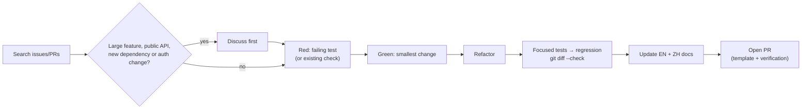

# Contributing to pixiv-cli

English | [简体中文](CONTRIBUTING.zh-CN.md)

Focused bug reports, docs fixes, tests and well-scoped features are welcome.



## Ground rules

- Keep changes focused; unrelated cleanup goes in a separate PR.
- Follow the [AGENTS.md hard constraints](AGENTS.md#hard-constraints) for secrets, account access, dependency/tool installation, Git operations, and PR or release authorization.
- Use the [coding standards](docs/en/maintainers/coding-standards.md#boundary-validation-no-over-defensive-code) for trust-boundary validation, error behavior, and evidence-backed limits, retries, or fallbacks.

## Build and test

See the [development guide](docs/en/maintainers/development.md#environment-check) for platform and toolchain requirements and the [coding standards](docs/en/maintainers/coding-standards.md#style-baseline) for the Go baseline.

```bash
CGO_ENABLED=0 go test ./...
sh scripts/build.sh
./build/pixiv --help
```

Encoder verification, opt-in real API tests, release gates and platforms: [development guide](docs/en/maintainers/development.md).

## Architecture guardrails

Read the [architecture guide](docs/en/maintainers/architecture.md) and [AGENTS.md](AGENTS.md) before changing package ownership or dependency direction. The architecture guide is the current map for CLI composition, SDK/MCP boundaries, shared mechanisms, and reverse-search ownership.

## Tests

The [coding standards](docs/en/maintainers/coding-standards.md#test-submission-rules) own permanent-test contracts, admission, caps, CI exemptions, and removal rules. Use the [test workflow](.agents/skills/pixiv-cli-test/SKILL.md) for test-first work, check selection, and evidence; the [development guide](docs/en/maintainers/development.md#tests) owns test layout and live-verification procedures.

## Agents

Start at [AGENTS.md](AGENTS.md). The checked-in `pixiv-cli-*` skills cover design, testing, MCP/native, review, PR and release without personal global instructions or CCS; clients without skill discovery read each `SKILL.md`. Agent contracts and skills stay English; public docs stay bilingual.

## Documentation

Update docs in the same PR when a command, flag, SDK API, MCP tool, config key, environment variable, output contract, auth flow, proxy, download behavior or known limitation changes.

- Keep `README.md` / `README.zh-CN.md` and every `docs/<locale>/` page behaviorally aligned; no untranslated placeholders.
- Update SDK/MCP contracts or `docs/en/maintainers/` per their responsibility; check `skills/pixiv-cli/` when CLI commands, flags or safety semantics change.
- Follow the [coding standards](docs/en/maintainers/coding-standards.md#package-documentation-and-comments) for source-comment language and package documentation, with the [code-commenting workflow](.agents/skills/pixiv-cli-code-commenting/SKILL.md) for focused edits.
- PR body: what changed, the verification you actually ran, the checklist. Maintainers write bilingual release notes from merged PRs at release time — see [release notes and publication](docs/en/maintainers/development.md#release-notes-and-publication).
- Keep each stable rule in one authoritative document and link to it.

## Pull request checklist

- [ ] The change is focused and its user-visible behavior is explained.
- [ ] Follow the [test workflow](.agents/skills/pixiv-cli-test/SKILL.md) for applicable local, regression, and platform checks; identify required checks that remain unrun. Document-only work has document/link/metadata checks.
- [ ] Required CI is evaluated on the current head and its actual path classifier, not a presumed Markdown exemption.
- [ ] Existing pre-commit checks pass when installed and applicable; missing tooling is reported rather than installed silently.
- [ ] `git diff --check` passes.
- [ ] English and Simplified Chinese documentation are synchronized where required.
- [ ] No credential, downloaded content, local state, or machine-specific artifact is included.

Conventional Commits are recommended (`fix(cli): preserve record identity`, `docs: clarify account selection`). No CLA, DCO sign-off or signed commits are required unless a future policy says so.

## License

By contributing, you agree your contribution may be distributed under the repository's [MIT License](LICENSE).
