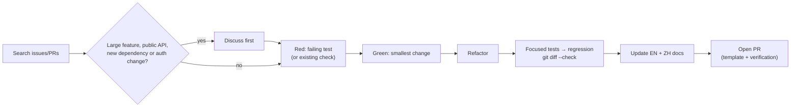

# Contributing to pixiv-cli

English | [简体中文](CONTRIBUTING.zh-CN.md)

Focused bug reports, docs fixes, tests and well-scoped features are welcome.



## Ground rules

- Never include Pixiv tokens, cookies, downloaded works, local databases, caches, machine-specific config or private API responses in an issue, fixture, commit or CI log.
- Keep changes focused; unrelated cleanup goes in a separate PR.
- Don't hide real authentication, network, Pixiv API, filesystem or encoding failures behind empty success or silent fallback. No arbitrary timeouts, truncation, pagination caps, retry limits or hidden downgrades.
- Real Pixiv/FANBOX SDK and reverse-search checks are opt-in: never use a user's account or upload an image without explicit authorization, and never put a real token on a command line stored in shell history.

## Build and test

Go version from `go.mod`, `CGO_ENABLED=0`, no Rust/native library/C linker. Race tests need `CGO_ENABLED=1` and a C toolchain. On Windows use Git Bash, MSYS2 or WSL.

```bash
CGO_ENABLED=0 go test ./...
sh scripts/build.sh
./build/pixiv --help
```

Encoder verification, opt-in real API tests, release gates and platforms: [development guide](docs/en/maintainers/development.md).

## Architecture guardrails

| Rule | Detail |
| --- | --- |
| Thin entry | `cmd/pixiv` → `internal/cli`; `internal/cli/root.go` owns registration, lifecycle and production wiring; commands live in `internal/cli/internal/command` |
| SDK only | CLI/MCP call `sdk/pixiv` / `sdk/fanbox` through owner-local narrow ports, never `internal/{pixivapi,fanboxapi}` protocol adapters |
| MCP layout | Aggregators in `internal/mcpserver/{pixiv,fanbox}`, tools in `tools/<tool>`; stdio stdout is JSON-RPC only |
| Shared code | Cross-subsystem mechanisms in `internal/*`, protocol-free helpers in `internal/*`, config/paths in `internal/config/{settings,paths}`; one responsibility per file |

Read the [architecture guide](docs/en/maintainers/architecture.md) and [AGENTS.md](AGENTS.md) before moving these boundaries.

## Tests

1. Inspect existing assertions; prefer existing checks. Keep new test code only for an uncovered, durable core contract; one-off probes stay in `tmp/test/`.
2. Implement the smallest coherent change that passes.
3. Refactor without changing verified public behavior.
4. Run focused tests, then the relevant regression suite.

Pure restructuring uses before/after characterization; comment-only edits use document/tool checks. Rules for admission, temporary evidence and Red exceptions: [test selection](.agents/skills/pixiv-cli-test/SKILL.md#decide-whether-test-code-must-change). A required regression or security check is never optional because it is short. Test through the public boundary when practical.

## Agents

Start at [AGENTS.md](AGENTS.md). The checked-in `pixiv-cli-*` skills cover design, testing, MCP/native, review, PR and release without personal global instructions or CCS; clients without skill discovery read each `SKILL.md`. Agent contracts and skills stay English; public docs stay bilingual.

## Documentation

Update docs in the same PR when a command, flag, SDK API, MCP tool, config key, environment variable, output contract, auth flow, proxy, download behavior or known limitation changes.

- Keep `README.md` / `README.zh-CN.md` and every `docs/<locale>/` page behaviorally aligned; no untranslated placeholders.
- Update SDK/MCP contracts or `docs/en/maintainers/` per their responsibility; check `skills/pixiv-cli/` when CLI commands, flags or safety semantics change.
- Source comments may be English or Chinese; follow [code commenting](.agents/skills/pixiv-cli-code-commenting/SKILL.md) (no per-function quotas).
- PR body: what changed, the verification you actually ran, the checklist. Maintainers write bilingual release notes from merged PRs at release time — see [release notes and publication](docs/en/maintainers/development.md#release-notes-and-publication).
- Keep each stable rule in one authoritative document and link to it.

## Pull request checklist

- [ ] The change is focused and its user-visible behavior is explained.
- [ ] Behavior changes have observed Red/Green and relevant regression evidence, or an explicitly accepted blocker; document-only work has document/link/metadata checks.
- [ ] Applicable local checks from [pixiv-cli-test](.agents/skills/pixiv-cli-test/SKILL.md) passed, including full/race/native checks when their scope applies; unrun checks are identified.
- [ ] Required CI is evaluated on the current head and its actual path classifier, not a presumed Markdown exemption.
- [ ] Existing pre-commit checks pass when installed and applicable; missing tooling is reported rather than installed silently.
- [ ] `git diff --check` passes.
- [ ] English and Simplified Chinese documentation are synchronized where required.
- [ ] No credential, downloaded content, local state, or machine-specific artifact is included.

Conventional Commits are recommended (`fix(cli): preserve record identity`, `docs: clarify account selection`). No CLA, DCO sign-off or signed commits are required unless a future policy says so.

## License

By contributing, you agree your contribution may be distributed under the repository's [MIT License](LICENSE).
