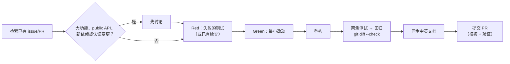

# 为 pixiv-cli 贡献

[English](CONTRIBUTING.md) | 简体中文

欢迎聚焦的问题报告、文档修复、测试和边界清晰的功能。



## 基本规则

- 改动保持聚焦；无关清理单独提 PR。
- 凭据、账号访问、依赖/工具安装、Git 操作和 PR/发布授权遵守 [AGENTS.md 硬约束](AGENTS.md#hard-constraints)。
- 信任边界校验、错误行为及有依据的限制、重试或 fallback 见[编码规范](docs/zh-CN/maintainers/coding-standards.md#只在边界检查不过度防御)。

## 构建与测试

平台与工具链要求见[开发流程](docs/zh-CN/maintainers/development.md#环境检查)，Go 风格基线见[编码规范](docs/zh-CN/maintainers/coding-standards.md#风格基线)。

```bash
CGO_ENABLED=0 go test ./...
sh scripts/build.sh
./build/pixiv --help
```

编码器验证、opt-in 真实 API 测试、发布门禁与平台细节见[开发流程](docs/zh-CN/maintainers/development.md)。

## 架构边界

调整包归属或依赖方向前阅读[架构说明](docs/zh-CN/maintainers/architecture.md)与 [AGENTS.md](AGENTS.md)。架构说明是 CLI 组装、SDK/MCP 边界、共享机制与反向搜索归属的现行地图。

## 测试

长期测试契约、准入、数量上限、CI 豁免与删除规则见[编码规范](docs/zh-CN/maintainers/coding-standards.md#测试提交规则)。按[pixiv-cli-test 流程](.agents/skills/pixiv-cli-test/SKILL.md)处理 test-first、检查选择与证据；测试布局和真实环境验证流程见[开发流程](docs/zh-CN/maintainers/development.md#测试)。

## Agent

从 [AGENTS.md](AGENTS.md) 开始。仓库内 `pixiv-cli-*` 技能覆盖设计、测试、MCP/native、审查、PR 与发布，不依赖个人全局指令或 CCS；不支持技能发现的客户端直接读 `SKILL.md`。Agent 契约与技能用英文；公开文档保持双语。

## 文档

修改命令、flag、SDK API、MCP tool、配置键、环境变量、输出契约、认证流程、代理、下载行为或已知限制时，在同一 PR 同步文档。

- `README.md` / `README.zh-CN.md` 与 `docs/<locale>/` 各页保持行为对应；不得留未翻译占位。
- 按职责更新 SDK/MCP 契约或 `docs/zh-CN/maintainers/`；CLI 命令、flag 或安全语义变化时检查 `skills/pixiv-cli/`。
- 源码注释语言与包文档规则见[编码规范](docs/zh-CN/maintainers/coding-standards.md#包文档与注释)，局部编辑流程见[代码注释 skill](.agents/skills/pixiv-cli-code-commenting/SKILL.md)。
- PR 正文：改了什么、实际跑过的验证、checklist。发布时由维护者基于已合并 PR 编写双语 release notes，见[发布说明与发布](docs/zh-CN/maintainers/development.md#release-notes-and-publication)。
- 稳定规则只放在一个权威文档里，其他位置链接过去。

## Pull request checklist

- [ ] 改动保持聚焦，并说明了用户可感知行为。
- [ ] 按[pixiv-cli-test 流程](.agents/skills/pixiv-cli-test/SKILL.md)完成适用的本地、回归与平台检查，并标明尚未运行的必需检查；纯文档变更已检查内容、链接与元数据。
- [ ] 必需 CI 按当前 head 与实际路径分类器判断，不把 Markdown 变更自动视为豁免。
- [ ] 已安装且适用的既有 pre-commit 检查通过；缺少工具时据实报告，不静默安装。
- [ ] `git diff --check` 通过。
- [ ] 需要同步的英文与简体中文文档已对应。
- [ ] 未包含凭据、下载内容、本地状态或机器相关产物。

Commit message 推荐 Conventional Commits（`fix(cli): preserve record identity`、`docs: clarify account selection`）。除非未来规范明确要求，不需要 CLA、DCO sign-off 或 signed commit。

## 许可证

提交贡献即表示你同意该贡献按仓库的 [MIT License](LICENSE) 分发。
