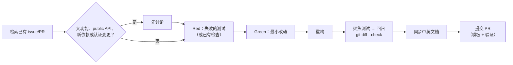

# 为 pixiv-cli 贡献

[English](CONTRIBUTING.md) | 简体中文

欢迎聚焦的问题报告、文档修复、测试和边界清晰的功能。



## 基本规则

- ❌ 不要在 issue、fixture、commit 或 CI 日志中包含 Pixiv token、Cookie、下载作品、本地数据库、缓存、机器配置或私有 API 响应。
- 改动保持聚焦；无关清理单独提 PR。
- 不得把真实的认证、网络、Pixiv API、文件系统或编码失败隐藏为空成功或静默 fallback；不得增加无依据的 timeout、截断、分页上限、重试限制或隐藏降级。
- 真实 Pixiv/FANBOX SDK 与反向搜图检查均为 opt-in：未经明确授权不得使用用户账号或上传图片，也不要把真实 token 放进会写入 shell history 的命令行。

## 构建与测试

Go 版本以 `go.mod` 为准，`CGO_ENABLED=0`，无需 Rust、native library 或 C linker。race 测试需要 `CGO_ENABLED=1` 与 C 工具链。Windows 使用 Git Bash、MSYS2 或 WSL。

```bash
CGO_ENABLED=0 go test ./...
sh scripts/build.sh
./build/pixiv --help
```

编码器验证、opt-in 真实 API 测试、发布门禁与平台细节见[开发流程](docs/zh-CN/maintainers/development.md)。

## 架构边界

| 规则 | 说明 |
| --- | --- |
| 入口保持薄 | `cmd/pixiv` → `internal/cli`；`internal/cli/root.go` 负责命令注册、生命周期与生产组装；具体命令在 `internal/cli/commands` |
| 只走 SDK | CLI/MCP 经 owner-local 窄端口调用 `sdk/pixiv` / `sdk/fanbox`，不直连 `internal/services/{pixiv,fanbox}` 协议适配包 |
| MCP 布局 | 产品聚合在 `internal/mcpserver/{pixiv,fanbox}`，tool 位于 `tools/<tool>`；stdio 的 stdout 只承载 JSON-RPC |
| 共享代码 | 跨子系统机制在 `internal/shared/*`，协议无关 helper 在 `internal/utils/*`，配置/路径在 `internal/config/{settings,paths}`；一个文件一个职责 |

调整这些边界前请阅读[架构说明](docs/zh-CN/maintainers/architecture.md)与 [AGENTS.md](AGENTS.md)。

## 测试

1. 先看已有断言，优先复用现有检查；只有未覆盖的长期核心契约才保留新测试代码，一次性验证放在 `tmp/test/`。
2. 实现能通过的最小完整改动。
3. 在不改变已验证公开行为的前提下重构。
4. 先跑聚焦测试，再跑相关回归。

纯结构调整用前后特征测试；只改注释时做文档与工具检查。准入、临时证据与 Red 例外见[测试选择](.agents/skills/pixiv-cli-test/SKILL.md#decide-whether-test-code-must-change)。不能因为实现短就省略必要的回归或安全检查。可行时通过 public boundary 测试。

## Agent

从 [AGENTS.md](AGENTS.md) 开始。仓库内 `pixiv-cli-*` 技能覆盖设计、测试、MCP/native、审查、PR 与发布，不依赖个人全局指令或 CCS；不支持技能发现的客户端直接读 `SKILL.md`。Agent 契约与技能用英文；公开文档保持双语。

## 文档

修改命令、flag、SDK API、MCP tool、配置键、环境变量、输出契约、认证流程、代理、下载行为或已知限制时，在同一 PR 同步文档。

- `README.md` / `README.zh-CN.md` 与 `docs/<locale>/` 各页保持行为对应；不得留未翻译占位。
- 按职责更新 SDK/MCP 契约或 `docs/zh-CN/maintainers/`；CLI 命令、flag 或安全语义变化时检查 `skills/pixiv-cli/`。
- 源码注释可用中文或英文，遵循[代码注释规范](.agents/skills/pixiv-cli-code-commenting/SKILL.md)（不设每函数注释配额）。
- PR 正文：改了什么、实际跑过的验证、checklist。发布时由维护者基于已合并 PR 编写双语 release notes，见[发布说明与发布](docs/zh-CN/maintainers/development.md#release-notes-and-publication)。
- 稳定规则只放在一个权威文档里，其他位置链接过去。

## Pull request checklist

- [ ] 改动保持聚焦，并说明了用户可感知行为。
- [ ] 行为变更有实际 Red/Green 和相关回归证据，或明确接受的阻塞；纯文档变更已检查内容、链接与元数据。
- [ ] [pixiv-cli-test](.agents/skills/pixiv-cli-test/SKILL.md) 中适用的本地检查通过，包括适用范围内的全量、race、native 检查；未执行项目已注明。
- [ ] 必需 CI 按当前 head 与实际路径分类器判断，不把 Markdown 变更自动视为豁免。
- [ ] 已安装且适用的既有 pre-commit 检查通过；缺少工具时据实报告，不静默安装。
- [ ] `git diff --check` 通过。
- [ ] 需要同步的英文与简体中文文档已对应。
- [ ] 未包含凭据、下载内容、本地状态或机器相关产物。

Commit message 推荐 Conventional Commits（`fix(cli): preserve record identity`、`docs: clarify account selection`）。除非未来规范明确要求，不需要 CLA、DCO sign-off 或 signed commit。

## 许可证

提交贡献即表示你同意该贡献按仓库的 [MIT License](LICENSE) 分发。
