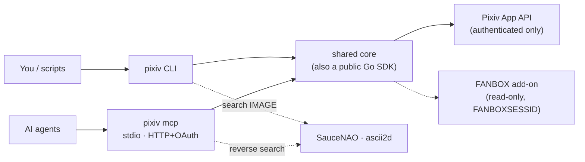
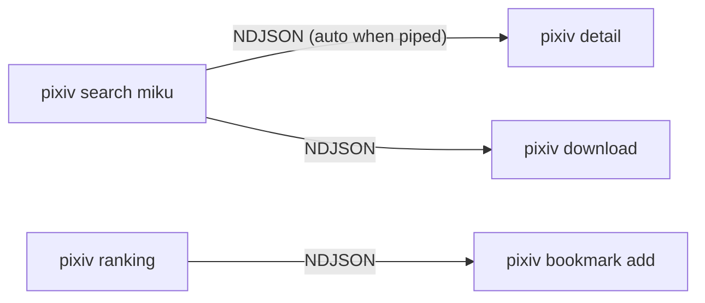
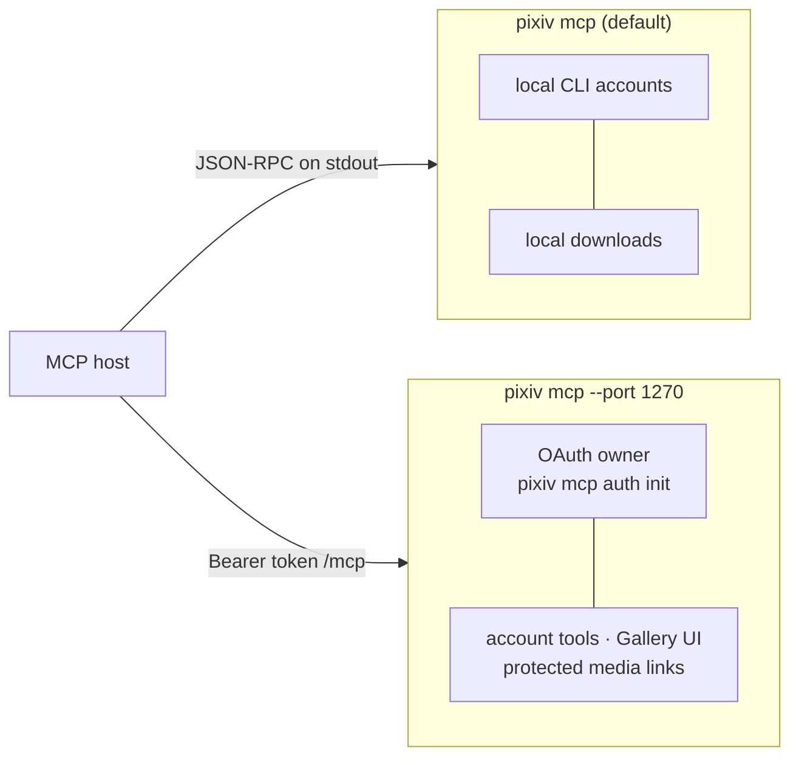

<div align="center">

# pixiv-cli

**Pixiv CLI · MCP server (stdio / HTTP)**

[English](README.md) · [简体中文](README.zh-CN.md)

<p><a href="https://github.com/FlanChanXwO/pixiv-cli/actions/workflows/ci.yml"></a> <a href="https://github.com/FlanChanXwO/pixiv-cli/releases/latest"></a> <a href="go.mod"></a> <a href="LICENSE"></a> </p>

[Install](#install) · [Quick start](#60-second-quick-start) · [Interfaces](#choose-your-interface) · [Documentation](#documentation) · [Contributing](CONTRIBUTING.md)

</div>

Unofficial CLI and MCP server for Pixiv: search, browse, bookmark, follow and download from a terminal or an AI agent. Read-only FANBOX access is included as an add-on.

> Not affiliated with or endorsed by Pixiv Inc. Follow Pixiv's terms and applicable law.



## What you get

| Area | Highlights |
| --- | --- |
| Discover | Search artworks/novels/users; filter by rating, subtype, AI mode, aspect ratio, resolution, drawing tool, bookmark count; all 16 ranking modes; recommendations, timelines, series, comments |
| Reverse search | Local image or URL → SauceNAO / ascii2d → canonical Pixiv records |
| Download | Artwork IDs/URLs, creator and public-bookmark URLs, allowed CDN URLs; page ranges, quality, GIF/APNG Ugoira; full success/warning/failure report |
| Account actions | Bookmarks, follows, comments and stamps |
| Accounts | Browser OAuth login, multi-account, token rotation, optional cross-machine relay, opt-in account pool honoring `Retry-After` |
| MCP | Same features as tools; image and Ugoira bytes; MCP Apps gallery over HTTP |
| Pipelines | Piped lists emit canonical NDJSON that `detail`, `download`, `bookmark` and `follow` consume |
| FANBOX (add-on) | Read-only creators, posts, feeds, tags and first-party files with a separate `FANBOXSESSID` |



## Install

| Channel | Command |
| --- | --- |
| Homebrew (macOS/Linux, recommended) | `brew install FlanChanXwO/tap/pixiv-cli` · upgrade: `brew update && brew upgrade pixiv-cli` |
| Script (Linux/macOS) | `curl -fsSLo /tmp/pixiv-install.sh https://github.com/FlanChanXwO/pixiv-cli/releases/latest/download/install.sh && sh /tmp/pixiv-install.sh --add-to-path` |
| Script (Windows `cmd.exe`, no PowerShell) | `curl.exe -fsSLo "%TEMP%\pixiv-install.cmd" https://raw.githubusercontent.com/FlanChanXwO/pixiv-cli/main/scripts/install.cmd && call "%TEMP%\pixiv-install.cmd" --add-to-path` |
| Docker (linux amd64/arm64) | `docker pull ghcr.io/flanchanxwo/pixiv-cli:v1.2.3` (also `docker.io/flanchanxwo/pixiv-cli`) |
| Go | `go install github.com/FlanChanXwO/pixiv-cli/cmd/pixiv@vX.Y.Z` (exact tag) |
| Archive / source | [GitHub Releases](https://github.com/FlanChanXwO/pixiv-cli/releases) · `sh scripts/build.sh` (`CGO_ENABLED=0`, no Rust/C toolchain) |

- Scripts detect AMD64/ARM64, verify the Release SHA-256, preflight the binary and install per-user. `--no-path` leaves PATH alone; `--install-dir DIR` changes the destination. Inspect the script before running it.
- Direct downloads ship checksums and an Ed25519-signed manifest. Details: [installation](docs/en/install.md), [Docker](docs/en/install.md#docker), [Go source](docs/en/install.md#go-source-installation).

<details>
<summary>Install with an AI agent (copy this prompt)</summary>

```text
Install the latest stable pixiv-cli from https://github.com/FlanChanXwO/pixiv-cli for this machine: inspect the repository's scripts/install.sh or scripts/install.cmd first, choose the script matching the detected OS and architecture (the Windows path must use cmd.exe and must not invoke PowerShell), download only official GitHub Release assets, require the published SHA-256 check to pass before replacing anything, install per-user without administrator or root privileges, add only the chosen install directory to the user PATH, ask before installing any missing prerequisite, never read or output Pixiv credentials, verify with pixiv --version, and report the installed version plus every file and PATH change.

Also install the `pixiv-cli` Skill that matches the same stable release tag (not main): download the full skills/pixiv-cli/ directory from that tag into the agent skills directory the user confirms. Do not guess the skills path and do not follow the main branch for skill content.
```

The published Skill is also on [SkillHub](https://www.skillhub.cn/skills/pixiv-cli) and [ClawHub](https://clawhub.ai/flanchanxwo/skills/pixiv-cli) (`clawhub install pixiv-cli`). Pin it to the version matching your CLI; `pixiv <cmd> --help` remains the final source of syntax.

</details>

## 60-second quick start

```bash
pixiv auth login                                   # browser OAuth, saved by UID
pixiv search "初音ミク" --content-type illust --ai-mode exclude --resolution high
pixiv search "初音ミク" --type novel --search-by tag-exact
pixiv search ./image.png --provider ascii2d-color --json    # reverse image search
pixiv detail https://www.pixiv.net/artworks/123456
pixiv download https://www.pixiv.net/artworks/123456 --pages 1,3-5 --quality regular
pixiv download https://www.pixiv.net/users/12345678/artworks          # whole creator
pixiv search "miku" --limit 20 | pixiv download                      # pipeline
pixiv bookmark add 123456 && pixiv follow add 12345678
pixiv recommended --type all --limit 10
pixiv timeline latest --type artwork --limit 20

pixiv fanbox auth import && pixiv fanbox post 123456       # FANBOX (hidden input)
```

`pixiv --help` and the [CLI reference](docs/en/cli-reference.md) cover every command, flag, config key and environment variable.

## Choose your interface

### CLI

Text by default, `--json` for one document, `--ndjson` (or a pipe) for record streams.

```bash
pixiv ranking --mode day --json
pixiv user detail 12345678
```

### MCP



```json
{"mcpServers":{"pixiv":{"command":"pixiv","args":["mcp"]}}}
```

```bash
pixiv mcp auth init                                   # once; prints owner secret once
pixiv mcp --port 1270                                 # http://127.0.0.1:1270/mcp
pixiv mcp --port 1270 --base-url https://mcp.example.com   # behind an HTTPS proxy
```

| | stdio | HTTP |
| --- | --- | --- |
| Pixiv/FANBOX query and write tools | Yes | Yes |
| `pixiv_artwork_media` (images, GIF/APNG + PNG preview) | inline | inline or protected App link |
| `pixiv_download*` to local files | Yes | — |
| `pixiv_show_gallery`, `pixiv_gallery_animation` | — | Yes |
| `pixiv_account_*` (list, status, use, login) | use CLI auth | Yes |

- One connector serves Pixiv and FANBOX; migrate `pixiv fanbox mcp` to `pixiv mcp`.
- Fixed status/error text is English; Pixiv metadata and user text are verbatim.
- **Warning:** `pixiv_reverse_search` may read **server-side** files and private URLs and upload them to third-party providers. Authorize only trusted connectors.
- Contracts: [MCP tools](docs/en/mcp-tools.md) · [tool migration](docs/en/mcp-tools.md#tool-migration) · [HTTP startup](docs/en/cli-reference.md#mcp-http-server) · [owner init](docs/en/cli-reference.md#mcp-owner-initialization).

## Accounts and token safety

```bash
pixiv auth list            # * default, ✓/- token stored locally
pixiv auth use 12345678
pixiv auth check
pixiv auth pool status     # opt-in read pool
```

- Refresh tokens are stored by UID in the local account store and never printed except by an explicit `auth export`.
- Remote login: configure `login_relay_public_url` + `login_relay_listen_addr` on the server; open the one-time URL on a desktop with pixiv-cli installed. See [getting a refresh token](docs/en/authentication.md#getting-a-refresh-token).
- Account names, IDs, membership and the active selection are convenience data, not proof of ownership, entitlement or current Pixiv status. Use only accounts you are authorized to manage.

## Documentation

| Guide | For |
| --- | --- |
| [Installation](docs/en/install.md) | Channels, Docker, trust, `pixiv update` |
| [Authentication](docs/en/authentication.md) | Login, remote hand-off, token import/export |
| [CLI reference](docs/en/cli-reference.md) | Commands, flags, config, downloads, MCP startup |
| [MCP tools](docs/en/mcp-tools.md) · [MCP Apps gallery](docs/en/mcp-gallery.md) | Tool schemas, output, HTTP authorization, Gallery UI |
| [Go SDK](docs/en/sdk.md) | Embedding the same core in Go programs |
| [Architecture](docs/en/maintainers/architecture.md) · [MCP server](docs/en/maintainers/architecture-mcp.md) | Package boundaries and runtime flow |
| [Development](docs/en/maintainers/development.md) · [CI](docs/en/maintainers/ci.md) · [Release](docs/en/maintainers/release.md) | Toolchain, tests, PR gates, releases |
| [Changelog](changelog/README.md) | User-visible changes |

## Contributing

Bug reports, docs fixes, tests and focused features are welcome — read [CONTRIBUTING.md](CONTRIBUTING.md) first and discuss large or public-interface changes before coding.

## License

[MIT](LICENSE) © FlanChanXwO · Third-party notices are embedded: run `pixiv --licenses`. Release archives contain only the executable.
