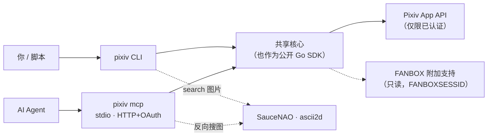
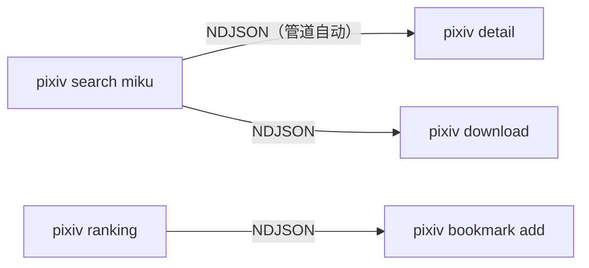
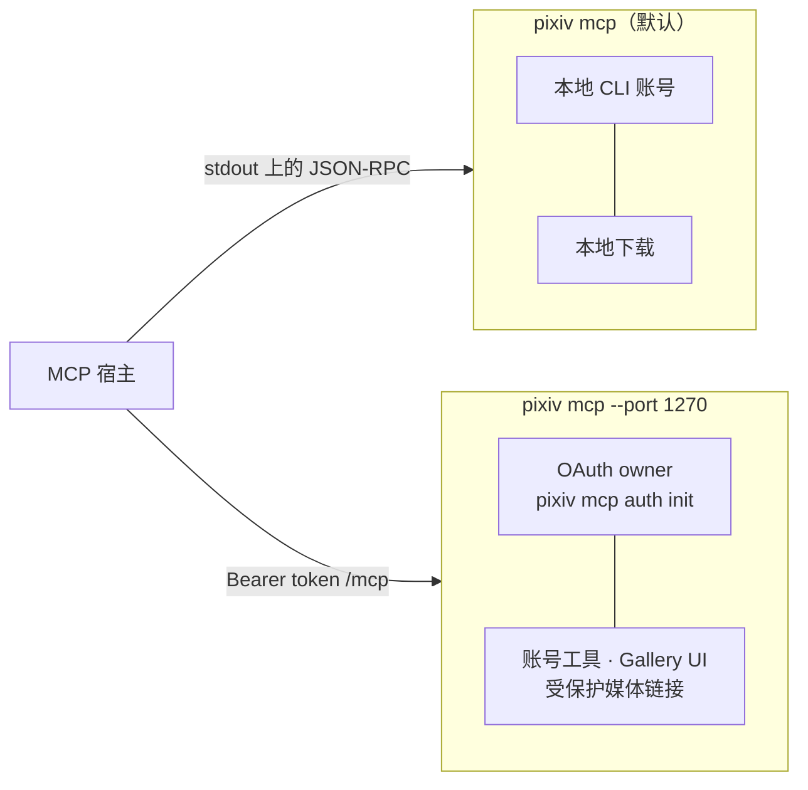

<div align="center">

# pixiv-cli

**Pixiv CLI · MCP server (stdio / HTTP)**

[English](README.md) · [简体中文](README.zh-CN.md)

<p><a href="https://github.com/FlanChanXwO/pixiv-cli/actions/workflows/ci.yml"></a> <a href="https://github.com/FlanChanXwO/pixiv-cli/releases/latest"></a> <a href="go.mod"></a> <a href="LICENSE"></a> </p>

[安装](#安装) · [快速开始](#60-秒快速开始) · [使用入口](#选择使用入口) · [文档](#文档) · [参与贡献](CONTRIBUTING.zh-CN.md)

</div>

Pixiv 的非官方 CLI 与 MCP server：在终端或 AI Agent 中搜索、浏览、收藏、关注与下载。另附带只读的 FANBOX 支持。

> 本项目与 Pixiv Inc. 无隶属或背书关系。使用时请遵守 Pixiv 条款与适用法律。



## 能做什么

| 领域 | 要点 |
| --- | --- |
| 发现 | 搜索作品/小说/用户；按分级、子类型、AI 模式、横纵比、分辨率、绘图工具、收藏数筛选；全部 16 种排行榜；推荐、时间线、系列、评论 |
| 反向搜图 | 本地图片或 URL → SauceNAO / ascii2d → canonical Pixiv record |
| 下载 | 作品 ID/URL、作者与公开收藏页 URL、允许的 CDN 直链；页码区间、质量、Ugoira GIF/APNG；完整的成功/warning/失败报告 |
| 账号操作 | 收藏、关注、评论与贴图 |
| 账号 | 浏览器 OAuth 登录、多账号、token 轮换、可选跨机器 relay、遵循 `Retry-After` 的可选账号池 |
| MCP | 上述能力均以工具提供；交付图片与 Ugoira 字节；HTTP 下提供 MCP Apps 画廊 |
| 管道 | 列表接入管道时自动输出 canonical NDJSON，可交给 `detail`、`download`、`bookmark`、`follow` 消费 |
| FANBOX（附加） | 用独立的 `FANBOXSESSID` 只读访问创作者、帖子、feed、标签与第一方文件 |



## 安装

| 渠道 | 命令 |
| --- | --- |
| Homebrew（macOS/Linux，推荐） | `brew install FlanChanXwO/tap/pixiv-cli` · 升级：`brew update && brew upgrade pixiv-cli` |
| 脚本（Linux/macOS） | `curl -fsSLo /tmp/pixiv-install.sh https://github.com/FlanChanXwO/pixiv-cli/releases/latest/download/install.sh && sh /tmp/pixiv-install.sh --add-to-path` |
| 脚本（Windows `cmd.exe`，不依赖 PowerShell） | `curl.exe -fsSLo "%TEMP%\pixiv-install.cmd" https://raw.githubusercontent.com/FlanChanXwO/pixiv-cli/main/scripts/install.cmd && call "%TEMP%\pixiv-install.cmd" --add-to-path` |
| Docker（linux amd64/arm64） | `docker pull ghcr.io/flanchanxwo/pixiv-cli:v1.2.3`（也可用 `docker.io/flanchanxwo/pixiv-cli`） |
| Go | `go install github.com/FlanChanXwO/pixiv-cli/cmd/pixiv@vX.Y.Z`（精确 tag） |
| 压缩包 / 源码 | [GitHub Releases](https://github.com/FlanChanXwO/pixiv-cli/releases) · `sh scripts/build.sh`（`CGO_ENABLED=0`，无需 Rust/C 工具链） |

- 脚本自动识别 AMD64/ARM64，校验 Release SHA-256，预检二进制后按用户级安装。`--no-path` 不改 PATH；`--install-dir DIR` 指定目录。运行前可先审阅脚本。
- 直接下载附带校验和与 Ed25519 签名清单。详见 [安装](docs/zh-CN/install.md)、[Docker](docs/zh-CN/install.md#docker)、[Go 源码安装](docs/zh-CN/install.md#go-源码安装)。

<details>
<summary>让 AI Agent 安装（复制这段 prompt）</summary>

```text
请为这台机器安装 https://github.com/FlanChanXwO/pixiv-cli 的最新 stable 版本：先审阅仓库中的 scripts/install.sh 或 scripts/install.cmd，再根据检测到的操作系统与架构选择对应脚本（Windows 必须使用 cmd.exe，禁止调用 PowerShell），只下载官方 GitHub Release 资产，只有发布的 SHA-256 校验通过后才能替换文件，使用无需管理员或 root 权限的用户级目录，只把选定安装目录加入用户 PATH，缺少任何前置工具时先征求同意，绝不读取或输出 Pixiv 凭据，最后运行 pixiv --version 验证，并报告安装版本及全部文件和 PATH 变更。

同时安装与该 stable 发布 tag 完全一致的 `pixiv-cli` Skill（不要跟随 main）：把该 tag 下的完整 skills/pixiv-cli/ 目录安装到用户确认的 Agent skills 目录。不要猜测 skills 路径，也不要用 main 上的 skill 内容。
```

已发布的 Skill 也可从 [SkillHub](https://www.skillhub.cn/skills/pixiv-cli) 与 [ClawHub](https://clawhub.ai/flanchanxwo/skills/pixiv-cli)（`clawhub install pixiv-cli`）安装。请固定到与 CLI 一致的版本；命令语法以 `pixiv <cmd> --help` 为准。

</details>

## 60 秒快速开始

```bash
pixiv auth login                                   # 浏览器 OAuth，按 UID 保存
pixiv search "初音ミク" --content-type illust --ai-mode exclude --resolution high
pixiv search "初音ミク" --type novel --search-by tag-exact
pixiv search ./image.png --provider ascii2d-color --json    # 反向搜图
pixiv detail https://www.pixiv.net/artworks/123456
pixiv download https://www.pixiv.net/artworks/123456 --pages 1,3-5 --quality regular
pixiv download https://www.pixiv.net/users/12345678/artworks          # 整个作者
pixiv search "miku" --limit 20 | pixiv download                      # 管道
pixiv bookmark add 123456 && pixiv follow add 12345678
pixiv recommended --type all --limit 10
pixiv timeline latest --type artwork --limit 20

pixiv fanbox auth import && pixiv fanbox post 123456       # FANBOX（隐藏输入）
```

全部命令、参数、配置项与环境变量见 `pixiv --help` 和 [CLI 参考](docs/zh-CN/cli-reference.md)。

## 选择使用入口

### CLI

默认文本输出；`--json` 输出单个文档；`--ndjson`（或接入管道）输出 record 流。

```bash
pixiv ranking --mode day --json
pixiv user detail 12345678
```

### MCP



```json
{"mcpServers":{"pixiv":{"command":"pixiv","args":["mcp"]}}}
```

```bash
pixiv mcp auth init                                   # 只需一次；owner secret 只打印一次
pixiv mcp --port 1270                                 # http://127.0.0.1:1270/mcp
pixiv mcp --port 1270 --base-url https://mcp.example.com   # 位于 HTTPS 反向代理之后
```

| | stdio | HTTP |
| --- | --- | --- |
| Pixiv/FANBOX 查询与写入工具 | 是 | 是 |
| `pixiv_artwork_media`（图片、GIF/APNG + PNG 预览） | inline | inline 或受保护的 App 链接 |
| `pixiv_download*` 写入本地文件 | 是 | — |
| `pixiv_show_gallery`、`pixiv_gallery_animation` | — | 是 |
| `pixiv_account_*`（list、status、use、login） | 使用 CLI 认证 | 是 |

- 一个 connector 同时服务 Pixiv 与 FANBOX；请把 `pixiv fanbox mcp` 迁移到 `pixiv mcp`。
- 固定的状态/错误文本为英文；Pixiv 元数据和用户文本原样保留。
- **注意：** `pixiv_reverse_search` 可读取**服务端**文件与私有 URL，并上传给第三方 provider。只授权可信的 connector。
- 契约：[MCP 工具](docs/zh-CN/mcp-tools.md) · [工具迁移](docs/zh-CN/mcp-tools.md#工具迁移) · [HTTP 启动](docs/zh-CN/cli-reference.md#mcp-http-server) · [owner 初始化](docs/zh-CN/cli-reference.md#mcp-owner-初始化)。

## 账号与 token 安全

```bash
pixiv auth list            # * 默认账号，✓/- 本地是否存有 token
pixiv auth use 12345678
pixiv auth check
pixiv auth pool status     # 可选的读取账号池
```

- refresh token 按 UID 存于本地账号库；除显式 `auth export` 外从不打印。
- 跨机器登录：在服务器配置 `login_relay_public_url` 与 `login_relay_listen_addr`，在已安装 pixiv-cli 的桌面打开一次性 URL。见 [获取 refresh token](docs/zh-CN/authentication.md#获取-refresh-token)。
- 账号名、UID、会员状态与当前选择仅为便利信息，不构成账号归属、权限或当前 Pixiv 状态的证明。只管理已获授权的账号。

## 文档

| 指南 | 用途 |
| --- | --- |
| [安装](docs/zh-CN/install.md) | 安装渠道、Docker、信任、`pixiv update` |
| [认证](docs/zh-CN/authentication.md) | 登录、跨机器 hand-off、token 导入导出 |
| [CLI 参考](docs/zh-CN/cli-reference.md) | 命令、参数、配置、下载、MCP 启动 |
| [MCP 工具](docs/zh-CN/mcp-tools.md) · [MCP Apps 画廊](docs/zh-CN/mcp-gallery.md) | 工具 schema、输出、HTTP 授权、Gallery UI |
| [Go SDK](docs/zh-CN/sdk.md) | 在 Go 程序中嵌入同一核心 |
| [架构](docs/zh-CN/maintainers/architecture.md) · [MCP server](docs/zh-CN/maintainers/architecture-mcp.md) | 包边界与运行时流程 |
| [开发](docs/zh-CN/maintainers/development.md) · [CI](docs/zh-CN/maintainers/ci.md) · [发布](docs/zh-CN/maintainers/release.md) | 工具链、测试、PR 门禁、发布 |
| [更新日志](changelog/README.zh-CN.md) | 用户可见变更 |

## 参与贡献

欢迎 bug 报告、文档修正、测试和聚焦的功能——请先阅读 [CONTRIBUTING.zh-CN.md](CONTRIBUTING.zh-CN.md)，大改动或公开接口变更请先讨论。

## 许可证

[MIT](LICENSE) © FlanChanXwO · 第三方声明已内嵌：运行 `pixiv --licenses`。Release 压缩包只包含可执行文件。
