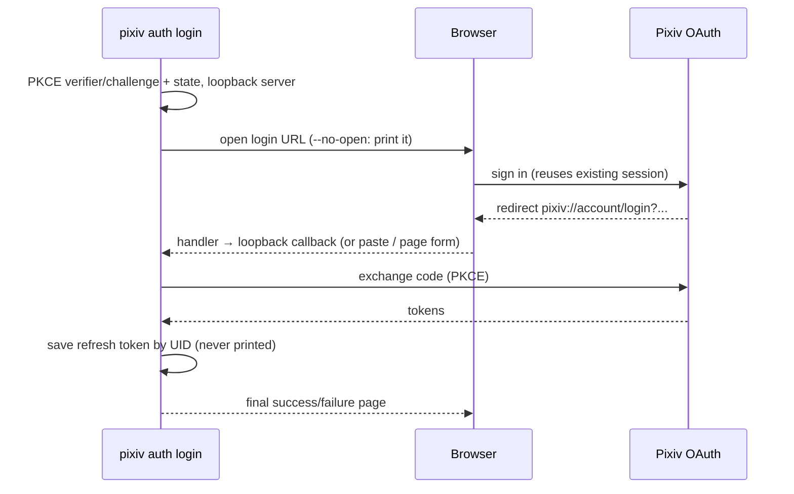
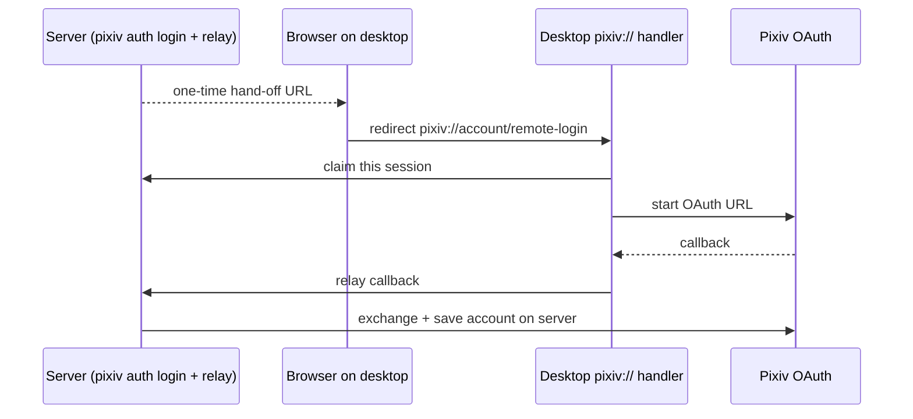
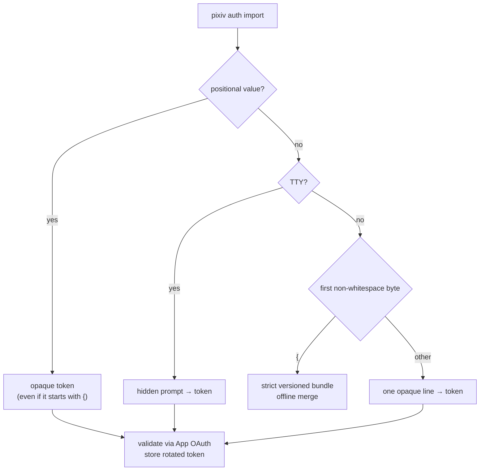

# Authentication

English | [简体中文](../zh-CN/authentication.md) | [CLI reference](cli-reference.md)

Login, remote hand-off, token import and backup. Flags for each command: [CLI command table](cli-reference.md#cli-command-table) and [`auth login` flags](cli-reference.md#auth-login-flags).

## Getting a refresh token

Refresh tokens are raw Pixiv App API OAuth credentials stored in the local account store. Recommended:

```bash
pixiv auth login
```



| Stage | Behavior |
| --- | --- |
| Init | PKCE verifier/challenge, OAuth state, local loopback HTTP server |
| Browser | macOS/Windows: normal startup prepares the current-user `pixiv://` handler; desktop Linux initializes its XDG handler for interactive login. Opens the default browser; `--no-open` prints the login URL and local page address |
| Callback | This round's loopback callback, a one-time desktop hand-off, a terminal paste, or the local page form. After a helper hand-off the browser opens the final local page once exchange completes |
| Validation | Loopback callback must match this round's state; Pixiv's official callback URL and `pixiv://account/login` are an explicit fallback when Pixiv returns no state |
| Save | Tokens never printed; refresh token saved to local SQLite keyed by UID. Unix: `0700` dirs, `0600` files. Windows: first creation inherits the parent ACL, replacement keeps the target ACL; no DACL tightening/loosening is claimed |

**`pixiv://` handler routing** — persistent but runs only when the OS opens `pixiv://` (macOS `PixivCLIURLHandler.app`, Windows current-user protocol association, desktop Linux XDG entry); it records the prior handler privately.

| Incoming URL | Routed to |
| --- | --- |
| any, while a local loopback bridge is active | that bridge (always wins) |
| `pixiv://account/login` | the active one-time desktop hand-off only |
| `pixiv://account/remote-login` | starts that hand-off |
| any other `pixiv://` URL | the prior handler (change it with the OS association UI) |

**Headless SSH server** — keep the listener on loopback with a fixed port:

```bash
pixiv auth login --no-open --addr 127.0.0.1:41871   # on the server
ssh -N -L 41871:127.0.0.1:41871 USER@SERVER          # on the local machine
# then open http://127.0.0.1:41871/ locally
```

The tunnel reaches only the server's loopback listener and makes the manual page reachable, but cannot receive Pixiv's final `pixiv://` callback for a browser-only machine — use the hand-off below, or paste the complete final callback URL into the original prompt. `--addr` accepts loopback addresses only; never bind publicly.

### Cross-machine one-time hand-off

Configure the server with `login_relay_public_url` and `login_relay_listen_addr`; `pixiv auth login` then prints one remote hand-off URL.



- No pixiv-cli session, confirmation or callback-copy page is rendered. A new hand-off replaces the prior local one; a client without the desktop handler cannot complete the flow.
- Relay over HTTP or HTTPS: a certificate/key pair for direct TLS, or a same-host reverse proxy with the relay on loopback.
- Legacy `login_relay_secret` / `login_relay_target_url` are silently ignored; `pixiv auth devices` is removed. Advanced relay settings stay in private `config.toml` (`pixiv config` manages download path, filename/directory templates, request interval and proxy).

**Proxy for login** — the browser's system proxy is not passed to the Go CLI:

```bash
pixiv config set https_proxy http://127.0.0.1:7890     # persistent
pixiv auth login --proxy http://127.0.0.1:7890         # this command only
```

- `--proxy URL` / `--no-proxy` affect only the current command, are never written to `config.toml` and cannot be combined; `--no-proxy` clears even environment/config proxies.
- With an HTTP(S) proxy, media transfers (`download`, Ugoira) deliberately use HTTP/1.1 to avoid proxy HTTP/2 stream resets; App API, OAuth and Web metadata keep normal negotiation. Authentication and quality are unchanged.
- Real login depends on Pixiv's OAuth web flow; automated tests use a fake OAuth server.

## Importing authentication

```bash
pixiv auth import                                    # hidden prompt on a TTY
printf '%s\n' 'YOUR_REFRESH_TOKEN' | pixiv auth import
pixiv auth import 'YOUR_REFRESH_TOKEN'               # visible in argv/shell history
pixiv auth import < account.pxauth                   # offline bundle restore
pixiv auth export --all | ssh trusted-host pixiv auth import
```



| | Token mode | Bundle mode |
| --- | --- | --- |
| Network | App OAuth validation; Pixiv's returned UID is authoritative | none — never falls back to OAuth |
| stdin parsing | one opaque line; only one final LF/CRLF removed | strict decode; malformed bundle is an error, not a token attempt |
| `--proxy` / `--no-proxy` | allowed (not together) | rejected |
| Effect | stores rotated token | atomic merge by UID: existing replaced, new added; current default kept; bundle default adopted only if no local default |
| Text output | `added uid:UID` / `updated uid:UID` (+ `username:NAME`) | each added/updated UID in bundle order + resulting default |
| `--json` | `{"user_id":12345678,"username":"display name","status":"added"}` | `{"accounts":[{"user_id":12345678,"username":"display name","status":"added"}],"default_user_id":12345678}` |

`status` is `added` or `updated`. Neither form exposes default state, token presence, the input token or the rotated token. A positional token can leak via process listings, shell history, wrappers and audit tooling.

## Exporting and backing up authentication

```bash
pixiv auth export                                    # raw token, default account
pixiv auth export 12345678                           # raw token, exact account
pixiv auth export --all                              # versioned bundle on stdout
pixiv auth export 12345678 --output account.pxauth
pixiv auth export --all --output accounts.pxauth [--force]
```

| Form | stdout | stderr on success |
| --- | --- | --- |
| default / UID, no `--output` | raw stored token + one newline | none |
| `--all`, no `--output` | versioned JSON bundle only | none |
| any selection + `--output PATH` | output path + account count (never secrets) | — |

- Strictly local: reads the SQLite store; never refreshes or contacts Pixiv; never mutates auth/config; skips startup pending-update cleanup and automatic update checks.
- `--all` cannot combine with a UID; `--force` requires `--output`; no JSON/proxy flags.
- `--output` refuses an existing destination unless `--force`. Unix: file `0600`, existing parent permissions/ownership unchanged. Windows: owner + protected DACL granting full control only to the current user, LocalSystem and builtin Administrators (CI-tested; not claimed as validated on a real Windows filesystem for this release).
- The bundle is an **unencrypted point-in-time secret backup**, not live sync; token rotation can make older copies stale.
- Strict codec rejects: unsupported schema/version, unknown or duplicate fields, trailing JSON, duplicate/non-positive UIDs, empty tokens, a default UID not in the bundle, and any non-canonical key spelling/case (e.g. `Schema`, `Default_User_ID`, `User_ID`, `Refresh_Token`), even alongside the canonical key.
- Failed export selection/I/O never prints a secret diagnostic.

| Restore write failure: `LocalWriteCommitOutcome` | Meaning |
| --- | --- |
| `not_committed` | replacement did not occur |
| `committed` | replacement occurred but a later durability/cleanup step failed — reload the store |
| `unknown` | target state could not be established — inspect manually |

Neither `committed` nor `unknown` is a successful rollback. All other stdout/stderr, JSON, MCP results, logs and errors never expose refresh tokens. No persistent auth import/export MCP tools exist; session-scoped MCP authentication is unchanged.
