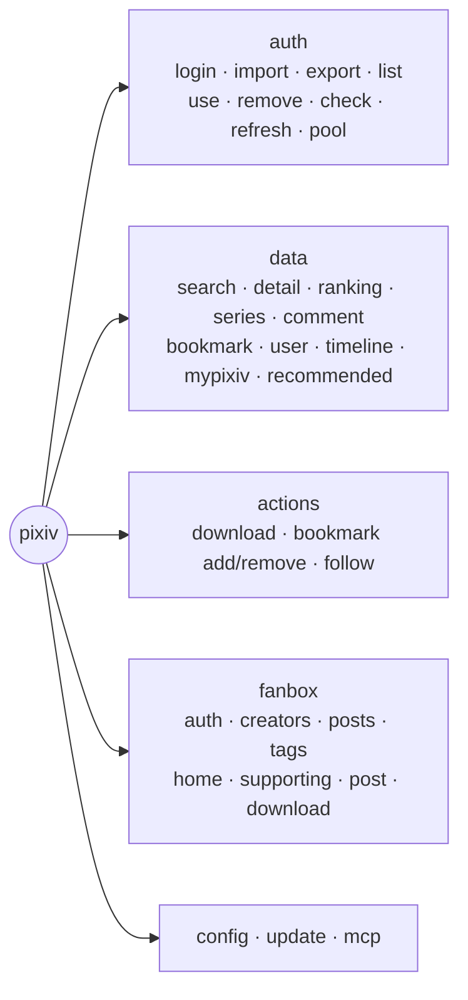
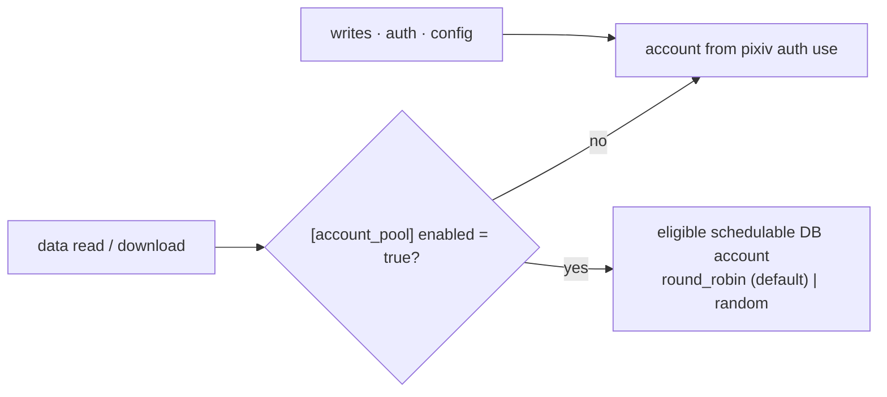
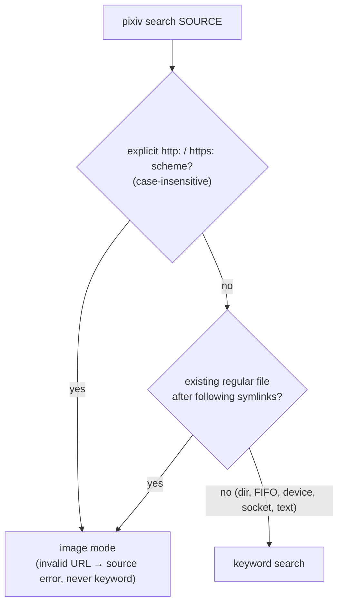
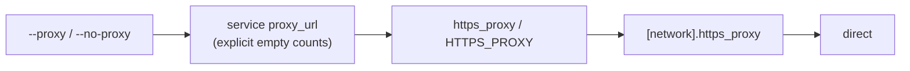
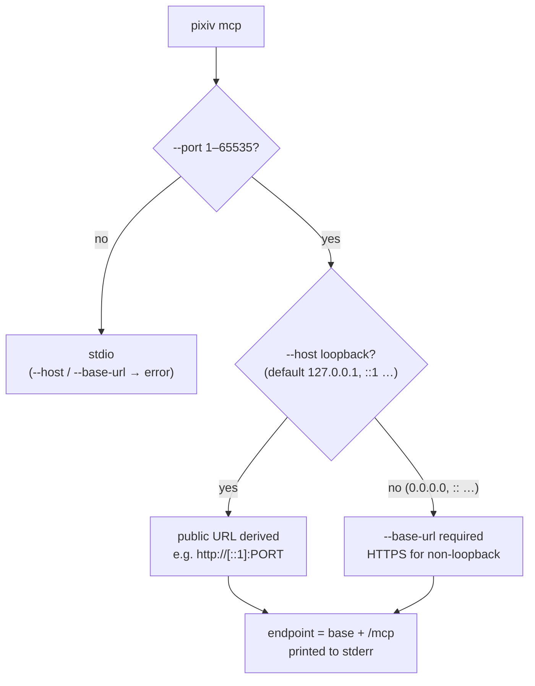

# Pixiv CLI Reference

English | [简体中文](../zh-CN/cli-reference.md) | [Project home](../../README.md)

The contract for `pixiv` commands, flags, configuration and MCP startup. Install/update and authentication live in [Installation](install.md) and [Authentication](authentication.md); SDK and MCP tools in their own guides ([related documentation](#related-documentation)); user-visible changes in the [changelog](../../changelog/README.md).



| At a glance | Rule |
| --- | --- |
| Output | Text by default; `--json` = one document; `--ndjson` (or a visual list piped to a non-TTY with no explicit format) = canonical record stream |
| Downloads | Success keeps stdout empty; Ugoira filename fallback warnings → stderr; item failures → diagnostics + non-zero exit |
| Unknown options | Fail as unknown flags |
| Proxy URIs | `http`, `https`, `socks5`, `socks5h` |
| Reverse search | `pixiv search SOURCE` with an HTTP(S) URL or existing regular file; independent of the Pixiv account; may upload the source to a third party — review the [SauceNAO privacy and terms](https://saucenao.com/legal.html) (uploads may be retained briefly; URL queries may be cached longer) |

## CLI usage

```bash
pixiv auth login                                        # or: printf '%s\n' TOKEN | pixiv auth import
pixiv auth list
pixiv auth use 12345678
pixiv auth check
pixiv auth refresh
pixiv config path
pixiv config get download_path
pixiv config set download_path ~/Downloads/pixiv
pixiv config unset https_proxy
pixiv --version
pixiv update --check [--json]

pixiv search "初音ミク" --type artwork --limit 10
pixiv search "初音ミク" --type novel --json
pixiv search "artist" --type user --limit 10
pixiv search ./image.png --provider ascii2d-color --json
pixiv search https://example.com/image.png --provider all --ndjson
pixiv search --trending-tags --json
pixiv detail 123456 --type artwork --json
pixiv detail 123456 --type novel --json
pixiv series SERIES_ID_OR_URL --type artwork --limit 20
pixiv comment 123456 --type artwork --limit 20
pixiv comment create 123456 --type artwork --comment "hello"
pixiv comment reply 123456 --type artwork --parent-comment-id 789 --comment "reply" --json
pixiv comment stamp 123456 --type artwork --stamp-id 9 --json
pixiv comment delete 789 --type artwork --json
pixiv comment stamps --json
pixiv bookmark list --type artwork --limit 20
pixiv bookmark list --type all --limit 20 --json
pixiv bookmark tags --type all --limit 20 --json
pixiv bookmark detail NOVEL_ID --type novel --json
pixiv bookmark add NOVEL_ID --type novel
pixiv user followers 123456 --limit 20
pixiv user follow add 123456 --restrict private
pixiv follow remove 123456
pixiv ranking --mode day
pixiv recommended --type all --limit 5
pixiv download 123456 789012 --output ./downloads
```

| Local state | |
| --- | --- |
| Location | `~/.pixiv-cli` (macOS/Linux), `%USERPROFILE%\.pixiv-cli` (Windows) |
| Contents | `pixiv-cli.db` (accounts keyed by UID), `config.toml`, callback-bridge state, Release-check cache, macOS callback helper |
| Permissions | Unix `0700` dirs / `0600` files; Windows inherits parent ACL on creation, keeps target ACL on replacement, no DACL claims |
| `config.toml` creation | Created with common download/output/login/update settings on the first ordinary command; never overwritten. Advanced settings (proxy, login timeout, Premium-status cache) omitted until set. Help, root `--version`, secret export and the internal OAuth callback do not create it |

Options may appear before or after positional arguments (Cobra/pflag): `pixiv auth check 12345678 --json` and `pixiv search "初音ミク" --json` are both supported. `auth export` deliberately has no `--json`.

### Data-operation contract



- Pool membership is the database `schedulable` flag; manage it with `pixiv auth pool status|enable|disable`. Writes, authentication and configuration never use the pool.
- Data commands reject `--uid` and `--refresh-token`.
- **Records:** visual lists write canonical NDJSON when stdout is non-terminal and no format was chosen. Each line has stable string `id`, `type`, `url`. `download`, `bookmark add/remove` and `follow add/remove` consume compatible records without positional IDs; bookmark records must match the selected `--type` namespace (artwork by default, `novel` with `--type novel`).
- **Follow:** explicit targets must be positive numeric user IDs (user URLs rejected locally). `pixiv user follow add/remove` and root `pixiv follow add/remove` share one owner; `add --restrict public|private` defaults to `public`.
- **Comments:** `create/reply/stamp/delete` take one positive numeric ID and no Record input. Reads keep optional `total`/`access_control`; opaque numeric `comment_access_control` stays under `access_control.comment_access_control` with no inferred booleans. Create/reply/stamp return the upstream positive `comment_id`; delete returns a status. `comment stamps` is read-only and non-paginated. `--json` and explicit `--ndjson` take precedence.

```bash
pixiv search "miku" --type artwork --limit 20 | pixiv detail            # pipe auto-selects NDJSON
pixiv search "miku" --type artwork --limit 20 --ndjson | pixiv detail   # explicit equivalent
```

`detail` infers its endpoint from each record's `type`; an explicit `--type` in record mode is only a compatibility constraint and never overrides it. Reverse-search `artwork`/`user` identity records follow the same path. `search --json` is an aggregate document, not a record stream — `pixiv search ... --json | pixiv detail` is unsupported.

### Reverse image search



- Image mode is entered before any Pixiv SDK or account-pool setup and accepts only `--provider`, `--json`, `--ndjson`, `--proxy`, `--no-proxy`; search filters, `--type`, pagination and `--trending-tags` are rejected, not ignored.
- Binary bytes on stdin never select image mode (`cat image.png | pixiv search` is unsupported).

| Provider | Notes |
| --- | --- |
| `saucenao` | configured default; `--provider` overrides per invocation |
| `ascii2d-color`, `ascii2d-bovw` | JPEG, PNG, WEBP; ascii2d-specific 10 MB upload limit |
| `all` | fixed order SauceNAO → ascii2d color → ascii2d bovw; may be partial |

`reverse_search_pixiv_only` (default `true`, config only) controls whether non-Pixiv matches stay in `results`. There is no reverse-search-wide 1 MiB compressed-upload rule; `gzip, deflate, br` is response negotiation.

| Network surface | Proxy | User-Agent |
| --- | --- | --- |
| Standard source / SauceNAO client | `--proxy`/`--no-proxy`, else global `https_proxy`/`[network].https_proxy` | — |
| ascii2d browser client | `--proxy`/`--no-proxy`, else `[reverse_search.network].proxy_url` (explicit empty = direct), else the standard route | `[reverse_search.network].user_agent`; default Chrome 146 macOS UA paired with the `Chrome_146` TLS profile. Chromium UAs derive `Sec-CH-UA`, `Sec-CH-UA-Mobile`, `Sec-CH-UA-Platform`; others omit them. Control characters rejected |
| FlareSolverr (optional) | its `url` is a JSON control endpoint, never inherits native/standard proxies; `proxy_url` is sent only as the browser upstream in `sessions.create` | returns browser UA + clearance for the native ascii2d client |

FlareSolverr runs only after an ascii2d challenge is detected; the image is always a native `/search/file` multipart upload, never sent through FlareSolverr. Solver state is process/client-scoped and never written to disk.

- The source is fetched/opened once into a private temporary snapshot; output shows only `input.kind` (`file`/`url`) and `input.sha256`. Third parties may upload, retain or cache — never submit images or URLs you are not authorized to share.
- **JSON** envelope: `{input, providers, results, records, provider_errors, partial}`. `records` holds only canonical Pixiv identities: artwork matches use generic `type:"artwork"` (no subtype lookup via detail), user matches `type:"user"`. External-only matches may stay in `results` when Pixiv-only filtering is off but never become records. Human output is a safe summary; piped/explicit NDJSON emits only records, which `detail` accepts (generic `artwork` resolves to the concrete detail).
- **Exit:** with `all`, one success + one failure → `partial=true`, safe stderr warning, exit 0. A single-provider or all-provider failure exits non-zero, keeping any available JSON envelope.
- **Errors** use stable `code` + `message`; sources, API keys, cookies, CSRF/redirect values, temporary paths and upstream bodies never appear. Causes are sanitized at the output boundary. Vocabulary: `unknown`, `invalid_request`, `invalid_source`, `source_not_regular_file`, `source_read_failed`, `source_http_status`, `snapshot_failed`, `source_loader_not_configured`, `provider_not_configured`, `missing_credential`, `malformed_upstream_response`, `upstream_http_status`, `provider_failed`, `all_providers_failed`, `challenge_required`, `solver_unavailable`, `solver_failed`, `malformed_solver_response`.

### Positional input from stdin

- A missing required or omitted optional positional value consumes the whole non-TTY stdin as **one** value, removing only one trailing LF/CRLF (no whitespace splitting): `printf '%s\n' 13214141 | pixiv search` ≡ `pixiv search 13214141`.
- Explicit positional arguments win and do not read stdin.
- Download and mutation commands classify the stream by its first non-whitespace byte: `{` → strict streaming canonical NDJSON; otherwise the whole stream is one raw ID/URL.
- `-` has no stdin meaning; it is ordinary text.

Canonical data actions: `search`, `detail`, `ranking`, `series`, `comment`, `bookmark`, `download`, `user`, `timeline`, `mypixiv`, `recommended`. Common short options `-t/--type`, `-p/--page`, `-l/--limit`, `-o/--output` (download directory), `-j/--json` are option spellings, not command aliases (e.g. `pixiv timeline latest --type artwork`). `novel search`, `user search` and root `follow` are compatibility routes mapped to the same use cases. Only documented structured entity filters exist — no ignored top-level expression filter. Ugoira downloads accept `--ugoira-mode gif|apng` (default `gif`); page selection and non-original quality are unsupported for Ugoira.

### CLI command table

| Command | Usage | Description |
| --- | --- | --- |
| `auth import` | `pixiv auth import [REFRESH_TOKEN] [--json] [--proxy URL\|--no-proxy]` | Direct input validates and stores the rotated token; no-argument TTY input is hidden and non-TTY input auto-detects an opaque token or strict offline bundle. Explicit values are always tokens; bundle mode conflicts with proxy flags. |
| `auth login` | `pixiv auth login [--json] [--no-open] [--addr 127.0.0.1:0] [--use] [--timeout DURATION] [--relay-public-url URL --relay-listen-addr ADDR] [--relay-tls-cert-file PATH --relay-tls-key-file PATH] [--proxy URL\|--no-proxy]` | Ordinary loopback OAuth. With a complete relay server configuration, prints a one-time hand-off URL that directly starts an installed desktop CLI handler. Saves by Pixiv UID; never prints the refresh token. |
| `auth list` | `pixiv auth list [--json]` | Lists local accounts; never prints tokens. Text uses `*` for the default and `✓`/`-` for stored/missing local token — local-state markers, not an online validity claim. |
| `auth pool` | `pixiv auth pool status [--json]`; `pixiv auth pool enable UID... [--all]`; `pixiv auth pool disable UID... [--all]` | Shows/changes non-secret scheduling state. `status` reports `enabled`, `strategy`, `schedulable`, `frozen_until` and current `eligible`; enable/disable validates every UID before committing the batch. |
| `auth export` | `pixiv auth export [UID] [--all] [--output PATH] [--force]` | Local export of default/exact/all accounts. Without `--output`: one account = raw token stdout, `--all` = bundle stdout. With `--output`: private bundle + safe summary. `--force` requires `--output`. |
| `auth use` | `pixiv auth use [UID] [--json]` | Sets the default account; interactive selection on a TTY. |
| `auth remove` | `pixiv auth remove [UID] [--yes] [--json]` | Removes an account; confirms on a TTY by default. Removing the default selects the first remaining account. |
| `auth check` | `pixiv auth check [UID] [--json] [--proxy URL\|--no-proxy]` | Refreshes the token and validates the account; records `user_id` and username when available. |
| `auth refresh` | `pixiv auth refresh [UID] [--all] [--json] [--proxy URL\|--no-proxy]` | Refreshes access + rotated refresh token for the selected/default account, then forces a profile read to update cached Premium status. `--all` refreshes every account. JSON always returns `accounts`. |
| `config path` | `pixiv config path` | Prints the `config.toml` path, creating the baseline if missing. |
| `config get` | `pixiv config get KEY` | Prints one effective value. |
| `config set` | `pixiv config set KEY [VALUE]` | Writes one known key (see [config aliases](#cli-managed-config-aliases)); `saucenao_api_key` is stdin-only. |
| `config unset` | `pixiv config unset KEY` | Deletes one known key from `config.toml`. |
| `update` | `pixiv update [--check] [--prerelease] [--proxy URL]` | Checks for or performs an update matching the install source; `--json` only with `--check`. |
| `search` | `pixiv search [WORD\|IMAGE_PATH_OR_URL] [-t artwork\|novel\|user] [options]` | Entity search or automatic reverse-image search. `--trending-tags` is the no-word artwork tag-list mode; no filters or pagination. |
| `detail` | `pixiv detail [ID_OR_URL] [-t artwork\|novel\|user] [--content] [--json\|--ndjson]` | One artwork, novel or user, or canonical NDJSON records. `--content` is a retained novel-only compatibility flag returning `content_unavailable` before opening the pool or calling the rejected endpoint. |
| `ranking` | `pixiv ranking [-t artwork\|novel] [--mode MODE --date YYYY-MM-DD --page N --limit N]` | Artwork (default) or novel rankings; `--date` artwork only. |
| `series` | `pixiv series SERIES_ID_OR_URL -t artwork\|novel [--page N --limit N --json\|--ndjson]` | Works in one series; positive ID or supported series URL whose namespace must match the required type. |
| `comment` | `pixiv comment ID -t artwork\|novel [--page N --limit N --json\|--ndjson]`; `pixiv comment create ID -t artwork\|novel --comment TEXT [--json]`; `pixiv comment reply ID -t artwork\|novel --parent-comment-id COMMENT_ID --comment TEXT [--json]`; `pixiv comment stamp ID -t artwork\|novel --stamp-id STAMP_ID [--comment TEXT] [--json]`; `pixiv comment delete COMMENT_ID -t artwork\|novel [--json]`; `pixiv comment stamps [--json\|--ndjson]` | Read plus create/reply/stamp/delete/stamp-list. Mutations take positive numeric IDs only; create/reply need a non-empty body; stamp body optional (empty = sticker-only wire); create/reply/stamp return `comment_id`, delete a status; `stamps` returns output-safe stamps without pagination or runtime URLs. |
| `bookmark` | `pixiv bookmark list\|tags\|detail\|add\|remove ...` | `list`/`tags` accept a user ID or URL and `--type artwork\|novel\|all` (`all` = artwork before novel, typed records/tags). `detail`, `add`, `remove` accept artwork/novel, not `all`; add/remove default to `artwork`. |
| `user` | `pixiv user search\|detail\|artworks\|novels\|bookmarks\|following\|followers\|related\|blocked\|follow ...` | Profile/relationship reads and follow management. Follow takes a positive numeric ID or user Record; omitted IDs use the current account only where the subcommand says so. |
| `download` | `pixiv download [options] SRC...` | Artwork IDs/URLs, allowed CDN URLs, or works expanded from user and public-bookmark URLs. Artwork-series URLs are not sources. `--output/-o` aliases `--download-path`. |
| `timeline` | `pixiv timeline following\|latest -t artwork\|novel [--content-type TYPE ...]` | Followed-user or latest streams. Following artwork filters subtype locally (upstream has no subtype query); latest artwork supports only `illust\|manga`. |
| `mypixiv` | `pixiv mypixiv users\|works [-t artwork\|novel ...]` | `users` is current-account-only with verified identity; `works USER_ID` takes positive numeric IDs only, never URLs. |
| `recommended` | `pixiv recommended [-t artwork\|novel\|user\|all] [--content-type all\|illust\|manga] [--page N --limit N --json]` | For artwork, `--page/--limit` selects the raw window, then `--content-type` filters inside it (not sent upstream; no unbounded forward scan). `all` traverses the artwork stream once and partitions that window into illust/manga. Positional `KIND` still accepted. |
| `novel search` | `pixiv novel search WORD [options]` | Compatibility route; prefer `pixiv search WORD --type novel`. Basic novel fields only. |
| `user search` | `pixiv user search WORD [options]` | Compatibility route; prefer `pixiv search WORD --type user`. |
| `follow` | `pixiv follow add\|remove USER_ID ...` | Compatibility route sharing the owner and input contract of `pixiv user follow add\|remove`. |
| `mcp` | `pixiv mcp [--port PORT [--host HOST] [--base-url URL]] [--proxy URL\|--no-proxy]` | Local stdio by default; explicit `--port` enables authenticated HTTP. |
| `mcp auth init` | `pixiv mcp auth init [--reset]` | Initializes the MCP owner and prints its secret once; reset revokes grants, keeping clients and the selected account. |
| `fanbox auth` | `pixiv fanbox auth import\|list\|use\|remove\|status` | Local FANBOX sessions; values never printed. Native `--proxy`/`--no-proxy` applies only to the FANBOX command. |
| `fanbox creators` | `pixiv fanbox creators [--kind supporting\|following] [--page N --limit N]` | Supporting or following creators. |
| `fanbox posts` | `pixiv fanbox posts SOURCE [--page N --limit N]` | Posts from a creator, tag, post ID or supported FANBOX URL. |
| `fanbox tags` | `pixiv fanbox tags CREATOR` | Featured tags of a creator. |
| `fanbox home` / `supporting` | `pixiv fanbox home\|supporting [--page N --limit N]` | Authenticated home or supporting feed. |
| `fanbox post` | `pixiv fanbox post POST_ID` | One post and its safe asset summary. |
| `fanbox download` | `pixiv fanbox download SOURCE...` | Saves post assets below the configured download path. |

**Filenames:** cross-platform-invalid characters are normalized in both the template output and the URL-derived extension; ASCII control characters are replaced and trailing dots/spaces (rejected by Windows) removed. For Pixiv thumbnails, a successful resource Content-Type may replace an ambiguous URL extension (e.g. `.png`) to match the bytes; unknown media types keep the URL extension.

### `auth login` flags

| Flag | Default | Description |
| --- | --- | --- |
| `--json` | `false` | Save result as JSON; never prints tokens. |
| `--no-open` | `false` | Print the login URL and local page address instead of opening a browser. |
| `--addr` | `127.0.0.1:0` | Loopback listen address; port `0` auto-assigns. |
| `--use` | `false` | Make the account default after login (automatic when no default exists). |
| `--timeout` | `0` | Max wait for completion; `0` = no CLI deadline. |
| `--relay-public-url` | config | Public HTTP(S) base URL of this server's relay for one login. |
| `--relay-listen-addr` | config | Relay listen host:port for one login. |
| `--relay-tls-cert-file` / `--relay-tls-key-file` | config | PEM pair for direct TLS; both required. Without them an HTTPS public URL requires a loopback listener behind a same-host reverse proxy. |
| `--proxy URL` / `--no-proxy` | empty | Proxy override for this token exchange only; never saved. |

### Data command flags

| Command | Flag | Default | Description |
| --- | --- | --- | --- |
| `search` | `--type` / `-t` | `artwork` | Entity: `artwork`, `novel`, `user`. Subtype is `--content-type`; `illust` is not an entity value. |
| `search` | `--provider` | `reverse_search_provider` (`saucenao`) | `saucenao`, `ascii2d-color`, `ascii2d-bovw`, `all`; image sources only. |
| `search` | `--content-type` | `all` | `all`, `illust-and-ugoira`, `illust`/`illustration` (alias), `manga`, `ugoira`; artwork search only. |
| `search`, `novel search` | `--search-by` | `tag-partial` | Artwork: `tag-partial`, `tag-exact`, `title-caption`, `tag-title-caption`; novel: first three. |
| `search`, `novel search` | `--sort` | `date_desc` | `date_desc` or `date_asc`. |
| `search` | `--period` | empty | Artwork: `day`, `week`, `month`, `half-year`, `year`; exclusive with `--start-date`/`--end-date`. |
| `novel search` | `--period` | empty | `day`, `week`, `month`. |
| `search` | `--start-date` / `--end-date` | empty | Inclusive `YYYY-MM-DD`; start ≤ end. Artwork only. |
| `search` | `--rating` | empty | Local artwork filter `sfw`, `r18`, `r18g`, `mature`, `all` over the model `x_restrict`; bound to the cursor, never sent upstream. |
| `search` | `--ai-mode` | `all` | `all`, `exclude`, `only`; Pixiv `AIType==2` = AI-generated. |
| `search` | `--aspect-ratio` | `all` | `all`, `landscape`, `portrait`, `square`. |
| `search` | `--resolution` | `all` | `all`, `high`, `medium`, `low`. |
| `search` | `--draw-tool` | empty | Exact name from the [catalog](#drawing-tool-catalog); ambiguous values rejected. |
| `search` | `--bookmark-min` / `--bookmark-max` | empty | Inclusive non-negative bounds on `TotalBookmarks`; min ≤ max. Metadata reports strategy and completeness. |
| `search` | `--bookmark-strategy` | `auto` | `auto` (= `local` today), `local` (exact filter on fetched candidates), `best_effort` (App candidate bounds; always `partial`, even when empty or exhausted), `server` (fails until reliable server-side evidence exists). |
| `novel search` | `--rating`, `--min-text-length`, `--max-text-length`, `--original-only` | unsupported | Not in the v1 command; not sent, not local filters. |
| list commands | `--limit` / `-l` | one upstream batch | Positive = fill the logical page across batches; `0` = traverse until the cursor ends. |
| list commands | `--page` / `-p` | empty | 1-based logical page; requires a positive `--limit`. |
| `ranking` | `--mode` | `day` | `day`, `day_male`, `day_female`, `week`, `week_original`, `week_rookie`, `month`, `day_manga`, `week_manga`, `month_manga`, `week_rookie_manga`, `day_r18`, `day_male_r18`, `day_female_r18`, `week_r18`, `week_r18g`. The final nine require authentication. |
| `ranking` | `--date` | empty | Typically `YYYY-MM-DD`. |
| `detail` | `--type` / `-t` | `artwork` | `artwork` (also `illust`, `manga`, `ugoira`), `novel`, `user`; inferred from records in record mode. `--content` → `content_unavailable` before pool execution. |
| `series`, `comment` | `--type` / `-t` | required | `artwork` or `novel`. Series: positive ID or supported URL matching the type. Comment read/create/reply/stamp: positive artwork/novel ID; delete: type selects the endpoint. Input is interpreted after the type. |
| `comment create`, `comment reply` | `--comment` | required | Non-empty; never truncated. |
| `comment stamp` | `--comment` | optional | Omit or empty = sticker-only wire; never truncated. |
| `comment reply` | `--parent-comment-id` | required positive integer | Parent comment, not the artwork/novel ID. |
| `comment stamp` | `--stamp-id` | required positive integer | Sent independently from the body. |
| `bookmark list` | `--type` / `-t` | `artwork` | `artwork`, `novel`, `all` (one logical page, artwork then novel, typed). `--restrict`, `--tag` passed to the matching list. |
| `bookmark tags` | `--type` / `-t` | `artwork` | `artwork`, `novel`, `all` (same-name tags kept separate and typed). `--restrict` selects public/private. |
| `user artworks` | `--type` | `illustration` | `illust`, `manga`, `ugoira`. |
| `user bookmarks` | `--restrict`, `--tag` | `public`, empty | Visibility and exact bookmark-tag filter. |
| `user following`, `user followers` | `--restrict` | `public` | `public` or `private`. |
| `timeline following` | `--type` / `-t`, `--content-type` | required, `all` | `artwork` or `novel`; artwork filters locally `all\|illust-and-ugoira\|illust\|manga\|ugoira`; `--restrict public\|private`. `--content-type` with `novel` rejected. |
| `timeline latest` | `--type` / `-t`, `--content-type` | required, `illust` | Latest artwork supports only `illust` or `manga`. `--content-type` with `novel` rejected. |
| `mypixiv users` | `--page`, `--limit` | optional | Verified authenticated identity only; no positional target, no anonymous fallback. |
| `mypixiv works` | `--type` / `-t` | required | Without `USER_ID`: `artwork` or `novel`; with a positive `USER_ID`: also `manga`. Legacy `illust` aliases `artwork`. Invalid types/IDs → `invalid_argument` before pool execution. |
| `recommended` | `--type` / `-t` | empty | `artwork`, `novel`, `user`, `all`; positional `KIND` is compatibility syntax. |
| `recommended` | `--content-type` | `all` | Artwork-only local filter `all`, `illust`, `manga`, applied after `--page/--limit`; not sent as upstream `content_type`. |
| record actions | `--on-error` | `skip` | `skip` (stderr diagnostic) or `fail-fast` for malformed/incompatible records. |
| `download` | `--pages` | empty | 1-based pages and closed ranges (`1,3-5`); open ranges invalid. Default = all pages; missing pages fail explicitly. |
| `download` | `--quality` | `original` | `original`, `regular` (long side 1200), `small` (540), `thumb` (250×250 center crop), `mini` (48×48 center crop). Ugoira rejects non-original quality and page selection. |
| `download` | `--ugoira-mode` | `gif` | `gif` or `apng`. |
| `download` | `--download-path` / `--output` / `-o` | `DOWNLOAD_PATH`, `config.toml`, or `./downloads` | `--output` is an alias; conflicting values are an error. |
| `download` | `--filename-template` | `FILENAME_TEMPLATE`, `config.toml`, or `{author} - {title}_{id}` | `{id}`, `{title}`, `{author}`, `{author_id}`, `{date}`, `{tags}`, `{num}`. Unknown placeholders/unmatched braces are errors; an invalid or empty-rendered Ugoira template falls back to the default with a stderr warning. |
| `download` | `SRC...` | required | Artwork PID/URL, allowed CDN URL, user profile/artworks URL, public bookmarks URL; not artwork-series URLs. CDN files use a safe URL basename + deterministic URL-identity suffix; metadata options do not apply. |
| `bookmark add` | `--type` / `-t` | `artwork` | `artwork` or `novel`; `all`/others rejected before any network call. |
| `bookmark add` | `--restrict` | `public` | `public` or `private`. |
| `bookmark add` | `--tag` | empty | Repeatable. |
| `bookmark remove` | `--type` / `-t` | `artwork` | `artwork` or `novel`. |
| `follow add` | `--restrict` | `public` | `public` or `private`. |

**Pagination and filtering**

- All content reads use the authenticated account (or eligible pool) via the App API. App failures are final — no anonymous Web/API fallback.
- Filters are bound to the opaque SDK cursor; logical `--page`/`--limit` continue across batches until filled or exhausted. No `--limit` = one batch; `--limit 0` = until exhaustion; positive `--page` needs positive `--limit`.
- Unfiltered artwork search starts a deep page at its raw App offset (`--page 10 --limit 30` → offset 270) without earlier batches. AI-only and bookmark-count filtering apply the logical skip after local filtering, so they may need preceding batches. Other list commands keep their existing behavior.

| `--rating` | matches `x_restrict` |
| --- | --- |
| `sfw` | `0` |
| `r18` | `1` |
| `r18g` | `2` |
| `mature` | `1` or `2` |
| `all` | filter off |

Its canonical semantic digest binds to the cursor; no `rating`/`x_restrict` field is sent. Bookmark bounds are inclusive and non-negative on public `TotalBookmarks`; Premium is not a local hard gate, and bookmark counts are not like counts.

**Artwork output fields** — `search --json/--ndjson` and `detail --json` keep upstream `is_bookmarked`, `is_muted`, `visible`, `sanity_level`, `restriction_attributes` and optional `series` (`id`, `title`); detail also keeps `total_comments` when provided (search never invents it). Viewer flags belong to the reading account. Absent fields are omitted — missing means unknown, not `false`/`0`; an explicitly empty `restriction_attributes` stays `[]`. No per-result enrichment request. Output keeps opaque resource references but never resolved/signed URLs, request headers, Cookies, expiry metadata, tokens or other transport credentials.

### Drawing-tool catalog

`--draw-tool` and MCP `tool` require one exact value. The catalog is part of this version's public contract and is not expanded by help or error output.

```text
SAI · Photoshop · CLIP STUDIO PAINT · IllustStudio · ComicStudio · Pixia · AzPainter4 · Painter · Illustrator · GIMP
FireAlpaca · 網上描繪 · AzPainter · CGillust · 描繪聊天室 · 手畫博克 · MS_Paint · PictBear · openCanvas · PaintShopPro
EDGE · drawr · COMICWORKS · AzDrawing · SketchBookPro · PhotoStudio · Paintgraphic · MediBang Paint · NekoPaint · Inkscape
ArtRage · AzDrawing4 · Fireworks · ibisPaint · AfterEffects · mdiapp · GraphicsGale · Krita · kokuban.in · RETAS STUDIO
emote · 4thPaint · ComiLabo · pixiv Sketch · Pixelmator · Procreate · Expression · PicturePublisher · Processing · Live2D
dotpict · Aseprite · Pastela · Poser · Metasequoia · Blender · Shade · 3dsMax · DAZ Studio · ZBrush
Comi Po! · Maya · Lightwave3D · 六角大王 · Vue · SketchUp · CINEMA4D · XSI · CARRARA · Bryce
STRATA · Sculptris · modo · AnimationMaster · VistaPro · Sunny3D · 3D-Coat · Paint 3D · VRoid Studio · 筆芯筆
鉛筆 · 原子筆 · 毫筆 · 顏色鉛筆 · Copic麥克筆 · 沾水筆 · 透明水彩 · 毛筆 · 記號筆 · 麥克筆
水溶性彩色铅笔 · 涂料 · 丙烯顏料 · 鋼筆 · 粉彩 · 噴筆 · 顏色墨水 · 蠟筆 · 油彩 · COUPY-PENCIL · 顏彩
```

### Illustration tag-query syntax

Verified on the authenticated App API for illustration `search` with a tag `--search-by` mode:

| `--search-by` | `tagA tagB` | `tagA OR tagB` |
| --- | --- | --- |
| `tag-exact` | both complete tags (AND) | either complete tag (OR) |
| `tag-partial` (default) | fuzzy per term — **not** strict exact AND; results may match partial, alias or translated tags | tested, fuzzy terms |
| `title-caption`, App-only `tag-title-caption` | no documented boolean contract | — |

`OR` must be uppercase; the literal `AND` is not a verified operator (use a space). No escape for a literal uppercase `OR` tag/keyword is verified — avoid that token when a strict query is needed.

### Input rules per command

| Command | Accepts | Notes |
| --- | --- | --- |
| `novel search` | keyword target, sort, duration, pagination, documented targets | App-only; rating, text-length, original-only are not in v1 |
| `detail --type novel` | positive ID | metadata; `--content` → `content_unavailable` without calling the rejected endpoint, no WebView fallback |
| `detail --type artwork` | positive ID, or HTTPS `pixiv.net`/`www.pixiv.net` `/artworks/{id}` (optional locale segment, query, fragment) | |
| `detail --type novel\|user` | positive numeric IDs | user/novel URLs are never reinterpreted as artwork URLs; unsupported shapes fail locally |
| `detail` (stdin records) | `illust`, `manga`, `ugoira`, generic `artwork` → artwork detail; `novel`, `user` → matching detail | `--ndjson` = records, `--json` = one array, omitted + non-TTY = NDJSON; aggregate `search --json` not accepted |
| `user follow add/remove`, `follow add/remove` | positive numeric user ID or canonical user Record | profile URLs rejected locally; `--restrict` `public` (default) or `private`; success output stays empty |
| `download` | artwork refs, allowed CDN URLs, `/users/{id}`, `/users/{id}/artworks`, `/users/{id}/bookmarks/artworks` | user/bookmark sources paginate `illust`, `manga`, `ugoira` and dedupe by first appearance; series URLs rejected; App OAuth required, no Web fallback; URL parsing is local (no HTML fetch, no redirects) |

`--pages` accepts only 1-based pages and closed ranges. Record-level input errors follow `--on-error`; reported artwork failures stay visible and make the command non-zero. Cancellation stops immediately.

### Common flags

| Flag | Applies to | Default | Description |
| --- | --- | --- | --- |
| `--ndjson` | data list/read commands | `false` | One canonical Record per line; cannot combine with `--json`. |
| `--json` | safe data reads, auth summaries, `update --check`, comment mutations, `comment stamps` | `false` | One complete document where exposed. Download/bookmark/follow actions emit no success report; comment create/reply/stamp emit `comment_id`, delete emits `deleted: true`. |
| `--proxy URL` | network commands and `mcp` | `https_proxy`/`HTTPS_PROXY`, `config.toml`, or empty | `http`/`https`/`socks5`/`socks5h` for this command only; forbidden with bundle-form `auth import`. |
| `--no-proxy` | same as `--proxy` | empty | Clears the proxy for this command; not with `--proxy` or bundle restore. |

### CLI-managed `config` aliases

`pixiv config get/set/unset` accepts only these aliases; all other settings are hand-maintained in private `config.toml` (no generic editor).

| KEY | Type | Default | Description |
| --- | --- | --- | --- |
| `account_pool_enabled` | boolean | `false` | Database-backed pool selection for safe reads/downloads. |
| `account_pool_strategy` | string | `round_robin` | `round_robin` or `random`. |
| `download_path` | string | `./downloads` | Download directory. |
| `filename_template` | string | `{author} - {title}_{id}` | Filename template. |
| `directory_template` | string | empty | Relative download directory template. |
| `request_interval` | duration | `0` | Minimum interval between request starts; also `PIXIV_REQUEST_INTERVAL` or `[network].request_interval`. |
| `https_proxy` | string | empty | Global proxy URI; the lowercase `https_proxy` env var takes precedence. |
| `log_level` | string | `info` | `info` is silent; `debug` enables typed stderr diagnostics. Written as `[logging].level`. |
| `log_format` | string | `text` | `text` or one JSON event per line. Written as `[logging].format`. |
| `reverse_search_provider` | string | `saucenao` | `saucenao`, `ascii2d-color`, `ascii2d-bovw`, `all`. |
| `reverse_search_pixiv_only` | boolean | `true` | Keep only identified Pixiv artwork/user matches in the canonical set; external evidence can remain in `results` when disabled. |
| `saucenao_api_key` | sensitive string | unset | `config get` always prints `<redacted>`; `config set` reads only non-TTY stdin, never an argument. |
| `mcp_gallery_*` | — | — | Gallery settings, see [MCP HTTP server](#mcp-http-server). |

- The first command needing config creates a compact baseline from the current schema (core download, output, login, update, logging defaults); advanced keys such as `directory_template` and `request_interval` stay omitted until set. Existing files are never overwritten. Config is read at command start — changes apply on the next invocation.

```bash
read -rs SAUCENAO_KEY && printf '%s\n' "$SAUCENAO_KEY" | pixiv config set saucenao_api_key
unset SAUCENAO_KEY
pixiv config get saucenao_api_key    # always prints <redacted>
```

`SAUCENAO_API_KEY` overrides the file value without displaying it. Never put the key in shell history, diagnostics, JSON, MCP input or a checked-in TOML file.

**Advanced TOML sections:** `[account_pool]`, `[network]`, `[pixiv.network]`, `[fanbox.network]`, `[fanbox.flaresolverr]`, `[reverse_search]`, `[reverse_search.network]`, `[reverse_search.flaresolverr]`, `[mcp]`, `[login]`, `[update]`.

```toml
[network]
https_proxy = "http://global-proxy.example:7890"

[pixiv.network]
proxy_url = "socks5h://pixiv-proxy.example:1080"

[fanbox.network]
proxy_url = ""                    # explicit direct native FANBOX access
user_agent = "my-native-agent/1.0"

[fanbox.flaresolverr]
url = "http://127.0.0.1:8191"
proxy_url = "socks5://solver-upstream.example:1080"

[reverse_search]
provider = "saucenao"
pixiv_only = true

[reverse_search.network]
proxy_url = "socks5://ascii2d-proxy.example:1080"
user_agent = "Mozilla/5.0 (Macintosh; Intel Mac OS X 10_15_7) AppleWebKit/537.36 (KHTML, like Gecko) Chrome/146.0.0.0 Safari/537.36"

[reverse_search.flaresolverr]
url = "http://127.0.0.1:8191"
proxy_url = "socks5://solver-upstream.example:1080"
```



- Service proxy keys preserve absent vs explicit empty. Pixiv and FANBOX keep their own boundaries. CLI overrides are never persisted.
- Reverse search: the command override wins for standard and ascii2d traffic; otherwise the service value affects only ascii2d, while SauceNAO/standard keep the global route. The `user_agent` affects only ascii2d (paired with client hints). FlareSolverr is optional, challenge-only, JSON (not image multipart), and independent from both native routes. The default generator omits service proxies and FlareSolverr tables but may emit baseline `[reverse_search]` values.
- Update checks use only the general network fallback; they never consume FANBOX service or solver settings.
- `[account_pool]` stores only `enabled` and `strategy`; per-account `schedulable`, freeze and marker state live in `pixiv-cli.db`. A leftover `account_pool.accounts` is undeclared and ignored; delete it from the file or leave it, and `pixiv config unset account_pool_accounts` reports an unknown key. The historical `data/account-pool.json` is not read, migrated or deleted. Never put a refresh token in `config.toml`.
- `[logging].level` (`info|debug`) and `[logging].format` (`text|json`) are live; `PIXIV_LOG_LEVEL` / `PIXIV_LOG_FORMAT` override them. Debug output is stderr-only, omits query strings, headers, cookies, tokens, response bodies and proxy userinfo, and never creates log files. `config` management and secret export stay quiet. MCP JSON-RPC uses stdout in stdio mode and HTTP with `--port`.
- v1 does not read or migrate a legacy `~/.pixiv-cli/auth.json`. Migrate explicitly: old version `pixiv auth export --all --output <private bundle>`, then v1 `pixiv auth import < bundle.json`.

### Environment variables

| Variable | Default | Description |
| --- | --- | --- |
| `DOWNLOAD_PATH` | `./downloads` | Download directory. |
| `FILENAME_TEMPLATE` | `{author} - {title}_{id}` | Filename template. |
| `DIRECTORY_TEMPLATE` | empty | Relative download directory template. |
| `PIXIV_REQUEST_INTERVAL` | empty | Minimum interval between request starts. |
| `PIXIV_LOG_LEVEL` | `info` | `info` or `debug`; overrides `[logging].level`. |
| `PIXIV_LOG_FORMAT` | `text` | `text` or `json`; overrides `[logging].format`. |
| `SAUCENAO_API_KEY` | empty | Overrides the private config value; never printed. |
| `https_proxy` / `HTTPS_PROXY` | empty | Proxy URI; lowercase wins on case-sensitive systems; Windows treats both as one variable. |

Data commands select the explicit/default account (pool off) or an eligible DB account (pool on); they accept no credential-selection flags.

### Removed anonymous web fallback

v1 removed the anonymous Web API fallback: content commands need an authenticated account (`pixiv auth use` or `[account_pool]`), otherwise they return an authentication requirement. A leftover `web_fallback_enabled` is undeclared and ignored. Invalid tokens and App API network/server errors return a safe, classified failure.

## MCP HTTP server

`pixiv mcp` defaults to stdio — one local connector for both products:

```json
{"mcpServers":{"pixiv":{"command":"pixiv","args":["mcp"]}}}
```

Stdio uses the CLI account/default or pool and the independent FANBOX session; it never initializes or reads HTTP owner state. Log in locally with `pixiv auth login` / `pixiv fanbox auth`. Stdout carries JSON-RPC only; diagnostics use stderr.

```bash
pixiv mcp auth init
pixiv mcp --port 1270
pixiv mcp --port 9000
pixiv mcp --port 1270 --host 0.0.0.0 --base-url https://mcp.example.com/prefix
# Container, with an existing HTTPS proxy and persistent private app-data volume:
docker run --rm -p 1270:1270 -v pixiv-data:/home/pixiv/.pixiv-cli IMAGE mcp --port 1270 --host 0.0.0.0 --base-url https://mcp.example.com
```



- `--port` is the sole HTTP selector. No transport is inferred from TTY, stdin, credentials, environment or configuration. Invalid arguments/owner state and bind errors fail explicitly; no other port is tried.
- Canonical URLs reject user information, invalid ports, queries, fragments and dot segments; a validated path prefix is preserved. Host/Forwarded headers never select the public URL.
- Unpublished PR settings `mcp.listen_addr` / `mcp.base_url` (aliases `mcp_listen_addr` / `mcp_base_url`) are no longer public and have no effect — remove them. Former `--listen-addr HOST:PORT` maps to `--port PORT --host HOST`.
- The endpoint is printed to stderr with the owner-initialized status, never the secret. In HTTP mode stdout is not JSON-RPC. Both products share the endpoint with separate credential/runtime owners; `pixiv fanbox mcp` migrates to `pixiv mcp`. `--proxy` / `--no-proxy` are per-launch upstream overrides — not inbound TLS — and do not rewrite FlareSolverr settings.

**Gallery settings** (via `pixiv config get/set/unset`; restart MCP after changes):

| Alias | TOML key under `[mcp]` | Default | Validation |
| --- | --- | --- | --- |
| `mcp_gallery_animation_temp_capacity_mib` | `gallery_animation_temp_capacity_mib` | `1024` | Positive integer; checked MiB conversion; private animation temporary storage |
| `mcp_gallery_cache_capacity_mib` | `gallery_cache_capacity_mib` | `256` | Integer ≥ 0; checked MiB conversion; `0` disables caching |

Missing keys and `config unset` restore defaults; no extra flags or environment variables. The cache lifetime (15 minutes) and the independent metadata and image read limits (4 each) are fixed; the former `mcp_gallery_cache_ttl` and `mcp_gallery_concurrency` settings were removed — leftover values are undeclared and ignored. The process-local LRU budget covers metadata payloads and image filling buffers; oversized images stream in full uncached. Expiry = earliest of the 15-minute TTL, issuing authorization expiry and upstream read-session expiry, so artwork info may lag within that window while bookmark state and writes stay live. Every hit rechecks authorization and account/credential/network generation; revocation denies further reads; restart clears the cache. HTTP responses are `private, no-store` with no disk or public CDN cache.

**Cloud deployment** — local HTTP is supported; for cloud connectors set the public HTTPS base and terminate TLS in an existing reverse proxy (pixiv-cli provisions no certificates). Preserve the public Host header and original escaped paths. Incoming Host and any Origin must match the canonical origin (host case and default-port equivalents accepted); forwarding headers cannot establish trust. For base `https://mcp.example.com/pixiv`, forward:

```text
/pixiv/mcp
/pixiv/oauth/authorize
/pixiv/oauth/register
/pixiv/oauth/token
/.well-known/oauth-protected-resource
/.well-known/oauth-protected-resource/pixiv/mcp
/.well-known/oauth-authorization-server/pixiv
```

Do not strip the prefix or normalize encoded/double-slash paths. See [MCP HTTP authorization](mcp-tools.md#http-authorization); local fixture checks do not establish cloud-host interoperability.

On Unix, `SIGINT` (Ctrl+C) and `SIGTERM` cancel the server and wait for in-flight handlers to clean up; cancellation is reported on stderr with exit code `1`; no fixed cleanup timeout.

## MCP owner initialization

`pixiv mcp auth init` is local administration — not a tool, not a server launch, no listener (start `pixiv mcp --port PORT` separately per [HTTP startup](#mcp-http-server)).

| Aspect | Behavior |
| --- | --- |
| Writes | `<app-data>/mcp-state.json` with a private sidecar lock and atomic replacement; Unix dir `0700`, state/lock `0600` |
| Leaves alone | Pixiv/FANBOX credentials, CLI default, database schema, configuration; no updates or desktop-helper setup |
| stdout | only the new 256-bit random owner secret + newline — store it in a password manager; never in chat, MCP arguments, logs or source control |
| Persisted | only its SHA-256 verifier |
| Re-run | fails without replacing state or showing the old secret |
| `--reset` | rotates verifier/generation, clears all OAuth grants/token hashes; keeps client metadata and `selected_pixiv_user_id` |
| Bad state | corrupt/incomplete JSON, unsupported versions, non-regular/symlink files and permission errors fail — never silently reset |
| Failures | a disk write error publishes no secret; if stdout fails after commit the owner stays saved — recover with `--reset` (also revokes grants) |

## Related documentation

- [Installation and updates](install.md): channels, Docker, trust, `pixiv update`.
- [Authentication](authentication.md): login, relay hand-off, import/export.
- [Go SDK](sdk.md): public client, models, pagination, resources, typed errors.
- [MCP tools](mcp-tools.md) and [MCP Apps gallery](mcp-gallery.md): tools, schemas, output, HTTP authorization, Gallery UI.
- [Architecture](maintainers/architecture.md): package responsibilities and runtime flow.
- [Development](maintainers/development.md): environment, tests, builds, release gates.
- [Agent skill](../../skills/pixiv-cli/SKILL.md): safe instructions for an agent driving the installed CLI.
