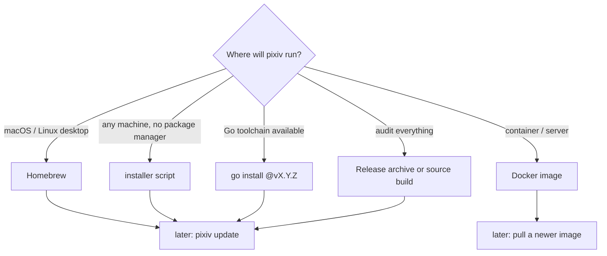
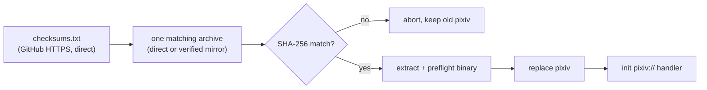
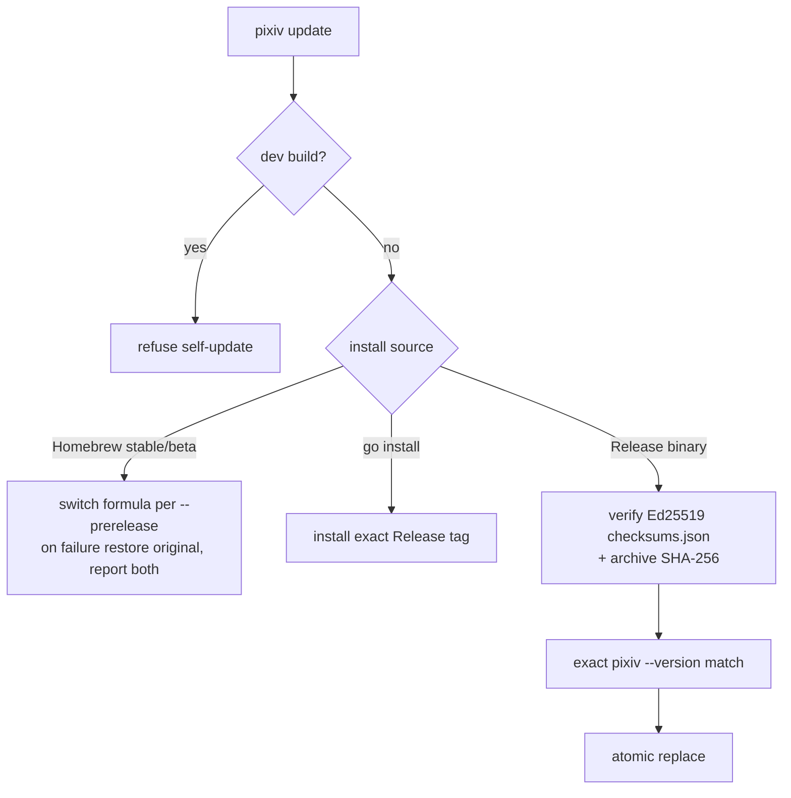

# Installation and updates

English | [简体中文](../zh-CN/install.md) | [CLI reference](cli-reference.md)

[GitHub Releases page]: https://github.com/FlanChanXwO/pixiv-cli/releases



> [!NOTE]
> The Ed25519 public key, key ID and fingerprint are committed in [`internal/selfupdate/installer/release_installer.go`](../../internal/selfupdate/installer/release_installer.go); the public source/tap repositories, protected `release` Environment and isolated credentials are configured. Release and tap are separately published — check the [GitHub Releases page] and `brew info FlanChanXwO/tap/pixiv-cli` for current state. Every version must pass the same tag, signing, asset and Homebrew gates before it is a trusted source.

## Official installer scripts

```bash
# Linux/macOS
curl -fsSLo /tmp/pixiv-install.sh https://github.com/FlanChanXwO/pixiv-cli/releases/latest/download/install.sh
sh /tmp/pixiv-install.sh --add-to-path
```

```bat
rem Windows Command Prompt; no PowerShell dependency
curl.exe -fsSLo "%TEMP%\pixiv-install.cmd" https://raw.githubusercontent.com/FlanChanXwO/pixiv-cli/main/scripts/install.cmd
call "%TEMP%\pixiv-install.cmd" --add-to-path
```

| | `install.sh` | `install.cmd` |
| --- | --- | --- |
| Platforms | Linux/macOS AMD64, ARM64 | Windows AMD64, ARM64 |
| Default dir | `$HOME/.local/bin` | `%LOCALAPPDATA%\Programs\pixiv` |
| `--add-to-path` | only for `$HOME/.local/bin` | current user's `Path` value only |
| `--install-dir DIR` / `--no-path` | other destination / no profile or registry change | same |



- Never requests admin/root, installs prerequisites, reads Pixiv credentials or bypasses reputation warnings.
- **Bootstrap trust:** before `pixiv` exists there is no embedded Ed25519 verifier — SHA-256 detects corruption/mismatch; authenticity relies on HTTPS and the official repository. Inspect the script first. Afterwards `pixiv update` uses the embedded Ed25519 trust root.
- **Mirrors:** versioned installers embed a static source list (never fetched remotely; changes only with a signed Release). Candidates are probed only for the platform archive and are usable only if their checksum response is byte-identical to the direct file; the archive still needs the direct SHA-256 match.
- **Linux:** assets require glibc ≥ 2.35. Release, native-evidence and packaged-smoke jobs build on Ubuntu 22.04 and reject any ELF needing more than `GLIBC_2.35`; preflight surfaces loader failures before replacement.
- **`pixiv://` handler:** initialized after a verified install (Homebrew does it in `post_install`). A warning means the binary installed but desktop integration did not. On macOS/Windows the next normal command retries, so a manually extracted archive self-repairs. Desktop Linux needs `xdg-mime` and `gio`; headless Linux supports the relay server without a handler.

## Build from source

```bash
sh scripts/build.sh
```

Uses the Go version in `go.mod`, sets `CGO_ENABLED=0`, writes `build/pixiv` (`build/pixiv.exe` on Windows); no Rust toolchain, native library or C linker. On Windows use Git Bash, MSYS2 or WSL. Encoding, licenses and platform evidence: [development guide](maintainers/development.md#ugoira-go-encoder).

## Go source installation

```bash
go install github.com/FlanChanXwO/pixiv-cli/cmd/pixiv@vX.Y.Z
```

- Use an exact published tag (never a branch) and follow that tag's requirements; Go-encoder versions build with `CGO_ENABLED=0`.
- Frontend sources are embedded; no generator or npm step. Installs to `GOBIN` or `GOPATH/bin`.
- Self-update installs the selected exact tag and keeps the previous executable on failure.

## Homebrew

```bash
brew install FlanChanXwO/tap/pixiv-cli        # stable
brew install FlanChanXwO/tap/pixiv-cli-beta   # future beta channel; ships only with pre-releases
```

Both formulas install the same `pixiv` binary and conflict with each other; they download only verified macOS/Linux Release assets and add no `ffmpeg` dependency. Release and tap are separate channels — use `brew info FlanChanXwO/tap/pixiv-cli` and the [GitHub Releases page], not a hard-coded version.

## Docker

| Fact | Value |
| --- | --- |
| Images | `ghcr.io/flanchanxwo/pixiv-cli`, `docker.io/flanchanxwo/pixiv-cli` (same native `linux/amd64` + `linux/arm64` images) |
| Tags | Exact release (`v1.2.3`) for reproducibility; `latest` follows stable only — prereleases never move it |
| State | Same `pixiv` binary and `~/.pixiv-cli` namespace (`/home/pixiv/.pixiv-cli`, image UID 1000) |
| Working dir | `/work` — use it with an explicit output path; not a separate product mode |
| Upgrade | Pull a newer image and redeploy with the same state volume; `pixiv update` is not container-aware |

```bash
# Persistent state + download workspace
docker run --rm -v pixiv-cli-state:/home/pixiv/.pixiv-cli -v "$PWD:/work" \
  ghcr.io/flanchanxwo/pixiv-cli:v1.2.3 --version

# Host directory not writable by UID 1000: run as host identity with an ephemeral HOME
docker run --rm --user "$(id -u):$(id -g)" -e HOME=/tmp/pixiv-cli -v "$PWD:/work" \
  ghcr.io/flanchanxwo/pixiv-cli:v1.2.3 download URL --output /work/downloads

# Persistent state for that identity: bind a host dir you own
mkdir -p "$PWD/pixiv-cli-state"
docker run --rm --user "$(id -u):$(id -g)" -e HOME=/tmp/pixiv-cli \
  -v "$PWD/pixiv-cli-state:/home/pixiv/.pixiv-cli" ghcr.io/flanchanxwo/pixiv-cli:v1.2.3 auth list

# Import a token via stdin (TTY → hidden prompt; paste, then Ctrl-D)
docker run --rm -it -v pixiv-cli-state:/home/pixiv/.pixiv-cli ghcr.io/flanchanxwo/pixiv-cli:v1.2.3 auth import
# Automation: pipe with -i (not -it); writes only to the state volume
secret-manager print-token | docker run --rm -i -v pixiv-cli-state:/home/pixiv/.pixiv-cli \
  ghcr.io/flanchanxwo/pixiv-cli:v1.2.3 auth import

# MCP stdio (stdout reserved for JSON-RPC); add the state volume to reuse accounts
docker run --rm -i ghcr.io/flanchanxwo/pixiv-cli:v1.2.3 mcp
```

Bind mounts keep host ownership. Never pass a token as an argv value. `auth import` behaves as on the host; Docker adds no OAuth callback flow for `auth login`. MCP HTTP in a container: see [MCP HTTP server](cli-reference.md#mcp-http-server).

## Direct download

- Six fixed-name archives (darwin/linux/windows × amd64/arm64): `pixiv-cli_<version>_<os>_<arch>.tar.gz` (`.zip` on Windows), plus `checksums.txt` and Ed25519-signed `checksums.json`. Trust them only after the release passed its gates.
- No Apple notarization or Windows Authenticode: Gatekeeper/SmartScreen may still prompt. Download only from the project's GitHub Release page, verify version, checksum and signature, and never bypass warnings for assets of unknown origin.

## Version and updates

```bash
pixiv --licenses          # embedded third-party notices; no auth, network or local state
pixiv --version           # exactly one line: pixiv <version>; no stderr, no update check
pixiv update --check [--json] [--prerelease]
pixiv update --proxy http://127.0.0.1:7890
```

- Archives contain only the executable; no separate license files.
- The former `version` subcommand, its `--json` and public `commit`/`build_date` fields were removed (breaking): they now fail as unknown command with empty stdout. Use the root flag.
- The actual install does not accept `--json`.



- **Sources:** without an explicit `--proxy`, configured `https_proxy` or `HTTPS_PROXY`, Release-binary updates probe the embedded source list concurrently — API-capable candidates for the Releases API, archive-capable ones for manifest, checksum and archive. The first valid response becomes preferred; an asset download may silently try each remaining declared route once; if all fail, the error names every failed route. Candidates never alter canonical URLs, SemVer selection, Ed25519 or SHA-256 verification.
- **Channels:** only canonical SemVer tags. Stable excludes GitHub prereleases; `--prerelease` includes them. Any non-draft published Release in the channel with a non-SemVer tag makes the check report it and fail closed.
- **Trust:** binaries embed the production Ed25519 key/key ID/fingerprint; the private key exists only in the protected `release` Environment and a controlled macOS Keychain recovery copy. `pixiv update --check` is read-only and no substitute for verifying the chosen version's assets at install time.
- **Automatic check:** after successful regular commands, best-effort stable check — skipped for MCP, help, root `--version`, `update`, every `auth export`, bundle-form `auth import` and dev builds; at most once per 24 h per user cache (API-capable candidates only), capped at 3 seconds. Results and failures go only to stderr (failures as warnings), never change the exit code or pollute JSON stdout or MCP HTTP responses. Disable it:

```toml
# ~/.pixiv-cli/config.toml
[update]
check_enabled = false
```
