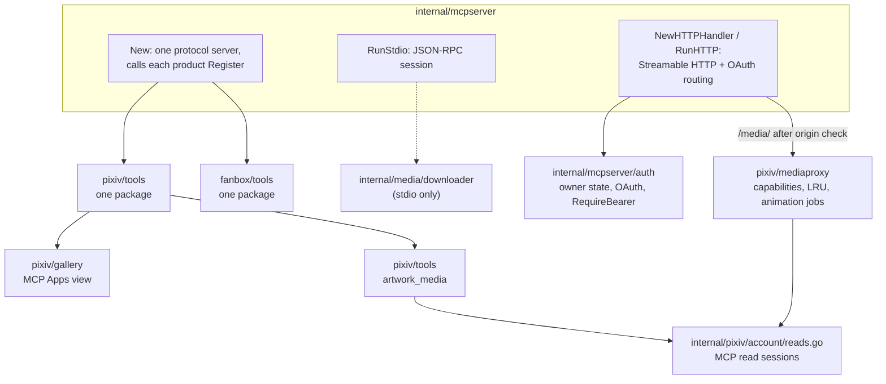
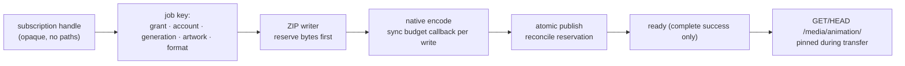

# MCP server architecture

English | [简体中文](../../zh-CN/maintainers/architecture-mcp.md) | [Architecture](architecture.md)

Package ownership inside `internal/mcpserver` and the services it composes. Tool behavior is in [MCP tools](../mcp-tools.md) and [MCP Apps gallery](../mcp-gallery.md).

## Server and registration

- `New` builds the single protocol server and calls each product's `Register`. Pixiv tools use `pixiv_`, FANBOX `fanbox_`; no unprefixed aliases. Each product has one `tools` package: `register.go` keeps the registration order and port gates, and one domain file owns the name, annotations, schema and handler of the tools in that domain.
- Stdio injects local downloads through `internal/media/downloader`; HTTP never receives that port. Gallery and owner tools require their media/account/login ports.
- `NewHTTPHandler` (parent package) assembles stateless Streamable HTTP and OAuth routing; `RunHTTP` owns listener and lifecycle; `RunStdio` owns the local session and waits for cleanup.
- Products keep their own SDK ports, account selection and runtime. Discovery opens no FANBOX account; the root opens its service lazily when a FANBOX tool runs. Pixiv nullable `page`/`limit` are parsed by its adapter; traversal stays in `internal/pagination`. Handler failures keep structured output with `isError=true`; legitimate empty results stay successful.

## Gallery and media

| Package | Owns |
| --- | --- |
| `pixiv/gallery` | MCP Apps view attached to `pixiv_show_gallery`, `pixiv_show_artwork` and `pixiv_artwork_media`; stable resource URI + content-version alias for UI cache keys; valid historical aliases forward fresh reads to the current embedded view |
| `pixiv/mediaproxy` | process-local image capability signing and raster delivery via the public SDK (routed under `/media/` after canonical-origin validation); grant/session-scoped metadata and image LRU; query/image semaphores; same-key metadata flights; streaming lifecycle; animation jobs |
| `pixiv/tools/media.go` | `pixiv_artwork_media` static image delivery and Ugoira encoding per call; `pixiv_gallery_animation` control adaptation; `pixiv_show_gallery` / `pixiv_show_artwork` views |
| `pixiv/internal/outputs` | structured media envelope and schema-error redaction |

- Capabilities bind the OAuth grant, account and image selection; neither browser nor route accepts upstream credentials or arbitrary URLs. The composition root supplies the same outbound proxy and explicit-account lease factory as other Pixiv operations.
- Gallery UI owns lazy placeholders, explicit retries, view cancellation, Blob cleanup and host-capability downloads, plus a 256 MiB estimated session LRU (static images, metadata, original bytes) across internal navigation; fresh tool input/results and teardown clear it. Detached cached images lose view listeners; eviction releases sources; active oversized images stay displayable. The original modal uses the full-byte media tool and shares bytes with host-confirmed downloads. Without host download support it prepares a selected-page original capability through the Gallery tool and exposes a protected HTTPS attachment link (exact download queries, original quality only, reusing the inline-image server cache). Bookmark state is never cached; search continuation stays in data tools.
- **mediaproxy cache:** serialized metadata, in-progress buffers and pinned payloads share the configured budget; large/unreservable images stream uncached. Every lookup validates current authorization; old account/session generations can't reuse content; only complete successful transfers enter the cache (never bookmark state or writes). Grant notifications, credential-generation signals and per-entry expiry reclaim idle entries; pinned bytes stay charged until release. Publication validates grant and generation under the cache mutex so a late old fill can't repopulate. The SDK registers policy-validated quality variants when mapping trusted metadata. Logs use fixed stages without secret identifiers.
- **artwork_media:** one SDK lease binds metadata and all page resources to the selected account; responses closed after each read; lease closed on every exit; bytes + explicit per-page indexes/failures; no server paths; no partial-delivery replay. Ugoira uses the shared downloader archive selector, SDK `SaveResource` and the Go encoder in a private per-call workspace, returns all GIF/APNG bytes as `ImageContent` plus a separately indexed PNG preview (APNG content MIME is PNG-family, metadata keeps the animation subtype), and removes temp files before delivery. Actual archive quality and output basename are explicit; static-only parameters are rejected, not ignored. App-capable clients get the indexed `_meta["pixiv/mediaContents"]` delivery described in [media delivery](../mcp-gallery.md#media-delivery-to-mcp-apps); if optional publication is unavailable the array keeps complete inline content (a host may still reject it — preparation is not receipt).
- ZIP body failures emit fixed `animation_zip_incomplete` / `animation_zip_reset` / `animation_zip_timeout` markers (partial byte count only) while the job context is active, without changing retries, deadlines, quality or tool errors.
- **HTTP write observation** uses the HTTP lifecycle logger; byte counts describe writer acceptance, not peer receipt; `ResponseController` unwrapping keeps SDK streaming/deadline behavior; no body/header retained; no added buffering, wait or retry.

### Animation jobs

- The composition root gives a server-owned private workspace and closes it before account read sessions. Binary animation and PNG preview routes reuse canonical origin and authorization checks.
- ZIP/preview writers reserve disk bytes before writing; a synchronous internal native callback reserves each output write against the same pool before touching the file. Ready artifacts are reclaimed only when actually requested bytes don't fit (no preemptive reservation). The native output upper limit stays enforced and the global serial encode gate stays shared.
- Temporary producers queue with the native reservation; startup cleanup needs the service marker and a released lifetime OS lock. Files stay pinned during GET/HEAD; cleanup joins active work. Gallery polls through the Apps bridge; CSP still forbids direct fetch connections.

## Read sessions (`internal/pixiv/account/reads.go`)

- Lifecycle-managed MCP read sessions: validate the local account revision on acquisition; share the rotation gate only for OAuth refresh and successful rotation persistence.
- Credential replacement/removal, network changes, expiry and upstream 401 invalidate the generation and release idle connections. Mutation leases and pool commit/replay stay in the Facade.
- Root injects a separate read port and opaque session generations; MCP adapters never read credentials. A cancelled account lookup returns its error without invalidating the shared generation or forcing rotation.
- On Windows the credential and animation-authorization watchers also watch their parent directories to detect the watched directory being moved.

## OAuth and owner state (`internal/mcpserver/auth`)

- One concrete versioned JSON state with owner init/reset. Root injects the app-data path; only the CLI prints the one-time secret. Mutations lock the sidecar, read fresh state and atomically replace it; reads don't cache. The owner verifier is also the generation boundary for in-memory authorization state. No database.
- Grant records must include boolean `revoked` and `used_refresh_hashes`; missing fields or wrong types fail closed (refresh history may be `[]` or the serializer's `null` for a nil slice). Invalid state blocks reads, init/reset and registration without overwriting the file.
- `auth.NewHandler` provides discovery, DCR, authorize and token routes plus `Handler.RequireBearer`. `NewHTTPHandler` mounts them beside `/mcp`, validates owner state before listening, and applies canonical Host/Origin checks before OAuth or SDK handlers. The constructor takes the canonical base URL, permits local HTTP, rejects credentials, query, fragment and client-normalized dot segments. Issuers never come from request Host or forwarding headers.

| Area | Rules |
| --- | --- |
| Metadata routes | Root and resource-specific protected-resource metadata share the SDK handler. Base `https://example.test/pixiv` → resource `https://example.test/pixiv/mcp`; metadata `/.well-known/oauth-protected-resource` and `/.well-known/oauth-protected-resource/pixiv/mcp`; AS metadata `/.well-known/oauth-authorization-server/pixiv`; registration `/pixiv/oauth/register`. Proxies must forward these and `/pixiv/` |
| DCR | JSON public clients only; omitted auth method → `none`; no client secret ever. Responses return the fixed profile (code; authorization_code/refresh_token; mcp). Unknown metadata ignored; logo/client/JWKS URLs never fetched. Unsupported methods, grants, response types or scopes → OAuth JSON errors |
| Redirects | Stored verbatim, no normalization. HTTPS, loopback HTTP (incl. localhost) and dotted reverse-domain native schemes accepted; fragments, relative URIs, ordinary remote HTTP, executable schemes and malformed URIs rejected. Authorize needs an exact registered match; malformed callback queries and pre-existing `code`, `error`, `error_description`, `error_uri`, `state`, `iss` are rejected locally; other query params kept |
| Persistence | Registration and reset share the sidecar lock and read fresh state; only a successful atomic write releases 201/client_id; failures → `server_error` without paths, raw metadata or credentials. Reset keeps registrations and the selected account |
| Authorize | Needs code, canonical resource, `mcp` scope (also the default) and a valid S256 challenge. Unknown clients/invalid redirects fail locally; other validated errors redirect with the original state and canonical `iss` (advertised in AS metadata) |
| Consent page | Escaped; client name labeled unverified; redirect origin and URI shown. One-use CSRF token binds form to browser, request and owner generation. Owner verification rotates the HttpOnly/SameSite=Lax cookie (Secure for HTTPS bases). Every authorization needs explicit Allow/Deny. POST rejects cross-origin requests and parameter overrides (host case, default ports considered). Form action is the full canonical authorization URL (a legal double-slash prefix can't become a cross-origin target); Host/forwarded headers and client redirects can't change it. Cookie paths keep the escaped prefix |
| CSP | Blocks scripts, framing and base overrides; form-action only self + the validated callback origin (Chromium checks form redirects). `strict-origin` hides authorization query params but keeps Origin for same-origin POST |
| Codes | Sessions, pending consent and hashed codes are memory-only, invalidated by reset/restart. Codes: 10-min deadline, bound to client/redirect/resource/scope/PKCE/generation; exchange validates bindings and current generation inside the file transaction, rejects at the deadline, consumes only after successful persistence |
| Token endpoint | Standard form POST only. Query credentials, duplicate/missing params and unsupported grants → OAuth JSON errors without echoing inputs. PKCE verifier 43–128 unreserved ASCII before S256. Access and refresh: independent 256-bit opaque random values, only SHA-256 persisted. Access `expires_in=3600`; refresh has no idle expiry |
| Refresh | Rereads state under the reset lock; binds canonical resource, client and scope; rotates and keeps used hashes. Replay persists revocation of that grant before `invalid_grant`; random invalid values revoke nothing. Failed writes publish no tokens and keep retryable codes/refresh tokens; failed revocation never claims success. Restart keeps clients/grants/refresh, drops pending codes |
| `RequireBearer` | SDK middleware; reads current state per request; validates resource/revocation/expiry; rejects multiple Authorization headers. Unauthorized → 401 + canonical `resource_metadata` challenge (not an MCP result). Invalid state fails safely without paths. `no-store`; expiry/reset affects later authorization, not running requests |
| Tests | HTTP and real temp-file tests cover exact deadlines, concurrent code/refresh/reset, restart and real write failure; deadlines via `testing/synctest`, no production clock config |

**HTTP owner** — exact escaped paths instead of ServeMux cleaning; Host and any Origin must match the canonical origin; forwarding headers never establish trust; proxies must keep public Host and prefixes. `no-store` enforced at response commit, incl. SDK SSE. On cancellation or listener failure the server cancels its own context and waits for active handlers (no fixed timeout), keeps the original listener error and never cancels the caller context. Receiving middleware binds legacy SDK sessions to the service context; the SDK propagates modern-revision request cancellation. No custom session store or transport fallback.

**Interoperability evidence** — the standard-client fixture covers 401 discovery, DCR, PKCE, both products' SDK reads and persisted grants after restart at the same address. The pinned Go MCP SDK v1.8.0 default refresh token source omits `resource` and gets `invalid_request`; validation is not relaxed for it. A separate control adds the [required resource parameter](https://modelcontextprotocol.io/specification/2026-07-28/basic/authorization#resource-parameter-implementation) via a configurable HTTP client and verifies rotation and reconnected reads — not evidence of unmodified SDK refresh compatibility or ChatGPT/Gemini acceptance. Path and registration rules follow RFC 8414 §3, RFC 9728 §3, RFC 7591 §2/§3.2 and RFC 8252 §7/§8.4. Temp-file and HTTP fixtures do not establish live connector OAuth compatibility.
