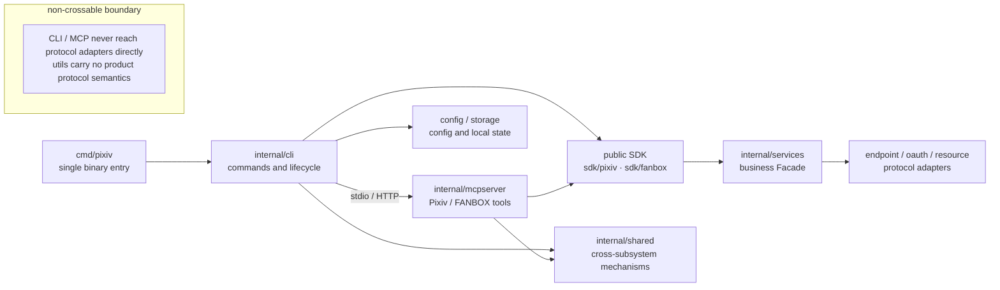

# Architecture

English | [简体中文](../../zh-CN/maintainers/architecture.md) | [Documentation index](../../index.md)

> [!IMPORTANT]
> CLI and MCP reach business capability only through the public SDK and owner-local narrow ports. Production assembly may depend on concrete implementations, but it must not expose locator, runtime graph, or protocol adapter to the command layer.

## Find a section by reader

| Reader / concern | Go to |
| --- | --- |
| Entry-to-SDK call chain | [Overall flow](#overall-flow) |
| Page sources and embedding | [Frontend source and embedded pages](#frontend-source-and-embedded-pages) |
| What a package may or may not do | [Package responsibilities](#package-responsibilities) |
| Release trust root and signing | [Release assets and trust boundary](#release-assets-and-trust-boundary) |
| Local state, config, path permissions | [internal/config/paths](#internalconfigpaths), [internal/storage/file](#internalstoragefileatomiclockreplacesecret) |
| Hard constraint list | [Known constraints](#known-constraints) |

## Overall flow

`cmd/pixiv/main.go` is the only official binary entry; it only delegates to `internal/cli`:

1. `pixiv` with no arguments shows CLI help.
2. `pixiv auth/config/update/search/timeline/detail/ranking/recommended/user/bookmark/follow/download` enters CLI mode; root `--version` is a standalone read-only flag; `pixiv fanbox` enters FANBOX mode; `auth import` handles direct token import or bundle restore, and `auth export` handles the local secret snapshot.
3. `pixiv mcp` assembles and starts unified Pixiv/FANBOX stdio by default or Streamable HTTP with explicit `--port`; `pixiv fanbox mcp` is removed.
4. CLI and MCP construct production resources explicitly per command owner:
   - Account credentials come from `~/.pixiv-cli/pixiv-cli.db` (SQLite, `internal/storage/database`; Windows: `%USERPROFILE%\.pixiv-cli\pixiv-cli.db`); the legacy `auth.json` is not read automatically — users must explicitly export/import a bundle
   - Global configuration comes from `~/.pixiv-cli/config.toml` (Windows: `%USERPROFILE%\.pixiv-cli\config.toml`)
   - Public environment variables participate as an override layer in the merge
5. There is no anonymous Web fallback: all content commands require an authenticated local account or explicit credentials; the removed `web_fallback_enabled`, if still present, returns `removed_setting`.

## Frontend source and embedded pages

`frontend/mcp-apps/gallery/` owns Gallery HTML/CSS/JS and its fixture; `frontend/pages/login/` owns login/callback/result templates and styles; `frontend/pages/oauth/` owns consent HTML/CSS. The resource-only `frontend` Go package embeds exact source paths, excluding fixtures, and assembles pages once at process startup using the standard library. Gallery CSS/JS and consent CSS are inlined; login templates/styles remain separate and byte-preserved. The existing `frontend` package tests validate embedded sources and placeholders.

The existing Go owners retain MCP registration, template rendering/data/escaping, CSP/media origin, canonical actions, CSRF and authorization. Current and historical resource URIs remain supported. Clean builds and versioned `go install` require no generation; runtime uses only embedded bytes, with no disk or network reads. Homebrew templates retain their existing owner.

## Package responsibilities

### `cmd/pixiv`

The `main` package that produces the `pixiv` binary. It carries no business logic; it only delegates to `internal/cli.Run` and returns the process exit code.

### `internal/cli`

Owns command dispatch and output for the CLI user mode:

- Cobra command tree, help, and flag parsing.
- Text/JSON output.
- Input adapter for `auth import [REFRESH_TOKEN]`: positional argument is treated as an opaque token; with no argument on a TTY it reads hidden input, and on a non-TTY it distinguishes an opaque token from a strict bundle by the first non-whitespace byte; bundle restore happens via stdin pipe or redirection, with no `--file`.
- Secret-output adapter for `auth export`: without `--output`, the default/UID selection emits only the raw token and a newline, while `--all` emits only a versioned bundle; with `--output` it writes a private file and emits only a secret-free summary.
- CLI protocol `--page`/`--limit` parsing and error messages; the post-parse logical paging plan is delegated to the shared traversal algorithm in `internal/shared/pagination`.
- Loopback OAuth, browser launch, and TTY interaction for `auth login`.
- `pixiv mcp` dispatch.
- Input/output adaptation for root `--version` and `pixiv update`; the removed `version` subcommand returns unknown-command during Cobra parsing.
- Read-only automatic update notice after a successful normal CLI command; the notice and failure warnings are written only to stderr.

`internal/cli` is the CLI composition root, split by responsibility into three same-package files (no new directory levels): `root.go` holds the command tree, global flags, and wiring shared by command owners;
`execution.go` owns the execution entry points, exit codes, resource closing (the close-resource list for a single execution is held by a private `closeState` there, closed idempotently in reverse registration order), and startup/finish handling;
`composition.go` owns production dependency assembly for Pixiv/FANBOX/MCP.

Before closing, callers must stop resource producers and finish registration. The `closeState` mutex protects the list, not late registrations; closers must not register into or recursively close the same scope. Closing follows command completion, and MCP stdio waits for in-flight handlers; close errors are joined.

`internal/cli/invocation` only owns `Streams`. Command owners construct
config snapshot, DB, business Facade, lifecycle, media/download, and update dependencies through explicit factories and narrow ports, and close resources in reverse order.
CLI does not export a cross-command locator, nor does it have an independent bootstrap constructor or `internal/cli/runtime`.

The command tree is handled uniformly by `root.go` for global flags and the requirement-driven startup lifecycle; exit codes are decided by the execution entry points in `execution.go`, and owner command packages then register their domain commands:
root-level `internal/cli/commands/{config,mcp,update}`, Pixiv `internal/cli/commands/pixiv/{auth,bookmark,comment,detail,download,follow,mypixiv,ranking,recommended,search,series,timeline,user}`,
FANBOX `internal/cli/commands/fanbox/{auth,download,post}`. Data commands consume the public SDK `*pixiv.Client`/`*fanbox.Client` via the owner-local narrow
`Data` port (`Open`/`Pooled`/`JSONOut`, etc.) and never reach internal protocol adapter packages;
the shared stdin codec lives in `internal/cli/pipeline`, and the stable Pixiv record projection shared by CLI/MCP lives in `internal/shared/record`; the command-scoped Pixiv target resolver lives in `internal/shared/resolver`, consumes only the command contract, records, and pure-local `sdk/pixiv.ParseURL`, and requires owners to inject any controlled bare-ID probe explicitly, without owning clients, credentials, or protocol adapters.

The `record` package only carries record protocol, JSON normalization, and public SDK DTO mapping, must not depend on CLI, MCP, or internal protocol adapter packages, and must not grow into a general dumping ground. These subpackages do not reverse-import the `internal/cli` root package.

root `--version` stdout is exactly one line, `pixiv <version>`, with empty stderr and no startup update check. The removed
`version` subcommand returns unknown-command during parsing with empty stdout. Automatic update runs only after a successful normal business command; it is skipped for MCP, help, root
`--version`, `update`, all `auth export`, bundle-form `auth import`, and dev builds. It selects the stable Release, uses a 24-hour
throttle on the user cache, and waits at most 3 seconds. Configuration, network, and source-identification failures only surface as stderr warnings; they must not
change the exit code of an already-successful business command, and must not leak into JSON stdout or MCP JSON-RPC.

Windows pending-update cleanup at process startup is also a potential mutation; all `auth export` invocations are identified before Cobra
parsing and skip that cleanup, while other commands still run the normal startup cleanup. The repeated-override semantics of root bool flags are
protected by focused tests, so that forms like `--help=false` cannot accidentally bypass the secret export boundary.

### `internal/cli/commands/pixiv/auth/loginhelper`

Owns the system URL scheme helper, persistent handler manifest, one-shot remote handoff private state, and remote callback client for `auth login`.
`internal/cli` only installs the on-demand handler through this package, retaining OAuth, loopback HTTP, system browser, TTY, and relay server orchestration. The
handler only allows exact `pixiv://account/login` and `pixiv://account/remote-login` to enter the current round; the active loopback takes priority, and remote callbacks are
delivered only to the active one-shot handoff, while other `pixiv://` URLs are routed to the handler persisted in the manifest.

Desktop private state only stores the current
handoff's relay origin, session ID, and capability; the server stores no desktop device record, and the public SDK does not expose this state. The remote callback only accepts
a one-shot result URL on the same relay base; `internal/cli` opens the non-sensitive final page and then waits for OAuth exchange.
Darwin separately holds the embedded Swift, `Info.plist`, and LaunchServices; Windows uses the current-user registry/class launch; desktop Linux uses
an XDG desktop entry and `gio`. Headless Linux does not register a handler, but can run the relay server.

### `internal/shared/buildinfo`

Holds the `Version` injected by the Go linker. The local default is `dev`;
only builds whose version is `dev` are treated as dev builds and must reject self-update.

### `internal/shared/record`

Owns the stable Pixiv record projection shared by CLI/MCP: it preserves unknown fields of the public `sdk/pixiv` DTO,
fixes `id`, `type`, and `url`, and provides JSON normalization, version-metadata cleanup, and record-field-based local filtering.
This package does not depend on CLI, MCP, or `internal/services` protocol adapter packages; MCP's own output schema and DTO wrapping still live in
`internal/mcpserver/pixiv/internal/records`.

### `internal/shared/searchfilter`

Owns shared artwork-local filter semantics for CLI/MCP: it normalizes rating and content-type inputs to canonical
values, matches DTO `x_restrict` and artwork kinds client-side, and produces a cursor context that does not expose
raw filter values. Rating is never mapped to an unconfirmed upstream `x_restrict` request parameter; command-specific
field availability and endpoint-confirmed content-type wire parameters remain owned by each command contract. This
package holds no client, credentials, or protocol adapter.

### Business Facade, accounts, and generic traversal

- `internal/services/pixiv` is the Pixiv business Facade, aggregating business leaf modules such as `account` and `pool`. `account` owns local accounts, login completion, default account, credential identity/rotation, and account management; `pool` owns selection, freezing, Gate, safe replay, and the related error semantics.
- `internal/services/fanbox` is the FANBOX business Facade, aggregating the FANBOX `account` leaf module and client lifecycle; the FANBOX session does not share type or lifecycle with the Pixiv refresh token.
- `internal/shared/lifecycle` only carries protocol-agnostic lifecycle, Lease, and Attempt; it does not own Pixiv/FANBOX account selection, credentials, or replay strategy.
- `internal/shared/pagination` owns product-agnostic logical pagination for one ordered stream and ordered aggregate streams: filters run before the global skip/limit budget, `OneBatch` stops at the first matching source batch, and batch truncation is resumed through a source-position checkpoint. Its `StreamState` contains only the current stream and per-stream cursors; product owners encode that state together with query/account/subtype bindings in their opaque cursors.
- `internal/shared/traversal` owns the reentrant execute lifecycle for single-stream and aggregate reads, clearing uncommitted results before a safe replay. Command-level filter wiring remains in each CLI/MCP owner, while normalized artwork rating/content-type semantics come from `internal/shared/searchfilter`.

Ordinary CLI reads use `Pooled[R].Read[T]` on a concrete function type: failure returns the zero T and callbacks do not commit results; owners retain their own Request types. `Write` marks an invoked SDK call committed even on error, preventing cross-account replay with an unknown write outcome; a missing pooled port returns an error. Streaming NDJSON, pagination, and partial delivery remain with owners and traversal/lifecycle, not ordinary Read.

The config schema, `config.toml` path/get/set/unset, generated baseline, and the immutable `Snapshot` required for a single execution live in `internal/config/settings`; the protocol-agnostic month-truncation pure function lives in `internal/utils/date`. CLI/MCP use business Facades via owner-local narrow Seams and the MCP runtime `SDKPorts`, without directly depending on upstream Adapters. `internal/account` and `internal/session` have been deleted, with no compatibility alias retained.

### `internal/shared/diagnostics`

Provides an explicit, in-memory typed diagnostics scope. Pixiv MCP, FANBOX MCP, Pixiv/FANBOX
network transport, account pool, download, and FlareSolverr emit only the allowed module, operation, route, status,
proxy, UA, request ID, reason, and count fields through the scope; the default sink is Nop. The MCP request scope only
affects diagnostics, not HTTP JSON-RPC responses. This package creates no log files, stores no response body,
Cookie, token, signed query, or arbitrary error dump; the public SDK stays silent when no explicit scope is present.

### Release trust root (`internal/update/installer`)

`internal/bootstrap` was deleted as part of the v1 migration and is no longer the CLI/MCP composition root. The production Ed25519 public trust root's
key ID and public key constants live in `internal/update/installer/release_installer.go`; `internal/cli/commands/update/production.go`
assembles the key ID→public key map and hands it to the Release installer, so callers cannot pollute the trust root. `internal/cli/root.go` only holds the update command seams; registration and execution are delegated to `internal/cli/commands/update`
and does not construct the trust root. The public key fingerprint and known signing fixtures are verified by installer same-package tests; the private key is not in source or runtime config.
Read-only update checks do not need this key; this wiring itself cannot replace the independent release acceptance for each version.

### `internal/storage/database`

CLI/MCP database owners coordinate initialization, short account/pool transactions and complete snapshot reads through the private `pixiv-cli.db.lock` sidecar. The lock never covers OAuth or content network requests. The coordination file contains no credentials and does not change account data; direct external SQL writers and older processes do not participate. Non-cancellable contexts retain native lock waiting. Cancellable contexts use the same non-blocking lock interface, checking contention every 10ms; cancellation wakes immediately and closes the waiting file handle. There is no overall wait deadline or transaction replay. The account owner cancels its lifecycle before taking the session mutex, so database-lock waits during watcher validation do not block shutdown.

Owns the SQLite authority for local account state:

- Schema, migration ledger, and repository for `pixiv-cli.db`; account identity/credential is keyed by `user_id`,
  and Pixiv rotation and FANBOX session replacement use `credential_revision` compare-and-swap.
- SQLite uses forward-only migrations through schema v3. It upgrades legacy v1 databases with the v2/v3 changes and recognizes the final columns already present in this tree's initial schema without replaying duplicate DDL; the legacy `auth.json` and the legacy `account_pool.accounts` are not part of the startup migration path.
- Platform-appropriate private DB/journal file permissions (Unix-like `0700`/`0600`).
- auth export only reads the default, an exact UID, or all local accounts; it does not read environment tokens, refresh, go to the network, or mutate state.

The legacy `auth.json` is no longer a store or fixture API. Users must explicitly run
`pixiv auth export --all --output <private bundle>` on the old version, then run
`pixiv auth import < bundle.json` on the new version; on failure the reason is returned directly, and the old file is not auto-deleted.

### `internal/config/settings`

Owns `config.toml` and runtime configuration:

- `config.toml` schema, defaults, and configuration key definitions.
- Runtime configuration merge: `config.toml` and public environment variables.
- Strongly typed parsing and sparse write-back for `pixiv config path/get/set/unset`.

The configuration is split as follows:

- `pixiv-cli.db`: stores account identity and credentials (`pixiv_account`/`fanbox_account`), DB file permission `0600`; the legacy `auth.json` is not read automatically.
- `config.toml`: stores global configuration keys, including `[pixiv.auth].default_user_id` and `[fanbox.auth].default_user_id`; Unix-like file permission `0600`. The first-run compact baseline is generated from **struct field tag** metadata and writes only entries marked `example:"true"`; keys that have a default but no `example`, plus advanced settings, remain omitted until explicitly written. When no default account is set, the first account is selected by `sort_order`.

Runtime settings use `koanf` to merge `config.toml` with public environment variables; `config set/unset` uses `tomledit` for write-back, preserving comments, order, and layout as much as possible.

#### Configuration declaration: struct field tags are the single source of truth

The exported fields of `RuntimeConfig` (including its nested account-pool, network, and FlareSolverr groups) declare all static facts via tags; runtime binding, CLI metadata, and baseline generation all reuse that one declaration:

| Tag | Meaning |
|---|---|
| `config` | TOML path relative to its containing group; `"-"` excludes the field and its entire subtree |
| `alias` | The public name used by `config get/set/unset`; omitted on groups and private advanced leaves |
| `env` | Environment variables that may be read, in declaration order (that order is the precedence; presence counts as a hit and an empty value does not fall through) |
| `default` | Value used when absent, interpreted by field type (distinguished by tag **presence**, not by whether the string is empty) |
| `example` | Whether the entry enters the first-run compact config; only `"true"` does, and it requires a `default` |
| `cli` | Whether `config get/set/unset` manages it |
| `secret` | Whether it must be hidden from public output and kept out of the example config (a `secret:"true"` + `example:"true"` pair is a schema error) |

Groups declare only a `config` prefix; their leaves declare relative paths. The same group type can be reused under different prefixes. `OptionalString` is a leaf, not a group. Optional pointer groups are inspected as types without allocating runtime values. Duplicate expanded paths, duplicate nonempty aliases, empty path segments, cyclic groups, unsupported leaf types, and leaf-only attributes on groups are declaration errors. Private leaves cannot enable CLI management, baseline examples, or environment bindings without a public alias.

The private schema caches field index chains and Go types, never target instances. Scalar binding uses the same source selection as `Effective`; pointer groups are not allocated by ordinary binding. Advanced readers locate compiled paths by Go field ownership, without adding public aliases or allocating solver groups before the domain enablement check. Ordinary runtime fields have no separate wiring list; account-pool defaults also come from declarations, while strict file types and strategy validation remain domain rules.

Default account selection has a separate private declaration scope. Its `int64` UID leaves have no alias or default; positive-integer parsing remains in the on-demand auth read/write methods. They never enter ordinary Runtime binding or trigger early validation during Snapshot loading.

Adding one ordinary setting therefore requires only: a field plus tags, a behavioural test, and the matching documentation. New declarations need no additional registry, environment `switch`, per-field runtime assignment, baseline list, or CLI alias list.

The developer-declared `cli`, `secret`, and `example` attributes accept only `"true"` or `"false"` when present; other spellings are schema errors. This does not change parsing of user configuration values.

`SettingSpec` remains the **public derived view** of that declaration (the CLI still consumes it); it is no longer a hand-written fact table.

File responsibilities inside `internal/config/settings`:

- `config.go`: types, field tags, and field contracts.
- `schema.go`: tag-derived metadata, declaration validation, lookup, retirement tombstones, and the public `SettingSpec` view.
- `snapshot.go`: file and environment snapshot, source selection, and runtime binding (including the domain rules for service networks, FlareSolverr, and the account pool).
- `values.go`: type parsing, normalization, and domain validation.
- `document.go`: TOML targeting and sparse mutation.
- `defaults.go`: baseline config document generation.
- `store.go`: `Store` operations (path, read, sparse write-back).
- `auth.go`: default account selection read/write (deliberately **not** part of ordinary runtime binding).
- `paths.go`: the `FileStore` port and the default file adapter.

`internal/config/settings` defines the `FileStore` port, injected by the CLI private composition graph from the protocol-agnostic file mechanisms in `internal/storage/file/{atomic,lock,replace,secret}`: a temporary file with a random name (containing no credentials) is created in the same directory as the target, the full content is written, file `Sync` is performed, the file is closed, and only then is the target replaced. On Unix-like platforms the parent directory and file are proactively tightened to `0700` and `0600` respectively, and after atomic replacement the target directory is synced again;
if this call created one or more directory levels, then after the replacement is committed the target directory and each new directory's outer parent are synced in leaf→root order, so that both the file entry and the new directory entries fall within the durability boundary; existing directories still only sync the target directory.

If any directory sync fails, the remaining directories are still attempted and the errors are merged; the replacement is already committed, so the caller cannot assume the old file is still present. A failure in the pre-replacement write, file `Sync`, or close keeps the old target; a normal replacement failure and a recoverable partial-completion failure also keep or restore the old target and clean up the temporary
file. If recovery after a partial completion itself fails, the caller receives a combined error, the target path may be temporarily missing, but the same-directory recovery backup of the old content and the source temp of the new content are both retained for manual recovery; in this case "No temp residual" does not apply. Other temporary-file cleanup failures are not swallowed but returned alongside the main error.

On Windows, file `Sync` and close are also performed before replacement: if the target exists, `ReplaceFileW` with a same-directory unique recovery backup is used; first creation uses `MoveFileEx` without overwriting the target. `ERROR_UNABLE_TO_MOVE_REPLACEMENT`
keeps target/source under their original names; `ERROR_UNABLE_TO_MOVE_REPLACEMENT_2` attempts to restore the old target that was moved to backup, and if restoration fails it keeps backup/source. A backup cleanup failure after a successful replacement is a committed error and is still treated as committed. A file created for the first time on Windows inherits the parent directory ACL, and replacing an existing target preserves that target's ACL; this protocol does not
proactively add or relax ACLs, but it also does not claim that `Mkdir`/`Chmod` will tighten DACLs, nor does it provide equivalent guarantees for POSIX mode or directory
fsync.

`update_check_enabled` corresponds to `[update] check_enabled`, default `true`; it only controls the automatic check after a successful normal CLI command, and does not disable a user-initiated `pixiv update`. `log_level` and `log_format` correspond to `[logging].level` and `[logging].format`; `info/text` are the defaults, while `debug/json` opt into the CLI-owned stderr presenter. Environment values override the file for the current invocation.

### `internal/browsercookies`

Owns the read-only browser cookie provider; it is not part of the public SDK, and does not depend on FANBOX, Pixiv, CLI, MCP, or the account store.
The root package (core) is protocol-neutral: it only accepts a fixed `CookieQuery`, discovers browser directories by security profile identifier,
and returns the target value as a redacted `Secret`; `chromium` supports explicit Chrome/Edge providers, `firefox` parses `profiles.ini`,
and `safari` only parses `Cookies.binarycookies` on macOS. Unknown Chromium derivatives are not fuzzily identified, and when multiple profiles are present without a selection, it fails explicitly. System/browser integration lives in `internal/browsercookies/system`: it imports and registers all
provider subpackages, so the root `New` can dispatch to every browser; the root package does not import any provider subpackage, and importing the root package alone does not register browsers.

The platform secret boundary is kept in the `secret` subpackage: macOS uses Keychain, Windows uses the current-user DPAPI, and Linux queries the Secret Service via `secret-tool` with fixed attributes. The Chromium provider reads Local State/Cookies from the platform profile root directory,
supporting v10/v11 GCM and legacy CBC; missing system tools, permission, lock, schema drift, and decryption format errors are all mapped to stable errors,
and no cookie, key, absolute path, or command output is written to logs, errors, JSON, or MCP. Cross-platform native provider evidence
must still be collected on the corresponding host per the release-prep runbook; offline fixtures and cross-compilation only prove code/format contracts.

### `internal/update`

The root package only retains the coordinator and automatic-check API (thin root); install-source identification, GitHub Releases queries, SemVer selection,
cache, explicit update policy, and Release binary installation protocol are implemented by `internal/update/{source,release,installer,process}`,
and re-exported by the root package to the CLI composition root:

- Homebrew distinguishes stable/beta via the executable symlink and the keg `INSTALL_RECEIPT.json`; switching between the two
  formulas first uninstalls the conflicting formula, and on failure explicitly attempts to restore the original formula.
- `go install` requires matching both the Go build info and the actual `GOBIN`/`GOPATH/bin` executable; updates always use the
  exact tag of the selected Release.
- Other official binaries are treated as Release installs. Before installation, the platform archive is selected, the Ed25519-signed
  `checksums.json` is verified, the archive SHA-256 is verified, `pixiv --version` is run as an exact preflight after unpacking, and then an in-place
  atomic replacement in the same directory is performed.
- The GitHub Releases API is the only query backend; drafts are excluded, and stable checks do not include prereleases. ETag/cache
  are used for throttling and atomic persistence.
- The update selector enforces canonical SemVer on the published Releases of the current check channel; if any tag is invalid, it
  fails closed and reports that tag, rather than skipping it and selecting an older version. Stable selection excludes GitHub-marked
  prereleases before verification. Signatures, checksums, immutable tags, and the pre-install preflight together form the Release trust boundary.

This package must not disguise signature, checksum, HTTP, archive, replacement, or permission errors as "no update". The production trusted key,
signing private key and Keychain recovery copy, the protected `release` Environment, and the public remote have been configured for the production release path; the complete six-target
native evidence and staticlib manifest were backfilled for the legacy Rust release. v0.3.0 has completed the official tag, signed Release, and stable tap formula;
the failure semantics of Release installation remain a protective boundary, not a temporary degradation.

### `scripts/cmd`, `scripts/tests`, and `scripts/internal`

Each script entry still in use lives at `scripts/cmd/<name>/main.go`, which only handles argument parsing and calls the corresponding owner
package. Pure test carriers live in `scripts/tests/`: they only verify workflow, documentation, or installer behavior and carry no production implementation.
Implementation logic and same-package tests live in `scripts/internal/<name>`. Shared release contracts live in
`scripts/internal/releasecontract` (release target/archive identity) and `scripts/internal/releasenotesrender`
(GitHub Release body rendering, shared by `releaseassets` and history sync). Platform runner/capability metadata is owned
by `ci/platforms.json` and exposed to workflows through `tools/platformmatrix`; workflow tests validate behavior/security
boundaries instead of maintaining a second exact YAML policy model.

### `sdk`, `sdk/pixiv`, `sdk/fanbox`

The public SDK is the only external contract surface, exported only from these three packages:

- `sdk`: shared `Page[T]`, `Cursor` (Text/JSON codec), `Error` (sentinel, context chain, redaction), `ResourceRef`/`Resource`, and resource request/response/save types.
- `sdk/pixiv`: Pixiv App-only SDK. `Open/OpenWith/New/NewWith` constructors, OAuth `LoginSession`, credentials rotation, normalized artwork/novel/user/comment/stamp models, opaque cursor, `ParseURL`, comment mutations, stamp reads, and resource reads. No anonymous Web path.
- `sdk/fanbox`: FANBOX SDK. `Client.ValidateSession`, creator/tag/post/home/supporting, two kinds of pagination, and resource reads; it does not read browsers, DB, or Pixiv credentials, and does not import `sdk/pixiv`.

The FANBOX native transport uses the Chrome 146 TLS profile and a built-in Firefox 148 HTTP User-Agent baseline, and only accepts an explicit HTTP client, proxy, UA, and optional
FlareSolverr options at construction. `FANBOXSESSID` is only allowed to propagate in validated requests to `api.fanbox.cc` and `downloads.fanbox.cc`;
third-party CDNs, Pixiv hosts, and solver control requests never carry this Cookie. The solver control transport
connects directly to FlareSolverr, the solver upstream proxy is only passed in as solver configuration and does not inherit the native or host environment proxy;
API/resource errors outside a challenge do not automatically enter the solver.

The legacy top-level `pixiv/` facade was deleted in v1; `pixiv` is retained as an import alias for `sdk/pixiv`. Auth backup (`AuthExportSelection`/bundle codec) still goes through the same local snapshot boundary of `sdk/pixiv`. The bundle contains an opaque refresh-token secret; it is an unencrypted point-in-time backup, not a live sync. After token rotation, old bundles or copies on other machines may be stale.

Callers define source mode, budget, filter, cursor persistence, and HTTP presentation in their own adapters. This repository does not provide an HTTP Provider, Discover, Probe, Capabilities, RSS, or crawler.

### `internal/services/pixiv/protocol`, `appapi`, `oauth`, `resource`

These existing paths remain upstream Adapters after the migration, composed only by the public SDK; they do not carry account/session business Facade:

- `protocol`: the single source of upstream base, profile header, endpoint catalog, and redacted adapter failure; it does not read config, send requests, or store response body, URL, header, or credentials.
- `appapi`: the credential-bearing App API transport/auth/retry adapter. It only exposes the narrow `GetJSON`/`GetRaw`/`PostForm` capabilities to endpoint families; idempotent JSON/raw response reads only retry once on the first 429 with a valid `Retry-After`, per context, and no longer carry novel/user/artwork business methods, route facades, or raw DTO/mappers.
- `oauth`: PKCE, code exchange, refresh, and token state.
- `resource`: policy-constrained resource transport, redirect/header/body boundaries.

v1 has deleted `internal/services/pixiv/webapi` and the anonymous Web/AJAX path: App API errors return a normalized error directly, without automatic protocol switching. Pixiv endpoint families live in `internal/services/pixiv/endpoint/{artwork,novel,user}/<leaf>`, where each family owns its own route, request, raw DTO, mapper, and continuation/error validation, and the parent package only owns normalized entities/values. FANBOX's `internal/services/fanbox/protocol` only owns product-specific session, cookie, challenge, URL policy, and narrow transport; `internal/services/fanbox/endpoint/{creator,post}/<leaf>` and `resource` each own their endpoint route/fixture/conversion. `sdk/fanbox` directly composes these Adapter capabilities, without depending on the business Facade.

`RequiredList` / `RequiredObject` share field-presence decoding only; endpoints retain completeness checks and mapping. `null` means Present=true and Valid=false; a decoded empty object need not be complete. Missing fields do not call the decoder, so callers must clear or recreate a reused outer DTO. An invoked decoder resets old state, but failure may leave partial data from the current input: handle the error and check Valid first. Historical object-decoder parity is limited to the verified production DTOs and inputs, not arbitrary generic types or custom decoders.

### `internal/services/pixiv`, `internal/services/fanbox` (business Facade)

After the migration, the two product root packages aggregate account and session business respectively, without bringing CLI/MCP DTOs, filters, records, schemas, or output adaptation into services. The Facade only depends on the Ports of business leaf modules, the config snapshot, protocol-agnostic shared modules, and the public SDK; it must not depend on the concrete implementation of `internal/storage/database`, and the public SDK must not reverse-import it.

The business Facade of `internal/services/pixiv` unifies account opening, login completion, credential rotation, account-pool selection/freezing/safe replay, and Lease lifecycle; `internal/services/fanbox` unifies account selection, session validation, and independent client lifecycle, but does not introduce Pixiv account-pool strategy.

An explicit nonzero `Request.UserID` pins both reads and writes to that local account, even when the pool is enabled. Account-opening and business errors are returned without switching accounts; requests with no explicit UID retain configured pool scheduling. This does not change the CLI default account.

The pure login renderer lives in `internal/services/pixiv/account/loginrelay/loginpage` and consumes templates/CSS from the resource-only `frontend` package. CLI page-response wrappers reuse it; it has no CLI, account-store, browser, or listener dependency. The reusable HTTP handler/session lives in the parent `loginrelay` package. It accepts the OAuth session validator and delivers one callback to its owner; it neither opens a listener nor exchanges or persists credentials. CLI retains listener/TLS/terminal orchestration. A host mux can mount the handler with its public path prefix stripped; production MCP mounts this handler at the canonicalized base plus `/pixiv-login/`, behind the same Host/Origin checks but authenticated by handoff proof rather than MCP bearer.

Escaped path prefixes are preserved in generated relay URLs and route dispatch. A canceled relay session rejects subsequent requests with HTTP 410 and rechecks cancellation before accepting a validated callback, so a callback whose validation overlaps restart/shutdown is not accepted after cancellation. The shared callback URL allowlist, start-response wire type, and result URL header live in `internal/services/pixiv/account/loginrelay`; both the CLI relay and desktop helper reuse them without reverse dependencies.

The MCP account owner also provides a single-current-login manager: repeated starts reuse pending work, explicit restart cancels and joins the previous attempt, and shutdown joins exchange/persistence. Completion preserves non-secret account-saved/selection-updated flags, including partial failure; the composition root binds it to the same SDK login session for validation and exchange, saves credentials without changing the CLI default, and then writes MCP selection separately. The same account service is reused across restarts, and each completed SDK login releases its session-owned idle HTTP connections. For explicit proxy/direct options, the composition root instead closes the idle connections of the client it created on every completion exit. The login-start tool and login-ID status query reuse this manager.

### Reverse-search Facade exception

Reverse image search is the only product capability that crosses the normal public-SDK boundary. The top-level contract and Facade live in `internal/services/reversesearch`; the provider protocol adapters live only in `internal/services/reversesearch/saucenao` and `internal/services/reversesearch/ascii2d`. Production assembly in `internal/cli/composition.go` may depend on `internal/services/reversesearch/assembly` to bind the HTTP client, proxy, and SauceNAO key once per command/session. CLI owners under `internal/cli/commands` and all of `internal/mcpserver` may import only the top-level `internal/services/reversesearch` contract; they must not import the provider subpackages or the assembly package. The Facade returns domain results, while CLI/MCP adapters project canonical records at their output boundary.

The Facade loads a regular file or HTTP(S) source into one private snapshot, hashes it, and removes it after the provider work finishes. The deliberate source policy permits arbitrary readable regular files and private, loopback, or link-local URLs. Under single-owner OAuth, authorize only trusted connectors: local paths refer to the MCP server filesystem, and URL requests use the server network, not the connector device. Neither the source nor provider transport material crosses the output boundary: only source kind/hash, safe provider summaries/errors, domain evidence, and canonical `artwork`/`user` records are publishable.

Reverse-search assembly owns three separate network surfaces: the standard source/SauceNAO client, the dedicated
ascii2d browser client, and the FlareSolverr JSON control client. The reverse-search service proxy may override only
ascii2d, while a command-level proxy override applies to both native clients; the standard client otherwise follows
the global route. The ascii2d User-Agent is paired with its `Chrome_146` TLS profile and matching Chromium client hints,
or omits those hints for a non-Chromium User-Agent. FlareSolverr's upstream proxy is used only by browser
`sessions.create`; solver control traffic stays independent, and the image always uses the native ascii2d multipart
upload rather than passing through the solver. Solver state is process/client-scoped and is not persisted.

### `internal/services/pixiv/endpoint/{artwork,novel,user}`

The three parent packages only own the normalized entities/values shared by their respective endpoint families; routes, wire DTOs, response validation, pagination, and mutation forms stay in the corresponding sub-families. novel and user no longer flow through a shared model package, preventing appapi or cross-domain mappers from becoming business owners again. Transport-layer constants such as MCP delivery still stay in `internal/mcpserver`.

### `internal/mcpserver`

`pixiv/gallery` owns the explicit MCP Apps view, attached to `pixiv_show_gallery` and `pixiv_artwork_media`. It retains the stable resource URI and publishes a content-version alias for the tool UI cache key; valid historical revision aliases forward fresh reads to the current embedded view. `pixiv/mediaproxy` owns process-local image capability signing and raster delivery through the public SDK; the HTTP runtime routes `/media/` after canonical-origin validation. Capabilities bind the OAuth grant, account and image selection; neither the browser nor the route accepts upstream credentials or arbitrary URLs.

The composition root supplies the same outbound proxy and explicit-account lease factory as other Pixiv operations. Gallery owns lazy image placeholders, explicit retries, view cancellation, Blob cleanup and host-capability downloads. Its independent 256MiB estimated session LRU retains successful loaded static images, metadata and original bytes across internal navigation; fresh tool input/results and teardown clear it. Detached cached images lose view listeners; eviction releases their sources, while active oversized images remain displayable. The original-image modal uses the existing full-byte media tool and shares bytes with host-confirmed downloads.

Without host download support, it prepares a selected-page original capability through the existing Gallery tool and exposes a protected HTTPS attachment link; exact download queries are accepted only for original quality and reuse the inline-image server cache. Mutable bookmark state is never cached. Search continuation remains in the original data tools.

The HTTP transport observes underlying POST writes/flushes only when a diagnostic scope exists. Byte counts describe writer acceptance, not peer receipt; ResponseController unwrapping preserves SDK streaming/deadline behavior. No body/header is retained, and observation adds no buffering, wait or retry.

`internal/services/pixiv/account/reads.go` owns lifecycle-managed MCP read sessions. It validates the local account revision on acquisition and shares the existing rotation gate only for OAuth refresh and successful rotation persistence. Credential replacement/removal, network changes, expiry and upstream 401 invalidate the generation and release idle connections. Mutation leases and account-pool commit/replay remain in the existing Facade. Root injects a separate read port and opaque session generations; MCP adapters never read credentials. A cancelled account lookup returns its request error without invalidating the shared generation or forcing another rotation. On Windows, the credential and animation-authorization watchers also watch their parent directories to detect the watched directory itself being moved.

`pixiv/mediaproxy` owns the grant/session-scoped metadata and image LRU, independent query/image semaphores, same-key metadata flights and streaming response lifecycle. Serialized metadata, in-progress image buffers and pinned cache payloads share the configured budget. Large/unreservable images stream without caching. Every lookup validates current authorization; old account/session generations cannot reuse content. Only complete successful transfers enter the cache, which never stores bookmark state or writes. Grant notifications, credential-generation signals and per-entry expiry reclaim idle entries; pinned bytes remain charged until release. Publication validates grant and generation under the cache mutex so a completed old fill cannot repopulate invalidated content. The SDK registers policy-validated artwork quality variants when mapping trusted metadata. Diagnostics use fixed stages without secret identifiers.

`pixiv/tools/artwork_media` owns static MCP image delivery. One existing SDK lease binds artwork metadata and all page resources to the selected account; resource responses are closed after each read and the lease is closed on every exit. It returns image bytes and explicit per-page content indexes/failures, without exposing server paths or replaying partial delivery. `pixiv/internal/outputs` owns the structured media envelope and schema-error redaction. Ugoira uses the shared downloader archive selector, SDK SaveResource, and the Go encoder in a private per-call temporary workspace. It returns all GIF/APNG bytes as standard ImageContent plus a separately indexed PNG preview (APNG content uses the PNG-family MIME while its metadata retains the animation subtype), then removes temporary files before delivery. The actual archive quality and output basename are explicit; static-only parameters are rejected rather than ignored.

Clients advertising the `io.modelcontextprotocol/ui` extension with `text/html;profile=mcp-app` receive an indexed App-only array in `_meta["pixiv/mediaContents"]`; model-facing `content` contains only the independent PNG preview. When the existing private animation publisher has retained the complete original, that array contains a protected `resource_link` for the animation and its inline PNG preview. Play reads the original binary only on demand; downloads use the same original file, grant/account-version checks and expiry. `content_index` and `preview_content_index` address this private array when present.

If optional publication is unavailable, the array retains complete inline image contents; a host can still reject that large response, so server preparation is not proof of receipt. Non-App or unsupported-MIME clients retain the original full `content` response; static media and public inputs are unchanged. For linked animations, Refresh animation explicitly reacquires authorization through `pixiv_gallery_animation` in the original format; it replaces expired playback/download addresses and uses the existing status polling and subscription cleanup. A failed image does not automatically prepare again. Hosts without server tool calls cannot renew expired links.

ZIP body failures additionally emit the fixed `animation_zip_incomplete` marker for unexpected EOF or `animation_zip_timeout` for a timeout reported by the underlying reader, provided the job context is still active. These markers contain only the partial byte count; they do not include raw errors or signed addresses and do not change retries, deadlines, output quality or tool errors.

The media tool also attaches the existing MCP App view for complete media playback and its independent static preview. When the host advertises file download, the view requests its confirmation flow. Otherwise an available protected HTTP attachment opens in the browser; browser restrictions still apply. The server retains the already encoded animation and preview under the existing animation temporary capacity, grant, account version and TTL, without another download or encoding. Private UI metadata carries these short-lived addresses; no filesystem path is exposed. Optional publication failure leaves the complete inline result intact but makes the browser download unavailable. Restart, expiry or authorization changes invalidate these addresses.

`New` constructs the single protocol server and calls each product's `Register`. Pixiv tools use `pixiv_` and FANBOX tools keep `fanbox_`; no unprefixed aliases remain. Stdio injects local downloads through `internal/media/downloader`; HTTP does not receive that port. Gallery and owner tools require their media/account/login ports. `NewHTTPHandler` assembles stateless Streamable HTTP and OAuth routing in the parent package; `RunHTTP` owns the listener and server lifecycle. `RunStdio` owns the local JSON-RPC session and waits for cleanup; `RunHTTP` independently owns HTTP lifecycle.

Each product retains its own SDK ports, account selection and runtime. Registration/discovery does not open a FANBOX account; the root lazily opens its independent service when a FANBOX tool runs. Each tool package owns its name, annotations, schema and handler. Pixiv nullable `page`/`limit` are parsed by its adapter and traversal stays in `internal/shared/traversal`. Handler failures retain structured output with `isError=true`; legitimate empty results remain successful. See [MCP tools](../mcp-tools.md).

`internal/mcpserver/auth` owns one concrete versioned JSON state and owner initialization/reset. Root injects its app-data path; the CLI alone prints the one-time secret. Mutations lock the sidecar, read fresh state and atomically replace it; reads do not cache state. Owner verifier is also the generation boundary for later in-memory authorization state. No database is added.

Grant records must explicitly include a boolean `revoked` field and a `used_refresh_hashes` field. Missing fields or invalid types fail closed; refresh history may be an empty array or the existing serializer’s `null` for a nil slice. Invalid state blocks reads, owner init/reset, and registration without overwriting the file.

`auth.NewHandler` provides discovery, DCR, authorize and token routes plus `Handler.RequireBearer`. `NewHTTPHandler` mounts these alongside `/mcp`, validates owner state before listening, and applies canonical Host/Origin checks before the OAuth or SDK handler. The constructor takes the canonical base URL, permits local HTTP, and rejects credentials, query, fragment and client-normalized dot segments. Issuer URLs never come from request Host or forwarding headers.

- Root and resource-specific protected-resource metadata share the SDK handler. For base `https://example.test/pixiv`, the resource is `https://example.test/pixiv/mcp`; metadata routes are `/.well-known/oauth-protected-resource` and `/.well-known/oauth-protected-resource/pixiv/mcp`, AS metadata is `/.well-known/oauth-authorization-server/pixiv`, and registration is `/pixiv/oauth/register`. A reverse proxy must forward these well-known routes as well as `/pixiv/`.
- DCR accepts only JSON public-client registrations, defaults an omitted auth method to `none`, and never issues or saves a client secret. Responses explicitly return the fixed profile: code, authorization_code/refresh_token, and mcp. Unknown extension metadata is ignored; logo/client/JWKS URLs are never fetched. Unsupported auth methods, grants, response types, or scopes return OAuth JSON errors.
- Redirects are stored verbatim, without URL normalization. HTTPS, loopback HTTP (including localhost), and dotted reverse-domain native schemes are accepted; fragments, relative URIs, ordinary remote HTTP, executable schemes, and malformed URIs are rejected. Authorize requires an exact registered redirect match. It rejects malformed callback query strings and pre-existing OAuth response parameters (`code`, `error`, `error_description`, `error_uri`, `state`, `iss`) locally, rather than overwriting registered query values or returning ambiguous results. Other callback query parameters are retained.
- Registration and owner reset share the sidecar lock and read fresh state under it. Only a successful atomic write releases a 201/client_id response. Persistence failures return `server_error` without paths, raw metadata, or credentials. Reset preserves registrations and the selected account.
- Authorize requires code, canonical resource, `mcp` scope (also the omitted default), and a valid S256 challenge. Unknown clients or invalid redirects fail locally; other validated authorization errors redirect with the original state and canonical `iss`. AS metadata advertises this issuer response support.
- The escaped consent page labels the client name as unverified and displays the redirect origin and URI. A separate one-use CSRF token binds the form to the browser, request, and owner generation. Owner verification rotates the HttpOnly/SameSite=Lax cookie; HTTPS canonical bases require Secure. Every authorization still requires explicit Allow/Deny. POST rejects cross-origin requests and parameter overrides; origin comparison accounts for host case and default ports.
- The form action is the full canonical authorization URL, not a path-only reference: a legal double-slash prefix must not become a cross-origin submission target. Request Host/forwarded headers and client redirects cannot change that action. Cookie paths retain the escaped prefix.
- CSP blocks scripts, framing, and base overrides; form-action permits only self and the validated callback origin, because Chromium checks form redirects too. `strict-origin` avoids leaking authorization query parameters while retaining the Origin header needed for same-origin form POST. Sessions, pending consent, and hashed codes are memory-only and invalidate on reset/restart. Codes carry a ten-minute deadline and bind client/redirect/resource/scope/PKCE/generation. Token exchange validates these bindings and the current generation inside the file transaction, rejects codes at the ten-minute deadline, and consumes them only after successful persistence.

- The token endpoint accepts standard form POST only. Query credentials, duplicate parameters, missing required parameters and unsupported grant types produce OAuth JSON error categories without echoing inputs. PKCE verifiers must contain 43–128 unreserved ASCII characters before S256 validation. Access and refresh tokens are independent 256-bit opaque random values; only SHA-256 hashes persist. Access expires after one hour (`expires_in=3600`); refresh has no idle expiry.
- Refresh rereads state under the same sidecar lock as reset and binds the current canonical resource, client and scope. Successful exchanges rotate refresh tokens and retain used hashes. Replay persists revocation of that grant before returning `invalid_grant`; random invalid values cannot revoke other grants. Failed writes publish no tokens and retain retryable codes/refresh tokens; failed revocation does not claim success. Restart preserves clients/grants/refresh but drops pending codes.
- `Handler.RequireBearer` reuses SDK middleware, reads current state on every request, validates resource/revocation/expiry, and rejects multiple Authorization headers. Unauthorized requests receive HTTP 401 and a canonical `resource_metadata` challenge, not an MCP result. Invalid state fails safely without exposing paths. Responses use `no-store`; expiry/reset affects subsequent authorization, not already authorized long requests.
- HTTP and real temporary-file tests cover exact deadlines, concurrent code/refresh/reset, restart and actual write failure. Deadline tests use standard-library `testing/synctest`, without adding production clock configuration.

The HTTP owner uses exact escaped paths rather than ServeMux path cleaning. Incoming Host and any Origin must match the configured canonical origin; forwarding headers never establish trust. Reverse proxies must retain public Host and path prefixes. MCP responses enforce `no-store` at response commit, including SDK SSE responses. On service cancellation or listener failure, the server cancels its own context and waits for active handlers without a fixed cleanup timeout; the original listener error is preserved and the caller context is not canceled by the server. Receiving middleware binds legacy SDK sessions to the service context; the SDK propagates modern-revision HTTP request cancellation. No custom protocol session store or transport fallback is added.

The standard-client fixture covers 401 discovery, DCR, PKCE, both product SDK reads, and persisted grants after restarting at the same address. The pinned Go MCP SDK v1.8.0 default refresh token source omits `resource` and receives `invalid_request`; the server does not relax validation for it. A separate control uses the SDK-configurable HTTP client to add the [required resource parameter](https://modelcontextprotocol.io/specification/2026-07-28/basic/authorization#resource-parameter-implementation) to the form and verifies rotation and reconnected reads. That control is not evidence of unmodified SDK refresh compatibility or ChatGPT/Gemini product acceptance.

Path and registration rules follow RFC 8414 §3, RFC 9728 §3, RFC 7591 §2/§3.2, and RFC 8252 §7/§8.4. Temporary-file and HTTP fixture checks do not establish live connector OAuth compatibility.

### `internal/media/downloader`

Owns download and local file persistence:

`internal/media/downloader` is the CLI download owner. It takes the public SDK client execution snapshot via the `DownloadTargetClient`/`DownloadClient` interfaces, and centrally owns source expansion, ID deduplication, page and quality validation, file acquisition and publication, progress events, and ugoira format selection; these semantics cannot be duplicated in adapters. `ResourceRef` is only resolved by the product Client; the downloader only consumes the verified opaque ref. The public SDK only retains atomic resource resolution/save capabilities and does not expose batch download workflows.

- `Download` synchronously downloads a list of IDs and returns the actual artifact path for each work.
- Single-page works are saved to the download directory.
- Multi-page works and ugoira create a per-work subdirectory.
- Single-page and multi-page works derive their extension from the upstream URL path and normalize cross-platform illegal characters the same way as the template-generated filename; Pixiv thumbnails use an explicit resource Content-Type to correct an ambiguous URL suffix when available, while unknown media types retain the URL extension.
- ugoira first downloads the SDK-verified `download_url` zip, then the Go encoder produces GIF/APNG, or the public SDK publishes the ZIP/extracted frames as-is; an authenticated session may legitimately select App medium, but it must never be labeled as original.

The default download path constructs `ugoira.NewEncoder()`; it has no backend selector or external-encoder fallback. Source and release builds use `CGO_ENABLED=0`. Rust sources, native libraries and the FFI/staticlib adapter are removed; legacy provenance remains in Git history.

### `internal/media/ugoira`

Owns `Format`, ordered frame input, `Encoder`, ZIP validation/decoding, resizing, GIF quantization/dithering, APNG streaming and atomic publication. The downloader consumes its `Encoder` contract and constructs `NewEncoder()`; it must not duplicate encoding or publication. PNG decoding uses the standard library; owner-local `jpeg` retains legacy IDCT/color rounding. Six-target source/version/binary/archive/member evidence is owned by `scripts/internal/nativeevidence`, separate from the runtime encoder.

## Release assets and trust boundary

`scripts/cmd/releaseassets` packages the archives for a fixed set of six targets: darwin/linux use `.tar.gz`, Windows uses `.zip`;
each archive contains one `pixiv`/`pixiv.exe`, `LICENSE`, `THIRD_PARTY_LICENSES.md`, and the full
`third_party/licenses`; they are pinned to LF in Git, so that licensebundle can be verified byte-for-byte on Windows too.
When Windows Git Bash lacks `zip`, the packaging script explicitly uses the runner-preinstalled `7z`; other platforms use `zip`. Both branches
produce the same member set, and a missing archiver fails directly rather than producing an incomplete asset.
The finalize stage collects the SHA-256 of these six archives into `checksums.txt`, and generates an Ed25519 `checksums.json` with a key ID for the raw
checksum bytes.

`.github/workflows/release.yml` runs signing/publishing in the protected `release` Environment; it uses least privilege and
full-SHA Actions, and only publishes after verifying the asset set on a draft Release. The publish job hands the same verified
`release/checksums.txt` to the downstream renderer; stable/prerelease each generate a unique `pixiv-cli`/
`pixiv-cli-beta` formula. Four native macOS/Linux runners install the formula in their isolated local staging
 tap with a tap-qualified formula name and actually verify `pixiv --version`; this path does not use or write to
the public tap, and the trust required by Homebrew 6 is only written to the temporary trust store of the runner's local staging tap.

Only the final protected
job can read the independent tap deploy key and push only the corresponding formula.
The official tag of v0.3.0 has gone through this release path and pushed the stable formula; subsequent tags must still independently satisfy the same installation gate. The complete
six-target legacy Rust evidence backfilled its staticlib/manifest. The production signing private key, Environment, and public remote
have been configured for the production release path, and the public trust root for supported binaries has been configured in `internal/update/installer/release_installer.go`. The legacy Rust crates.io dependency was pinned by
in-crate source replacement to a complete vendor closure, and verified with an empty Cargo cache for offline metadata/build/test and the six
target license checks.

The Homebrew formula template is generated from the verified six-target `checksums.txt`, using only macOS/Linux assets; the stable
`pixiv-cli` and the beta `pixiv-cli-beta` conflict with each other and both install `pixiv`. The tap credential and the release key are different
trust domains: the tap private key is only allowed into the final push step of the final protected deploy job, and cannot replace the Release Ed25519 trust
root. The public tap's stable formula corresponds to v0.3.0; the beta formula is still only written by the pre-release channel. Because the anonymous URL of a draft
Release is not installable, the Release is made public first and then the four-architecture gate runs; on failure, the already-public Release is retained for handling,
but no corresponding formula is written.

The current Release archive does not plan to include Apple notarization or Windows Authenticode. When users encounter a Gatekeeper or
SmartScreen prompt, they must return to the verified project GitHub Release, checksum, and signing record, and must not treat the system prompt as
an error that the CLI can silently bypass.

### `internal/config/paths`

No generic constants package is retained. `config/paths` is the sole owner of app-managed paths, `AppDataDirName`, and
Unix-like private directory/file permission constants; it does not read business configuration and does not implement file writes. Pixiv protocol values, MCP delivery
values, and config keys/defaults still live in their owning domain packages. `internal/shared/diagnostics` owns the typed, protocol-neutral event contract, while `internal/cli/diagnostics` owns the optional text/JSON stderr presenter configured by `[logging]`. This is not a persistent operation log or the historical generic `slog` chain; MCP JSON-RPC uses protocol-clean stdio or authenticated HTTP and errors still pass through the existing CLI, MCP, or public SDK interfaces.

### `internal/storage/file/{atomic,lock,replace,secret}`

The four leaf packages respectively own atomic write, file lock, replace/recovery, and the secret file writer; they only depend on the
path/permission conventions of `config/paths`, and do not own the config schema, account state, or Pixiv protocol semantics.

### `internal/utils`

Only retains protocol-semantics-free pure helpers: `parse` handles positive-integer parsing, `text` handles string defaults, `uri`
handles URL path extraction and file URI generation, and `date` handles month-based movement and end-of-month truncation in the target month.

Filename cleaning and template expansion live in `internal/media/downloader/filename`, ID deduplication and media MIME types live in `internal/media/downloader`;
refresh-token validation lives in `internal/services/pixiv/oauth`; paths/permissions live in
`internal/config/paths`, and atomic write, lock, replace, and the secret export writer live in
`internal/storage/file/{atomic,lock,replace,secret}`. Thus `internal/utils` no longer carries concrete infrastructure or product-domain responsibilities.

## Known constraints

> [!WARNING]
> The following constraints are non-negotiable hard boundaries. Any new timeout, truncation, count limit, retry cap, silent fallback, or hidden degradation must have evidence, a comment, a test, or documentation, otherwise it is treated as a violation.

- `appapi`, `oauth`, and resource transport use the HTTP client injected by the caller/SDK; the default client is dedicated to the current SDK client, has no fixed whole-request timeout, and cancellation/deadline is propagated via context. An explicit client retains the caller's policy.
- `pixiv mcp` defaults to local stdio. Explicit `--port` enables HTTP and requires initialized owner state. Running `pixiv` alone shows help. Configure HTTP with `--port`, `--host` and `--base-url`, not the removed address settings; see [startup](../cli-reference.md#mcp-http-server).
- No persistent account import/export MCP tool is added; the existing session-scoped MCP auth tools and wire contracts are unchanged.
- Account credentials are stored in the SQLite `pixiv-cli.db` (BLOB, unencrypted); Unix-like DB/journal file permissions are `0600`. An attacker with file access for the current user can still read credentials, and automatic backups are prohibited.
- `config.toml` uses sparse writes and never persists the full set of defaults to disk.

Gallery animation jobs live in `pixiv/mediaproxy`, with control adaptation in `tools/gallery_animation`. The composition root configures a server-owned private temporary workspace and closes it before account read sessions. Jobs are keyed by grant/account/generation/artwork/format; independent opaque subscription handles never expose paths. Binary animation and PNG preview routes reuse canonical origin and authorization checks. ZIP/preview writers reserve disk bytes before writing; a synchronous internal native budget callback reserves each output write against the same pool before touching the file.

Ready artifacts are reclaimed only when actual requested bytes do not fit, rather than preemptively reserving their space. The native upper output limit remains enforced. The legacy Rust entry point remains unbounded and the global serial gate remains shared. Temporary producers queue with the native reservation; startup cleanup requires the service marker and a released lifetime OS lock. Reservations are reconciled after atomic output publication; only complete success becomes ready. Files remain pinned during GET/HEAD and cleanup joins active work. Gallery polls through the Apps bridge; direct fetch connections remain prohibited by CSP.
