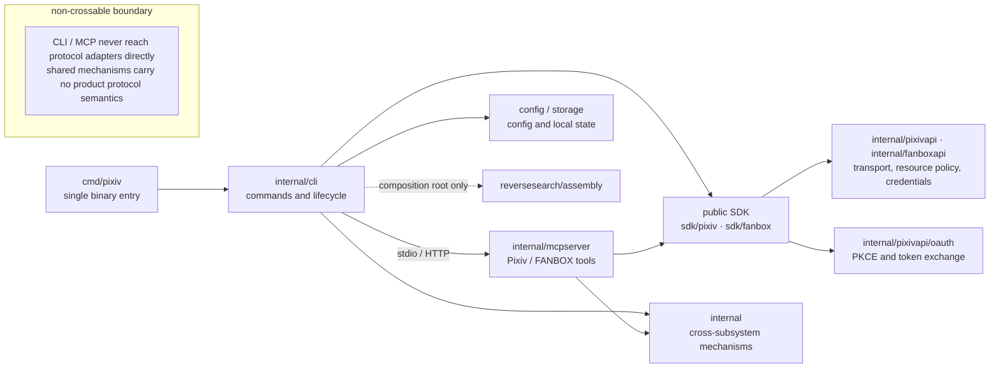
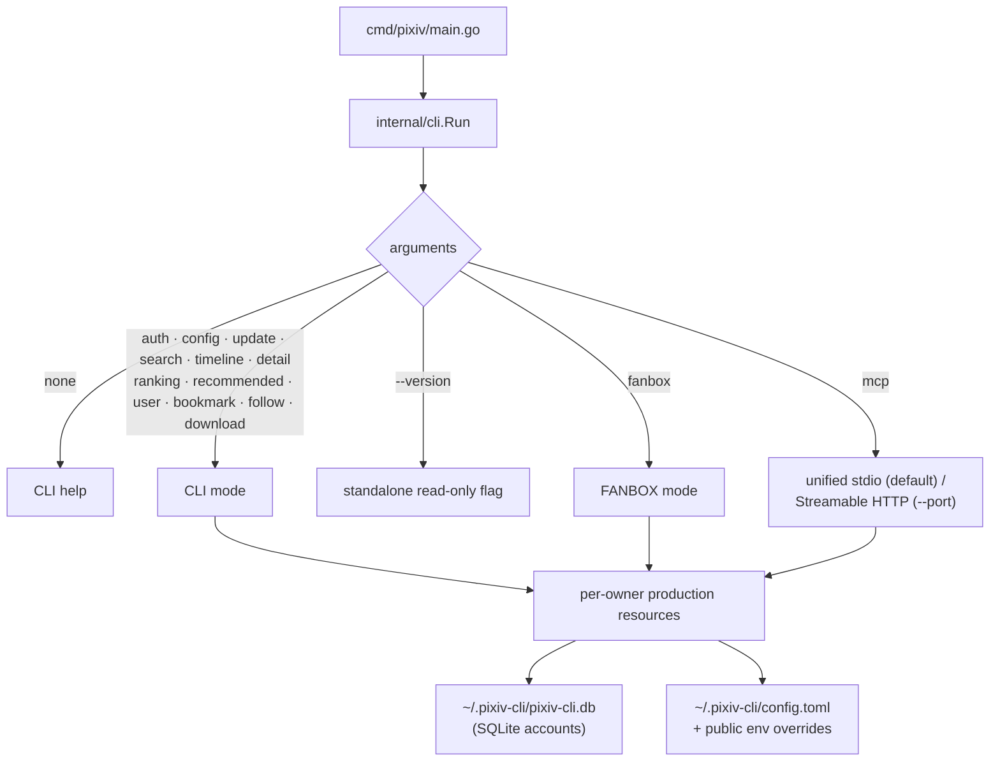
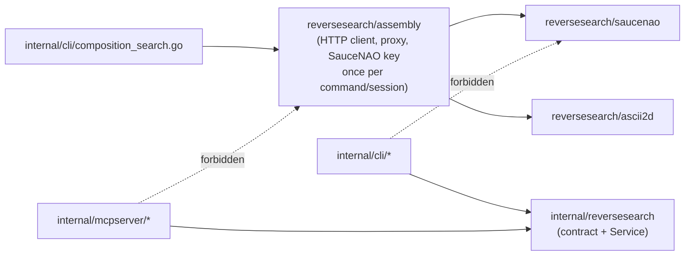
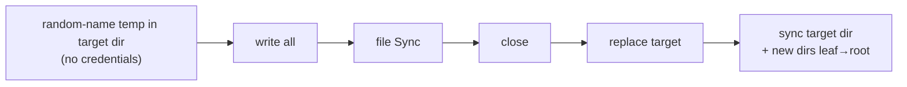
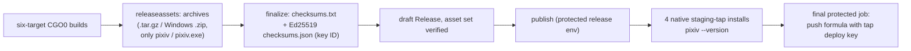

# Architecture

English | [简体中文](../../zh-CN/maintainers/architecture.md) | [Documentation index](../../index.md)

> [!IMPORTANT]
> CLI and MCP reach business capability only through the public SDK and owner-local narrow ports. Production assembly may depend on concrete implementations but must not expose a locator, runtime graph or protocol adapter to the command layer.

| Reader / concern | Go to |
| --- | --- |
| Entry-to-SDK call chain | [Overall flow](#overall-flow) |
| Page sources and embedding | [Frontend source and embedded pages](#frontend-source-and-embedded-pages) |
| What a package may or may not do | [Package responsibilities](#package-responsibilities) |
| MCP server, OAuth, media proxy, Gallery jobs | [MCP server architecture](architecture-mcp.md) |
| Release trust root and signing | [Release assets and trust boundary](#release-assets-and-trust-boundary) |
| Local state, config, path permissions | [internal/config/paths](#internalconfigpaths), [internal/storage](#internalstorageatomicfilefilelocksecretfile) |
| Hard constraint list | [Known constraints](#known-constraints) |

## Overall flow

- `auth import` handles direct token import or bundle restore; `auth export` the local secret snapshot. `pixiv fanbox mcp` is removed.
- Windows paths use `%USERPROFILE%\.pixiv-cli\`. Legacy `auth.json` is never read automatically — users explicitly export/import a bundle.
- No anonymous Web fallback: content needs an authenticated local account or explicit credentials. A leftover `web_fallback_enabled` is an undeclared key and is ignored.

## Frontend source and embedded pages

| Source dir | Owns | Embedding |
| --- | --- | --- |
| `frontend/mcp-apps/gallery/` | Gallery HTML/CSS/JS | CSS/JS inlined |
| `frontend/pages/login/` | login/callback/result templates and styles | kept separate, byte-preserved |
| `frontend/pages/oauth/` | consent HTML/CSS | CSS inlined |

The resource-only `frontend` package embeds exact paths (fixtures excluded) and assembles pages once at startup with the standard library; page behavior is checked manually in the relevant browser/MCP host. Go owners keep MCP registration, template rendering/data/escaping, CSP/media origin, canonical actions, CSRF and authorization. Current and historical resource URIs stay supported. No generation for clean builds or versioned `go install`; runtime reads only embedded bytes. Homebrew templates keep their owner.

## Package responsibilities

### `cmd/pixiv`

`main` package for the `pixiv` binary; no business logic, only `internal/cli.Run` and the exit code.

### `internal/cli`

CLI composition root. The `internal/cli` package keeps command-tree assembly and production dependency construction separate:

| File | Owns |
| --- | --- |
| `root.go` | Cobra command tree, global flags, and requirement-driven startup hooks |
| `execution.go` | execution entry points, exit codes, and resource closing (private `closeState`, idempotent reverse-order close) |
| `composition.go` | command constructors and Pixiv/FANBOX account, SDK, download, and update dependencies |
| `composition_options.go` | translation from runtime settings to SDK and network options |
| `composition_mcp.go` | MCP ports, login services, and stdio/HTTP runtime startup |
| `composition_search.go` | reverse-search ports; the only file importing `internal/reversesearch/assembly` |

Responsibilities: Cobra tree/help/flags; text/JSON output; `auth import` input adapter (positional = opaque token; no arg: TTY hidden input, non-TTY first non-whitespace byte picks token vs strict bundle; restore via pipe/redirect, no `--file`); `auth export` secret-output adapter (no `--output`: raw token + newline, or `--all` bundle; `--output`: private file + secret-free summary); `--page`/`--limit` parsing (logical plan in `internal/pagination`); loopback OAuth, browser, TTY for `auth login`; `pixiv mcp` dispatch; root `--version` and `pixiv update` (removed `version` subcommand → unknown-command during parsing); read-only automatic update notice on stderr.

- **Closing:** callers stop producers and finish registration before close; the mutex protects the list, not late registrations; closers must not register into or recursively close the same scope. Close follows command completion; MCP stdio waits for in-flight handlers; close errors are joined.
- **Owners:** `internal/cli/streams.go` owns only `Streams`; shared support lives in `internal/cli/internal/{command,input,pixivcmd,fanboxcmd,resolver}`. The composition root wires production dependencies to command owners through explicit factories and narrow ports; registered resources close in reverse. No cross-command locator, bootstrap constructor or `internal/cli/runtime`.
- **Command packages:** root `internal/cli/{config,mcp,update}`; Pixiv `internal/cli/{auth,bookmark,comment,detail,download,follow,mypixiv,ranking,recommended,search,series,timeline,user}`; FANBOX `internal/cli/fanbox/{auth,download,post}`. Shared command support lives in `internal/cli/internal/{command,input,pixivcmd,fanboxcmd,resolver}`. Pixiv data commands use `*pixiv.Client` through `pixivcmd.Executor` and `Runner`; FANBOX commands use `*fanbox.Client` through a lazy session factory and `fanboxcmd.UseClient`. `command.Env` provides common input/output support.
- **Shared helpers:** stdin codec `internal/cli/internal/input`; record projection `internal/record`; target resolver `internal/cli/internal/resolver` (consumes only the command contract, records and offline `sdk/pixiv.ParseURL`; owners inject any bare-ID probe; owns no clients, credentials or adapters). These never import the `internal/cli` root.
- **`--version` / auto-update:** stdout exactly `pixiv <version>`, empty stderr, no update check. Auto-update runs only after a successful normal command, skipped for MCP, help, `--version`, `update`, all `auth export`, bundle `auth import` and dev builds; stable Release, 24 h throttle on the user cache, ≤ 3 s; failures only as stderr warnings — never change the exit code or leak into JSON stdout or MCP JSON-RPC.
- **Windows startup cleanup** of pending updates is a potential mutation: all `auth export` invocations are detected before Cobra parsing and skip it. When changing root bool parsing, manually verify repeated overrides such as `--help=false` preserve the secret-export boundary.

### `internal/cli/auth/loginhelper`

Owns the URL scheme helper, persistent handler manifest, one-shot remote hand-off private state and remote callback client. `internal/cli/auth` installs the on-demand handler through it and keeps OAuth, loopback HTTP, browser, TTY and relay server orchestration.

| Platform | Mechanism |
| --- | --- |
| Darwin | embedded Swift, `Info.plist`, LaunchServices |
| Windows | current-user registry/class launch |
| Desktop Linux | XDG desktop entry + `gio` |
| Headless Linux | no handler; relay server still works |

Only exact `pixiv://account/login` and `pixiv://account/remote-login` enter the current round; the active loopback wins; remote callbacks go only to the active one-shot hand-off; other URLs go to the handler persisted in the manifest. Desktop state stores only the current hand-off's relay origin, session ID and capability; the server stores no device record; the SDK exposes none of it. The remote callback accepts only a one-shot result URL on the same relay base; `internal/cli` opens the non-sensitive final page and waits for exchange.

### Cross-cutting concerns

One owner per concern; no other layer implements it again.

1. A concern has one owning layer and one way of being passed in.
2. A business object may hold infrastructure, but only as one already-encapsulated dependency (a transport, a repository), never as its parts (`http.Client`, `selfHTTP`, `sync.Mutex`, cache maps).
3. Request-scoped information (cancellation, call correlation, logging) travels in `context.Context`, not in a field.
4. An injection point that exists only for tests stays out of the exported API. A same-package test may set an unexported field.

| Concern | Owner | Passed in as | Shape in a business object |
| --- | --- | --- | --- |
| Logging, diagnostics | `pixivapi`, `fanboxapi` for requests and internal decisions; the execution boundary for the final result | SDK: `Options.Logger` at construction; internal: `context.Context` | no field |
| Cancellation, deadlines, call correlation | execution boundary | `context.Context` | method parameter |
| HTTP client, proxy, retry, Retry-After, request interval | `internal/pixivapi`, `internal/fanboxapi` | once at construction | one transport field |
| Signed-URL cache, resource host allowlist | `pixivapi` resource transport | same | no field |
| Resource release (`Close`, `CloseIdleConnections`) | creator; `lifecycle` provides `Lease` | returned close function or `Lease` | no extra field |
| Database connection, file lock, transaction | `internal/storage/database` | `withLock` inside methods | repository interface only |
| Credential rotation persistence | `session` | `session.Use` callback | SDK callers do not handle credentials |
| Configuration | composition root, read once | named field value at construction | value field, no `settings.Store` |
| stdout output (text, JSON, NDJSON) | CLI command layer | the command holds the writer | business code returns data |

Infrastructure packages themselves — `pixivapi`, `fanboxapi`, `storage/*`, `media/downloader`, `mcpserver/pixiv/mediaproxy` — are not business objects. They own concurrency, caching, files, and network by design; the rule requires only a narrow interface and no leaked internals.

### Logging entry points

| Location | Owns |
| --- | --- |
| `internal/logging/` | slog handlers, context call information, and shared attribute keys; internal recovery points obtain the logger through `logging.From(ctx)` |
| `internal/cli/execution.go` | creates the configured stderr logger, binds the command path, and logs terminal failure |
| `internal/cli/composition_options.go`, `composition_mcp.go` | passes the same logger to both SDKs' `Options.Logger` and MCP ports |
| `internal/mcpserver/toolrun/toolrun.go` | shared `Scope` / `AddTool` wrappers bind tool name and call ID; an error or `isError` result produces one controlled failure summary |
| `internal/pixivapi/` (including `oauth/`), `internal/fanboxapi/` | holds the constructor-supplied logger and records outcomes at the actual request/decision point |

SDK business methods only register `sdk_operation` in context through `logging.WithOperation`; business `Client` types hold no logger. `operation` names the CLI command path or MCP tool, and `call_id` distinguishes concurrent tool calls. CLI/MCP logs go to stderr, keeping data stdout and JSON-RPC clean; a nil public SDK logger stays silent.

### Shared mechanisms

| Package | Owns | Must not |
| --- | --- | --- |
| `internal/version` | linker-injected `Version` (default `dev`; only `dev` builds reject self-update) | — |
| `internal/record` | stable Pixiv record projection for CLI/MCP: keeps unknown SDK model fields, fixes `id`/`type`/`url`, JSON normalization, version-metadata cleanup, record-field local filtering | depend on CLI, MCP or adapters; become a dumping ground (MCP schemas and output envelopes stay in `internal/mcpserver/pixiv/internal/{records,outputs}`) |
| `internal/searchfilter` | artwork-local rating/content-type normalization, client-side `x_restrict` and kind matching, cursor context hiding raw values | map rating to an unconfirmed upstream `x_restrict` param; hold clients, credentials or adapters (field availability and confirmed wire params stay with each command) |
| `internal/lifecycle` | protocol-agnostic lifecycle, Lease, Attempt | own account selection, credentials or replay strategy |
| `internal/pagination` | logical pagination for one stream and ordered aggregates: filters before the global skip/limit budget, `OneBatch` stops at the first matching batch, truncation resumed via source-position checkpoint; `StreamState` = current stream + per-stream cursors (owners encode it with query/account/subtype bindings) | product semantics |
| `internal/pagination` | reentrant execute lifecycle for single/aggregate reads, clearing uncommitted results before safe replay | own command filter wiring |
| `internal/logging` | `log/slog` handler plus context call information; CLI, MCP, transports, pool, download and FlareSolverr share attribute keys and emit only operation, method, host, path, status, duration, attempt, wait, reason and count; SDK accepts one `Options.Logger`; nil keeps the SDK silent | create log files or record bodies, Cookies, tokens, queries, signed URLs or arbitrary error cause dumps |

**Pooled reads:** `pixivcmd.Read[T]` reads within the `Runner`'s `Executor` callback and returns data only after the whole execution boundary succeeds; failure returns zero T. `Runner.Write` marks the attempt committed as soon as the mutation callback starts, even on error, preventing cross-account replay of an uncertain write. Command owners keep streaming NDJSON, pagination, and partial delivery; `pagination` and `lifecycle` own shared traversal and replay mechanisms.

### Business sessions, accounts and pool

- `internal/session` owns both account-bound SDK sessions: `session.Pixiv` aggregates `pixivaccount` (local accounts, login completion, default, credential identity/rotation, management) and `pixivaccount/pool` (selection, freezing, Gate, safe replay, error semantics); `session.Fanbox` aggregates `fanboxaccount` and client lifecycle. The two live in `pixiv.go` and `fanbox.go` of one package; FANBOX sessions share no type or lifecycle with Pixiv refresh tokens and have no pool strategy.
- Sessions depend only on leaf-module Ports, the config snapshot, protocol-agnostic shared modules and the public SDK — not on `internal/storage/database` concretely; the SDK never imports them. No CLI/MCP filters, records, schemas or output adaptation inside sessions.
- An explicit nonzero `Request.UserID` pins reads and writes to that account even with the pool on; open/business errors never switch accounts; requests without a UID keep pool scheduling; the CLI default is unchanged.
- Config schema, `config.toml` path/get/set/unset, baseline and the immutable per-execution `Snapshot` live in `internal/config/settings`; month truncation in `internal/searchfilter`. CLI/MCP use the sessions via owner-local Seams and MCP runtime `SDKPorts`. `internal/account` is deleted with no aliases.

**Login relay** — `internal/loginrelay` owns both the pure renderer, which consumes `frontend` templates/CSS without a CLI, store, browser or listener dependency, and the reusable HTTP handler/session: accepts the OAuth session validator and delivers one callback; never listens, exchanges or persists. CLI keeps listener/TLS/terminal. A host mux may mount it with its prefix stripped; production MCP mounts it at canonical base + `/pixiv-login/`, behind the same Host/Origin checks but authenticated by hand-off proof, not MCP bearer. Escaped prefixes are preserved in URLs and dispatch. A cancelled relay session returns HTTP 410 and rechecks cancellation before accepting a validated callback. The callback allowlist, start-response wire type and result URL header live in `loginrelay` and are reused by the CLI relay and desktop helper.

**MCP login relay** (`accounts.Login`) — single current login: repeated starts reuse pending work, restart cancels and joins, shutdown joins exchange/persistence. Completion keeps non-secret account-saved/selection-updated flags (incl. partial failure). The composition root binds it to the same SDK login session, saves credentials without touching the CLI default, then writes MCP selection. The account service is reused across restarts; each completed SDK login releases its idle HTTP connections (explicit proxy/direct: the root closes its client's idle connections on every exit).

### `internal/pixivapi`, `internal/fanboxapi`

Upstream protocol implementations live under module-level `internal/`; CLI/MCP content operations reach them through the public SDK. The SDK owns endpoint requests, response validation, and mapping; protocol packages own transport and resource policy.

| Location | Owns |
| --- | --- |
| `internal/pixivapi/pixivapi.go`, `transport.go` | App requests, auth headers, status handling, and pacing; idempotent reads retry once only on the first 429 with a valid `Retry-After`; mutations are not replayed |
| `internal/pixivapi/api.go`, `profile.go`, `failure.go`, `required.go` | route/parameter/header constants, request profile, redacted failures, and required-field decoding |
| `internal/pixivapi/resource.go` | signed-URL cache, media host allowlist, resource reads, and redirect validation |
| `internal/pixivapi/oauth/` | PKCE, authorization-code exchange, refresh-token rotation, and token state |
| `internal/fanboxapi/` | FANBOX session Cookie, native transport, identity cache, Cloudflare challenge/solver, media locator cache, and URL policy |
| `sdk/pixiv/` | endpoint behavior in `artwork.go`, `artwork_search.go`, `novel.go`, `user.go`, `bookmark.go`, `comment.go`, and `mutation.go`; cursor binding in `cursor.go`; public models in `models.go`; response shapes in `artwork_wire.go` and `response.go` |
| `sdk/fanbox/` | routes, requests, response validation, and mapping in `creator.go` and `post.go`; pagination in `pagination.go`; public resource operations in `resource.go` |

Each product SDK `Client` holds one protocol client. `RequiredList` / `RequiredObject` share field-presence decoding: `null` means Present true, Valid false; a missing field does not invoke the decoder. Callers handle decoding errors, check Valid, and reset reused outer response structs; domain code still checks response completeness.

### Reverse-search service exception

The only product capability crossing the normal SDK boundary.

Only the `internal/cli` composition root in `composition_search.go` imports `internal/reversesearch/assembly`. CLI command owners and MCP owners may use the top-level `internal/reversesearch` contract; they must not import `assembly` or provider packages such as `saucenao` and `ascii2d`.

- The Service returns domain results; CLI/MCP adapters project canonical records at their output boundary.
- It loads a regular file or HTTP(S) source into one private snapshot, hashes it and removes it afterwards. Deliberate source policy permits any readable regular file and private, loopback or link-local URLs; under single-owner OAuth authorize only trusted connectors — paths are the MCP server's filesystem and URLs use the server network. Only source kind/hash, safe provider summaries/errors, domain evidence and canonical `artwork`/`user` records are publishable.
- Three network surfaces: standard source/SauceNAO client, dedicated ascii2d browser client, FlareSolverr JSON control client. The service proxy may override only ascii2d; a command-level override applies to both native clients; the standard client otherwise follows the global route. The ascii2d UA pairs with the `Chrome_146` TLS profile and matching Chromium hints (omitted for non-Chromium UAs). FlareSolverr's upstream proxy is used only by browser `sessions.create`; control traffic stays independent; the image always uses native ascii2d multipart. Solver state is process/client-scoped, not persisted.

### `internal/storage/database`

- SQLite authority for local account state: schema, migration ledger and repository for `pixiv-cli.db`; identity/credentials keyed by `user_id`; Pixiv rotation and FANBOX session replacement use `credential_revision` compare-and-swap.
- Forward-only migrations through schema v3; legacy v1 databases upgrade with v2/v3 changes; final columns already present in this tree's initial schema are recognized without replaying DDL. Legacy `auth.json` and `account_pool.accounts` are not in the startup migration path.
- Private DB/journal permissions (Unix `0700`/`0600`). Auth export reads only the default, an exact UID or all accounts — no environment tokens, refresh, network or mutation.
- **Lock:** owners coordinate initialization, short account/pool transactions and complete snapshot reads through the private `pixiv-cli.db.lock` sidecar (no credentials, no account data change; never covers OAuth or content requests; external SQL writers and older processes don't participate). Non-cancellable contexts keep native waiting; cancellable ones poll the same non-blocking lock every 10 ms and wake immediately on cancellation, closing the handle. No overall deadline or transaction replay. The account owner cancels its lifecycle before taking the session mutex so lock waits during watcher validation don't block shutdown.
- Migration from old CLIs: old version `pixiv auth export --all --output <private bundle>`, new version `pixiv auth import < bundle.json`; failures return the reason; the old file is not auto-deleted.

### `internal/config/settings`

| Store | Holds |
| --- | --- |
| `pixiv-cli.db` | account identity and credentials (`pixiv_account` / `fanbox_account`), file `0600` |
| `config.toml` | global keys incl. `[pixiv.auth].default_user_id`, `[fanbox.auth].default_user_id`; Unix `0600`. Without a default, the first account by `sort_order` is selected |

Runtime settings parse `config.toml` with `go-toml/v2` and capture public environment variables once per snapshot; `config set/unset` writes back sparsely with `tomledit`, preserving comments, order and layout where possible. The compact first-run baseline writes only `example:"true"` entries.

#### Configuration declaration: struct field tags are the single source of truth

Exported fields of `RuntimeConfig` (incl. nested account-pool, network and FlareSolverr groups) declare all static facts; binding, CLI metadata and baseline generation reuse that one declaration.

| Tag | Meaning |
|---|---|
| `config` | TOML path relative to its containing group; `"-"` excludes the field and its entire subtree |
| `alias` | The public name used by `config get/set/unset`; omitted on groups and private advanced leaves |
| `env` | Environment variables that may be read, in declaration order (that order is the precedence; presence counts as a hit and an empty value does not fall through) |
| `default` | Value used when absent, interpreted by field type (distinguished by tag **presence**, not by whether the string is empty) |
| `example` | Whether the entry enters the first-run compact config; only `"true"` does, and it requires a `default` |
| `cli` | Whether `config get/set/unset` manages it |
| `secret` | Whether it must be hidden from public output and kept out of the example config (a `secret:"true"` + `example:"true"` pair is a schema error) |

- Groups declare only a `config` prefix; leaves declare relative paths; one group type can be reused under different prefixes. `OptionalString` is a leaf. Optional pointer groups are inspected as types without allocation.
- Declaration errors: duplicate expanded paths, duplicate non-empty aliases, empty path segments, cyclic groups, unsupported leaf types, leaf-only attributes on groups. Private leaves cannot enable CLI management, examples or env bindings without a public alias. `cli`, `secret`, `example` accept only `"true"`/`"false"` (user value parsing unchanged).
- The private schema caches field index chains and Go types, never instances. Scalar binding uses the same source selection as `Effective`; ordinary binding allocates no pointer groups. Advanced readers locate compiled paths by field ownership without new aliases or allocating solver groups before the domain enablement check. Account-pool defaults come from declarations; strict file types and strategy validation stay domain rules.
- Default-account selection has a separate private scope: `int64` UID leaves with no alias or default; positive-integer parsing stays in on-demand auth methods; never part of ordinary binding or early Snapshot validation.
- `SettingSpec` is the **public derived view** the CLI consumes, not a hand-written table. `keys.go` declares the typed `Key` constants for every alias; keep them aligned when changing declarations. `LogLevel` and `LogFormat` are named types with constants.
- **Adding an ordinary setting** = field + tags + a `Key` constant, matching docs; use the existing precedence/empty-value test when it covers a gap under the [test submission rules](coding-standards.md#test-submission-rules). No registry, env `switch`, per-field assignment, baseline list or alias list.

| File | Responsibility |
| --- | --- |
| `config.go` | types, field tags, field contracts |
| `keys.go` | typed `Key` constants for the public aliases |
| `schema.go` | tag-derived metadata, declaration validation, lookup, public `SettingSpec` view |
| `snapshot.go` | file/env snapshot, source selection, runtime binding (service networks, FlareSolverr, pool domain rules) |
| `values.go` | type parsing, normalization, domain validation |
| `document.go` | TOML targeting and sparse mutation |
| `defaults.go` | baseline document generation |
| `store.go` | `Store` operations (path, read, sparse write-back) |
| `auth.go` | default-account read/write (deliberately **not** ordinary binding) |
| `paths.go` | `FileStore` port and default file adapter |

**Atomic writes** (`FileStore`, injected from `internal/storage/{atomicfile,filelock,secretfile}`):

- Unix tightens parent/file to `0700`/`0600`. If this call created directories, after commit the target directory and each new directory's parent are synced leaf→root so both file and directory entries are durable; existing directories sync only the target dir.
- Failures: before replacement (write/Sync/close) the old target stays; normal replacement and recoverable partial failures keep/restore the old target and clean the temp. A failed directory sync still tries the rest and merges errors — the replacement is committed, so the old file may be gone. If recovery after partial completion fails, the caller gets a combined error, the target may be temporarily missing, and both the same-dir recovery backup and the new-content temp are kept for manual recovery ("no temp residual" does not apply). Other temp-cleanup failures are returned with the main error.
- Windows: Sync and close before replacement; existing target → `ReplaceFileW` with a same-dir unique backup; first creation → `MoveFileEx` without overwrite. `ERROR_UNABLE_TO_MOVE_REPLACEMENT` keeps target/source names; `ERROR_UNABLE_TO_MOVE_REPLACEMENT_2` tries to restore the moved-to-backup target, else keeps backup/source. Backup cleanup failure after success is a committed error. New files inherit the parent ACL, replacements keep the target ACL; no ACL tightening or POSIX-mode/directory-fsync equivalence is claimed.

`update_check_enabled` = `[update] check_enabled` (default `true`), only for the automatic check, never user-run `pixiv update`. `log_level` / `log_format` = `[logging].level` / `.format`; `info`/`text` default, `debug` adds request and decision records and `json` selects JSON records; env values override per invocation.

### `internal/browsercookies`

Read-only browser cookie provider; not public SDK; no FANBOX, Pixiv, CLI, MCP or account-store dependency.

| Part | Role |
| --- | --- |
| root (core) | protocol-neutral; fixed `CookieQuery`; discovers browser dirs by security profile ID; returns a redacted `Secret`; imports no provider (importing root alone registers nothing) |
| `chromium` | explicit Chrome/Edge providers; Local State/Cookies from the platform profile root; v10/v11 GCM + legacy CBC |
| `firefox` | parses `profiles.ini` |
| `safari` | `Cookies.binarycookies`, macOS only |
| `system` | imports and registers all providers so root `New` dispatches to every browser |
| `secret` | macOS Keychain, Windows current-user DPAPI, Linux Secret Service via `secret-tool` with fixed attributes |

Unknown Chromium derivatives are not fuzzily matched; multiple profiles without a selection fail explicitly. Missing tools, permissions, locks, schema drift and decryption errors map to stable errors; no cookie, key, absolute path or command output reaches logs, errors, JSON or MCP. Native evidence per platform must be collected on the host per the release-prep runbook; offline fixtures and cross-compilation prove only code/format contracts.

### `internal/selfupdate`

Thin root (coordinator + auto-check API), re-exporting `internal/selfupdate/{source,release,installer,process}` to the CLI composition root.

| Install source | Update behavior |
| --- | --- |
| Homebrew | stable/beta from the executable symlink and keg `INSTALL_RECEIPT.json`; switching uninstalls the conflicting formula first and explicitly tries to restore the original on failure |
| `go install` | must match Go build info **and** the actual `GOBIN`/`GOPATH/bin` executable; installs the exact selected tag |
| Release binary | select platform archive → verify Ed25519 `checksums.json` → verify SHA-256 → exact `pixiv --version` preflight → same-dir atomic replace |

- GitHub Releases API is the only query backend; drafts excluded; stable excludes prereleases before verification; ETag/cache for throttling with atomic persistence. Canonical SemVer is enforced on the channel's published Releases — one invalid tag fails closed and is reported (never skipped for an older version).
- Signature, checksum, HTTP, archive, replacement and permission errors are never disguised as "no update". Release-install failure semantics are a protective boundary, not a temporary degradation.
- **Trust root** (`internal/selfupdate/installer`): key ID and public key constants live in `release_installer.go`; `internal/cli/update/production.go` builds the key ID → key map for the installer so callers can't pollute it; `composition.go` calls the production update constructors directly. The offline installer test verifies that a signed download with a bad archive checksum preserves the existing binary; the private key is not in source or config; read-only checks don't need it; this wiring does not replace per-version release acceptance. `internal/bootstrap` was deleted in v1.

### `scripts/`

| Location | Holds |
| --- | --- |
| `scripts/build/`, `scripts/ci/`, `scripts/release/`, `scripts/pr/` | build/package scripts and platform registry, required CI scripts, the release tool, and the trusted PR tool; each Go tool is one `package main` with tests beside it |
| `scripts/citest/` | tests that execute real installers, change-scope classification, verification prefiltering, workflow action pins, and the container release contract |
| `scripts/build/platforms.json` → `scripts/build/matrix.sh` | runner/capability metadata for workflows; workflow tests validate behavior/security, not a second YAML policy model |

### `sdk`, `sdk/pixiv`, `sdk/fanbox`

The only external contract surface.

| Package | Exports |
| --- | --- |
| `sdk` | `Page[T]`, `Cursor` (Text/JSON codec), `Error` (sentinel, context chain, redaction), `ResourceRef`/`Resource`, resource request/response/save types |
| `sdk/pixiv` | App-only: `Open/OpenWith/New/NewWith`, OAuth `LoginSession`, rotation, artwork/novel/user/comment/stamp models, opaque cursor, `ParseURL`, comment mutations, stamp reads, resource reads; no Web path |
| `sdk/fanbox` | `Client.ValidateSession`, creator/tag/post/home/supporting, two pagination kinds, resource reads; reads no browser, DB or Pixiv credentials; never imports `sdk/pixiv` |

- FANBOX transport: Chrome 146 TLS profile + Firefox 148 UA baseline; only explicit HTTP client, proxy, UA and optional FlareSolverr at construction. `FANBOXSESSID` travels only in validated requests to `api.fanbox.cc` and `downloads.fanbox.cc` — never third-party CDNs, Pixiv hosts or solver control. Solver control connects directly; its upstream proxy is solver config only (no native/env inheritance); non-challenge API/resource errors never enter the solver.
- The legacy top-level `pixiv/` facade was deleted in v1 (`pixiv` remains an import alias for `sdk/pixiv`). Auth backup (`AuthExportSelection` / bundle codec) uses the same local snapshot boundary; the bundle is an unencrypted point-in-time secret backup that rotation can make stale.
- Callers own source mode, budget, filter, cursor persistence and HTTP presentation. No HTTP Provider, Discover, Probe, Capabilities, RSS or crawler is provided.

### `internal/mcpserver`

See [MCP server architecture](architecture-mcp.md). Each product's tools live in one `tools` package: `register.go` holds the single `Register` and the original port-gated registration order, and each domain file (`accounts.go`, `media.go`, `bookmarks.go`, …) keeps its tools' schemas, annotations and `<tool>Handler` methods on the product tool set. Shared ports stay in the product's `internal/toolhost`.

### `internal/media/downloader`

The CLI download owner. Takes the SDK execution snapshot via `DownloadTargetClient` / `DownloadClient` and centrally owns source expansion, ID dedup, page/quality validation, acquisition and publication, progress events and Ugoira format selection (adapters must not duplicate them). `ResourceRef` is resolved only by the product client; the SDK keeps only atomic resolve/save, no batch workflows.

| Case | Result |
| --- | --- |
| `Download` | synchronous; returns each work's actual artifact path |
| single page | saved to the download directory |
| multi-page, Ugoira | per-work subdirectory |
| extensions | from the upstream URL path, normalized like template filenames; Pixiv thumbnails use an explicit Content-Type to fix ambiguous suffixes; unknown types keep the URL extension |
| Ugoira | SDK-verified `download_url` ZIP → Go encoder GIF/APNG, or SDK publishes ZIP/frames as-is; App medium may be selected but is never labeled original |

Default path constructs `ugoira.NewEncoder()` — no backend selector or external fallback; `CGO_ENABLED=0`. Rust sources, native libraries and the FFI/staticlib adapter are removed (history in Git).

### `internal/media/ugoira`

Owns `Format`, ordered frame input, `Encoder`, ZIP validation/decoding, resizing, GIF quantization/dithering, APNG streaming and atomic publication. The downloader consumes `Encoder` and must not duplicate encoding or publication. PNG uses the standard library; owner-local `jpeg` keeps legacy IDCT/color rounding. Six-target execution evidence comes from the platform smoke workers, separate from the runtime encoder.

## Release assets and trust boundary

- The project `LICENSE` stays in the repo. Windows Git Bash without `zip` uses the preinstalled `7z`; both produce the same members; a missing archiver fails.
- `release.yml` runs signing/publishing in the protected `release` Environment, least privilege, full-SHA Actions. The publish job hands the verified `release/checksums.txt` to the renderer; stable/prerelease generate unique `pixiv-cli` / `pixiv-cli-beta` formulas. Four native macOS/Linux runners install from an isolated local staging tap (tap-qualified name, verify `pixiv --version`), never using or writing the public tap; Homebrew 6 trust goes only into the runner's temporary staging trust store.
- Only the final protected job reads the independent tap deploy key and pushes only its formula. Tap credential and release key are different trust domains; the tap key enters only that final push step and cannot replace the Ed25519 trust root (`internal/selfupdate/installer/release_installer.go`). The formula template uses only macOS/Linux assets from the verified six-target checksums; stable and beta conflict, both install `pixiv`.
- Draft URLs aren't installable, so the Release is made public before the four-architecture gate; on failure the public Release is kept for handling and no formula is written. v0.3.0 was the first tag through this path; every tag must pass the same gate.
- No Apple notarization or Windows Authenticode: Gatekeeper/SmartScreen prompts must be resolved against the verified Release, checksum and signing record, never silently bypassed.

Detailed gates: [Release](release.md).

### `internal/config/paths`

Sole owner of app-managed paths, `AppDataDirName` and Unix private dir/file permission constants; reads no business config, writes no files. No generic constants package: Pixiv protocol values, MCP delivery values and config keys/defaults stay in their domains. `internal/logging` owns the slog handler, context call information and shared attribute keys configured by `[logging]` — not a persistent log. MCP JSON-RPC uses clean stdio or authenticated HTTP; errors still flow through CLI, MCP or SDK interfaces.

### `internal/storage/{atomicfile,filelock,secretfile}`

Three leaves: atomic write/replace, file lock, secret file writer. Depend only on `config/paths` conventions; no config schema, account state or Pixiv semantics.

### Test and helper owners

Protocol-free helpers live with their callers: positive-integer parsing in `internal/cli/internal/input`, string safety in `internal/plaintext`, URL path/file-URI helpers in `internal/media/downloader`, and month truncation in `internal/searchfilter`.

| Moved responsibility | Owner |
| --- | --- |
| filename cleaning, template expansion | `internal/media/filename` |
| ID dedup, media MIME types | `internal/media/downloader` |
| refresh-token validation | `internal/pixivapi/oauth` |
| paths, permissions | `internal/config/paths` |
| atomic write and replace | `internal/storage/atomicfile` |
| file lock | `internal/storage/filelock` |
| secret export writer | `internal/storage/secretfile` |

## Known constraints

> [!WARNING]
> Non-negotiable. Any new timeout, truncation, count limit, retry cap, silent fallback or hidden degradation needs evidence, a comment, a test or documentation — otherwise it is a violation.

- `internal/pixivapi`, its `oauth` subpackage, and resource transport use the caller/SDK HTTP client; the default client is per SDK client with no fixed whole-request timeout; cancellation/deadline flow through context; explicit clients keep the caller's policy.
- `pixiv mcp` defaults to stdio; explicit `--port` enables HTTP and needs initialized owner state; `pixiv` alone shows help. Configure HTTP with `--port`, `--host`, `--base-url`, not removed address settings ([startup](../cli-reference.md#mcp-http-server)).
- No persistent account import/export MCP tool; session-scoped MCP auth tools and wire contracts unchanged.
- Credentials sit unencrypted (BLOB) in SQLite `pixiv-cli.db`; Unix DB/journal `0600`. Anyone with the user's file access can read them; automatic backups are prohibited.
- `config.toml` is written sparsely; defaults are never persisted wholesale.
