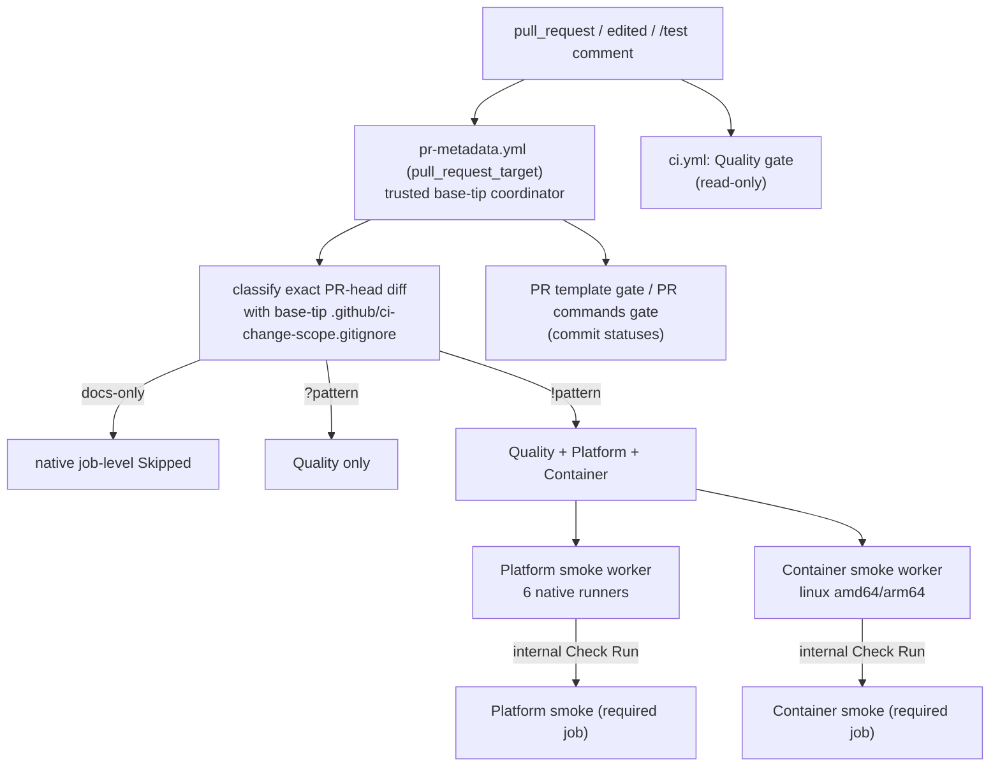

# CI gates

English | [简体中文](../../zh-CN/maintainers/ci.md) | [Development](development.md)

Which workflows run on a PR, how they decide what is required, and how results are trusted. Workflow YAML, `ci/platforms.json` and tool manifests remain the executable source of truth.

## Triggers

| Event | Runs |
| --- | --- |
| `pull_request`, `workflow_dispatch` | `ci.yml` Quality gate (no longer on tag pushes) |
| `pull_request.edited` | Quality too, so retargeting to `main` publishes its required result; title/body edits reclassify and run required Quality |
| `pull_request_target` | `pr-metadata.yml` coordinator |
| `/test` comment | `pr-verification.yml` `dispatch` pre-filters with `contains(github.event.comment.body, '/test')` before allocating a runner — a loose superset of `tools/prmeta --check-trigger` (few false positives, never drops a real trigger); `tools/prmeta` stays authoritative |
| branch / `main` push | nothing |
| stable `vX.Y.Z` tag | only `release.yml` (owns all tag gates, six-platform tests/builds and two-platform container verification; PR smoke matrices are not duplicated) |
| manual | browser/native evidence workflows |

Real Pixiv/FANBOX SDK E2E never enters PR CI; the offline `go test ./...` in validate covers the same packages, and real E2E is accepted separately on release-prep.

## Change-scope classification

- `ci.yml` and `pr-metadata.yml` share one trust model: resolve the protected base branch's current tip, check out `scripts/classify-change-scope.sh` and `.github/ci-change-scope.gitignore` from it, then fetch the exact PR HEAD only for the diff range — a PR cannot change its own skip decision. Classifier failure fails closed.
- Plain patterns are documentation-only; `?pattern` requires Quality only; `!pattern` requires Quality + Platform + Container. `pr-metadata.yml` itself (the smoke controller: classification, both dispatches, required gates) must be `!pattern`.
- Unneeded jobs are native job-level `Skipped`, never synthetic success. The Quality job keeps its literal required name even for docs-only skips (skipped dynamic job names aren't evaluated by GitHub).
- Body-only metadata edits reclassify the unchanged head: required smoke jobs mirror the existing worker result, unneeded ones stay skipped — editing the body cannot replace a failed smoke with a bypassing skip.

## Coordinator (`pr-metadata.yml`)

- From the base tip: validates the PR template and verification declaration, classifies, publishes `PR template gate` / `PR commands gate` statuses, dispatches required smoke workers, and exposes `Platform smoke` / `Container smoke` as real job-level required checks — without executing PR code in coordinator jobs.
- Uses `pull-requests: write` for PR comments only (no ordinary issue write). Failed reads of the PR or policy-state comments and failed comment create/update/delete keep the original GitHub API error and name the failed request; metadata failure still blocks the smoke gates. The workflow-shell API fixture runs only on Linux (Ubuntu tools); the permission contract is cross-platform.
- Smoke gates query the exact head and worker name with `filter=all`, paginate, and pick the latest `started_at` (ID breaks ties); response order is not assumed. `filter=latest` could hide a worker from another check suite after an update. Missing or failed workers fail the gate.

## Smoke workers

| Worker | Isolation |
| --- | --- |
| Platform | Matrix resolved from the trusted workflow ref; only matrix jobs check out the exact PR head with `contents: read`; a separate publisher never checks out PR code and holds only `checks: write` to complete the internal Check Run. Six native jobs in parallel, incl. Windows root callback wiring and the native `loginhelper` contract; runs the Go encoder package tests |
| Container | Same isolation model for Linux amd64/arm64, jobs in parallel |

Both build with `CGO_ENABLED=0`, keep the trusted ref, exact-head validation and independent result publisher. `Platform smoke worker` / `Container smoke worker` Check Runs are only the trusted result bridge; worker matrices are not required checks; the PR gate mirrors the aggregate outcome and keeps the worker details URL on failure.

## Installer and packaging tests

- `scripts/tests/installers` uses a local fake Release, fake `curl` and checksum fixtures (no GitHub). The Unix job runs `install.sh` for SHA-256, paths with spaces, version preflight and not overwriting on verification failure. Windows amd64/arm64 platform-smoke runs `install.cmd` with real `cmd.exe`, `certutil.exe` and `tar.exe`, always `--no-path` (runner registry untouched). Part of the platform job, no separate workflow-policy implementation.
- Windows `.zip` uses the runner's preinstalled `7z`; elsewhere `zip`. `scripts/test-package-release.sh` delegates fakes to real `7z` on Windows and uses the `zip` fixture elsewhere, checking archive members — a Git Bash missing `zip` fails the release test gate. It creates checked links with MSYS `winsymlinks:nativestrict`; if native links can't be created the test fails, so plain-file pseudo-links can't neuter the output-ancestor safety gate.
