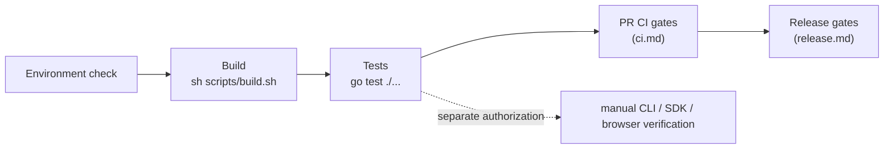
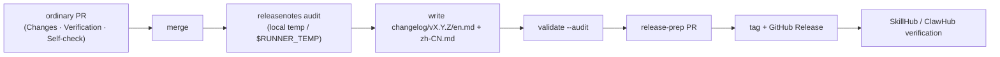

# Development

English | [简体中文](../../zh-CN/maintainers/development.md) | [Documentation index](../../index.md)



| What you want to do | Start here |
| --- | --- |
| Check the local toolchain | [Environment check](#environment-check) |
| Edit or validate pages | [Frontend assets](#frontend-assets) |
| Build or verify ugoira encoding | [Ugoira Go encoder](#ugoira-go-encoder) |
| Run the CLI and MCP | [Run](#run) |
| Handle login and credentials | [Credentials in development](#credentials-in-development) |
| Choose test scope | [Tests](#tests) |
| Understand PR checks | [CI gates](ci.md) |
| Check the release workflow | [Release](release.md) |
| Prepare release notes | [Release notes and publication](#release-notes-and-publication) |

## Environment check

`go.mod` is the single source of truth for the Go toolchain.

```bash
go version
go env GOVERSION CGO_ENABLED GOOS GOARCH
CGO_ENABLED=0 go test ./...
```

## Frontend assets

Sources in `frontend/mcp-apps/gallery/`, `frontend/pages/login/`, `frontend/pages/oauth/` are embedded by the resource-only `frontend` package and assembled once at startup (Gallery CSS/JS and consent CSS inlined; login keeps its templates/styles and `html/template` composition; fixtures not embedded). No npm, framework, disk reads or network at runtime; no generation step for clean builds or versioned `go install`.

```bash
go test ./...
go vet ./...
sh scripts/build.sh
```

- Local/platform/race builds compile the embedded sources directly. Inspect changed Gallery, consent and login behavior manually in the relevant browser/MCP host.
- Frontend changes require Quality, Platform and Container checks. Docker uses prebuilt binaries; Homebrew templates stay in `templates/homebrew/`.
- Source installation and self-update use an exact tag: `go install github.com/FlanChanXwO/pixiv-cli/cmd/pixiv@vX.Y.Z`.

## Ugoira Go encoder

The default downloader builds `ugoira.NewEncoder()` and produces GIF/APNG in Go — no `ffmpeg`, no backend selector, no runtime fallback. PNG frames use Go's standard decoder; JPEG frames the owner-local `internal/media/ugoira/jpeg` decoder.

```bash
sh scripts/build.sh                                   # CGO_ENABLED=0 → build/pixiv(.exe)
CGO_ENABLED=0 go test ./internal/media/ugoira/... -count=1
```

| Rule | Detail |
| --- | --- |
| Per-frame bound | 512 MiB, applied separately to ZIP member source bytes and the pre-decode allocation estimate (inherits the pinned Rust `image` crate's `Limits::default().max_alloc`) |
| Over the bound | declared size → fail before reading; actual expansion → fail during chunked reading; invalid/overflowing dimensions or estimates → error. No truncation or fallback |
| Cancellation | checked before/after each read chunk and image decode; PNG/JPEG decode loops have no callback, so mid-frame cancellation is seen when that decode returns |
| Toolchain | no Rust, native library or C linker; only race tests need `CGO_ENABLED=1` + C toolchain |

**Encoder fidelity notes** — `internal/media/ugoira`: the JPEG decoder is Go 1.26.3 parsing plus the legacy zune-jpeg 0.5.15 integer IDCT and 14-bit BT.601 (standard-library IDCT rounding changed palette selection enough to fail the fixed gate; the parser BSD license stays in the package and the zune-jpeg MIT attribution in `internal/media/ugoira/jpeg/idct.go`). Resize uses bounded sine/cosine polynomials with explicit `math.FMA` against legacy `sinf`; retained native encoder tests own fidelity evidence. APNG uses fixed Sub prediction, an independent level-7 zlib stream per frame and RGBA8 lossless: Over with transparent unchanged pixels only when every changed pixel is opaque and the delta reduces horizontal RGBA runs, else Source, with None disposal. Compressed bytes may change with the toolchain; reuse quality evidence only after verifying complete canvases, timing and loop behavior — not file size alone.

**Platform builds** — `scripts/build/platform.sh` builds an exact target with CGO0 and optionally a canonical archive: `--target GOOS/GOARCH`, `--output-dir DIR`, optional `--version VERSION` (no `v`) and `--package` (needs a version). It keeps Windows suffixes. Runner metadata stays in `scripts/build/platforms.json`; tests, source identity, permissions, approvals and publication stay in workflows.

**Linux compatibility** — release and packaged-smoke binaries are built with `CGO_ENABLED=0`, which produces a static ELF. The Linux runners for release test/production, packaged smoke and the Homebrew install matrix stay pinned to `ubuntu-22.04` / `ubuntu-22.04-arm`; verify with `file build/pixiv` when the build recipe changes.

## Run

```bash
sh scripts/build.sh                     # build/pixiv(.exe); Windows via Git Bash/MSYS2/WSL; cross-builds: go build
pixiv auth login
pixiv search "初音ミク" --json
pixiv download 123456

pixiv auth use 12345678                 # authenticated unified MCP HTTP
./build/pixiv mcp auth init
./build/pixiv mcp --port 1270           # http://127.0.0.1:1270/mcp

https_proxy=http://127.0.0.1:7890 ./build/pixiv mcp --port 1270
./build/pixiv mcp --proxy http://127.0.0.1:7890
./build/pixiv mcp --no-proxy
```

- The owner OAuth grant is separate from Pixiv/FANBOX credentials; keep the one-time owner secret private (never in test output or chat). Cloud connectors need a public HTTPS reverse proxy ([HTTP startup](../cli-reference.md#mcp-http-server)).
- CLI downloads keep their own settings; stdio download tools reuse CLI settings; HTTP never exposes filesystem writes.
- State lives in `~/.pixiv-cli` (`%USERPROFILE%\.pixiv-cli`): `pixiv-cli.db` (Pixiv UID / FANBOX UID keys; embedded migrations through schema v3, legacy v1 upgraded in place, later columns already present recorded without duplicate DDL, unknown newer schemas fail closed), `config.toml`, callback bridge, release-check cache, callback helper. Unix `0700`/`0600`; Windows inherits parent ACL on creation and keeps target ACL on replacement, no DACL changes.

> [!WARNING]
> New versions never read or delete legacy `auth.json`. Migrate with `pixiv auth export --all --output <private bundle>` on the old version, then `pixiv auth import < bundle.json` on the new one.

**Configuration** — `pixiv config path/get/set/unset` manages `account_pool_enabled`, `account_pool_strategy`, `download_path`, `filename_template`, `directory_template`, `request_interval`, `https_proxy`, `log_level`, `log_format`, `reverse_search_provider`, `reverse_search_pixiv_only`, `saucenao_api_key`. Other TOML (e.g. `[reverse_search.network]`, `[reverse_search.flaresolverr]`) is hand-maintained, not in the baseline, read as a startup snapshot. The baseline is driven by **struct field tags** in `internal/config/settings`, generated with `tomledit`, compact (`example:"true"` only), never overwrites. Adding an ordinary setting: (1) field + declaration in `internal/config/settings/config.go`, (2) check the existing precedence/empty-value test against the checklist, (3) docs — see the [tag contract](architecture.md#configuration-declaration-struct-field-tags-are-the-single-source-of-truth).

> [!NOTE]
> A leftover `[web] fallback_enabled` is an undeclared key and is ignored at load. `[logging].level` (`debug|info|warn|error`) and `[logging].format` (`text|json`) are live; `PIXIV_LOG_LEVEL` / `PIXIV_LOG_FORMAT` override.

**Flags and proxies** — Cobra/pflag accepts flags before or after positionals. Pixiv command proxy, `[pixiv.network]`, env and `[network]`, FANBOX `[fanbox.network]` / `[fanbox.flaresolverr]`, and reverse-search `[reverse_search.network]` / `[reverse_search.flaresolverr]` resolve per service boundary; reverse search has separate standard/SauceNAO, ascii2d browser and FlareSolverr JSON-control surfaces (FlareSolverr only for challenge recovery).

## Credentials in development

Full flows: [Authentication](../authentication.md). Development-specific facts:

- Browser cookies (`refresh_token=...`, `PHPSESSID`, `device_token`) are **not** Pixiv App OAuth refresh tokens; CLI, MCP, environment, SDK and stored accounts all reject them.
- Remote hand-off offers no manual callback backfill or mobile path; `pixiv auth devices` is removed and any `remote-devices.json` is silently ignored; legacy `login_relay_secret` / `login_relay_target_url` are ignored. Relay supports HTTP/HTTPS, direct TLS or same-host TLS proxy.
- Proxy override (`--proxy socks5h://127.0.0.1:7890`, `--no-proxy`) works on direct-token `auth import`, `auth login`, `auth check`, `search`, `timeline`, `detail`, `ranking`, `recommended`, `download` and `mcp` startup. Bundle-form `auth import` rejects it; `auth export/list/use/remove` and `config path/get/set/unset` don't accept it. Pacing: `PIXIV_REQUEST_INTERVAL` / `[network].request_interval`. Debug: `pixiv config set log_level debug` (+ `log_format json`), stderr-only, startup-scoped.

> [!WARNING]
> Only an explicit `pixiv auth export` without `--output` may write a token to stdout. The bundle is an unencrypted, secret-bearing point-in-time backup, not live sync. `committed` / `unknown` restore outcomes are never a successful rollback.

Real login depends on Pixiv's OAuth web flow; offline tests use a local HTTP server. Follow the [manual live procedure](#manual-live-verification) for authorized real-account observations.

## Tests

Permanent-test contracts, admission, caps, CI-selected inventory and removal criteria are owned by the [coding standards](coding-standards.md#test-submission-rules). Use the [test workflow](../../../.agents/skills/pixiv-cli-test/SKILL.md) for test-first work, check selection and evidence. This guide owns test layout and manual live-verification procedures.

Run the affected package during editing. On the final shared-contract candidate, run:

```fish
go test ./... -count=1
env CGO_ENABLED=1 go test -race ./... -count=1
go vet ./...
sh scripts/build.sh
```

Race checks need the C toolchain; source builds stay CGO-free. Preserve the workflow's Windows ARM64 race limitation and diagnostic handling. Report actual pass/fail/skip and unrun required checks. Release fixture gates are documented under [release](release.md#local-release-fixture-gates).

### CI exemptions

See the [coding standards](coding-standards.md#test-submission-rules) for the exact CI-selected inventory and preservation rules.

`PIXIV_E2E_BINARY` and `PIXIV_E2E_EXPECTED_VERSION` remain the offline packaged-binary inputs used by `platform-smoke.yml` on six runners. Platform and Container evidence must identify the actual PR head. For suite-rewrite evidence and handoff, follow the [test workflow](../../../.agents/skills/pixiv-cli-test/SKILL.md).

### Test file layout

Use at most one `x_test.go` beside its production owner `x.go`; platform-specific cases use `x_<platform>_test.go`. New tests use the external package (`X_test`). Existing CI-exempt files retain their required layout under the [handbook's test rules](coding-standards.md#test-submission-rules). The same-package exceptions are:

| Directory | Reason |
| --- | --- |
| `internal/pixivaccount` | `pixiv_test.go` calls private `newAccountWithToken` to check credential formatting/slog privacy; the rotation test uses the external package. |
| `internal/cli/auth/loginhelper` | Preserved native CI tests inspect private callback, handoff and platform-installer state. |
| `internal/media/ugoira` | Preserved native CI tests inspect private decoding, quantization and GIF/APNG encoding state. |
| `internal/storage/database` | The preserved Windows named CI test retains its original package declaration; other database tests use the external package. |
| `scripts/release` | Preserved release CI tests exercise the command package and private release/artifact operations. |

Register any new same-package exception here with the exact private symbol and reason. Inspect selected files with `go list`; repeat under `GOOS=darwin`, `windows` and `linux` for platform differences:

```fish
go list -f '{{if .TestGoFiles}}{{.ImportPath}}{{end}}' ./... | grep .
```

### Manual live verification

Real-environment verification uses normal CLI/SDK operations after explicit authorization. The [coding standards](coding-standards.md#test-submission-rules) define the boundary between permanent tests and manual observations.

1. Agree the product, secondary account, targets, network requests and downloads. Browser-secret access, image uploads and mutations each need explicit scope. Record current Pixiv/FANBOX default selections so they can be restored. Account checks may rotate/persist tokens; account selection writes local state.
2. Use existing authenticated CLI accounts or the approved private credential-input path for SDK-only calls. Keep tokens, Cookie values, signed URLs and raw bodies out of argv, source, environment dumps and shared evidence. Consult [authentication](../authentication.md) for login/import.
3. Replace the uppercase placeholders below with authorized non-secret IDs/paths. Run only the commands relevant to the agreed scope; keep content output private.

```fish
pixiv auth list --json
pixiv auth use PIXIV_UID
pixiv auth check PIXIV_UID --json
pixiv detail ARTWORK_ID --json
pixiv search SEARCH_WORD --limit 1 --json
pixiv download ARTWORK_ID --output PRIVATE_TEMP_DIR

pixiv fanbox auth list --json
pixiv fanbox auth use FANBOX_UID --json
pixiv fanbox auth status --json
pixiv fanbox posts CREATOR_ID --limit 1 --json
pixiv fanbox post POST_ID --json
env DOWNLOAD_PATH=PRIVATE_TEMP_DIR pixiv fanbox download POST_URL
```

4. For SDK-only or platform-specific observations, use the current exported API from a private local caller under ignored `tmp/test/_probe/`, or the normal browser import flow. Select the relevant checks:

| Scope | Manual observation |
| --- | --- |
| Pixiv SDK | Verify account identity, one stable detail/list, one `Next` continuation with the same query and a complete resource read/save. Reopen the account through the normal service after rotation. Cancel an in-flight request with its context and observe the propagated cancellation. |
| FANBOX SDK | On authorized creator/tag/post targets, exercise `Creator`, `Creators`, `CreatorTags`, `CreatorPosts`, `TaggedPosts`, `Post`, `Home`, `Supporting` and `ResolveURL` as needed; follow one available cursor. Fully read a first-party file attachment with `OpenResource` (HEAD/GET) and `SaveResource`, checking EOF and saved byte count. Record a missing attachment as a coverage gap. An explicitly authorized expired-session check expects `credentials_expired`. |
| Proxy/solver/reverse search | Use the configured service-specific proxy and optional solver topology. With separate image-upload authorization, run `pixiv search IMAGE_PATH --provider PROVIDER`; observe provider compatibility and, when relevant, reuse of a solver session. Preserve the upstream 429/error diagnostic. |
| Browser credentials | After browser/profile authorization, use normal import and verify the resulting account identity on the actual Keychain, Secret Service or DPAPI backend. Keep the secret value private. |
| Mutations | Agree the exact operation/target and initial state first. Perform one operation, independently read back with the same account, then restore the original state or remove only the object created for this check. Report failed cleanup with safe object IDs and the required recovery action. |

5. Restore account selections and remove only temporary downloads/probes created for the check. Record revision, OS/architecture, safe account/target IDs, operations, status/counts/byte totals, errors and cleanup outcome. Keep manual observations separate from offline and native CI results. Use the upstream retry contract; retain failures rather than adding guessed waits, retries or account rotation.

### Capability scope

Negative contract for v1: a shipped CLI/MCP/SDK entry point for any item below is a defect. An SDK-only migration seam in the evidence-gated table is not release-ready. Schema-only placeholders and mock empty results are forbidden. Adding or restoring an entry point is a functional change: update the row and the user docs; reviewers rerun the negative grep / directory checks manually.

**Unsupported**

| ID | Unique owner | Current evidence | Close-out condition |
| --- | --- | --- | --- |
| `ART-SEARCH-RATING` | `internal/cli/search` + `internal/searchfilter` + `sdk/pixiv` | CLI artwork search filters normalized `x_restrict` locally and binds the filter to its cursor; it does not send an upstream rating field. MCP `pixiv_search_illust` has no standalone rating parameter | Preserve the local CLI contract and verify cursor/filter consistency manually; exposing a new MCP parameter or upstream field requires its own supported behavior and synchronized schema/docs |
| `NOVEL-SEARCH-ADVANCED` | No owner (must not be added) | SDK/MCP schema has no advanced field | May be evaluated once the upstream contract appears; schema-only placeholders are forbidden |

**Evidence-gated**

| ID | Unique owner | Current evidence | Close-out condition |
| --- | --- | --- | --- |
| `NOVEL-RANKING` | `sdk/pixiv` + `internal/cli/ranking` (MCP later) | SDK and CLI expose the additive `NovelRanking` seam over the internal `/v1/novel/ranking` adapter; CLI selects it explicitly with `--type novel`; MCP has no `novel_ranking` tool, and live/public release evidence is still incomplete | Complete the live second-page, shared cursor, MCP and release compatibility gates; until then this remains evidence-gated and is not `public_ready` |
| `NOVEL-BOOKMARK-MUTATION` | `sdk/pixiv` + `internal/mcpserver/pixiv` (CLI later) | SDK exposes additive typed `AddNovelBookmark`/`RemoveNovelBookmark`; MCP exposes `add_novel_bookmark`/`remove_novel_bookmark`; outcome, validation and no-replay checks now use authorized manual verification; strict/live, read-back and release evidence remain incomplete | Complete strict/live mutation evidence, same-account read-back, cleanup and compatibility/release gates; until then this remains evidence-gated and is not `public_ready` |
| `COMMENT-WRITE` | `sdk/pixiv` (CLI/MCP later) | SDK exposes namespace-specific `PostArtworkComment`/`ReplyArtworkComment`/`DeleteArtworkComment` and novel equivalents; MCP `comment_post`/`comment_add` directories remain = 0; response ID, read-back, cleanup, and strict live evidence are incomplete | After strict/live write evidence plus same-account read-back, cleanup, and compatibility gates; until then this remains evidence-gated and is not `public_ready` |
| `NOTIFICATION` | No owner | MCP `notification` directory = 0; SDK `Notification*` exports = 0 | Same as above |
| `AUTOCOMPLETE` | No owner | MCP `autocomplete` directory = 0; SDK `Autocomplete*` exports = 0; not merged into `search` | Same as above |
| `WEB-RESTRICTED-READ` | No owner | No `webapi` package; `web_fallback_enabled` is undeclared and ignored | Do not reopen the anonymous Web path; any proposal to restore Web/AJAX must first amend the AGENTS frozen contract and pass an ADR |
| `USER-BLOCK-MUTE-REPORT` | No owner | MCP `mute`/`report` directories = 0; SDK `BlockUser`/`MuteUser`/`ReportUser` exports = 0 | After the upstream provides a verifiable mutation contract |
| `WATCHLIST-MARKER` | No owner | MCP `watchlist` directory = 0; SDK `Watchlist*` exports = 0 | After the upstream provides it |
| `BOOKMARK-USERS` | No owner | No corresponding tool/SDK export; `bookmark_detail` only covers the current user detail | May be evaluated after the upstream provides it |
| `SPOTLIGHT-PIXIVISION` | No owner (out of scope) | MCP `spotlight`/`pixivision` directories = 0; SDK `Spotlight*`/`Pixivision*` exports = 0 | Explicitly out of scope; re-evaluate only when the product scope changes |

## Git and local artifacts

`.gitignore` excludes `.DS_Store`, `build/`, `pixiv`, `pixiv-cli`, `downloads/`, `*.db` and common caches/temp files. Never commit Pixiv tokens, downloaded content, local databases, machine-specific config, Ed25519 private keys or tap deploy keys.

## Release notes and publication



- Sections, in order when non-empty: `Breaking changes`, `Added`, `Changed`, `Fixed`, `Security`, `New Contributors` (translated names in Chinese), ending with a same-scope `Full Changelog` compare link (first version: that tag's commits).
- Write for CLI, MCP, and SDK users: the command, flag, or tool they see and what they need to do. CI, tests, internal refactors, pull request process, and and documentation or README changes stay out of the body.
- Each note inlines its source PR (or a real short-SHA commit link); one entry may merge related sources. Every audited PR and direct commit must be in the body or in a trailing `<!-- internal: ... -->` comment, which the rendered Release body omits. Each version lists first-time external contributors (not owner or bots). `changelog/unreleased/` is a release-prep workspace, not an ordinary PR target.
- Classification, breaking-change judgment and version summaries are the release-prep maintainer's call from the final Markdown and compatibility assessment, not the PR body; PR authors don't pick versions.
- `validate --audit` checks section order, one-to-one bilingual entries, compare footer, and missing or out-of-scope sources; `validate --unreleased --audit` does the same for `changelog/unreleased/` without a version heading or compare link. The formal tag's `release_notes_audit` job reruns audit + validation with read-only `contents` and `pull-requests`.
- Version selection is not release authorization: before a release-prep PR, merge, tag push, release trigger or history sync, the maintainer confirms the exact version, range and impact in the current session. Full path: `.agents/skills/pixiv-cli-release-notes/SKILL.md`.
- `sync-history` is dry-run by default; only `--apply` updates an existing Release body or creates a missing historical Release from its tag (no assets); both compare the remote body with the local bilingual render.

## Documentation sync

Update the bilingual README, CLI reference or relevant `docs/` page when any of these change: MCP tools/parameters/return semantics; CLI commands/parameters/account config/output; environment variables or defaults; download, auth, proxy, Ugoira flows; install/update channels, signing trust roots, Release/tap gates or reputation hints; new limits, retries, timeouts, truncation, degradation or error handling; test or build commands.
