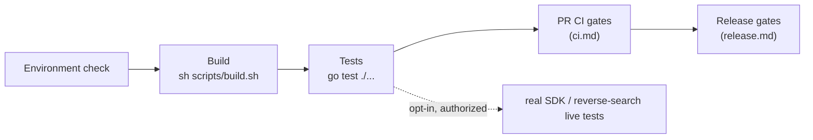
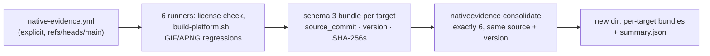
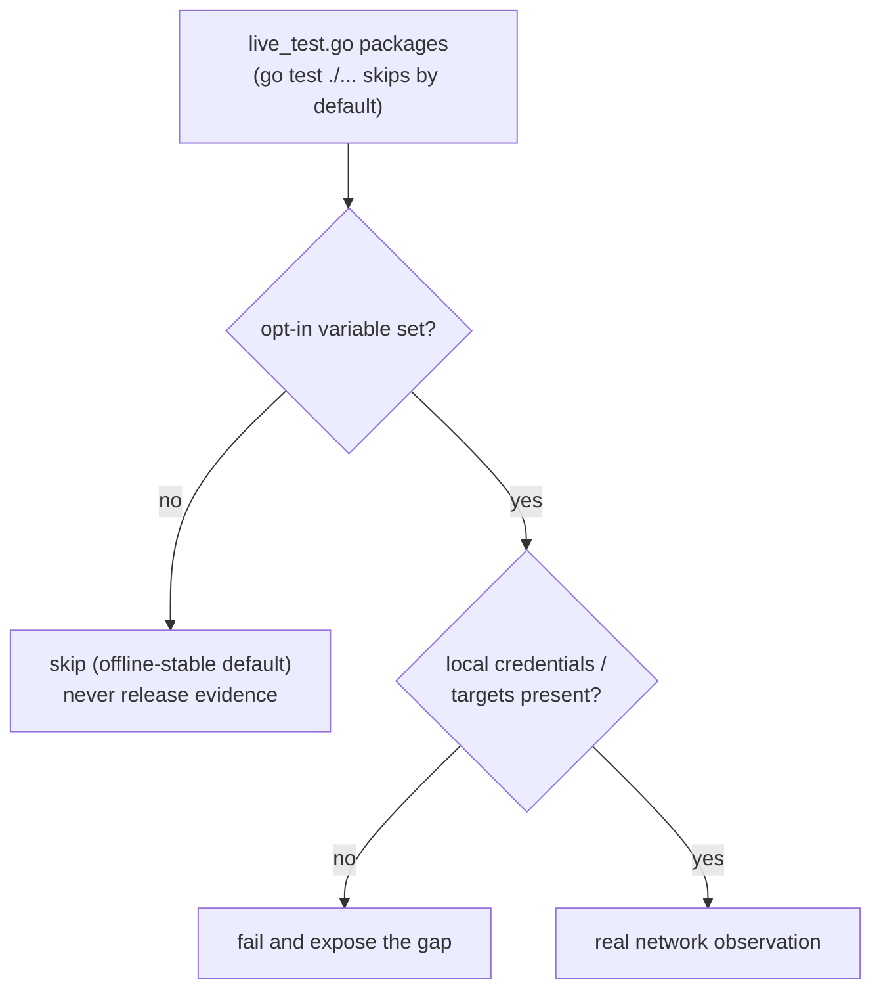
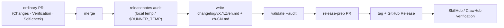

# Development

English | [简体中文](../../zh-CN/maintainers/development.md) | [Documentation index](../../index.md)



| What you want to do | Start here |
| --- | --- |
| Check the local toolchain | [Environment check](#environment-check) |
| Edit or validate pages | [Frontend assets](#frontend-assets) |
| Build or verify ugoira encoding | [Ugoira Go encoder](#ugoira-go-encoder) |
| Run the CLI and MCP | [Run](#run) |
| Handle login and credentials | [Credentials in development](#credentials-in-development) |
| Choose test scope | [Tests](#tests) |
| Understand PR checks | [CI gates](ci.md) |
| Check the release workflow | [Release](release.md) |
| Prepare release notes | [Release notes and publication](#release-notes-and-publication) |

## Environment check

`go.mod` is the single source of truth for the Go toolchain.

```bash
go version
go env GOVERSION CGO_ENABLED GOOS GOARCH
CGO_ENABLED=0 go test ./...
```

## Frontend assets

Sources in `frontend/mcp-apps/gallery/`, `frontend/pages/login/`, `frontend/pages/oauth/` are embedded by the resource-only `frontend` package and assembled once at startup (Gallery CSS/JS and consent CSS inlined; login keeps its templates/styles and `html/template` composition; fixtures not embedded). No npm, framework, disk reads or network at runtime; no generation step for clean builds or versioned `go install`.

```bash
go test ./...
go vet ./...
sh scripts/build.sh
node frontend/mcp-apps/gallery/gallery_test.mjs   # Gallery bridge directly
```

- The `frontend` package tests validate embedded inputs and placeholders; local/platform/race builds compile the sources directly. The Go regression also runs every host capability mode when Node is available.
- Frontend changes require Quality, Platform and Container checks. Docker uses prebuilt binaries; Homebrew templates stay in `templates/homebrew/`.
- Source installation and self-update use an exact tag: `go install github.com/FlanChanXwO/pixiv-cli/cmd/pixiv@vX.Y.Z`.

## Ugoira Go encoder

The default downloader builds `ugoira.NewEncoder()` and produces GIF/APNG in Go — no `ffmpeg`, no backend selector, no runtime fallback. PNG frames use Go's standard decoder; JPEG frames the owner-local `internal/media/ugoira/jpeg` decoder.

```bash
sh scripts/build.sh                                   # CGO_ENABLED=0 → build/pixiv(.exe)
CGO_ENABLED=0 go test ./internal/media/ugoira/... -count=1
```

| Rule | Detail |
| --- | --- |
| Per-frame bound | 512 MiB, applied separately to ZIP member source bytes and the pre-decode allocation estimate (inherits the pinned Rust `image` crate's `Limits::default().max_alloc`) |
| Over the bound | declared size → fail before reading; actual expansion → fail during chunked reading; invalid/overflowing dimensions or estimates → error. No truncation or fallback |
| Cancellation | checked before/after each read chunk and image decode; PNG/JPEG decode loops have no callback, so mid-frame cancellation is seen when that decode returns |
| Toolchain | no Rust, native library or C linker; only race tests need `CGO_ENABLED=1` + C toolchain |

**Encoder fidelity notes** — `internal/media/ugoira`: the JPEG decoder is Go 1.26.3 parsing plus the legacy zune-jpeg 0.5.15 integer IDCT and 14-bit BT.601 (standard-library IDCT rounding changed palette selection enough to fail the fixed gate; the parser BSD license stays in the package and the zune-jpeg MIT attribution in the license bundle). Resize uses bounded sine/cosine polynomials with explicit `math.FMA` against legacy `sinf`, with 1,031 references in `testdata/lanczos-kernel.json`. APNG uses fixed Sub prediction, an independent level-7 zlib stream per frame and RGBA8 lossless: Over with transparent unchanged pixels only when every changed pixel is opaque and the delta reduces horizontal RGBA runs, else Source, with None disposal. Compressed bytes may change with the toolchain; reuse quality evidence only after verifying complete canvases, timing and loop behavior — not file size alone.

**Platform builds** — `scripts/build-platform.sh` builds an exact target with CGO0 and optionally a canonical archive: `--target GOOS/GOARCH`, `--output-dir DIR`, optional `--version VERSION` (no `v`) and `--package` (needs a version). It keeps Windows suffixes and the Linux ABI gate. Runner metadata stays in `ci/platforms.json`; tests, source identity, permissions, approvals and publication stay in workflows.

**Linux ABI gate** — public baseline glibc 2.35. Linux runners for release test/production, native evidence, packaged smoke and the Homebrew install matrix are pinned to `ubuntu-22.04` / `ubuntu-22.04-arm` (other jobs may use newer runners). After every Linux executable:

```bash
go run ./scripts/cmd/linuxabi --binary <linux-elf>
```

It reads the loader contract from ELF `SHT_GNU_verneed` and checks imported symbol versions; anything above `GLIBC_2.35` fails before packaging. "It runs on the build runner" is not acceptable evidence — the runner's newer glibc hides regressions.

### License bundle

- `go run ./scripts/cmd/licensebundle` unions production modules from `go list -mod=readonly -deps -json ./cmd/pixiv` across the six release targets with `CGO_ENABLED=0`. Offline (`GOPROXY=off`, `GOSUMDB=off`), ignores workspace/flag overrides, needs cached module sources, no Cargo, no test/tool-only modules. `--check` compares the index and full text tree without publishing.
- `third_party/attributions.json` pins extra ported-source notices; texts live in `third_party/attributions/` (separate from generated `third_party/licenses/`). Selected MIT texts, the Go BSD/patent grant and the SunPro notice remain after Rust removal; `fhttp v0.6.8` supplies the Go BSD text its headers reference (its archive lacks a license file). Missing/empty texts fail before publication; nested notices included; CRLF → LF with full text kept.
- Generated texts are embedded by `third_party/notices.go` and printed by `pixiv --licenses`; archives contain only `pixiv`/`pixiv.exe`. Index and tree keep rollback-safe publication. The test-only image-compare attribution in `third_party/attributions/image-compare-0.5.0/` is not embedded.

### Native runner evidence



- `.github/workflows/native-evidence.yml` is an explicit maintenance entry, not a main-push gate: empty global permissions, job-only `contents: read`, full-SHA actions, credential-free checkout, no publishing/signing environment; runners selected by the registry's `native-evidence` capability.
- Schema 3 binds exact `source_commit`, target, binary version and binary/archive/member SHA-256; it runs `--version` and checks the archive holds exactly the recorded binary; old schemas and Rust source-digest/staticlib fields are rejected. `consolidate` rejects symlinks and unsafe paths and publishes atomically; it never backfills libraries into source.

```bash
go run ./scripts/cmd/nativeevidence consolidate \
  --repo-root . --expected-version "v0.1.0-native-evidence.${RUN_ID}" \
  --expected-commit "$SOURCE_COMMIT" --input-dir /absolute/evidence \
  --output-dir /absolute/new-complete-evidence
```

Set `RUN_ID` and `SOURCE_COMMIT` from one audited run and use new absolute paths. PR Platform workers also upload schema 3 `native-evidence-<goos>-<goarch>` bundles (`v0.2.0-ci.<run-id>`) from the trusted base-ref workflow — editing a PR-head workflow doesn't change that producer. Inspect the actual run and exact head; never splice runs or treat a fixture, cross-build or workflow definition as six-platform execution.

**Browser evidence** — `.github/workflows/browser-evidence.yml` is a separately dispatched, credential-free matrix running `internal/browsercookies/...` platform code and synthetic fixtures on macOS, Linux, Windows amd64/arm64 (never on ordinary main pushes). Windows runners lack `sqlite3`, so both Windows jobs provision the architecture-matched official SQLite 3.53.4 tools via `scripts/install-browser-sqlite.ps1` (fixed URLs + SHA-256) before the SQLite preflight. A focused test-only workflow contract covers credential, pinned-action, fixture, SQLite provisioning and cleanup boundaries; `scripts/cmd/browsernativeevidence firefox-contract` exercises the isolated Firefox profile. The `firefox_native` job unpacks the official package in runner temp, lets Firefox create an isolated profile, injects synthetic cookies — no user profiles, Keychain, DPAPI or Secret Service; nothing uploaded. Real profile/session evidence only comes from the protected release-prep host; this workflow is not real browser-import success.

## Run

```bash
sh scripts/build.sh                     # build/pixiv(.exe); Windows via Git Bash/MSYS2/WSL; cross-builds: go build
pixiv auth login
pixiv search "初音ミク" --json
pixiv download 123456

pixiv auth use 12345678                 # authenticated unified MCP HTTP
./build/pixiv mcp auth init
./build/pixiv mcp --port 1270           # http://127.0.0.1:1270/mcp

https_proxy=http://127.0.0.1:7890 ./build/pixiv mcp --port 1270
./build/pixiv mcp --proxy http://127.0.0.1:7890
./build/pixiv mcp --no-proxy
```

- The owner OAuth grant is separate from Pixiv/FANBOX credentials; keep the one-time owner secret private (never in test output or chat). Cloud connectors need a public HTTPS reverse proxy ([HTTP startup](../cli-reference.md#mcp-http-server)).
- CLI downloads keep their own settings; stdio download tools reuse CLI settings; HTTP never exposes filesystem writes.
- State lives in `~/.pixiv-cli` (`%USERPROFILE%\.pixiv-cli`): `pixiv-cli.db` (Pixiv UID / FANBOX UID keys; embedded migrations through schema v3, legacy v1 upgraded in place, later columns already present recorded without duplicate DDL, unknown newer schemas fail closed), `config.toml`, callback bridge, release-check cache, callback helper. Unix `0700`/`0600`; Windows inherits parent ACL on creation and keeps target ACL on replacement, no DACL changes.

> [!WARNING]
> New versions never read or delete legacy `auth.json`. Migrate with `pixiv auth export --all --output <private bundle>` on the old version, then `pixiv auth import < bundle.json` on the new one.

**Configuration** — `pixiv config path/get/set/unset` manages `account_pool_enabled`, `account_pool_strategy`, `download_path`, `filename_template`, `directory_template`, `request_interval`, `https_proxy`, `log_level`, `log_format`, `reverse_search_provider`, `reverse_search_pixiv_only`, `saucenao_api_key`. Other TOML (e.g. `[reverse_search.network]`, `[reverse_search.flaresolverr]`) is hand-maintained, not in the baseline, read as a startup snapshot. The baseline is driven by **struct field tags** in `internal/config/settings`, generated with `tomledit`, compact (`example:"true"` only), never overwrites. Adding an ordinary setting: (1) field + declaration in `internal/config/settings/config.go`, (2) one focused behavioral test, (3) docs — see the [tag contract](architecture.md#configuration-declaration-struct-field-tags-are-the-single-source-of-truth).

> [!NOTE]
> A leftover `[web] fallback_enabled` returns `removed_setting`; clear with `pixiv config unset web_fallback_enabled`. `[logging].level` (`info|debug`) and `[logging].format` (`text|json`) are live; `PIXIV_LOG_LEVEL` / `PIXIV_LOG_FORMAT` override.

**Flags and proxies** — Cobra/pflag accepts flags before or after positionals. Pixiv command proxy, `[pixiv.network]`, env and `[network]`, FANBOX `[fanbox.network]` / `[fanbox.flaresolverr]`, and reverse-search `[reverse_search.network]` / `[reverse_search.flaresolverr]` resolve per service boundary; reverse search has separate standard/SauceNAO, ascii2d browser and FlareSolverr JSON-control surfaces (FlareSolverr only for challenge recovery).

## Credentials in development

Full flows: [Authentication](../authentication.md). Development-specific facts:

- Browser cookies (`refresh_token=...`, `PHPSESSID`, `device_token`) are **not** Pixiv App OAuth refresh tokens; CLI, MCP, environment, SDK and stored accounts all reject them.
- Remote hand-off offers no manual callback backfill or mobile path; `pixiv auth devices` is removed and any `remote-devices.json` is silently ignored; legacy `login_relay_secret` / `login_relay_target_url` are ignored. Relay supports HTTP/HTTPS, direct TLS or same-host TLS proxy.
- Proxy override (`--proxy socks5h://127.0.0.1:7890`, `--no-proxy`) works on direct-token `auth import`, `auth login`, `auth check`, `search`, `timeline`, `detail`, `ranking`, `recommended`, `download` and `mcp` startup. Bundle-form `auth import` rejects it; `auth export/list/use/remove` and `config path/get/set/unset` don't accept it. Pacing: `PIXIV_REQUEST_INTERVAL` / `[network].request_interval`. Debug: `pixiv config set log_level debug` (+ `log_format json`), stderr-only, startup-scoped.

> [!WARNING]
> Only an explicit `pixiv auth export` without `--output` may write a token to stdout. The bundle is an unencrypted, secret-bearing point-in-time backup, not live sync. `committed` / `unknown` restore outcomes are never a successful rollback.

Real login depends on Pixiv's OAuth web flow; automated tests use a fake OAuth server and never contact Pixiv.

## Tests

Default to existing checks without adding permanent tests. The [test admission rules](../../../.agents/skills/pixiv-cli-test/SKILL.md#decide-whether-test-code-must-change) decide which durable core regressions enter main and how to run local probes under `tmp/test/`.

Coverage spans CLI commands and build metadata, explicit/automatic updates, `internal/{pixivaccount,fanboxaccount}`, `internal/pixivaccount/pool`, `internal/reversesearch` fixtures and aggregation, `internal/storage/database`, `internal/config/settings`, `internal/{lifecycle,pagination}`, App API auth retry, the public SDK, HTTP client wiring, downloads, the Go encoder/native-evidence contract and `internal/mcpserver/{pixiv,fanbox}/tools` registration.

```bash
go test ./...
sh scripts/build.sh
go test ./internal/browsercookies/... -count=1   # offline fixture/crypto/permission regression
```



| Test | Enable | Needs | Verifies |
| --- | --- | --- | --- |
| `TestRealPixivSDKRead` | `PIXIV_SDK_E2E=1` | selected account from local `pixiv-cli.db`; optional `PIXIV_E2E_READ_USER_ID` (must name a stored account, fails closed before network, no default fallback; release evidence uses a secondary account) | identity, stable detail/list and `Resource` read; rotated credentials persisted via a normal repository transaction first |
| `TestRealFanboxSDKRead` | `FANBOX_SDK_E2E=1` | `FANBOXSESSID` from the agreed macOS Keychain item; `FANBOX_E2E_CREATOR_ID`, `_TAG`, `_POST_ID`, `_POST_URL` | `Creator`, `Creators`, `CreatorTags`, `CreatorPosts`, `TaggedPosts`, `Post`, `Home`, `Supporting`, `ResolveURL`, `OpenResource`, `SaveResource`; one continuation per list cursor; a file attachment fully read (HEAD, save, byte count) in a temp dir; expired session → `credentials_expired` |
| `TestRealFanboxSDKPostInfo` | `FANBOX_SDK_E2E=1 FANBOX_E2E_POST_ONLY=1` | post ID + page URL | `Post`, non-empty body, `ResolveURL`, resource manifest; allows `file_assets=0` (does not replace the strict test) |
| `TestRealReverseSearch` | `PIXIV_REVERSE_SEARCH_E2E=1` | `PIXIV_REVERSE_SEARCH_SOURCE`, `_PROVIDER`; `SAUCENAO_API_KEY` for SauceNAO/`all` (exported from a private env, never inline) | third-party compatibility; takes no source/key args, never echoes them; authorized test image only; not a release gate |
| `TestRealReverseSearchMCPReusesSolverSession` | same | `PIXIV_REVERSE_SEARCH_SOLVER_URL`; optional `_SOLVER_PROXY` (browser upstream only) | solver session reuse; no session state or source persisted |

```bash
PIXIV_E2E_READ_USER_ID=<secondary-uid> \
PIXIV_SDK_E2E=1 go test ./sdk/pixiv -run TestRealPixivSDKRead -count=1 -v
FANBOX_E2E_CREATOR_ID=<non-secret-creator-id> FANBOX_E2E_TAG=<non-secret-tag> \
FANBOX_E2E_POST_ID=<non-secret-post-id> FANBOX_E2E_POST_URL=<non-secret-post-url> \
FANBOX_SDK_E2E=1 go test ./sdk/fanbox -run TestRealFanboxSDKRead -count=1 -v
# optional challenge recovery (not configured by default)
FANBOX_E2E_SOLVER_URL=http://127.0.0.1:8191 FANBOX_E2E_SOLVER_PROXY=http://host.docker.internal:7890 \
FANBOX_E2E_CREATOR_ID=... FANBOX_E2E_TAG=... FANBOX_E2E_POST_ID=... FANBOX_E2E_POST_URL=... \
FANBOX_SDK_E2E=1 go test ./sdk/fanbox -run TestRealFanboxSDKRead -count=1 -v
FANBOX_E2E_POST_ID=<non-secret-post-id> FANBOX_E2E_POST_URL=<non-secret-post-url> \
FANBOX_SDK_E2E=1 FANBOX_E2E_POST_ONLY=1 go test ./sdk/fanbox -run TestRealFanboxSDKPostInfo -count=1 -v
export SAUCENAO_API_KEY      # pre-exported from a private environment
PIXIV_REVERSE_SEARCH_E2E=1 PIXIV_REVERSE_SEARCH_SOURCE=<private-test-image-path-or-url> \
PIXIV_REVERSE_SEARCH_PROVIDER=all go test ./internal/reversesearch -run TestRealReverseSearch -count=1 -v
```

- No separate E2E wrapper; offline suite and credentialed observation share one path. Targets accept only explicit non-secret values — never tokens, sessions or cookies as args or env. `PIXIV_E2E_PROXY` is a non-secret proxy URI; solver variables are optional non-secret topology.
- After release-prep runs, scan stdout, stderr, logs and evidence: tokens, cookies, signed URLs and raw bodies must never reach argv, env dumps, logs, test names, artifacts or diffs. This section describes coverage, not that the real tests have run.
- Under an explicit proxy, resource transport negotiates HTTP/1.1 while App API and OAuth keep theirs; the live resource read regresses this boundary without a slow-download timeout. A 429 without a valid `Retry-After` keeps the diagnostic and fails — no guessed wait or endless retry.
- `PIXIV_E2E_BINARY` / `PIXIV_E2E_EXPECTED_VERSION` run the offline `cmd/pixiv` smoke against a built, unpacked release binary (no tokens, no real API); `platform-smoke.yml` runs that CLI/config/MCP surface check on six runners.
- Add or update tests per change scope; if tests can't run, state the reason and risk in the delivery notes. Release fixture gates: [release](release.md#local-release-fixture-gates).

### Test file layout

A production `x.go` has at most one `x_test.go` in its directory; platform tests use `x_<platform>_test.go` with a real base owner. New owners use the external test package (`X_test`); only the directories below may be same-package because they observe unexported state. New exceptions must be registered here with a permanent reason.

| Directory | Reason for same-package |
| --- | --- |
| `internal/media/ugoira` | Tests exercise `readFrameSource`, `frameSource`, `validateDecodedSize`, `frameNRGBA`, `decodeInto`, `resizeFrame`, and `apngWriter` directly to verify allocation boundaries and cancellation without huge allocations, preserve transparent RGB and ownership of the previous frame during buffer reuse, compare Lanczos3 pixels with fixed upstream reference vectors, exercise APNG sequence overflow and write failures, and check reservoir state, deduplication weights/indices, Oklab/Wu reference values, fixed-seed K-means centers and per-pixel dither indices. `colorGrid` tests verify exact candidate bounds at cell edges; `frameQuantizer` tests verify that reused error rows are cleared, ordinary quantization returns independent indices, and explicit buffer reuse starts only after the previous frame is consumed. LZW tests cover dictionary/code-width reset across frames and recovery after a write failure. GIF tests observe `gifWriter`/`gifBlocks` to verify global tables, streaming LZW sub-blocks and write failures; lifecycle tests observe `encodeGate` to coordinate queued cancellation without sleeps. Exposing these codec internals would expand the `Encoder` contract solely for tests. |
| `internal/config/settings` | `schema_test.go` passes synthetic types to the private `deriveSchemaFromTags` compiler to test declaration rejection without exporting reflection metadata or resetting the production cache. |
| `internal/cli` | The composition root test observes unexported root wiring, invocation lifecycle, and close ordering; these seams are not a public API. |
| `internal/cli/search` | Tests observe private searchArtworks logical-page continuation through a real SDK with an HTTP fixture. The private logical-page strategy remains an implementation detail; MCP separately exposes bound default-batch continuation. Exporting application internals only for tests would widen the public surface. |
| `internal/mcpserver/pixiv/tools` | Tests observe private searchArtworks logical-page continuation through a real SDK with an HTTP fixture. The private logical-page strategy remains an implementation detail; MCP separately exposes bound default-batch continuation. Exporting application internals only for tests would widen the public surface. |
| `internal/browsercookies/chromium` | Tests construct the provider directly and inject an encryption key override, observing the unexported cookie record decryption path and profile discovery logic. |
| `internal/browsercookies/firefox` | Tests observe unexported profile discovery (`profiles.ini` parsing), cookie database path resolution, and record layout. |
| `internal/browsercookies/safari` | Tests directly call the unexported `parseBinaryCookies`, asserting binarycookies record layout. |
| `internal/browsercookies/secret` | Tests construct `SecretService{command: ...}` injecting unexported fields and assert unexported sentinel errors and command-output redaction behavior. |
| `internal/selfupdate/installer` | Tests inject the unexported `assetURLValidator` seam and checksum verification function, and use real fixture binaries to verify root `--version` preflight and that the old executable is not replaced on failure. |
| `internal/selfupdate/release` | `source_route_test.go` observes unexported source route selection and canonical API URL cache state; the rest of the directory already uses the external package. |
| `internal/storage/database` | Tests observe the unexported `tableInfoQuery` allowlist and migration-compatibility seams so SQL identifiers remain fixed literals and legacy schemas cannot silently bypass their contract. |
| `sdk/pixiv` | `cursor_test.go` observes unexported cursor construction and client-instance binding to verify exact query-bound invalid continuations without widening the public SDK surface. |
| `scripts/internal/browsernativeevidence` | Tests observe unexported environment probes and inject synthetic Firefox cookie seeds. |
| `scripts/internal/homebrewformula` | Tests directly call unexported formula rendering and version validation (`renderFormula`, `validateFormulaVersion`, `checkDynamicVersionNeeds`). |
| `scripts/internal/licensebundle` | Tests observe unexported `defaultBundleFileOps`, `modulesFromMetadata`, `packageLicenseFiles`, and license text normalization; executable Go fixtures verify the six-target offline command contract. |
| `scripts/internal/linuxabi` | Tests directly call unexported glibc version parsing and ABI comparison (`parseGLIBCVersion`, `checkImportedSymbols`). |
| `scripts/internal/nativeevidence` | Tests observe unexported record/consolidate state and the workflow security/ownership contract, covering schema 3, independent `source_commit`, exact binary `--version` output, six-target hash/archive verification, and mutation rollback. |
| `scripts/internal/publicapi` | Tests observe the unexported parser handling of `unexported`/`hidden` symbols and the golden comparison logic, using `writeFixture` to generate fixtures. |
| `scripts/internal/releaseassets` | Tests inject unexported `injectReleaseSources`/`injectWindowsReleaseSources`, observing asset archive naming (`archiveName`) and checksums generation. |
| `scripts/internal/releasenotes` | Tests observe unexported GitHub client call mappings, injecting a fake client to assert source auditing. |

- No temporary items; no open-ended phrases like "migration period". Adding a directory needs the specific unexported symbol and proof that a minimal exported interface won't do; removing one needs a deletion task and migration evidence (external package compiles, coverage unchanged).
- `live_test.go`, `live_mutation_test.go` and `live_solver_test.go` are environment-gated real tests without a single production file owner; they stay in their target package (`sdk/pixiv`, `sdk/fanbox`, `internal/reversesearch`, `internal/browsercookies`) and skip unless their documented opt-in variable is set. Build-tagged test files differ per `GOOS`/`GOARCH`; verify with `go list` under `GOOS=darwin`, `windows` and `linux`.

```bash
# List all directories whose tests stay inside the production package (package X rather than X_test)
go list -json ./... | python3 -c 'import json,sys
dec=json.JSONDecoder(); s=sys.stdin.read(); i=0; same=[]
while i<len(s):
    try: p,i=dec.raw_decode(s,i)
    except json.JSONDecodeError: break
    while i<len(s) and s[i] in " \n\t": i+=1
    if p.get("Dir") and p.get("TestGoFiles") and not p["ImportPath"].endswith(("_test",)):
        same.append((p["ImportPath"],len(p["TestGoFiles"])))
for ip,n in sorted(same): print(ip,n)'
# Expected result = the Permanent directories above
```

### Capability scope

Negative contract for v1: a shipped CLI/MCP/SDK entry point for any item below is a defect. An SDK-only migration seam in the evidence-gated table is not release-ready. Schema-only placeholders and mock empty results are forbidden. Adding or restoring an entry point is a functional change: update the row and the user docs; reviewers rerun the negative grep / directory checks manually.

**Unsupported**

| ID | Unique owner | Current evidence | Close-out condition |
| --- | --- | --- | --- |
| `ART-SEARCH-RATING` | `internal/cli/search` + `internal/searchfilter` + `sdk/pixiv` | CLI artwork search filters normalized `x_restrict` locally and binds the filter to its cursor; it does not send an upstream rating field. MCP `pixiv_search_illust` has no standalone rating parameter | Preserve the local CLI contract and test cursor/filter consistency; exposing a new MCP parameter or upstream field requires its own supported behavior and synchronized schema/docs |
| `NOVEL-SEARCH-ADVANCED` | No owner (must not be added) | SDK/MCP schema has no advanced field | May be evaluated once the upstream contract appears; schema-only placeholders are forbidden |

**Evidence-gated**

| ID | Unique owner | Current evidence | Close-out condition |
| --- | --- | --- | --- |
| `NOVEL-RANKING` | `sdk/pixiv` + `internal/cli/ranking` (T18/T30; MCP later) | SDK and CLI expose the additive `NovelRanking` seam over the internal `/v1/novel/ranking` adapter; CLI selects it explicitly with `--type novel`; MCP has no `novel_ranking` tool, and live/public release evidence is still incomplete | Complete the live second-page, shared cursor, MCP and release compatibility gates; until then this remains evidence-gated and is not `public_ready` |
| `NOVEL-BOOKMARK-MUTATION` | `sdk/pixiv` + `internal/mcpserver/pixiv` (G1-T13; CLI later) | SDK exposes additive typed `AddNovelBookmark`/`RemoveNovelBookmark`; MCP exposes `add_novel_bookmark`/`remove_novel_bookmark`; offline outcome, validation and no-replay evidence is present, while strict/live, read-back and release evidence remain incomplete | Complete strict/live mutation evidence, same-account read-back, cleanup and compatibility/release gates; until then this remains evidence-gated and is not `public_ready` |
| `COMMENT-WRITE` | `sdk/pixiv` (T16; CLI/MCP later) | SDK exposes namespace-specific `PostArtworkComment`/`ReplyArtworkComment`/`DeleteArtworkComment` and novel equivalents; MCP `comment_post`/`comment_add` directories remain = 0; response ID, read-back, cleanup, and strict live evidence are incomplete | After strict/live write evidence plus same-account read-back, cleanup, and T33/T38 compatibility gates; until then this remains evidence-gated and is not `public_ready` |
| `NOTIFICATION` | No owner | MCP `notification` directory = 0; SDK `Notification*` exports = 0 | Same as above |
| `AUTOCOMPLETE` | No owner | MCP `autocomplete` directory = 0; SDK `Autocomplete*` exports = 0; not merged into `search` | Same as above |
| `WEB-RESTRICTED-READ` | No owner | No `webapi` package; `web_fallback_enabled` is a tombstone key (`config get/set` → `removed_setting`) | Do not reopen the anonymous Web path; any proposal to restore Web/AJAX must first amend the AGENTS frozen contract and pass an ADR |
| `USER-BLOCK-MUTE-REPORT` | No owner | MCP `mute`/`report` directories = 0; SDK `BlockUser`/`MuteUser`/`ReportUser` exports = 0 | After the upstream provides a verifiable mutation contract |
| `WATCHLIST-MARKER` | No owner | MCP `watchlist` directory = 0; SDK `Watchlist*` exports = 0 | After the upstream provides it |
| `BOOKMARK-USERS` | No owner | No corresponding tool/SDK export; `bookmark_detail` only covers the current user detail | May be evaluated after the upstream provides it |
| `SPOTLIGHT-PIXIVISION` | No owner (out of scope) | MCP `spotlight`/`pixivision` directories = 0; SDK `Spotlight*`/`Pixivision*` exports = 0 | Explicitly out of scope; re-evaluate only when the product scope changes |

## Git and local artifacts

`.gitignore` excludes `.DS_Store`, `build/`, `pixiv`, `pixiv-cli`, `downloads/`, `*.db` and common caches/temp files. Never commit Pixiv tokens, downloaded content, local databases, machine-specific config, Ed25519 private keys or tap deploy keys.

## Release notes and publication



- Sections, in order when non-empty: `Breaking changes`, `Added`, `Changed`, `Fixed`, `Security`, `Documentation`, `Maintenance` (translated names in Chinese), ending with a same-scope `Full Changelog` compare link (first version: that tag's commits).
- Each outcome-oriented note inlines its source PR (or a real short-SHA commit link); one entry may merge related sources. Internal-only changes go under `Maintenance`, never skipped. Each version lists first-time external contributors (not owner or bots). `changelog/unreleased/` keeps only release-prep hints — not an ordinary PR target.
- Classification, breaking-change judgment and version summaries are the release-prep maintainer's call from the final Markdown and compatibility assessment, not the PR body; PR authors don't pick versions.
- `validate --audit` checks section order, bilingual source set, compare footer, missing and out-of-scope sources. The formal tag's `release_notes_audit` job reruns audit + validation with read-only `contents` and `pull-requests`.
- Version selection is not release authorization: before a release-prep PR, merge, tag push, release trigger or history sync, the maintainer confirms the exact version, range and impact in the current session. Full path: `.agents/skills/pixiv-cli-release-notes/SKILL.md`.
- `sync-history` is dry-run by default; only `--apply` updates an existing Release body or creates a missing historical Release from its tag (no assets); both compare the remote body with the local bilingual render.

## Documentation sync

Update the bilingual README, CLI reference or relevant `docs/` page when any of these change: MCP tools/parameters/return semantics; CLI commands/parameters/account config/output; environment variables or defaults; download, auth, proxy, Ugoira flows; install/update channels, signing trust roots, Release/tap gates or reputation hints; new limits, retries, timeouts, truncation, degradation or error handling; test or build commands.
