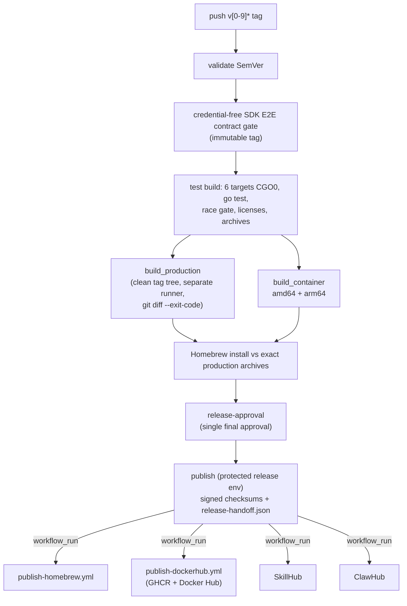

# Release

English | [简体中文](../../zh-CN/maintainers/release.md) | [Development](development.md)

Release gates, signing, container and Homebrew publication. Release-note writing is in [development](development.md#release-notes-and-publication); authorization rules in `.agents/skills/pixiv-cli-release-notes/SKILL.md`.



## Release workflow

- `.github/workflows/release.yml` accepts only `v[0-9]*` tag pushes — no `workflow_dispatch`, `release_tag` input or test-only overlay. It reads or injects no Pixiv/FANBOX credentials; real SDK E2E, native browser and one-time solver acceptance happen in an authorized environment, and the contract gate is not real release evidence.
- Validate, test build, production build and publish all bind the same tag. On failure, fix on the default branch and re-run the normal immutable-tag process; never inject new verifiers, tests or sources into an old tag, and there is no manual recovery entry for an existing Release.
- `releaseassets finalize` also reads `scripts/install.sh` and `scripts/install.cmd` from the tag, copies them into the Release under fixed names, and writes `checksums.txt` plus the Ed25519 manifest alongside the six archives. The publish policy locks finalize parameters and the full eight-asset upload set; the Homebrew renderer requires both installers in the checksum set, while the formula downloads only the platform archive.
- **Race gate:** the `go.mod` toolchain doesn't support race on Windows ARM64, yet all six native targets run it — five run `go test -race ./...`, Windows ARM64 runs the same command and must match Go's exact `-race is not supported on windows/arm64` diagnostic; any other failure fails, no entry is skipped. The test matrix pins `GIT_CONFIG_*` to `core.autocrlf=false` so Git for Windows keeps LF blobs (else pre-commit `gofmt` misreports CRLF). Test gate only; production builds from the tag's clean default checkout.
- **Handoff:** release preparation writes the immutable `release/release-handoff.json` (release run, tag, commit, each production/container artifact's size and SHA256); publication verifies it against the approved `release/checksums.txt`; policy rejects intermediate steps, path replacement and post-publish rewriting. Production archives, container images, prepared checksums and Homebrew install against the exact archives all finish before `release-approval`; publication then uses the secret-bearing `release` environment and consumes approved artifacts without rebuilding.
- **Downstream publishers** (Homebrew, Docker Hub, SkillHub, ClawHub) are triggered by `workflow_run` of a successful `Release`. The handoff binds original run, tag, commit and artifact identities (not just a tag file; independent of Homebrew finishing). Each publisher revalidates identity and artifacts. Never infer a version from `workflow_run.head_branch` or substitute later `main` content. Authorized recovery dispatches pass the original `release_run_id` to a specific publisher — never a replacement tag or current main.

## Container release verification

- `build_container` runs after the shared `build` gate beside `build_production` (never waits for asset rebuilds). Targets: `ubuntu-22.04` → `linux/amd64`, `ubuntu-22.04-arm` → `linux/arm64`.
- Each checks out the tag, builds a versioned CGO0 Linux binary through the ABI gate, runs container packaging tests, builds a pinned glibc runtime image, verifies non-root, exact version, `pixiv config path` under `/home/pixiv/.pixiv-cli/`, `/work`, and OCI provenance (`org.opencontainers.image.source`, revision, version, licenses), then exports `verified-container-linux-amd64` / `-arm64`. Build jobs get only `contents: read`.
- `.github/workflows/publish-dockerhub.yml` is the independent post-Release publisher for GHCR and Docker Hub (Release and registries can't commit atomically). It takes the immutable handoff and both verified artifacts, checks tag and source identity, and pushes the same loaded bytes to `ghcr.io/flanchanxwo/pixiv-cli` and `docker.io/flanchanxwo/pixiv-cli` — never rebuilds. Only Docker Hub auth uses the protected `DOCKER_HUB_TOKEN` (via stdin); `packages: write` is requested only by this publisher. On failure, dispatch from the default branch with the original `release_run_id`. Exact-version tags always publish; an older stable recovery succeeds without moving `latest`; only the newest stable advances `latest`. No retry loop hides failures.

```bash
go test ./scripts/tests/containerrelease -count=1
go test ./tools/release ./tools/platformmatrix -count=1
```

The credential-free container smoke workflow builds both architectures on relevant changes; these local checks don't replace that CI evidence for a tag.

## Verifier source navigation

| Owner | Responsibility |
| --- | --- |
| `ci/platforms.json` + `tools/platformmatrix` | shared runner/capability registry, validated and emitted |
| `scripts/internal/releasecontract` | release archive identity |
| `tools/release` | reusable trust/artifact checks: immutable tag + default-branch ancestry, published Release state, run handoff identity, exact archive/container sets, checksums |
| `scripts/cmd/nativeevidence` → `scripts/internal/nativeevidence` | `record` / `consolidate` dispatch; schema, single-runner records, six-target merge, archive member/hash audit, filesystem safety (its workflow test covers only credential/action/ownership boundaries) |
| publisher workflows | only channel credentials, permissions, change detection, publication commands |

Recovery runs may verify a successful `Release` handoff without binding the workflow head to the tag; publishers whose contract requires it (e.g. Docker Hub) also bind the handoff run to the tag commit. Workflow tests keep behavior and security boundaries, not exact job counts, step positions or shell text. Historical recovery plans and acceptance reports keep their original text and are not current process docs.

## Homebrew

`publish-homebrew.yml` consumes the handoff, verifies the production section, and maps stable/prerelease to `pixiv-cli` / `pixiv-cli-beta` (both install `pixiv`, mutually conflicting). Homebrew is not part of the Release workflow and adds no approval boundary (`release-approval` is the only one). `HOMEBREW_TAP_DEPLOY_KEY` reaches only the authorized tap-write step via the `release` Environment.

1. **Install check** on macOS Intel/arm64 and Linux amd64/arm64: `brew tap-new pixiv-cli-release/staging --no-git`, single staging formula in `Formula/`, `brew install --formula pixiv-cli-release/staging/<formula>`, then `test "$(pixiv --version)" = "pixiv $RELEASE_TAG"`. macOS trusts the temp namespace with `brew trust --tap pixiv-cli-release/staging`; Linux uses a short-lived fixed-digest `homebrew/brew` container with a read-only bind mount. No workspace formula path, bypass variables or public tap clone/write/trust.
2. **Deploy** only after every target passes: the protected `deploy_homebrew_tap` job HTTPS-clones the public tap; `scripts/cmd/homebrewrecovery` (trusted default-branch tip) compares versions with `internal/version` SemVer for each formula independently:

| Published vs requested | Action |
| --- | --- |
| same version, identical bytes | report already published; no commit/push |
| older requested, or same version with different content | fail closed before reading the deploy key |
| newer requested | verify the staged formula, read the key in the last step, SSH push with pinned GitHub ED25519 known_hosts and strict checking to exactly `HEAD:main` |

Recovering the same `release_run_id` is idempotent; older requests can't roll back. Any earlier job failure leaves the tap unchanged. Draft assets aren't downloadable by Homebrew, so the Release is public before installing; if install fails the Release stays public, the tap unchanged, and the maintainer handles it — never a manual push.

**Why Linux uses a container** — Linuxbrew's `Resource` staging cleanup on hosted Linux runners hits `EINVAL` in `FileUtils.chmod` before `--keep-tmp` can intervene. `docker run --rm` with the fixed-digest image creates a local staging tap, copies the formula from the read-only mount, runs an ordinary tap-qualified `brew install --formula`, and compares `pixiv --version` with `RELEASE_TAG`. `HOMEBREW_NO_AUTO_UPDATE=1` and `HOMEBREW_NO_ENV_HINTS=1` only remove drift. The container reads no secrets, writes nothing to the host, uses no public tap and no `HOMEBREW_TEMP`/source/debug/keep-tmp flags. Its Homebrew 4.6 lacks `brew trust` — not a bypass, since the tap is created by `brew tap-new` inside the `--rm` container. Both platforms use the same `--version` gate without a Python/Ruby JSON parser. The comparison happens after install. Local Docker same-formula experiments ran on arm64 and amd64 QEMU; the runner rehearsal is still required external evidence.

This local check proves only declared workflow dependencies and semantics — **not** the remote `release` Environment, secrets or tag protection, nor the four-architecture install evidence from a formal tag.

### Pre-release read-only Homebrew rehearsal

<details>
<summary>Expand the operational boundary and platform evidence</summary>

- `.github/workflows/homebrew-prepublish-verify.yml` may be run manually from the default branch with an **already public, non-draft, non-prerelease** stable tag. It checks `v`-prefixed SemVer, default branch and matching Release tag, downloads only that Release's `checksums.txt`, renders the `pixiv-cli` staging formula, and installs it on the four production-identical runners.
- Read-only: no `release` Environment, secret, tag checkout, Release edits, tap clone/commit/push, and deliberately no deploy job — the single publishing path can't be bypassed. Linux uses the fixed-digest container; macOS the native command.
- It reproduces the install chain before release and **does not replace** formal tag publishing, signed Releases, tap deployment or post-publish acceptance. The quality gate keeps behavior-level formula and artifact checks instead of a second policy implementation.
- A formal release still requires a tag, signed Release, tap formula and install acceptance; complete same-source/version six-target evidence ([native runner evidence](development.md#native-runner-evidence)); and a configured `release` Environment, signing key and public repository — preconditions that don't mean a Release/tap exists or the install path is accepted.

</details>

## Signing trust root

The production Ed25519 trust root is committed at [`internal/selfupdate/installer/release_installer.go`](../../../internal/selfupdate/installer/release_installer.go):

| Field | Value |
| --- | --- |
| Key ID | `ed25519-2c27e77742d3c33a` |
| SPKI DER SHA-256 fingerprint | `2c27e77742d3c33ad14be867d4e0519229a220898c9a7c868447eaef0951b4cf` |

- A same-package test verifies the mapping against a known real signature — proof the root is wired in, not that signing, assets or install acceptance happened.
- The private key is only a protected `release` Environment secret, with a recovery copy only in a controlled macOS Keychain; never in source, logs, assets or formulas.
- Rotation: first release a version trusting the new key ID, keep the old public key until old versions leave support, then stop using the old key in a new signed Release. Binaries must never suddenly depend on an uncommitted trust root.
- No Apple notarization or Windows Authenticode; Gatekeeper/SmartScreen prompts are a reputation boundary that docs and scripts must not bypass.

## Skill publishers

| Publisher | Contract |
| --- | --- |
| SkillHub | checks immutable tag, default-branch ancestry, public Release, SemVer, and product-skill changes since the previous merged semver tag; unchanged → skip; changed → dry-run then commit. Product `SKILL.md` version must equal the CLI tag. `SKILLHUB_TOKEN` enters only the final commit step; a returned `skillId` and review state prove receipt, not public acceptance |
| ClawHub | credential-free dry-run; final publish/inspect verifies the exact artifact fingerprint; `verify_only` inspects a submitted version without republishing (requires clean aggregate security). A clean static scan with aggregate security `pending`, or a delayed `skill-card.md`, yields an explicit warning, not a false failure — neither proves acceptance. Without server-resolved GitHub provenance, rely on the trusted tag checkout plus fingerprint evidence; don't claim independent provenance |

## Local release fixture gates

```bash
sh scripts/test-build-platform.sh
sh scripts/test-package-release.sh
go test ./tools/release ./tools/platformmatrix -count=1
go test ./scripts/internal/nativeevidence -count=1
go test ./scripts/internal/browsernativeevidence -count=1
sh scripts/test-homebrew-formula.sh
git diff --check
```

They prove format, failure semantics and local policy only — not the six native runners' real GIF/APNG smoke, versioned archive contents or Homebrew install acceptance.
