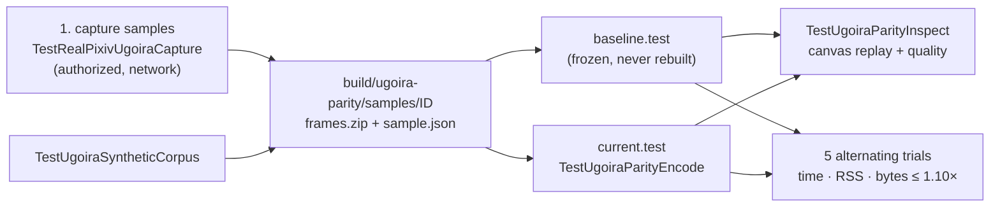

# Offline ugoira parity

English | [简体中文](../../zh-CN/maintainers/ugoira-parity.md) | [Development](development.md#ugoira-go-encoder)

How to compare the Go encoder against the frozen legacy baseline for quality and performance. None of these runs in ordinary tests.



## 1. Capture samples

`TestRealPixivUgoiraCapture` shares the selected account and credential-rotation persistence with `TestRealPixivSDKRead`, then calls SDK `UgoiraMetadata` and `SaveResource`. Enable it only with authorization to download the samples.

```bash
PIXIV_UGOIRA_CAPTURE=1 PIXIV_UGOIRA_IDS=150808387,150247639,150356234 \
PIXIV_UGOIRA_QUALITY=medium PIXIV_UGOIRA_DIR="$PWD/build/ugoira-parity/samples" \
go test ./e2e -run '^TestRealPixivUgoiraCapture$' -count=1 -v
```

- Positive comma-separated IDs and explicit `original` or `medium`; an unavailable quality fails without substitution. This command captures medium; the 1080p original in the corpus was acquired separately from the documented `originalSrc` into its own directory.
- Each new ID directory holds the complete `frames.zip` and `sample.json` (ordered filenames/delays, actual quality, dimensions, duration, byte count, ZIP SHA-256, frame-metadata SHA-256); the log records the manifest SHA-256. URL, ref, headers and credentials are never serialized. Existing samples are refused; a failed capture removes only its new directory.
- Keep artifacts under ignored `build/`, never commit them. `PIXIV_E2E_PROXY` means the same as in SDK E2E. Ordinary tests skip capture.

## 2. Encode

Compile the old baseline once from its pre-migration source, record its source commit, Go/build settings and binary SHA-256, and never change it. The current test-only driver uses the same `ugoira.NewEncoder()` as the downloader (no credentials or network). Never overwrite `baseline.test`.

```bash
mkdir -p build/ugoira-parity
CGO_ENABLED=0 go test -c -trimpath -o build/ugoira-parity/current.test ./e2e
GOMAXPROCS=1 RAYON_NUM_THREADS=1 \
UGOIRA_PARITY_SAMPLE="$PWD/build/ugoira-parity/samples/150808387" \
UGOIRA_PARITY_OUTPUT="$PWD/build/ugoira-parity/current-150808387.gif" \
UGOIRA_PARITY_FORMAT=gif UGOIRA_PARITY_MAX_EDGE=0 \
build/ugoira-parity/current.test -test.run '^TestUgoiraParityEncode$' -test.v
```

- Requires absolute paths, a new output matching `gif`/`apng`, and a uint32 max edge (`0` = no resize). Checks ZIP and frame hashes before encoding and emits `UGOIRA_PARITY_RESULT` (input hashes, format, max edge, `Encode` time, output bytes, Go version, `GOMAXPROCS`).
- New output per trial; same inputs and runtime settings across implementations. Measure peak RSS separately with the same host tool; logged time excludes compilation, acquisition, hashing and startup. The driver alone is not proof of quality, performance or six-platform parity.
- Toolchain changes: keep the frozen baseline; if needed build a separately named legacy comparator from the same audited producer, verify it against the frozen output, record both build modes, compare both implementations under one toolchain.
- **Acceptance:** a warmup + five alternating trials per real sample/format; time, peak process RSS and output-byte ratios each ≤ 1.10 (RSS ≠ Go heap).
- Always set `GOMAXPROCS=1` and `RAYON_NUM_THREADS=1`: the legacy Rust quantizer's worker count changes output pixels as well as runtime. Match the baseline's worker settings when choosing outputs for quality scoring.

## 3. Inspect quality

```bash
UGOIRA_PARITY_CORPUS="$PWD/build/ugoira-parity/synthetic" \
go test ./e2e -run '^TestUgoiraSyntheticCorpus$' -count=1
UGOIRA_PARITY_SAMPLE="$PWD/build/ugoira-parity/samples/150808387" \
UGOIRA_PARITY_OUTPUT="$PWD/build/ugoira-parity/baseline-150808387.gif" \
go test ./e2e -run '^TestUgoiraParityInspect$' -count=1 -v
```

| Test | Does |
| --- | --- |
| `TestUgoiraSyntheticCorpus` | writes the three original quality scenes + transparency/repeated-frame, single-pixel and odd-dimension cases; temp dirs without `UGOIRA_PARITY_CORPUS`, else an absolute dir keeping schema-1 samples for both binaries; refuses existing sample dirs |
| `TestUgoiraParityInspect` | rebuilds GIF canvases from Keep/Background rectangles and replays APNG Source/Over with None disposal; checks frame count, size, loop, delays, GIF transparency; needs `MaxEdge=0`; PNG inputs must match exactly, JPEG differences reported separately (reference uses Go's JPEG decoder); emits per-frame `UGOIRA_QUALITY_RESULT` with hashes; outside performance measurement |
| `TestUgoiraSSIMRustCalibration` | enabled by `UGOIRA_PARITY_RUST_QUALITY`; compares against the old gate's `<scene>-rust.gif` and `<scene>-ssim.csv` with 1e-9 tolerance (nine-decimal CSV) |

**Metric** — RGB SSIM averages three channel scores. MSSIMSimple uses non-overlapping 8×8 windows weighted by actual area (incl. smaller edge windows); covariance is a sum, not population variance. The old `image` 0.25 CICP conversion behind `DynamicImage::into_luma8` uses BT.709/D65, float32 multiply-accumulate and rounding; the metric keeps the measured arm64/FMA baseline (the older integer `Pixel::to_luma` is not that path).

## Encoder fidelity notes

| Part | Choice | Why |
| --- | --- | --- |
| JPEG | owner-local `internal/media/ugoira/jpeg`: Go 1.26.3 JPEG parsing + legacy zune-jpeg 0.5.15 integer IDCT + 14-bit BT.601 | standard-library IDCT rounding changed palette selection enough to fail the gate; matching only color coefficients didn't fix every sample. Registers no global format, adds no module. Parser BSD license kept in the package; zune-jpeg MIT attribution must stay in the license bundle. Synthetic 17×9 `jpeg-{444,progressive,gray,restart}` fixtures + legacy RGBA references cover it without Rust or jpegtran |
| Resize | bounded sine/cosine polynomials with explicit `math.FMA`, fixed against legacy `sinf`; 1,031 references in `testdata/lanczos-kernel.json` | Lanczos3 rounding without a platform math library |
| APNG | fixed Sub prediction, independent level-7 zlib per frame, RGBA8 lossless. Over with transparent unchanged pixels only when all changed pixels are opaque and the delta reduces horizontal RGBA runs; else Source. None disposal | avoid fragmenting flat colors; Go 1.27's fast levels exceeded the 10% size allowance on the high-texture corpus (the opaque-texture regression keeps that allowance vs its frozen Rust reference) |

Compressed bytes may change with the toolchain; reuse quality evidence only after verifying complete canvases, timing and loop behavior — not file size alone.

## Corpus

Archive dimensions were verified by decoding every frame (display dimensions are insufficient). The first original ZIP came from Pixiv's public `ugoira_meta` `originalSrc`, its frame list checked against authenticated SDK metadata (the SDK offered only medium) — a test-data step, not a product fallback.

| Artwork ID | Archive quality | Actual dimensions | Frames | Coverage |
| --- | --- | --- | --- | --- |
| 150808387 | original | 1920×1080 | 63 | High resolution, local motion, fine lines |
| 150247639 | medium | 423×600 | 8 | Complex illustration, broad changes |
| 150356234 | medium | 219×320 | 121 | Small canvas, long sequence, gradients |
| 150863948 | medium | 600×420 | 12 | Local motion, flat colors |
| 150863611 | medium | 600×338 | 37 | Gradients, texture, local motion |
| 150863218 | medium | 480×270 | 128 | Full-frame changes, dense texture |

Keep original and medium archives in separate directories with full metadata and hashes; never infer an original ZIP URL or relabel a medium sample. These sources don't replace per-sample quality and five-trial alternating checks.
