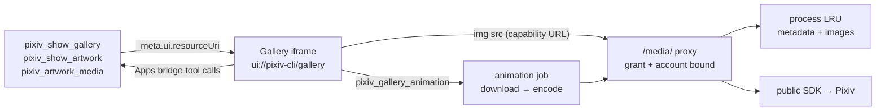
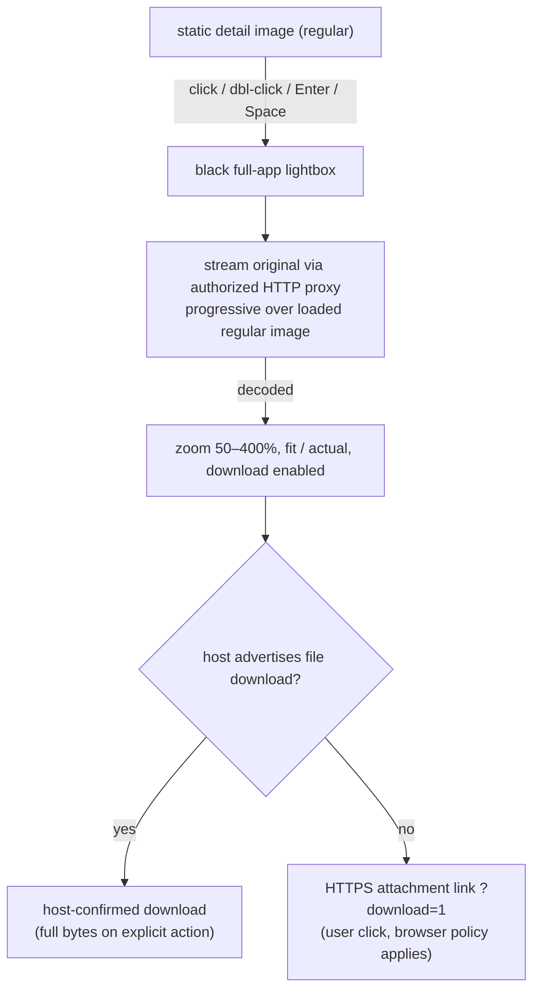
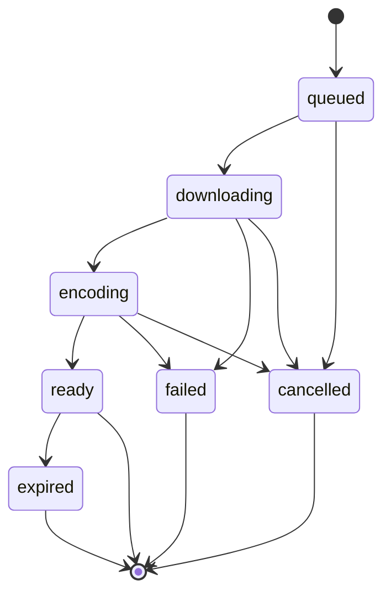
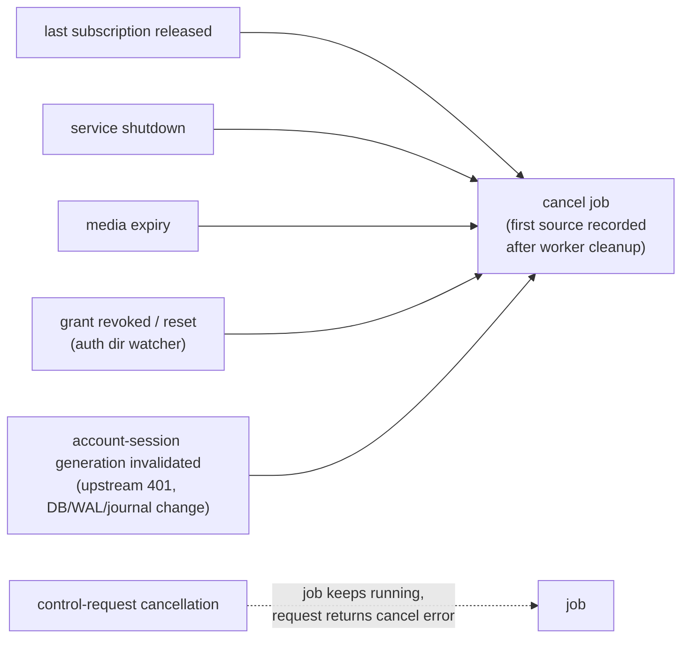

# MCP Apps gallery

English | [简体中文](../zh-CN/mcp-gallery.md) | [MCP tools](mcp-tools.md)

The HTTP-only image UI behind `pixiv_show_gallery`, `pixiv_show_artwork`, `pixiv_artwork_media` App delivery and `pixiv_gallery_animation`. Startup settings (cache size, TTL, concurrency, animation disk budget) are in the [CLI reference](cli-reference.md#mcp-http-server).

## MCP Apps artwork previews

- `pixiv_show_gallery`, `pixiv_show_artwork` and `pixiv_artwork_media` associate results with the Gallery UI (`text/html;profile=mcp-app`, `_meta.ui.resourceUri`). Stable `ui://pixiv-cli/gallery` stays readable; tools reference a `ui://pixiv-cli/gallery/sha256-<digest>` alias derived from the rendered frontend (including the injected canonical media origin) so host UI caching cannot hide updates. Historical aliases deliver the current view on a fresh read — the digest is a cache identity, not an integrity guarantee.
- Ordinary search, ranking, recommendation and detail tools have no UI association. Call the gallery only when the user explicitly asks for images or a gallery; the host decides whether to render.

| `pixiv_show_gallery` | Contract |
| --- | --- |
| Input | Required non-empty positive-integer array `illust_ids` (duplicates keep first position); optional positive `page` (default 1), `quality` (`thumbnail` default, `regular`, `original`) |
| Behavior | Fetches metadata (no new search); displays only the supplied IDs — use data tools for further pages, then explicitly open another gallery |
| Output | `records`, `images` (artwork ID, page, URL, optional `avatar_url`), `failures`, `media_origin` when configured. Per-item failures keep successful records and set `isError` |

`pixiv_show_artwork` takes one required positive `illust_id` and returns the same result as `pixiv_show_gallery` with that single ID. Call it only when the user explicitly asks to see one artwork. With tool-call support, any result holding exactly one artwork (from either tool) opens its detail page directly, without a back-to-results control, and a static (non-animated) `pixiv_artwork_media` result opens the same detail page at its first returned page; without tool calls the single thumbnail card remains.

**Image capabilities** — static previews are same-origin proxy URLs, not base64 tool content or raw CDN links. GET/HEAD under the canonical base's `/media/` validate a signed capability bound to the OAuth grant, selected account, artwork, page and quality.

| Property | Rule |
| --- | --- |
| Lifetime | ≤ issuing access token; grant revocation/reset or restart invalidates; account switches do not retarget old URLs |
| Reads | Public SDK + configured outbound proxy; arbitrary URL inputs and non-raster content rejected |
| Caching | `Cache-Control: private, no-store`; no disk or public cache; HEAD validates without a body |
| Handling | Complete image URLs are short-lived credentials — never share or log them |

## Cards and detail

| Element | Behavior |
| --- | --- |
| Frame | Borderless host surface requested; 16px padding (desktop multi-image: 32px top/bottom). A single thumbnail (shown only without tool-call support) reports a content-sized width up to 384px incl. padding. Height follows content within host limits (can shrink). Host decides final size and whether to honor the border preference |
| Grid | Below 600px of host width, multiple results form one keyboard-focusable, snap-aligned horizontal row, because phone hosts route vertical swipes to the chat instead of an inner scroller. Wider hosts keep a responsive grid inside a keyboard-focusable scroll region up to 480px high. Every result stays reachable. Hover never moves cards or images and applies only to hover-capable pointers, so touch taps leave no lingering highlight |
| Cards | Thumbnails (incl. static Ugoira covers) with no text or badges: complete at natural aspect ratio in the grid, uniformly cropped to 3:4 in the narrow row |
| Detail layout | Full host width; rounded detail sheet below the uncropped image in a centered column ≤ 960px (no tall sidebar beside empty media). The image frame follows the page aspect ratio up to the smaller of 360px and 90% of the host width (never `vh`, which grows with an auto-sized frame); letterboxing shows a blurred copy of the same image rather than flat bars |
| Detail content | Full title, tags, description, author, date, views, bookmarks, artwork ID, dimensions (no Pages row); R-18/R-18G badges. Author + bookmark button share a compact row; then one unlabeled icon-and-value strip (views, bookmarks, ID, dimensions, date) that wraps whole items on narrow screens; then pale-blue tags in one row with a show-all toggle when they overflow |
| Author | Valid IDs open the Pixiv profile through the host. Real raster avatar from optional `images[].avatar_url` — a capability bound to the artwork author, grant and account; the proxy resolves the trusted SDK profile-image resource, rejects non-raster content, accepts no arbitrary URL or original semantics. A failed avatar is left out, with no generated icon; the status is available to assistive technology |
| Copy ID | Click copies; a check mark confirms. Requests clipboard-write; falls back to native selection copy; if both fail the ID stays selected, no error marker |
| Handle | Unlabeled handle follows drag: down/click collapses, up/click expands; keyboard supported |
| Captions | ` ` → newline; numeric and common named entities decoded; absolute HTTP(S) `<a>` rebuilt through host link opening. Script URLs, credential-bearing URLs and event attributes dropped; other markup and invalid entities stay inert text |
| Accessibility | Icon controls have accessible names, keyboard focus, host-theme colors; metadata stays text |

### Loading and page navigation

- Detail, image and avatar loading use skeletons with reduced-motion support; loading/failure descriptions remain for assistive technology. Failures show icon-only retry (no banners); no automatic retry. Retrying any failed gallery thumbnail renews every failed thumbnail of that gallery in one authenticated batch.
- Images load when visible. With tool-call support the view fetches fresh thumbnail capabilities in one authenticated batch first, so URLs invalidated by expiry/restart are not reused; without it, supplied URLs are best effort.
- Click a thumbnail for detail. Single-page works have no navigation; multipage works show an `n / total` counter over the image and support horizontal swipes; prev/next arrows are hidden at either end and on touch screens. Tapping the counter toggles a native progress slider overlaid on the image, so it reserves no layout space. Dragging previews; committing loads; superseded responses are ignored. Vertical gestures stay with the chat. Dimensions follow the selected page; original downloads use it.

### Originals and downloads

| Control | Behavior |
| --- | --- |
| Bars | One floating bottom dock holds the current page (multipage), zoom, fit/actual size (its icon shows the next action) and download; it appears once an image is shown. In host fullscreen the host provides the close control, so the lightbox shows none; inline hosts keep a top-left close |
| Layout | Fit is pure CSS, so the image re-fits whenever the host resizes the frame (panel, maximize, rotation). The image area reserves room for the dock, which never covers it; in host fullscreen the dock also clears a host input floating over the bottom. Narrow (≤ 600px) touch screens span the full width and let the dock overlap the image edge to save height. Host `safeAreaInsets` take precedence over browser safe areas. Touch screens hide stepped zoom and side arrows in favor of pinch and swipe; side arrows are also hidden at either end. In host fullscreen the lightbox reports an image-shaped preferred width through `ui/notifications/size-changed`; the host decides whether to honor it |
| Loading | Regular image shown immediately if loaded, original renders progressively over it (else on black). Undimmed white ring spinner until decode; zoom/download enable only then. Page change without a loaded target keeps the previous page dimmed with spinner, then fades in |
| Fullscreen | Requested when the host advertises it; closing restores the previous mode |
| Gestures | Wheel / pinch resize; click toggles fit/actual; in fit mode horizontal swipes change page, zoomed the image pans |
| Keys | Arrows page, `+`/`-` zoom, `0` fit, Escape close |
| Errors | Compact retry; download keeps the current page |
| Browser attachment | Reuses the validated original-quality capability for the page; only exact `?download=1`; filename from artwork ID, one-based page and validated MIME. Shares the authorized server cache with the inline image; grant, expiry and account-version checks stay active. No successful save is claimed |

Originals stream through the proxy, avoiding full Base64 transfer through the host bridge.

### Browser session cache

- One 256 MiB estimated session LRU holds loaded static images, successful animation/PNG preview elements, detail metadata, decoded originals and explicitly downloaded original bytes; paging and re-entering detail reuse them and restore the page.
- The displayed image stays until an uncached replacement loads; rapid changes discard superseded loads.
- New query/results, cancellation and teardown clear it; re-delivery of an identical result without new tool input keeps detail and cache.
- Not cached: failures, bookmark state. Oversized images display fully without retention. The estimate counts decoded pixels and encoded data allowances, not total browser/GPU memory.

### Bookmark actions

| Interaction | Effect |
| --- | --- |
| Click | Toggle; adds with current visibility (public for a new bookmark) |
| Hold 500 ms / right-click / Shift+F10 | Compact anchored popup: public/private, explicit Save changes, removal, state refresh. Close, Escape or outside click dismisses without layout change. Moving/cancelling a press cancels the hold; opening settings never writes |
| After a write | Confirmed button state refreshed, statistics reloaded, cached detail invalidated; unreadable stats show an unavailable value + explicit error |
| Unknown / unconfirmed state | Writes disabled; the bookmark button is replaced by an icon-only state retry, with the reason available to assistive technology rather than shown as text. Writes stay explicit with host approval and state refresh |

**Tags** send a user-initiated exact-tag gallery search via `ui/message` only if the host advertises `message.text` (otherwise tags are inert, no hover). Clicking any tag disables all tags in that app instance; a rejected message restores them with a retryable error. Acceptance ≠ agent completion and the bridge has no turn-completion event, so an accepted request keeps the instance locked (across navigation and re-delivery) — continue in the newly returned gallery. No timer or acknowledgement unlocks it.

## Host integration

- Standard Apps bridge for initialization, tool results and calls ([MCP Apps specification](https://github.com/modelcontextprotocol/ext-apps/blob/main/specification/2026-01-26/apps.mdx)).
- CSP: images only from the canonical proxy origin and Blob; no direct fetch connections, external scripts or styles; `no-referrer`. The iframe gets no OAuth bearer, Pixiv credential or FANBOX session.
- Replacing views cancels pending tool requests and releases animation subscriptions.
- Local bridge/browser fixtures do not prove cloud-host interoperability. Without Apps support use structured data and `pixiv_artwork_media` directly.

## Media delivery to MCP Apps

Applies to `pixiv_artwork_media` over HTTP.

| Client | `content` | App data |
| --- | --- | --- |
| Advertises `io.modelcontextprotocol/ui` with `text/html;profile=mcp-app` and the animation original was retained | independent PNG preview only | `_meta["pixiv/mediaContents"]`: protected `resource_link` for the animation + inline PNG preview; `content_index` / `preview_content_index` address this array |
| Same, but no published HTTP artifact (incl. stdio) | original full inline content | no App metadata hides the animation |
| Non-App or unsupported MIME | original full `content` | — |

- Play reads the original binary on demand; downloads use the same file with grant/account-version checks and expiry. Static media and public inputs are unchanged.
- The tool also attaches the App view for playback and the static preview. With tool-call support a static (non-animated) result opens the regular detail page instead; the animation view uses icon-only controls, with status text for assistive technology and no standing download explanation. Downloads: host file download → confirmation flow; otherwise a protected HTTP attachment opens in the browser (browser restrictions apply). The server keeps the encoded animation and preview under the animation temp capacity, grant, account version and TTL — no re-download or re-encode. Private UI metadata carries the short-lived addresses; no filesystem path. Optional publication failure keeps the complete inline result but disables browser download. Restart, expiry or authorization changes invalidate addresses.
- **Refresh animation** explicitly reacquires authorization through `pixiv_gallery_animation` in the original format, replacing expired addresses with the usual polling and subscription cleanup. A failed image never prepares again automatically. Hosts without server tool calls cannot renew expired links.

## `pixiv_gallery_animation`

| Action | Input | Notes |
| --- | --- | --- |
| `prepare` | positive `illust_id`, optional `format` (`gif` default, `apng`) | each call returns an independent subscription `handle` |
| `status` | opaque `handle` | poll every 2 s; stop on terminal states |
| `release` | opaque `handle` | releasing the last subscription cancels unfinished work |

- Control responses never embed bytes and give no progress percentage. Retry only after an explicit user action.
- **Ready** output: `animation_url`, independent `preview_url` (PNG), `media_origin`, `filename`, `mime_type`, `size`, `expires`.
- **UI flow:** shows the static preview first; unloaded animation starts only on Play; Gallery reports loading until the image loads, then confirms preview or playback. Switching animation/preview reuses image elements without another read. Once ready, the redundant Load animation action hides; delivery failure, an unconfirmed host download or a format change restores it without auto-preparing. Re-entry with retained media makes a new prepare to validate authorization; only URLs matching the new ready response reuse old elements.
- **Retention:** successful elements share the 256 MiB session LRU; failed, incomplete and over-budget sources are cleared; retained ones are released on eviction, new results or teardown; leaving the view releases the subscription and image callbacks. Format change and retry get a new subscription. The estimate covers encoded bytes and decoded pixels of all frames via private UI hint `_meta["pixiv/animationFrameCount"]` (missing/invalid → no new retention). The hint adds no inputs or structured fields; the PNG estimate uses decoded pixel allowances; decoder overhead and total browser/GPU memory are outside it.
- **Downloads:** `ui/download-file` with a `resource_link` when the host supports it; otherwise a user-clicked browser link to the same protected animation with exact `?download=1`. GET/HEAD keep authorization, expiry and account-version checks; attachment filename from artwork ID and format. Other query parameters and preview downloads are rejected; browser policy applies; no save is claimed.
- **Jobs:** duplicate preparation reuses one job and a complete artifact within the same grant/account/session generation/artwork/format. Ready artifacts live until expiry (bounded by cache TTL and authorization expiry). Every GET/HEAD under `/media/animation/` checks authorization and current account generation; responses `private, no-store`; addresses are short-lived capabilities — never log or share.
- **Disk:** private dirs/files `0700`/`0600`. ZIP, native output reservations, previews and retained artifacts share the startup budget `mcp_gallery_animation_temp_capacity_mib` (default 1024 MiB). Native writes claim actual bytes through an internal synchronous callback, so encoding another format keeps unused ready artifacts while capacity remains. Writes fail explicitly before exceeding the budget — never truncated or re-encoded at lower quality. Expired/unused ready artifacts may be evicted; files pinned by a transfer are cleaned after its handle closes.
- **Lifecycle:** shutdown joins workers and transfers before removing the workspace. Startup removes only marked workspaces whose lifetime OS lock is released; live instances and unknown dirs stay. Temporary producers queue with the native output reservation (no false capacity failures between concurrent preparations); ready-file reads stay concurrent. The first preparation still downloads and encodes; no latency is promised.

## Read sessions and server cache

| Layer | Behavior |
| --- | --- |
| Gallery queries | Dedupe IDs, query concurrently within the configured limit, keep input order and per-item failures |
| Read sessions | Reuse access token and HTTP connections until expiry, keyed by account, credential revision and network config. Only refresh + credential persistence hold the rotation gate; content requests start after persistence and never hold it during transfer. Upstream auth failure invalidates the session without automatic retry. Trusted SDK metadata registers quality variants (no extra artwork query). Cancelling one credential check keeps the shared session and unrelated transfers; real credential/authorization invalidation cancels them |
| Server cache | Grant-scoped, default 256 MiB / 15 min / concurrency 4. Merges concurrent metadata lookups; stores only successful metadata and complete raster images; each hit reauthorizes the grant and resolves the current account/session generation; bookmark state and writes never cached |
| Streaming | Images stream after upstream status and file-header validation; trusted Content-Length kept, else streamed without a declared length. Interrupted transfers close upstream, discard filling buffers and never append error text to image bytes |
| Stage observations | Fixed stages: session wait/refresh, artwork lookup, first image bytes, transfer, cache hits — no token, grant or capability URL |
| ZIP markers | While the job context is active: `animation_zip_incomplete` (unexpected EOF or Content-Length mismatch), `animation_zip_reset` (connection reset), `animation_zip_timeout` (reader timeout). Only the partial byte count; no raw errors or signed URLs; no change to retries, deadlines, quality or tool errors |

## Diagnostics

With debug diagnostics enabled:

| Event | Meaning |
| --- | --- |
| `mcp_response_serialization` | Actual result JSON encoding duration and byte count for `pixiv_artwork_media` / `pixiv_gallery_animation` (excludes JSON-RPC envelope and network) |
| `mcp_http_write` / `mcp_http_flush` | Each underlying POST write (accepted bytes, duration) / flush (duration), incl. failures, request cancellation, shutdown. Keeps SDK framing; does not prove peer receipt; no bodies or headers |
| artwork-media animation stages | artwork lookup, animation metadata, ZIP download, observed native encode wait/encoding, result-file read |
| `animation_generation` | Final outcome after temp cleanup, incl. failures and cancellation; bytes = 0 on failure, animation size on success. Excludes serialization and delivery. An attempt failing before the native queue reports no fabricated queue duration |

Normal logging keeps the existing encoding path; overlapping HTTP/protocol scopes do not duplicate encoding or observations. Delivery interruptions report fixed request-cancelled / transport-interrupted reasons, never raw errors, credentials or capability URLs. Background metadata, ZIP and encoding observations carry their real outcome: ZIP success after close + Content-Length validation, encoding success after the encoder returns; partial ZIP bytes describe transfer, not delivery. Shared artwork lookup and session acquisition distinguish failures; OAuth refresh includes rotated-credential persistence (persistence failure is not refresh success); cancellation while acquiring the rotation gate records a fixed reason and stops before refresh or reads. Error returns and retry behavior are unchanged.

## Cancellation and invalidation

- The CLI presenter uses fixed reasons, not handles or raw cancellation text. Auth/account-session invalidation detected by subscription or media checks has its own reason. A subscription check with a revoked grant cancels its job while still rejecting the request; foreign accounts cannot cancel it. Control-request cancellation (incl. during session acquisition) leaves subscribed work running.
- Cancelling one animation HTTP request keeps the shared artifact and other subscriptions; authorization or credential invalidation still expires them. Active transfers are bound to the job: shutdown or revocation cancels the transfer, closes its file and sets an immediate write deadline to unblock a stalled write (cancellation-triggered, not a transfer timeout). Callbacks finish before the handler returns; private files are removed after pinned transfers release them.
- The animation owner watches the authorization directory for atomic state replacement and proactively cancels revoked/reset grants. Losing that watcher stops animation work, blocks new requests, and shutdown reports a fixed watcher error.
- Account-session invalidation publishes a generation-scoped cancellation: upstream auth failure stops other transfers and jobs on that generation without retrying; older generations cannot cancel their replacement. The MCP account owner watches the database parent directory for DB, WAL and journal changes and revalidates credential revisions without refreshing tokens; external replacement/removal cancels the old generation, metadata-only changes keep it.
- After rotation persistence, publication rechecks the credential revision, rejecting an obsolete client even if its notification was consumed earlier. Losing the directory or DB path stops old sessions and reports a fixed watcher error on close. Shutdown cancels the account lifecycle before joining the watcher (incl. DB-lock waits); normal shutdown is not a watcher failure. On kqueue, an ENOENT lstat for the just-removed SQLite journal counts as a commit notification only while the parent watch and regular main DB exist; revisions are then revalidated. Other watcher errors, directory/DB loss and failed revalidation stay fatal.
- Before publishing a subscription, authorization is rechecked after session acquisition; grant notifications read their snapshot under the job-publication mutex. Idle static metadata/image entries are reclaimed on grant revocation, credential-generation invalidation and expiry; pinned content stays charged until readers release it. Late cache fills validate grant and generation under the cache mutex. Artifact deletion failures keep their budget and are reported on shutdown even if later cleanup succeeds; HTTP and cleanup shutdown errors are joined, not discarded.
