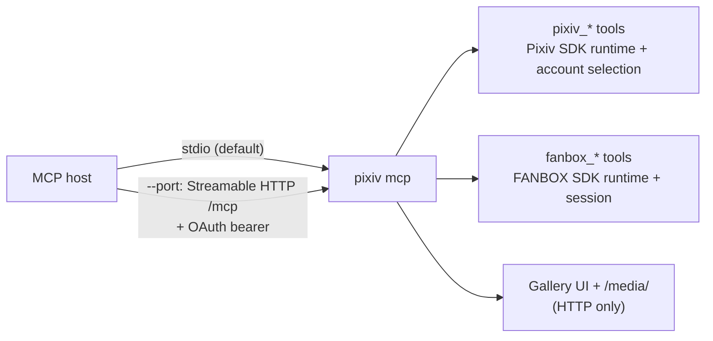
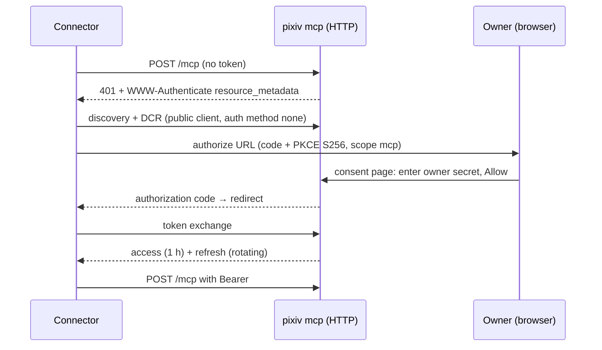
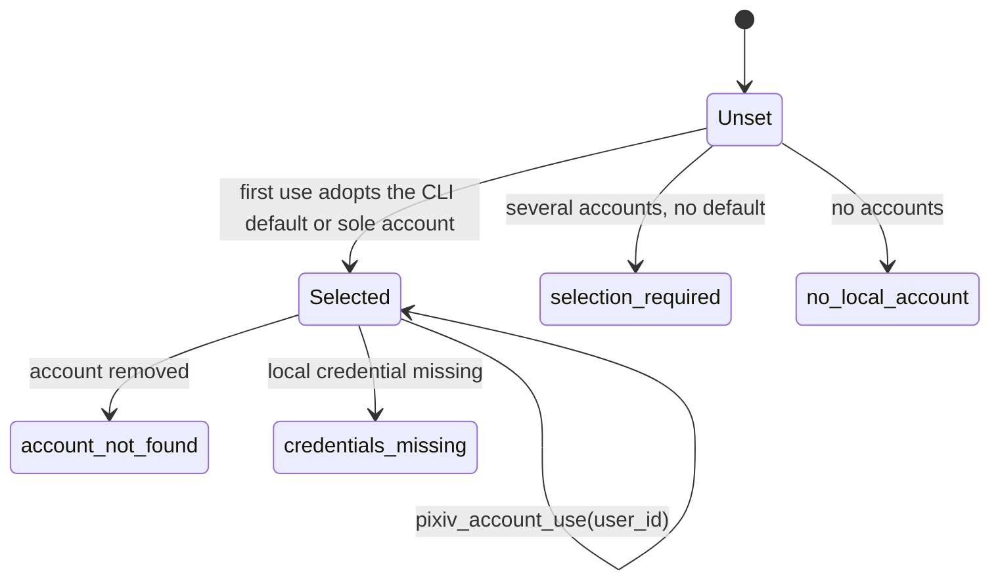
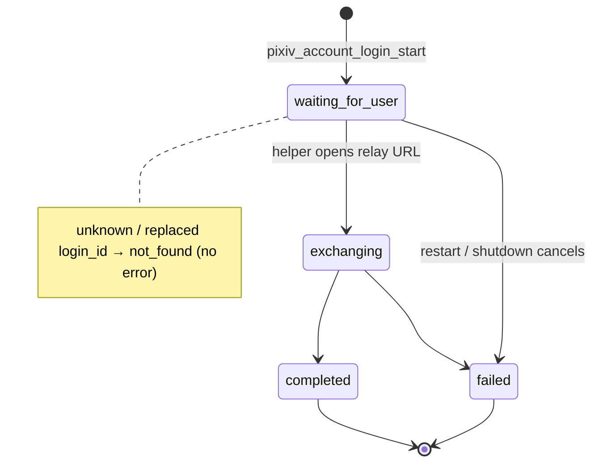
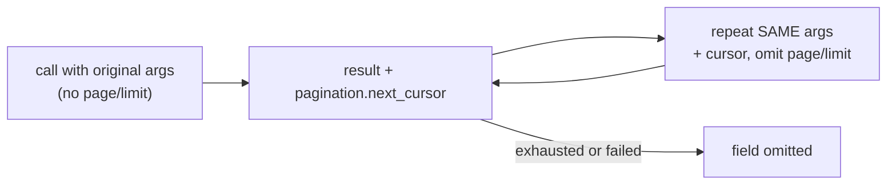

# MCP tools

[简体中文](../zh-CN/mcp-tools.md) | English | [Documentation index](../index.md)

Tool contracts for `pixiv mcp`. The MCP Apps gallery, animation delivery, caching and cancellation are in [MCP Apps gallery](mcp-gallery.md); startup and proxies in the [CLI reference](cli-reference.md#mcp-http-server).



| General rule | Detail |
| --- | --- |
| Transports | Stdio uses local product credentials, no HTTP owner state, no read-session file watcher. HTTP uses its persisted owner selection. Migrate `pixiv fanbox mcp` to the single `pixiv mcp` |
| Owner admin | `pixiv mcp auth init [--reset]` is a local command, not a tool or server launch — see [owner initialization](cli-reference.md#mcp-owner-initialization) |
| Schemas | Optional inputs stay optional: an object with no required fields omits `required` or uses `required: []`, never `required: null` (strict clients reject the whole discovery response otherwise) |
| Names | Pixiv tools use `pixiv_`, FANBOX `fanbox_`; old Pixiv names are not aliases. One server, independent SDK runtimes and credentials |
| `pixiv_novel_content` | Retained compatibility tool: a positive `novel_id` returns structured `content_unavailable`, `isError=true`, empty content blocks; never calls `/v1/novel/content`, no WebView fallback. Use `pixiv_novel_detail` for metadata |

## Transport capabilities

| Capability | stdio | HTTP |
| --- | --- | --- |
| Pixiv/FANBOX query and mutation tools, opaque FANBOX resources | Yes | Yes |
| `pixiv_artwork_media` complete images / GIF / APNG and PNG preview | Inline content | Inline or protected App delivery |
| `pixiv_download`, `pixiv_download_random_from_recommendation` | Local files | Unregistered |
| `pixiv_show_gallery`, `pixiv_show_artwork`, `pixiv_gallery_animation`, Gallery resources | Unregistered | Available with media service |
| `pixiv_account_*` owner management / helper login | Use local CLI authentication | Owner state and relay |

## HTTP authorization



- Built-in single-owner OAuth server: protected-resource and authorization-server metadata, DCR public clients (`token_endpoint_auth_method=none`), Authorization Code + PKCE S256, scope `mcp`. The owner enters the secret only on the instance consent page — never in chat or tool arguments — and every authorization needs explicit consent.
- Cloud deployment requires an HTTPS reverse proxy; local HTTP is supported. This contract is not evidence that ChatGPT or Gemini live connection testing passed.

| Topic | Rule |
| --- | --- |
| Bearer | Every `/mcp` request needs a valid token. Missing/expired/revoked → HTTP 401 with canonical `WWW-Authenticate`, not a tool result. Unavailable private auth state fails closed |
| Caching | MCP responses are `Cache-Control: no-store`, including SSE |
| Tokens | Access lasts one hour. Refresh rotates the pair; reusing an old refresh token revokes its grant |
| Reset / restart | Reset revokes grants, invalidates owner sessions and unexchanged codes, keeps registered clients. Restart drops in-memory sessions/codes, not persisted clients or grants. Expiry/reset affects new requests, not already-authorized work |
| Cancellation | Server cancellation stops acceptance and cancels/waits for active handlers; modern-revision request cancellation propagates through the official SDK |
| Body limits | OAuth control requests and query strings ≤ 64 KiB (oversized → 413, no truncation). Control bodies must finish within 10 s (slow → 408 + close). Successful reads clear the deadline before parsing/authorization/storage; early rejection keeps it so cleanup cannot drain an incomplete body forever |
| DCR registry | ≤ 1024 clients. At capacity a new registration replaces an arbitrary client with neither owner approval nor a grant, so anonymous registrations cannot exhaust it; a pending client may need to re-register under pressure |
| Approval marker | Explicit owner consent durably protects a client before a code is issued; DCR metadata cannot set this private marker. Existing grants (including revoked ones from older state files) also protect clients; reset keeps approval before clearing grants. All 1024 protected → `temporarily_unavailable` (503); admins review stale approved clients/grants in private state while stopped. Older binaries rejecting unknown private-state fields cannot read state with the marker |
| Pending entries | Owner sessions, forms and codes: ≤ 1024 each, `temporarily_unavailable` (503) at capacity, no eviction. Sessions/forms expire after 10 min (= code lifetime), reclaimed on the next auth state read |
| Deadlines | HTTP header admission 10 s. Tool execution, media transfer and shutdown have no new completion deadline. These bounds address unauthenticated growth, not upstream media size |

## Pixiv account selection

Applies to HTTP. Stdio uses local CLI account selection and authentication.



- One persisted selection shared by all connectors; never replaced implicitly. Local credential presence does not prove upstream validity.
- The first SDK access in a tool call fixes the account snapshot for later reads and writes. Explicit selection overrides pool scheduling without changing the CLI default.

### Account tools

| Tool | Input and semantics |
| --- | --- |
| `pixiv_account_list` | Empty object; all local account summaries and the shared selection. |
| `pixiv_account_status` | Empty object for local selection/credential presence; optional string `login_id` queries login progress without reading account storage. |
| `pixiv_account_use` | Required positive integer `user_id`; checks local existence, then persists the selection for all connectors. |
| `pixiv_account_login_start` | Optional boolean `restart` (default `false`); starts or reuses the server-owned helper login. |

- Closed input objects. The three local operations (status without `login_id`) return `selected_user_id`, `selection_state`, `credential_state`, `accounts` (`user_id`, `username`, `has_credentials`).
- Status may persist the initial default/sole-account choice, so all three publish `readOnlyHint=false`, `destructiveHint=false`, `idempotentHint=true`, `openWorldHint=false`. A successful status can report an unusable account; it is not an upstream auth check.
- Failures keep the structured envelope with `error` and `isError=true`: `invalid_request` (schema), `invalid_user_id`, `account_not_found`, `owner_not_initialized`, `canceled`, `deadline_exceeded`, `local_state_error`. Unavailable state reports `unknown`, not an empty account. Raw arguments, credentials, paths and storage causes are never echoed.

### New-account login



| Step | Contract |
| --- | --- |
| Start result | `login_id`, `authorization_url` (this server's relay entry, not the SDK OAuth URL), `status`, `requires_local_helper` (true on success), `instructions` |
| User action | Open the URL on a computer with pixiv-cli and its `pixiv://` helper; if it does not open, (re)install via the official installer and reopen. No timer guesses helper availability. Never paste callback URLs, codes or tokens into chat |
| Repeat start | Reuses a waiting/exchanging flow. `restart=true` cancels and joins it first. After completion a new start replaces the result; no history |
| Annotations | `readOnlyHint=false`, `destructiveHint=true`, `idempotentHint=false`, `openWorldHint=true` (restart discards pending login; the flow may save an account and update shared selection). CLI default untouched |
| Status query | `pixiv_account_status({"login_id":"..."})` → `login` object. Does not read account storage: selection/credential fields are `unknown` with zero/empty placeholders — query without `login_id` for real selection |
| Success | `login.account`, `account_saved=true`. An existing selection with local credentials is kept (`selection_updated=false`, `status=completed`); only an unset, missing-account or credential-less selection adopts the new account (`selection_updated=true`) |
| Concurrency | Availability is checked under the selection lock, so a concurrent explicit choice is not overwritten with stale data |
| Saved but not selected | `isError=true`, `account_saved=true`, `selection_updated=false` — fix the local write problem and call `pixiv_account_use`, don't log in again |
| Errors | `login.error_code` = `login_failed` or `login_cancelled` (never raw storage causes). Start failure: `status=failed`, `error=login_start_failed`, `isError=true`; invalid input: same envelope with `error=invalid_request` |
| Lifetime | Owned by the server, not the start request or helper connection. Restart and shutdown cancel and join; no fixed login timeout or raw-callback completion tool. Loopback fixtures cover this, not real helper installation or host browser acceptance |

## Errors, pagination, and output

| Situation | Result |
| --- | --- |
| Schema-invalid input | Rejected before the SDK opens: MCP SDK tool result with `isError=true` + text diagnostic, no structured output; not a JSON-RPC error. Account tools and reverse search instead return their sanitized structured envelope |
| Failure after handler execution | Tool's structured result kept, `isError=true`; entity reads return empty `records` |
| Normal empty page | Success, never converted to an error |

**List tools** accept `page` and `limit`:

| Input | Meaning |
| --- | --- |
| no `limit` | one upstream batch |
| positive `limit` | fill the logical page across batches |
| `limit: 0` | traverse until the cursor ends |
| `page` | 1-based; requires positive `limit` |

Entity filters run before logical pagination; duplicates are removed by stable entity identity. Results expose `pagination.page`, `limit`, `returned`, `has_more`, and `next_page` when another logical page exists. `pixiv_recommended(kind="all")` exposes independent pagination for illust, manga, novel and user. Most SDK cursors stay inside the server.

**Default-batch cursors** — `pixiv_search_illust`, `pixiv_illust_related`, `pixiv_illust_ranking`, `pixiv_illust_recommended` return `pagination.next_cursor` when a default batch has more:



- The envelope binds the original arguments (query/strategy, artwork ID, ranking mode/date, filters) and carries SDK continuation state, not credentials — encoding, not encryption or authorization. The SDK revalidates operation/query/account binding each time.
- Changed arguments, incompatible account, malformed or immediately repeated cursors fail explicitly. A batch consumes all returned items before advancing, including traversal past filtered-empty upstream batches. Positive-limit logical pagination is unchanged.
- `pixiv_recommended`: default batches attach `next_cursor` independently to `pagination.illust`, `manga`, `novel`, `user`. A stream cursor needs its matching single `kind`, the same applicable filter, omitted `page`/`limit`; `kind=all` with a cursor is rejected — drop other kinds' filters. Initial illust/manga projections share one upstream window; continuing one does not consume the other. An empty filtered visual window can still continue; filters excluding a visual kind produce no cursor for it. Failed or replayed attempts never leak records or pagination from earlier attempts.

**`pixiv_comments`** — closed input `{kind, id, page, limit}`, required `kind=artwork|novel`, positive `id`. Output `{comments, pagination}` plus optional `total` / `access_control` (omitted when upstream lacks them). Artwork and novel use their current comment operations. Opaque numeric `comment_access_control` is kept as `access_control.comment_access_control` — no inferred `can_comment`/`is_locked`. No mutation-only `stamp_id`; no standalone `stamps` tool.

**Output safety** — records keep public fields and an opaque resource reference when needed; never resolved/signed URLs, request headers, Cookies, expiry metadata, access tokens or other transport credentials (same for novel content blocks and comment/profile images). Structured results use the public SDK models and typed envelopes. FANBOX first-party resources carry opaque `ref` and optional `requires_credentials`, never `url`, `request_headers` or `expires_at`.

## Reverse image search

`pixiv_reverse_search` takes a closed object with **exactly one** of `source` or `image` (neither or both is an error) and optional `provider`:

```json
{"source":"/private/path/image.png","provider":"ascii2d-color"}
{"image":{"download_url":"https://host.example/image?signature=temporary","file_id":"host-file-id","mime_type":"image/png","file_name":"image.png"}}
```

| Input | Rules |
| --- | --- |
| `source` | Server-local regular-file path, local `file://` URI, or HTTP(S) URL |
| `file://` URI | Absolute path; empty or `localhost` authority. Other authorities, userinfo, query, fragment, NUL and UNC paths are rejected (not discarded). Percent-encode spaces, `#`, `%`. MCP-only rules, not CLI mode selection |
| `image` | Host attachment, advertised via `_meta["openai/fileParams"] = ["image"]`. Closed object, four string fields: required `download_url`, `file_id`; optional `mime_type`, `file_name` |
| `download_url` | HTTP(S) with host, no userinfo; local paths/file URIs invalid. Only this enters the snapshot loader; file ID, MIME and name are never forwarded. Expired/unavailable → error asks to reattach; no guessed URL or retry |
| `file_id` | Non-empty, descriptive only, never a download address |
| `provider` | `saucenao`, `ascii2d-color`, `ascii2d-bovw`, `all`; omitted → startup config (default `saucenao`) |

- `reverse_search_pixiv_only`, proxy, API key and transport settings are captured at startup; a call cannot change them.
- Network surfaces (startup): standard source/SauceNAO client (global proxy route); ascii2d browser client (`[reverse_search.network].proxy_url` if present, explicit empty = direct; `user_agent` ascii2d-only with matching `Sec-CH-UA*` hints for Chromium, omitted otherwise); FlareSolverr JSON control client (`[reverse_search.flaresolverr].proxy_url` is only the browser upstream in `sessions.create`; control traffic inherits neither native route).

> [!WARNING]
> `source` refers to the **MCP server's** filesystem and network, not the connector device. Private, loopback and link-local targets are allowed and the server may read private files. A single-owner OAuth grant lets the connector request these — authorize only trusted connectors.

- The source is fetched/opened once into a private snapshot, uploaded to the selected provider(s), and removed on completion, failure or cancellation. Never returned or logged: original source, attachment URL, file ID, file name, temp path, request headers, cookies, API key, CSRF value, redirect `Location`, upstream body. SauceNAO/ascii2d processing and retention follow their policies; URL queries may be cached. ascii2d accepts JPEG, PNG, WEBP with its own 10 MB limit — not a reverse-search-wide 1 MiB rule (`gzip, deflate, br` is response negotiation).
- The image goes natively to ascii2d `/search/file` multipart; FlareSolverr receives only JSON challenge-recovery requests. Solver state is process/client-scoped, never persisted.

| Output field | Content |
| --- | --- |
| envelope | always `{input, providers, results, records, provider_errors, partial}` |
| `input` | only `kind` and `sha256` |
| `providers` | fixed provider status list |
| `results` | provider evidence + optional canonical Pixiv identity; external-only results stay here |
| `records` | canonical `artwork` (deliberately generic — no detail call to guess subtype) or `user` |
| `provider_errors` | only stable `provider`, `code`, `message`; causes sanitized first |

| Outcome | `partial` | `isError` |
| --- | --- | --- |
| ≥1 provider succeeds, another fails | `true` | `false` |
| single provider fails / all fail | — | `true`, envelope kept |
| schema error | — | safe `invalid_request` envelope before execution, invalid values not echoed |
| cancellation | — | full request cancellation, never partial success |

Error codes: `unknown`, `invalid_request`, `invalid_source`, `source_not_regular_file`, `source_read_failed`, `source_http_status`, `snapshot_failed`, `source_loader_not_configured`, `provider_not_configured`, `missing_credential`, `malformed_upstream_response`, `upstream_http_status`, `provider_failed`, `all_providers_failed`, `challenge_required`, `solver_unavailable`, `solver_failed`, `malformed_solver_response`.

## Entity filters and bookmark-count search

Only these typed filters are inputs; the former top-level expression `filter` is not published (it was never connected).

| Filter | Fields |
| --- | --- |
| `illust_filter` | `id` (positive), `type` (`illust`, `manga`, or `ugoira`), `tags` (all exact matches), `min_views` (non-negative), `min_pages` (non-negative) |
| `novel_filter` | `id` (positive), `tags` (all exact matches), `min_views` (non-negative) |
| `user_filter` | `id` (positive) |

Artwork search also accepts inclusive non-negative `bookmark_min`, `bookmark_max` and `bookmark_strategy`; the outcome reports `filter.min`, `filter.max`, `membership`, `strategy`, `completeness`.

| `bookmark_strategy` | Behavior |
| --- | --- |
| `auto` | currently local `TotalBookmarks` filtering over fetched candidates |
| `local` | same exact candidate filtering, no global completeness claim |
| `best_effort` | App candidate bounds, partial completeness |
| `server` | fails explicitly until reliable server behavior is evidenced; no silent fallback |

For `pixiv_search_illust`, bookmark bounds and `illust_filter` are combined with AND before logical page/limit selection. Explicit `auto`, `local`, or `best_effort` without bounds still applies `illust_filter`. Repeat both filters and the strategy when continuing with a cursor.

`best_effort` always reports `partial`, including empty or exhausted candidate streams. `auto`/`local` report `complete_for_source` only when the candidate stream is exhausted with no undelivered results; this does not claim completeness beyond that source.

Unknown membership is not non-Premium; Premium is not a local hard gate; a bookmark count is not a like count.

## Artwork media

`pixiv_artwork_media` reads bytes through the selected account's SDK resource client — no server filesystem download. Search/detail/list tools stay metadata-only.

| Input | Contract |
| --- | --- |
| `illust_id` | Required positive integer. |
| `pages` | Optional array of one-based page numbers; omission means every page. Empty arrays, nonpositive or out-of-range pages fail. Duplicates are removed in request order. |
| `quality` | Static images use `regular` by default; `thumbnail` uses the SDK thumb variant, and `original` must be explicitly requested. No local resizing. |
| `animation_format` | Ugoira: `gif` (default) or `apng`; any supplied value on static artwork fails. |

- Input is validated before opening an account snapshot where possible; page bounds need metadata but are checked before any media read. One SDK lease binds detail and all media reads to one account, keeps Pixiv Referer and resource-host validation, and closes bodies and the lease on every exit. Static reads create no temp files; no implicit page/byte caps; no cross-account retries of partial delivery.
- Result: `illust_id`, `title`, `total_pages`, `requested_pages`, `delivered_pages`, `pages`, `failures`, `complete`. Each delivered page: one-based `page`, actual `mime_type` (detected from bytes), byte `size`, zero-based `content_index` into the MCP content array, whose entry is standard `ImageContent` with real bytes (never a URL/path). Unexpected HTTP status, read/close errors or non-image bodies are not delivered pages.
- Partial results keep successful images in request order, list failed pages with `error` and optional `http_status`, and set `complete=false`, `isError=true` — retry the failed pages explicitly. Input errors: `invalid_request` (schema), `invalid_illust_id`, `invalid_pages`, `invalid_quality`, `invalid_animation_format`, `animation_format_not_applicable`. Other failures are explicit and redact upstream bodies, URLs and credentials. A top-level `error` = whole-call failure; page failures live in `failures`.
- `complete=true` describes what the server built, not host acceptance. If a host rejects the payload, request explicit pages instead; no universal payload limit is invented. Annotations: read-only, non-destructive, idempotent, open-world. Synthetic tests do not establish ChatGPT/Gemini display support.
- MCP Apps clients get App-only delivery (`_meta["pixiv/mediaContents"]`, protected links, refresh) — see [media delivery to MCP Apps](mcp-gallery.md#media-delivery-to-mcp-apps).

### Ugoira animation

| Aspect | Contract |
| --- | --- |
| Inputs | Omit `pages` and `quality` (else `static_parameters_not_applicable` before archive reads); `animation_format` `gif` (default) or `apng` |
| Archive | Reuses the CLI policy: prefer original, else the available archive. `archive_quality` reports the real one; medium is never labeled original. The static `regular` default is not a resize |
| GIF | Skips repeated unchanged regions in opaque animations without changing quantized pixels, frame count or timing; transparent animations keep full-frame background clearing |
| APNG | Lossless frame differences where compatible with exact alpha compositing; all frames, dimensions and delays intact. Reduces redundancy, no guarantee every host accepts large results |
| Result | One logical page (`total_pages=1`). `pages` entry: `filename` (`<illust_id>.gif`/`.apng`), MIME, size, `archive_quality`, `content_index` → `ImageContent` with all bytes. APNG content MIME is `image/png` (all chunks intact) while structured `mime_type` is `image/apng`. `preview_content_index` → separate PNG of the first frame (preview only). Use index + filename, not "every `image/png` is a preview" |
| Workspace | Go encoder in a private temp workspace; archive save, encoding, preview decode and cleanup share one account lease; removed before success. Failures/cancellation publish no paths and never mark a preview-only result complete. No ffmpeg or new encoder |

## Tool annotations and downloads

| Tool class | Annotations |
| --- | --- |
| Reads (except account tools above) | read-only, non-destructive, idempotent |
| Bookmark/follow additions | non-destructive, idempotent writes |
| Removals, comment deletion | destructive, idempotent writes |
| Comment create/reply/stamp | non-destructive, non-idempotent writes |
| Local downloads | write/destructive (the shared saver may replace existing files) |

Hints support host approval; they are not server-enforced authorization. `openWorldHint` is true for external operations (including reverse-search uploads and Pixiv reads that may authenticate); `pixiv_account_list`, `pixiv_account_status`, `pixiv_account_use` and `fanbox_resolve_url` (local snapshot + URL parsing, no network) are closed-world.

**Stdio downloads** — `pixiv_download` (`src` or `srcs`, optional `pages`, `quality`, `ugoira_mode`, `delivery=local_path`) and `pixiv_download_random_from_recommendation` (optional `count`, default 5, range 1–20, same options). They reuse the shared downloader and CLI download directory/filename/directory templates; results keep `items`, `files` (path/file URI/MIME/size/page), warnings and partial failures; failures set `isError=true`. No arbitrary destination parameter. HTTP never registers them. Old `download` / `download_random_from_recommendation` names have no aliases.

## Tool migration

Consolidated tools need an explicit selector — no implicit target type. Old names are unregistered (no aliases). Output schemas, mutation `action` values and output ID fields are unchanged; only target inputs become `id` where shown. Filters for another entity type are rejected before account access.

| Previous entry | Current call / argument change |
| --- | --- |
| `pixiv_illust_comments`, `pixiv_novel_comments` | `pixiv_comments`, add `kind=artwork` / `novel`; retain `id` |
| `pixiv_create_artwork_comment`, `pixiv_create_novel_comment` | `pixiv_comment_create`, add `kind`; rename `illust_id` / `novel_id` to `id` |
| `pixiv_reply_artwork_comment`, `pixiv_reply_novel_comment` | `pixiv_comment_reply`, same target mapping; retain `parent_comment_id` |
| `pixiv_stamp_artwork_comment`, `pixiv_stamp_novel_comment` | `pixiv_comment_stamp`, same target mapping; retain `stamp_id` and optional `comment` |
| `pixiv_delete_artwork_comment`, `pixiv_delete_novel_comment` | `pixiv_comment_delete`, add `kind=artwork` / `novel`; retain `comment_id` |
| `pixiv_add_bookmark`, `pixiv_add_novel_bookmark` | `pixiv_bookmark_add`, add `kind=artwork` / `novel`; rename target to `id`; retain `restrict` and `tags` |
| `pixiv_remove_bookmark`, `pixiv_remove_novel_bookmark` | `pixiv_bookmark_remove`, add `kind=artwork` / `novel`; rename target to `id` |
| `pixiv_novel_bookmark_tags` | `pixiv_bookmark_tags`, add `kind="novel"` (`artwork` is the default); paging/visibility and output envelope preserved |
| `fanbox_creator_posts`, `fanbox_tagged_posts` | `fanbox_creator_posts`, omit `tag` / retain required non-empty tag |
| `fanbox_home`, `fanbox_supporting` | `fanbox_feed(source=home)` / `fanbox_feed(source=supporting)` |
| `pixiv_user_bookmarks`, `pixiv_user_novel_bookmarks` | `pixiv_user_bookmarks`, add `kind=artwork` / `novel` |
| `pixiv_user_followers`, `pixiv_user_following`, `pixiv_related_users` | `pixiv_user_relations`, add `relation=followers` / `following` / `related` |
| `pixiv_timeline_illust_following`, `pixiv_timeline_novel_following` | `pixiv_timeline_following`, add `kind=artwork` / `novel` |
| `pixiv_timeline_illust_latest`, `pixiv_timeline_novel_latest` | `pixiv_timeline_latest`, retain `content_type=illust\|manga` / add `content_type=novel` |
| `pixiv_mypixiv_illusts`, `pixiv_mypixiv_novels`, `pixiv_mypixiv_users` | `pixiv_mypixiv`, add `kind=artwork` / `novel` / `user` |
| `download`, `download_random_from_recommendation` | `pixiv_download`, `pixiv_download_random_from_recommendation` (stdio only) |

- `kind=artwork` includes manga and Ugoira where the original operation did. Only the matching `illust_filter` / `novel_filter` / `user_filter` may be supplied; novel user bookmarks have no new filter. `restrict` affects followers/following only; related users keep their ignored-field behavior.
- Still separate: `pixiv_bookmark_list_all` (one logical budget across artwork-then-novel); `pixiv_illust_recommended` vs `pixiv_recommended` (the former filters during collection and returns a records pagination envelope; the latter projects typed streams from one window with different cursor binding and pagination). Reads/writes, additions/removals, login/status, Gallery/media, local downloads/protected HTTP media and Pixiv/FANBOX credentials stay distinct.

## Read tools

Artwork records from `search_illust` and `illust_detail` keep upstream `is_bookmarked`, `is_muted`, `visible`, `sanity_level`, `restriction_attributes` and optional `series` (`id`, `title`); detail adds `total_comments` when supplied. Viewer state = the reading account. No per-result enrichment. Absent fields are omitted (unknown, not `false`/`0`); an explicitly empty restriction list stays `[]`.

| Tool | Input and semantics |
| --- | --- |
| `pixiv_search_illust` | Required `word`; optional `search_target`, `sort`, `duration`, `start_date`, `end_date`, `content_type`, `ai_mode`, `aspect_ratio`, `resolution`, exact `tool`, bookmark range/strategy, `illust_filter`, `page`, `limit`. Enum/date validation before the SDK opens. Default-batch `cursor` keeps bookmark strategy checkpoints; omit `page`/`limit`, repeat query, filters and strategy. |
| `pixiv_search_novel` | Required `word`; optional `search_target`, `sort`, `duration`, `novel_filter`, `page`, `limit`. Rating, text-length, original-only intentionally unpublished. |
| `pixiv_reverse_search` | Exactly one of `source` or host `image`; optional `provider`. See [reverse image search](#reverse-image-search). |
| `pixiv_illust_detail` | Exactly one of positive `illust_id` or a supported artwork `url`; one safe record. |
| `pixiv_novel_detail` / `pixiv_novel_content` | Positive `novel_id`; metadata / retained `content_unavailable` compatibility tool (empty blocks, rejected endpoint not called). |
| `pixiv_illust_related` | Positive `illust_id`, optional `illust_filter`, `page`, `limit`; `cursor` needs omitted `page`/`limit`. |
| `pixiv_illust_series` / `pixiv_novel_series` | Positive `series_id`, `page`, `limit`; novel series also returns safe series metadata. |
| `pixiv_comments` | Required `kind=artwork\|novel`, positive `id`; optional `page`, `limit`. See [above](#errors-pagination-and-output). |
| `pixiv_illust_ranking` | Optional `mode` (closed enum, default `day`), `date` (valid `YYYY-MM-DD`), `illust_filter`, `page`, `limit`; `cursor` needs omitted `page`/`limit`. |
| `pixiv_search_user` | Required non-blank `word` (blank rejected before the SDK), optional `user_filter`, `page`, `limit`; App user search. |
| `pixiv_illust_recommended` | Optional `illust_filter`, `page`, `limit`; `cursor` needs omitted `page`/`limit`. |
| `pixiv_recommended` | Required `kind`: `all`, `illust`, `manga`, `novel`, `user`; matching typed filters, `page`, `limit`. `illust`/`manga` select the subtype; conflicting filters rejected before the SDK; `all` = four independent streams, atomic failure. `cursor` needs a matching single kind and omitted page/limit. |
| `pixiv_trending_tags_illust` | No input; complete current artwork trending-tag list; empty upstream = successful empty result. |
| `pixiv_timeline_following` | Required `kind=artwork\|novel`; optional `restrict` (`public` default or `private`), matching filter, `page`, `limit`. Artwork includes illust, manga, Ugoira. |
| `pixiv_timeline_latest` | Required `content_type=illust\|manga\|novel`; optional matching filter, `page`, `limit`. |
| `pixiv_mypixiv` | Required `kind=artwork\|novel\|user`; optional matching filter, `page`, `limit`. Authenticated account's MyPixiv only. |
| `pixiv_user_detail` | Required positive `user_id`; one safe public profile record. |
| `pixiv_user_artworks` | Optional `user_id`, `type` (`illust`, `manga`, `ugoira`), `illust_filter`, `page`, `limit`; omitted ID = authenticated user. |
| `pixiv_user_novels` | Optional `user_id`, `novel_filter`, `page`, `limit`; omitted ID = authenticated user. |
| `pixiv_user_bookmarks` | Required `kind=artwork\|novel`; optional `user_id`, `restrict`, `tag`, `page`, `limit`; `illust_filter` artwork-only. Omitted/zero user ID = authenticated account; null paging/filter values keep their meaning. |
| `pixiv_bookmark_list_all` | Optional `user_id`, `restrict`, `tag`, `page`, `limit`; artwork then novel bookmarks; `page`/`limit` over the concatenation; any required stream failure → error, no partial records. |
| `pixiv_bookmark_tags_all` | Optional `user_id`, `restrict`, `page`, `limit`; artwork then novel tags, each with `content_type` and original `count`; same-name tags not merged; any stream failure → no partial tags. |
| `pixiv_novel_bookmark_detail` | Required positive `novel_id`; `{bookmarked, restrict, tags}`, absent/unbookmarked state preserved; candidate novel-bookmark detail App API. |
| `pixiv_user_relations` | Required `relation=followers\|following\|related`; optional `user_id`, `restrict`, `page`, `limit`; `user_filter` for following/related only; omitted ID = authenticated account; `restrict` accepted but ignored for related. |
| `pixiv_blocked_users` | Optional `user_id`, compatibility `restrict`, `page`, `limit`; omitted ID = authenticated user. App failure reported, never a Web fallback. |
| `pixiv_bookmark_tags` | Optional `kind` (`artwork` default or `novel`), `user_id`, `restrict`, `page`, `limit`; `{bookmark_tags, pagination}`. |
| `pixiv_bookmark_detail` | Required positive `illust_id`; `{bookmarked, restrict, tags}`; `tags` is `[]` when none, including unbookmarked. |

All reads use the same application/public-SDK path and keep typed authentication, authorization, not-found, upstream, cancellation and malformed-response errors — never an empty success from a missing optional port or failed App request.

## Write tools

| Tool | Input | Structured output |
| --- | --- | --- |
| `pixiv_bookmark_add` | `kind=artwork\|novel`, positive `id`, optional `restrict`, `tags` | `{success, action, illust_id}` or `{success, action, novel_id}` |
| `pixiv_bookmark_remove` | `kind=artwork\|novel`, positive `id` | `{success, action, illust_id}` or `{success, action, novel_id}` |
| `pixiv_comment_create` | `kind=artwork\|novel`, positive `id`, non-empty `comment` | `{success, action, illust_id/novel_id, comment_id}` |
| `pixiv_comment_reply` | Required `kind=artwork\|novel`, positive `id`, non-empty `comment` and positive `parent_comment_id` | `{success, action, illust_id/novel_id, comment_id}` |
| `pixiv_comment_stamp` | `kind=artwork\|novel`, positive `id` and `stamp_id`, optional `comment` (empty for sticker-only) | `{success, action, illust_id/novel_id, comment_id}` |
| `pixiv_comment_delete` | `kind=artwork\|novel`, positive `comment_id`; no content ID | `{success, action, comment_id}` |
| `pixiv_follow_user` | `user_id`, optional `restrict` | `{success, action, user_id}` |
| `pixiv_unfollow_user` | `user_id` | `{success, action, user_id}` |

An empty `restrict` on add = `public`; only `public`/`private`. Create/reply/stamp return the upstream `comment_id`; delete returns the supplied ID. The server never reads the latest comment to guess an ID, never falls back to the candidate v3 comments contract, and never replays an unknown post-submit state under another account. Failed writes return `success=false`, `isError=true`, a safe diagnostic.

## FANBOX tools

Same server, schemas via `tools/list`, FANBOX-specific credentials.

| Tools | Semantics |
| --- | --- |
| `fanbox_current_user` | Current authenticated FANBOX user. |
| `fanbox_creator`, `fanbox_creators` | One creator profile, or supporting/following creators. |
| `fanbox_creator_tags` | Tags used by a creator. |
| `fanbox_creator_posts` | Required `creator_id`; optional non-empty `tag`, `page`, `limit`. No tag → CreatorPosts; tag → TaggedPosts; explicit empty tag is an error. |
| `fanbox_post` | One post and its safe resource references. |
| `fanbox_feed` | Required `source=home\|supporting`; optional `page`, `limit`. Keeps each feed's API, post structure and FANBOX auth. |
| `fanbox_resolve_url` | Local URL parsing into a typed reference. |
| `fanbox_open_resource` | Opens an opaque `ref`; GET delivers bytes + safe metadata, HEAD metadata only. |

### FANBOX resource content

| Aspect | Contract |
| --- | --- |
| Lease | Independent FANBOX SDK lease only |
| GET content | Static images → `ImageContent`; GIF/APNG and other attachments → embedded-resource blobs. PNG vs APNG by the animation-control chunk, not just Content-Type. Valid non-image MIME kept; absent/malformed MIME detected from bytes. No server files, no byte cap |
| Fields | Existing `ref`, `status_code`, `content_type`, advertised `content_length`; `size` = actual bytes, `content_index`, `delivered` (bytes in this response), `complete` (request/cleanup success). HEAD: `delivered=false`, no index |
| URIs | Embedded resource URIs are content-hash URNs, not server paths or a resources/read endpoint |
| `filename` | GET and HEAD return it when file metadata has a name (extension included, no duplicated suffix). SDK owns name resolution; MCP never decodes refs or guesses from URLs, and applies CLI filename normalization (separators/reserved punctuation → `_`). A suggestion, not a trusted path; missing names stay absent |
| Failures | Non-success status, read/close errors, cancellation, lease-close errors stay structured; SDK categories kept without raw bodies, locations or invalid input. `status_code=0` = SDK exposed no status (a classified forbidden error gets no invented status). Schema → `invalid_request`; local ref/method → `invalid_ref` / `invalid_method`. Local synthetic tests only — not real account or host acceptance |

## Authentication and fallback

- Pixiv reads/writes require the App API path; no anonymous or Web fallback; App errors are final. A leftover `web_fallback_enabled` reports `removed_setting`.
- FANBOX shares the protocol server, not Pixiv credentials or the account pool. Each product keeps its SDK and service config; a command-level proxy override applies to both native clients.
