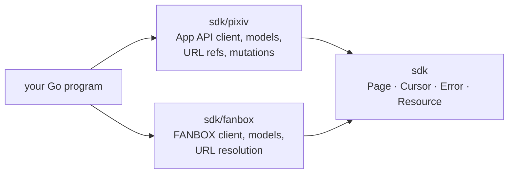
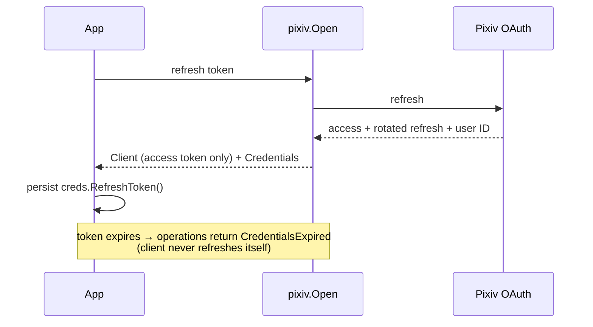
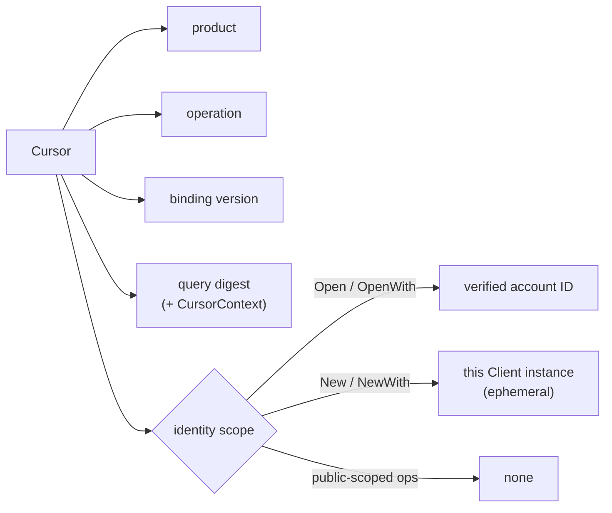
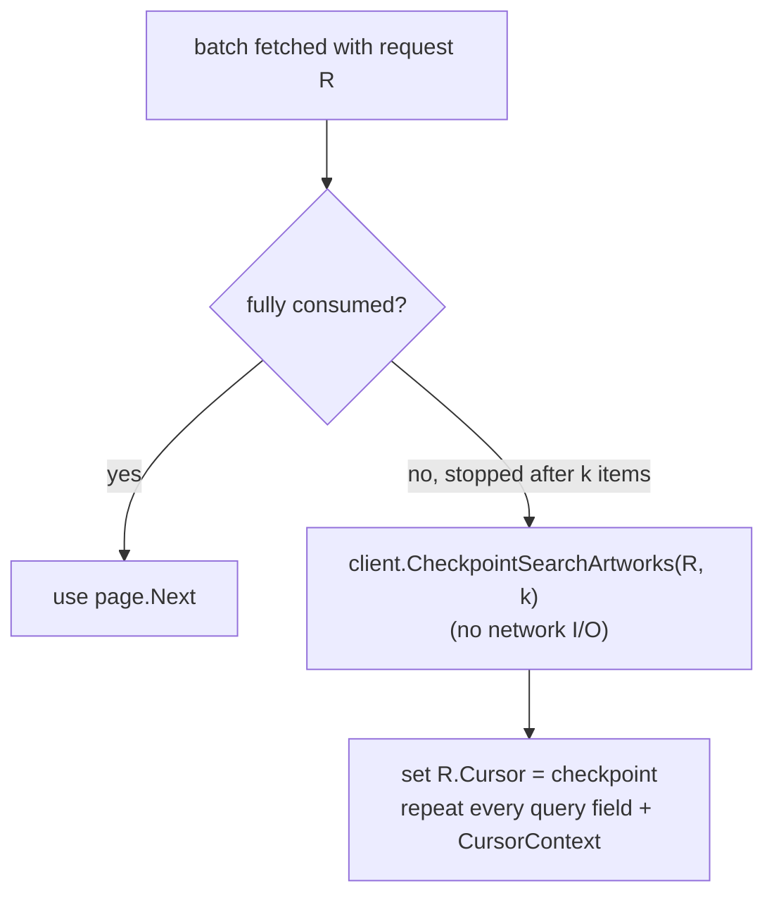
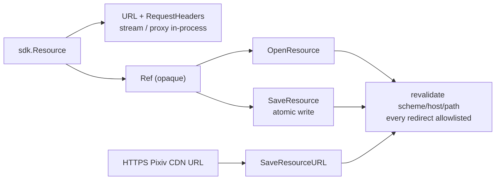

# Pixiv SDK (v1)

English | [简体中文](../zh-CN/sdk.md) | [Documentation index](../index.md)



| Package | Contents |
| --- | --- |
| `github.com/FlanChanXwO/pixiv-cli/sdk` | Protocol-agnostic primitives: pages, opaque cursors, classified errors, resource contract |
| `github.com/FlanChanXwO/pixiv-cli/sdk/pixiv` | Pixiv App API client, models, URL references, mutations |
| `github.com/FlanChanXwO/pixiv-cli/sdk/fanbox` | FANBOX client, models, URL resolution |

All exports carry English GoDoc; the package source is the canonical API summary.

## Quickstart

Pixiv: search with an existing access token and save the first image. This example reads a caller-supplied token from `PIXIV_ACCESS_TOKEN`; OAuth rotation is covered under Authentication below.

```go
package main

import (
	"context"
	"fmt"
	"os"

	"github.com/FlanChanXwO/pixiv-cli/sdk"
	"github.com/FlanChanXwO/pixiv-cli/sdk/pixiv"
)

func main() {
	ctx := context.Background()

	// 1. Construct with an existing access token; this step is offline.
	client, err := pixiv.New(os.Getenv("PIXIV_ACCESS_TOKEN"))
	if err != nil {
		panic(err)
	}
	defer client.CloseIdleConnections()

	// 2. Search artworks and iterate the typed page cursor.
	page, err := client.SearchArtworks(ctx, pixiv.SearchArtworksRequest{Word: "miku"})
	if err != nil {
		panic(err)
	}
	if len(page.Items) == 0 {
		return
	}
	first := page.Items[0]

	// 3. Fetch artwork pages (image resources).
	pages, err := client.ArtworkPages(ctx, pixiv.ArtworkPagesRequest{ArtworkID: first.ID})
	if err != nil {
		panic(err)
	}
	if len(pages) == 0 {
		return
	}

	// 4. Save the first image through the SDK-validated resource path.
	saved, err := client.SaveResource(ctx, pages[0].Image.Resource.Ref, sdk.SaveOptions{
		Path: "./first.png",
	})
	if err != nil {
		panic(err)
	}
	fmt.Println("saved", saved.Path)
}
```

FANBOX: open with a session, list supporting posts, read one post.

```go
client, err := fanbox.Open(fanbox.SessionCredentials{FANBOXSESSID: sess})
if err != nil {
    panic(err)
}
defer client.CloseIdleConnections()
page, err := client.Supporting(ctx, fanbox.SupportingRequest{})
if err != nil {
    panic(err)
}
if len(page.Items) == 0 {
    return
}
post, err := client.Post(ctx, fanbox.PostRequest{PostID: page.Items[0].ID})
if err != nil {
    panic(err)
}
_ = post // post.Body blocks carry image/file assets with their Resource refs
```

## Authentication

Pixiv is App-only: every content operation needs a valid access token. No anonymous or Web fallback.

```go
client, creds, err := pixiv.Open(ctx, refreshToken)
if err != nil {
    return err
}
defer client.CloseIdleConnections()
if err := saveRefreshToken(creds.RefreshToken()); err != nil {
    return err
}
// Issue content requests with client only after persistence succeeds.
```



`saveRefreshToken` stands for the application's existing private persistence function. `Credentials` also exposes `UserID`, `Username`, `ExpiresAt`, and `AccessToken()`. The SDK returns the rotation result; the application owns account storage.

- `Open` needs a positive account user ID in the OAuth response; otherwise it returns `MalformedUpstreamResponse` with no client or credentials.
- `New(accessToken)` / `NewWith(accessToken, options)` use a static token without network I/O at construction. `OpenWith(ctx, refreshToken, options)` applies connection settings before the first OAuth request.
- Both products release SDK-owned idle connections through `CloseIdleConnections`; a caller-supplied `HTTPClient` stays caller-owned.

### Programmatic browser login

`BeginLogin` creates a self-contained one-shot PKCE session. It opens no browser and no listener: the caller opens `AuthorizationURL()` and hands the callback or bare code to `Complete`.

```go
// Create session with BeginLogin, open session.AuthorizationURL(), then receive callbackURL.
if !session.AcceptsCallbackURL(callbackURL) {
    return fmt.Errorf("unexpected OAuth callback")
}
credentials, err := session.Complete(ctx, callbackURL)
if err != nil {
    return err
}
return saveRefreshToken(credentials.RefreshToken())
```

- `AcceptsCallbackURL` is non-consuming and offline. Official HTTPS callbacks require the session `state`; `pixiv://account/login` may omit it, but a supplied value must match.
- `IsOfficialOAuthCallbackURL` / `IsOfficialOAuthStartURL` validate browser input by exact origin without contacting Pixiv.
- The session never exposes verifier, state, code or callback URL through formatting.

### FANBOX

```go
client, err := fanbox.OpenWith(fanbox.SessionCredentials{FANBOXSESSID: session}, fanbox.Options{
    ProxyURL:  "https://proxy.example:8443", // native HTTP(S) CONNECT only
    UserAgent: "my-native-agent/1.0",          // native header only
    FlareSolverr: &fanbox.FlareSolverrOptions{
        URL:      "http://127.0.0.1:8191",
        ProxyURL: "socks5://solver-upstream.example:1080",
    },
})
if err != nil {
    return err
}
defer client.CloseIdleConnections()
```

> [!IMPORTANT]
> Pixiv refresh tokens and FANBOX sessions are independent and never convert.

- Native transport: tls-client Chrome 146 TLS profile. Empty `UserAgent` = built-in Firefox 148 HTTP header baseline.
- FlareSolverr is disabled when nil and consulted only after a strict native Cloudflare challenge; its service URL and upstream proxy are independent of the native proxy.
- The constructor performs no network I/O.

## Connections and logging

`pixiv.Options` configures `HTTPClient`, `AcceptLanguage`, `Pacing`, `ResourcePolicy`, and `Logger`; `fanbox.Options` configures `HTTPClient`, `ProxyURL`, `UserAgent`, `FlareSolverr`, and `Logger`. Both products accept the standard-library `*slog.Logger`; nil keeps the SDK silent.

```go
logger := slog.New(slog.NewJSONHandler(os.Stderr, &slog.HandlerOptions{
    Level: slog.LevelDebug,
}))
client, err := pixiv.NewWith(accessToken, pixiv.Options{Logger: logger})
if err != nil {
    return err
}
defer client.CloseIdleConnections()
```

The transport/protocol layer records request outcomes and retry, pacing, or challenge-recovery decisions. `sdk_operation` identifies the SDK method. Logs omit queries, headers, bodies, tokens, Cookies, and signed URLs. The application chooses the log destination; CLI/MCP use stderr.

## Pagination

List operations return `sdk.Page[T]` with an opaque `Cursor`:

```go
request := pixiv.SearchArtworksRequest{Word: "miku"}
for {
    page, err := client.SearchArtworks(ctx, request)
    if err != nil {
        return err
    }
    for _, artwork := range page.Items {
        fmt.Println(artwork.ID, artwork.Title)
    }
    if page.Next.IsZero() {
        break
    }
    request.Cursor = page.Next
}
```



| Cursor scope | Operations | Reuse |
| --- | --- | --- |
| Verified account | identity-scoped ops on a client from `Open`/`OpenWith` (incl. all `SearchArtworks`) | same account only |
| Client instance | identity-scoped ops on a client from `New`/`NewWith` (no verified ID) | same Client only; another Client or process gets `InvalidCursor` |
| Public | `SearchNovels`, `SearchUsers` | any client, same query |

> [!NOTE]
> Reusing a cursor with a different query returns `InvalidCursor`.

> [!WARNING]
> Cursor encoding gives continuation state and binding checks, not cryptographic authenticity. It is not a credential: keep secrets out of its identity, context and payload, and don't rely on tamper resistance across untrusted boundaries. The `SearchArtworks` binding-version change also requires the shared collector, SDK and callers to roll back together; a version-2 cursor is not consumable by the pre-version-2 search implementation.

- `SearchArtworksRequest.Offset` is the non-negative initial position in the raw App search stream (default 0), not a logical page after local filtering. Continuations must repeat the same `Offset` with `Cursor`; changing or omitting a nonzero offset returns `InvalidCursor`.
- Non-zero upstream continuations are positive typed positions: offset-based operations reject zero, negative and overflowing offsets before transport; value-based ones reject non-positive `last_order`, `max_bookmark_id`, `max_illust_id`. Recommended feeds keep their explicit `offset=0` exception (below).

### Resuming within an artwork search batch

`SearchArtworks` cursors use binding version **2** (including normal batch continuations); version-1 search cursors return `InvalidCursor` — discard and restart. Other operations keep their versions; the outer `sdk.Cursor` encoding is unchanged.



- `consumed` is positive and counts SDK items after normalization and AI filtering, including items your application later filtered or skipped. A checkpoint from an already-resumed request accumulates. Non-positive/overflowing → `InvalidArgument`; a position beyond the batch → `InvalidCursor` when fetched (never a silent restart). A checkpoint of the initial batch keeps a nonzero `Offset` and re-fetches that batch, not offset 0.
- Text/JSON codecs support persistence. `CursorContext` is a caller-defined local-filter context hashed into the binding, never sent upstream — change it when local filter semantics change. CLI/MCP bookmark search share a context for effective strategy and bounds (no new CLI flag or MCP field).
- Replay order: upstream batch → normalized items / AI filter → consumed prefix → caller filter and logical limit. This avoids gaps and duplicates for a stable source; re-fetching a live batch is **not** a snapshot and cannot guarantee stability under upstream insertions, deletions or reordering.

## Pixiv read operations

| Operation | Input highlights | Returns | Common errors |
| --- | --- | --- | --- |
| `SearchArtworks` | word, target, sort, date bounds, type, AI mode, aspect ratio, resolution, tool, bookmark bounds, raw initial `Offset` | `Page[Artwork]` | `InvalidArgument` (unknown enum, bad dates, bad bookmark range) |
| `SearchNovels` | word, target, sort, duration | `Page[Novel]` | `InvalidArgument` |
| `SearchUsers` | word | `Page[UserPreview]` | `InvalidArgument` |
| `ArtworkRanking` | mode (default `day`), optional `YYYY-MM-DD` | `Page[Artwork]` | `InvalidArgument` |
| `RecommendedArtworks` | cursor | `Page[Artwork]` | `InvalidCursor` |
| `FollowingArtworks` | `restrict` (`public`/`private`), cursor | `Page[Artwork]` | `InvalidArgument`, `InvalidCursor` |
| `LatestArtworks` | content type (`illust` by default or `manga`), cursor | `Page[Artwork]` | `InvalidArgument`, `InvalidCursor` |
| `NovelRanking` | mode (default `day`), cursor | `Page[Novel]` | `InvalidArgument`, `InvalidCursor` |
| `RecommendedNovels` | cursor | `Page[Novel]` | `InvalidCursor` |
| `FollowingNovels` | `restrict` (`public`/`private`), cursor | `Page[Novel]` | `InvalidArgument`, `InvalidCursor` |
| `LatestNovels` | cursor | `Page[Novel]` | `InvalidCursor` |
| `Stamps` | no query or cursor fields | `[]Stamp` | `MalformedUpstreamResponse`, classified upstream/transport errors |
| `Artwork` / `Novel` / `User` | positive typed ID | `Artwork` / `Novel` / `UserDetail` | `NotFound`, `InvalidArgument` |
| `ArtworkSeries` / `NovelSeries` | positive series ID, cursor | series page (novel also returns metadata) | `InvalidCursor` |
| `ArtworkComments` / `NovelComments` | positive ID, cursor | `CommentPage` | `NotFound` |
| `PostArtworkComment` / `ReplyArtworkComment` / `DeleteArtworkComment` | positive artwork ID; reply also requires a positive parent comment ID | `CommentMutationResult` for post/reply; `error` for delete | `InvalidArgument`, `MalformedUpstreamResponse`, classified upstream/transport errors |
| `StampArtworkComment` | positive artwork ID, optional comment (empty for sticker-only), positive stamp ID | `CommentMutationResult` | `InvalidArgument`, `MalformedUpstreamResponse`, classified upstream/transport errors |
| `PostNovelComment` / `ReplyNovelComment` / `DeleteNovelComment` | positive novel ID; reply also requires a positive parent comment ID | `CommentMutationResult` for post/reply; `error` for delete | `InvalidArgument`, `MalformedUpstreamResponse`, classified upstream/transport errors |
| `StampNovelComment` | positive novel ID, optional comment (empty for sticker-only), positive stamp ID | `CommentMutationResult` | `InvalidArgument`, `MalformedUpstreamResponse`, classified upstream/transport errors |
| `UserArtworkBookmarks` / `UserArtworkBookmarkTags` / `UserNovelBookmarks` / `UserNovelBookmarkTags` | `UserID`, `Restrict`, `tag`, cursor | typed page | `InvalidArgument`, `InvalidCursor` |
| `ArtworkBookmark` / `NovelBookmark` | positive artwork or novel ID | bookmark detail state | `InvalidArgument`, `MalformedUpstreamResponse`, classified upstream/transport errors |
| `AddArtworkBookmark` / `RemoveArtworkBookmark` | positive artwork ID; add accepts `Restrict` and tags | `error` | `InvalidArgument`, classified upstream/transport errors |
| `AddNovelBookmark` / `RemoveNovelBookmark` | positive novel ID; add accepts `Restrict` and tags | `error` | `InvalidArgument`, classified upstream/transport errors |

`NovelContent(ctx, NovelContentRequest{NovelID: id})` returns `InvalidArgument` for a non-positive ID and otherwise `ContentUnavailable`, without network I/O. Structured novel content is unsupported by the v1 App API.

### Key semantics

| Topic | Rule |
| --- | --- |
| `CurrentUser` | `/v1/user/detail` with the verified positive account ID and the Android filter; removed `/v1/user/me` not used |
| `SearchAIModeOnly` | Local batch filter over `Artwork.AIType == 2`; mode is in the cursor binding |
| Rankings | Cursors bind `mode` (and artwork `date`). `NovelRanking` sends fixed `for_android`, omits `offset` first, resumes only with the positive upstream `offset` |
| Recommended | `RecommendedArtworks` / `RecommendedNovels` distinguish omitted continuation from explicit `offset=0` (sent only when resuming). Artwork subtype filtering is not in the public request; don't infer it from caller-side filters |
| Identity-scoped users | `RelatedUsers`, `UserFollowing`, `UserFollowers`, `UserBlockedUsers` bind the verified account, else the client instance. Following/Followers normalize empty `restrict` → `public` before transport and binding |
| Following feeds | `FollowingArtworks` / `FollowingNovels`: empty `restrict` → `public`, other values rejected before transport, resolved value bound in the cursor |
| `LatestArtworks` | Empty type → `illust`; `manga` accepted; resolved subtype bound; `all`, `illust-and-ugoira`, `ugoira` rejected. Legacy `offset` and `max_illust_id` cursor forms must be positive |
| `LatestNovels` | Fixed `for_android`; cursor carries positive `max_novel_id`; no offset fallback; repeat the original request fields |
| Comments | Totals and access-control stay nil unless upstream supplied them; an empty list is a non-nil empty `Items` slice |
| `Stamps` | Authenticated `/v1/stamps`, no query/continuation. Each `Stamp` has a positive stable ID and an `ImageResource` (no claimed dimensions or extra fields); refs use the opaque resource boundary and are re-resolved from `/v1/stamps` in a new client |
| Comment post/reply | Namespace-specific add endpoint; `CommentMutationResult.CommentID` only when upstream returns a positive `comment_id`. Not read-back confirmation; no guessed recent comment, no read-back, no automatic replay of an uncertain mutation |
| Comment delete | Namespace-specific delete with the supplied positive `comment_id`; local shape validated, upstream result classified; ownership, namespace proof, read-back and cleanup are application responsibilities |
| Stamp comments | Namespace-specific add endpoint with independent `stamp_id`; `comment` optional (empty = sticker-only wire); never encoded as a reply parent or text fallback; same direct-response, no-read-back rule |
| Bookmark detail | `ArtworkBookmark` / `NovelBookmark` represent absence with empty `Restrict` and tags. `NovelBookmark` and `UserNovelBookmarkTags` follow candidate upstream contracts: novel bookmark tags have no continuation and reject a non-zero cursor until verified |
| Bookmark mutations | `AddArtworkBookmark` / `RemoveArtworkBookmark` use artwork endpoints. `AddNovelBookmark` / `RemoveNovelBookmark` use novel endpoints. Add defaults empty `Restrict` → `public` and rejects others locally. Status-only success, no read-back, no replay |
| Bookmark bounds | `BookmarkMin` / `BookmarkMax`: optional, inclusive, non-negative App candidate bounds forwarded as `bookmark_num_min` / `bookmark_num_max`; no Premium preflight, no global completeness claim, no silent strategy fallback. Applications may recheck `Artwork.TotalBookmarks` and must report strategy and completeness separately |

## Errors

All failures are `*sdk.Error` with a stable `Reason`:

```text
invalid_argument, invalid_cursor, unauthorized, credentials_expired, forbidden,
not_found, content_unavailable, challenge_required, rate_limited, upstream_error,
upstream_unavailable, malformed_upstream_response, resource_forbidden,
local_state_error, removed_setting
```

`errors.Is` / `errors.As` work; `context.Canceled` / `DeadlineExceeded` are preserved. The chain never contains URLs, headers, tokens, cookies or config content.

```go
if errors.Is(err, &sdk.Error{Reason: sdk.Unauthorized}) {
    // re-authenticate
} else if sdk.ReasonOf(err) == sdk.RateLimited {
    // back off using RetryAdvice
}
```

## Resources



Stream the first image into the caller-provided `io.Writer` named `dst`:

```go
page, err := client.ArtworkPages(ctx, pixiv.ArtworkPagesRequest{ArtworkID: id})
if err != nil {
    return err
}
if len(page) == 0 {
    return nil
}
image := page[0].Image.Resource
resp, err := client.OpenResource(ctx, sdk.OpenResourceRequest{Ref: image.Ref})
if err != nil {
    return err
}
defer resp.Body.Close()
_, err = io.Copy(dst, resp.Body)
return err
```

To save the same resource atomically:

```go
// Save through the SDK-validated path (revalidates URL/redirects, atomic write).
saved, err := client.SaveResource(ctx, image.Ref, sdk.SaveOptions{
    Path: "./out.png",
})
if err != nil {
    return err
}
fmt.Println(saved.Path, saved.Size, saved.ContentType)
```

| API | Rules |
| --- | --- |
| `SaveResource` | Atomic destination; `SaveProgress.Total` = response `Content-Length` when supplied; explicit header allowlist; never sends the caller's Cookie jar |
| `SaveResourceURL` | One HTTPS URL without userinfo and with a non-empty path on `i.pximg.net`, `s.pximg.net`, `i-f.pximg.net` (or hosts added to `ResourcePolicy.AllowedHosts`). Revalidates every redirect, sends the product `Referer`, never the Cookie jar, writes atomically. Returns `sdk.SavedResource` with only `Path`, `Size`, `ContentType` (no source URL or signed query). Does not expand pages or batches |
| `ResourceResponse.Filename` | Upstream-suggested attachment name when available. FANBOX derives it from file name/extension metadata (no duplicated suffix), never from a signed URL or header. Not filesystem-normalized — callers validate before choosing a destination. Missing names stay empty |

| Ref | Pixiv | FANBOX |
| --- | --- | --- |
| Contains | resource kind, stable ID, page, optional variant | resource kind, owning creator/post, attachment ID |
| Never contains | current or signed media URL | currently-usable or signed URL (so rotation never changes the cache key; refs reopen across sessions) |
| Re-resolution | reuse the client's current locator, or re-fetch artwork/novel/user/ugoira/novel-content/stamp metadata; every URL and redirect re-allowlisted | reuse the in-session locator, else re-fetch owning creator/post and locate the attachment by ID. URL and filename cached together under the ref; misses re-resolve by asset kind **and** ID (overlapping image/file IDs never cross) |
| Credentials | — | session cookie only on `downloads.fanbox.cc` (and the authenticated FANBOX API); never Pixiv/CDN or third-party hosts. `RequiresCredentials` reports when a locator still needs it |

> [!IMPORTANT]
> A `Resource` never stores cookies or tokens; `RequiresCredentials` reports when a resource still needs product credentials invisible to the caller.

### Models and output safety

Each entity has one public model type. Models carry JSON tags and marshal directly; `sdk.Resource` may hold a usable `URL`, forwarding `RequestHeaders` and `ExpiresAt` for in-process streaming, but its JSON form exposes only the opaque `ref` and optional `requires_credentials`.

- Encode `pixiv.Artwork`, `pixiv.Novel`, `pixiv.NovelContent`, `pixiv.UgoiraMetadata`, `fanbox.Post` and the other public models directly. `sdk.Page[T]` marshals its cursor as text and a last page as an empty string.
- CLI and MCP encode these models, pipeline `Record` values and typed envelopes.
- `Artwork` keeps upstream `IsBookmarked`, `IsMuted`, `Visible`, `SanityLevel`, `RestrictionAttributes` on search/detail as pointers, plus optional `Series` (`ID`, `Title`). Non-nil keeps explicit `false`, `0` or empty array; nil = not provided. Detail may supply `TotalComments` (search never synthesizes it). Viewer state belongs to the reading account; no per-result enrichment.

### Optional model fields

Models omit fields upstream did not provide instead of emitting `null` or empty values — e.g. `Artwork` omits `updated_at`, `tools` and `pages` (pages only on detail). Absent viewer/safety fields, `series` and `total_comments` are omitted; an explicitly empty `restriction_attributes` stays `[]`. Treat a missing key as unknown, not `false`/`0`; MCP schemas mark these optional.

## URL references

URL parsing is offline: use `pixiv.ParseURL(pageURL)` for Pixiv or `client.ResolveURL(ctx, fanbox.ResolveURLRequest{RawURL: pageURL})` on a FANBOX client. Pixiv references expose `CanonicalURL()` for the tracking-free form; FANBOX references expose `Kind`, `CreatorID`, `PostID`, and `Tag`.

```go
ref, err := pixiv.ParseURL(pageURL)
if err != nil {
    return err
}
canonical, err := ref.CanonicalURL()
if err != nil {
    return err
}
fmt.Println(canonical)
```

## FANBOX

- Creator profiles, posts, tags, home and supporting feeds, URL resolution and the shared resource contract.
- Verified native routes on `api.fanbox.cc`: `post.info`, `post.listHome`, `post.listSupporting`, `post.listTagged`, `tag.getFeatured`; creator pagination follows server-provided `pageUrls`.
- Post bodies are structured blocks; image/file blocks join their resource indexes, including attachments only in `imageMap` / `fileMap`. Third-party embeds keep only their canonical link. Restricted posts carry a summary with a nil body.
- Home, Supporting and Creators cursors are identity-scoped: bound to the verified FANBOX account ID (non-secret, resolved once per client), so another account's replay gets `InvalidCursor`. CreatorPosts and TaggedPosts are public-scoped. All cursors also bind product, operation, binding version and query digest.
