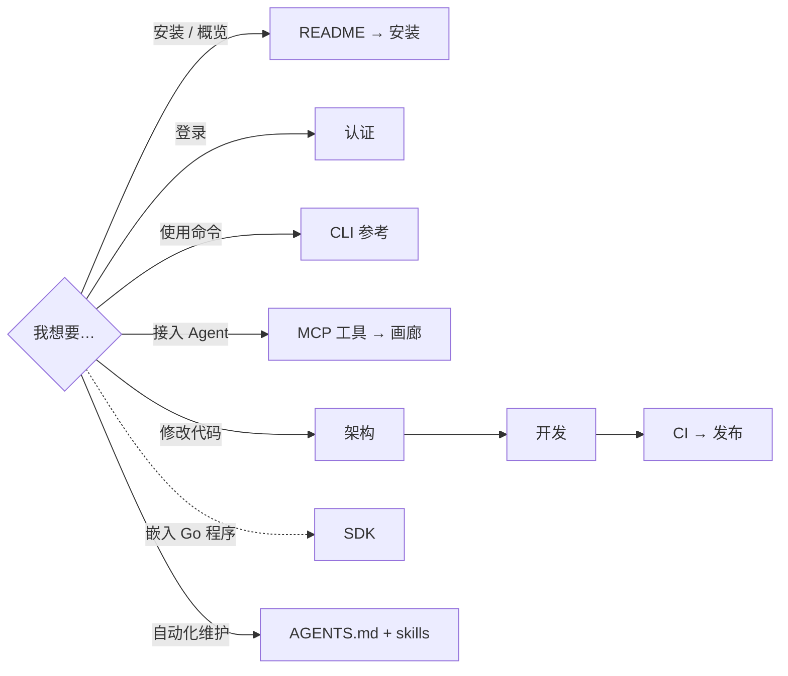

# pixiv-cli 文档

[English](index.md) | 简体中文

## 使用 pixiv-cli

| 主题 | English | 简体中文 |
| --- | --- | --- |
| 概览与安装 | [README](../README.md) | [README](../README.zh-CN.md) |
| 安装与更新 | [Installation](en/install.md) | [安装](zh-CN/install.md) |
| 登录与 token | [Authentication](en/authentication.md) | [认证](zh-CN/authentication.md) |
| CLI 命令 | [CLI reference](en/cli-reference.md) | [CLI 参考](zh-CN/cli-reference.md) |
| MCP 工具 | [MCP tools](en/mcp-tools.md) | [MCP 工具](zh-CN/mcp-tools.md) |
| MCP Apps 画廊 | [MCP Apps gallery](en/mcp-gallery.md) | [MCP Apps 画廊](zh-CN/mcp-gallery.md) |
| Go SDK（嵌入） | [SDK](en/sdk.md) | [SDK](zh-CN/sdk.md) |
| Issue 与 PR | [Contributing](../CONTRIBUTING.md) | [贡献指南](../CONTRIBUTING.zh-CN.md) |

英文文档定义 canonical 公开接口。中文可调整表达，但命令、参数、schema、输出与安全规则必须一致。

## 维护 pixiv-cli

| 任务 | 位置 |
| --- | --- |
| 包边界与调用关系 | [架构](zh-CN/maintainers/architecture.md) |
| MCP server、OAuth、媒体代理 | [MCP server 架构](zh-CN/maintainers/architecture-mcp.md) |
| 环境、构建、测试 | [开发](zh-CN/maintainers/development.md) |
| PR 检查 | [CI 门禁](zh-CN/maintainers/ci.md) |
| 发布、签名、Homebrew、容器 | [发布](zh-CN/maintainers/release.md) |
| 编码器质量/性能对照 | [Ugoira 对照](zh-CN/maintainers/ugoira-parity.md) |
| 已发布变更 | [更新日志](../changelog/README.zh-CN.md) |

## 自动化

完整路由表见仓库根目录 [AGENTS.md](../AGENTS.md)。仓库内 skills 不依赖个人全局指令或 CCS；不支持 skill 发现的客户端直接读取各 `SKILL.md`。

| 任务 | Skill |
| --- | --- |
| Go 实现与设计 | `.agents/skills/pixiv-cli-develop/` |
| 聚焦测试与证据 | `.agents/skills/pixiv-cli-test/` |
| 代码契约、意图注释、编号阶段 | `.agents/skills/pixiv-cli-code-commenting/` |
| MCP 工具变更 | `.agents/skills/pixiv-cli-mcp-tool/` |
| Ugoira 编码、平台构建、native 证据 | `.agents/skills/pixiv-cli-native/` |
| 文档与 skill | `.agents/skills/pixiv-cli-docs/` |
| 审查变更 | `.agents/skills/pixiv-cli-review/` |
| 准备 PR | `.agents/skills/pixiv-cli-pr/` |
| 诊断 CI | `.agents/skills/pixiv-cli-ci/` |
| Release notes | `.agents/skills/pixiv-cli-release-notes/` |
| Commit message | `.agents/skills/pixiv-cli-commit-message/` |

`CLAUDE.md` 只引用 `AGENTS.md`；不要恢复已删除的客户端专用副本。源码注释语言与英文 skill 文件无关。
