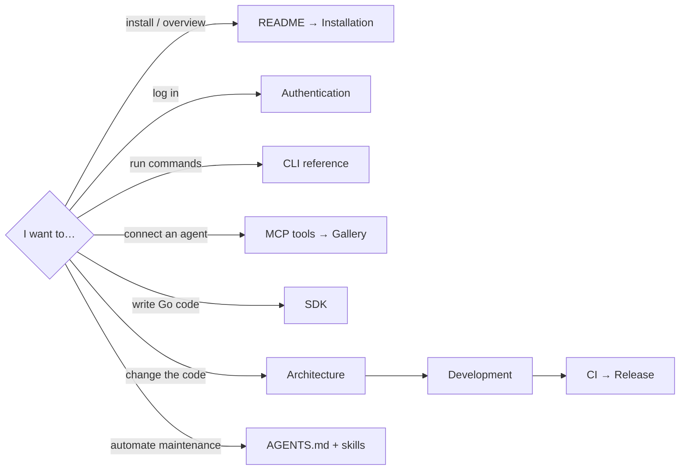

# pixiv-cli documentation

English | [简体中文](index-zh-CN.md)

## Using pixiv-cli

| Topic | English | 简体中文 |
| --- | --- | --- |
| Overview and install | [README](../README.md) | [README](../README.zh-CN.md) |
| Installation and updates | [Installation](en/install.md) | [安装](zh-CN/install.md) |
| Login and tokens | [Authentication](en/authentication.md) | [认证](zh-CN/authentication.md) |
| CLI commands | [CLI reference](en/cli-reference.md) | [CLI 参考](zh-CN/cli-reference.md) |
| Go SDK | [SDK](en/sdk.md) | [SDK](zh-CN/sdk.md) |
| MCP tools | [MCP tools](en/mcp-tools.md) | [MCP 工具](zh-CN/mcp-tools.md) |
| MCP Apps gallery | [MCP Apps gallery](en/mcp-gallery.md) | [MCP Apps 画廊](zh-CN/mcp-gallery.md) |
| Issues and PRs | [Contributing](../CONTRIBUTING.md) | [贡献指南](../CONTRIBUTING.zh-CN.md) |

English defines the canonical public interface. Chinese may rephrase, but commands, parameters, schemas, output and security rules stay identical.

## Maintaining pixiv-cli

| Task | Where |
| --- | --- |
| Package boundaries and call edges | [Architecture](en/maintainers/architecture.md) |
| MCP server, OAuth, media proxy | [MCP server architecture](en/maintainers/architecture-mcp.md) |
| Environment, build, tests | [Development](en/maintainers/development.md) |
| PR checks | [CI gates](en/maintainers/ci.md) |
| Release, signing, Homebrew, containers | [Release](en/maintainers/release.md) |
| Encoder quality/performance comparison | [Ugoira parity](en/maintainers/ugoira-parity.md) |
| Released changes | [Changelog](../changelog/README.md) |

## For automation

Start at [AGENTS.md](../AGENTS.md) for the full routing table. Checked-in skills need no personal global instructions or CCS; clients without skill discovery read each `SKILL.md` directly.

| Task | Skill |
| --- | --- |
| Go implementation and design | `.agents/skills/pixiv-cli-develop/` |
| Focused testing and evidence | `.agents/skills/pixiv-cli-test/` |
| Code contracts, intent comments, numbered phases | `.agents/skills/pixiv-cli-code-commenting/` |
| MCP tool changes | `.agents/skills/pixiv-cli-mcp-tool/` |
| Ugoira encoding, platform builds, native evidence | `.agents/skills/pixiv-cli-native/` |
| Docs and skills | `.agents/skills/pixiv-cli-docs/` |
| Reviewing changes | `.agents/skills/pixiv-cli-review/` |
| Preparing a PR | `.agents/skills/pixiv-cli-pr/` |
| Diagnosing CI | `.agents/skills/pixiv-cli-ci/` |
| Release notes | `.agents/skills/pixiv-cli-release-notes/` |
| Commit messages | `.agents/skills/pixiv-cli-commit-message/` |

`CLAUDE.md` only references `AGENTS.md`; do not restore removed client-specific copies. Source-comment language is independent of the English skill files.
