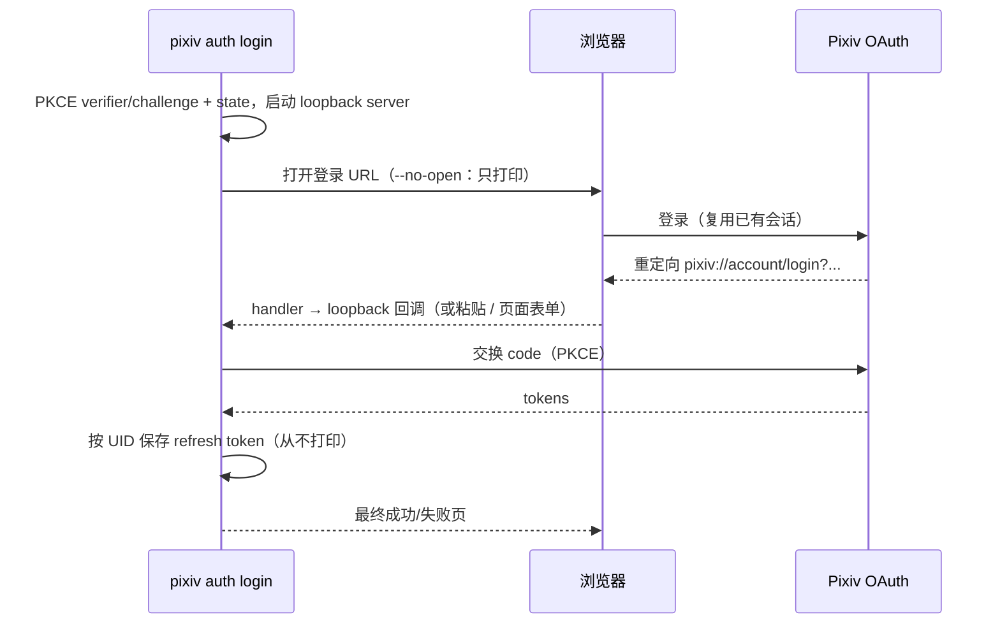
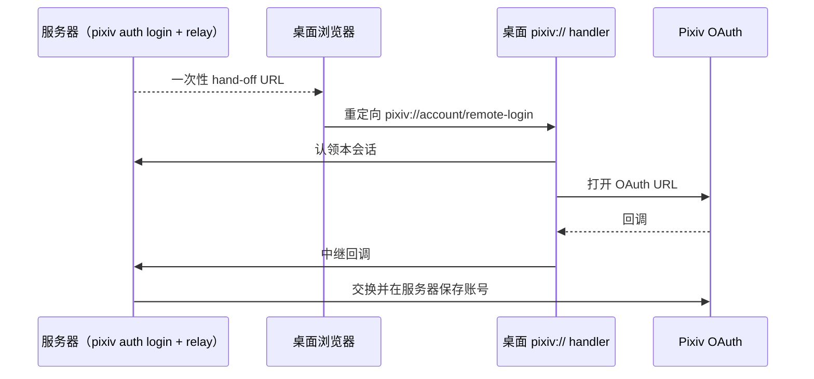
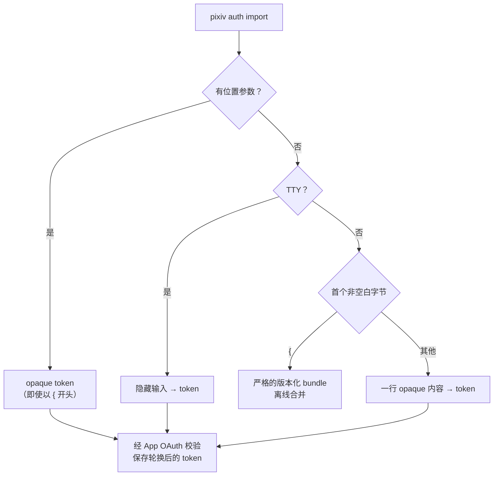

# 认证

[English](../en/authentication.md) | 简体中文 | [CLI 参考](cli-reference.md)

登录、跨机器 hand-off、token 导入与备份。各命令参数见 [CLI 命令表](cli-reference.md#cli-命令表) 与 [`auth login` 参数](cli-reference.md#auth-login-参数)。

## 获取 refresh token

refresh token 是存储在本地账号库中的原始 Pixiv App API OAuth 凭据。推荐方式：

```bash
pixiv auth login
```



| 阶段 | 行为 |
| --- | --- |
| 初始化 | 生成 PKCE verifier/challenge 与 OAuth state，启动本地 loopback HTTP server |
| 浏览器 | macOS/Windows：普通启动即准备当前用户的 `pixiv://` handler；桌面 Linux 在交互登录时初始化 XDG handler。打开默认浏览器；`--no-open` 打印登录 URL 与本地页面地址 |
| 回调 | 本轮 loopback 回调、一次性桌面 hand-off、终端粘贴或本地页面表单。helper hand-off 后，OAuth 交换完成时浏览器打开一次最终本地页面 |
| 校验 | loopback 回调必须匹配本轮 state；Pixiv 未返回 state 时，官方回调 URL 与 `pixiv://account/login` 作为显式 fallback |
| 保存 | 从不打印 token；refresh token 按 UID 存入本地 SQLite。Unix：目录 `0700`、文件 `0600`。Windows：首次创建继承父目录 ACL，替换时保留目标 ACL；不声称收紧或放宽 DACL |

**`pixiv://` handler 路由** —— 持久存在，但只在系统打开 `pixiv://` 时运行（macOS `PixivCLIURLHandler.app`、Windows 当前用户协议关联、桌面 Linux XDG 条目）；会私下记录之前的 handler。

| 传入 URL | 交给 |
| --- | --- |
| 存在活动的本地 loopback bridge 时的任意 URL | 该 bridge（始终优先） |
| `pixiv://account/login` | 仅限活动的一次性桌面 hand-off |
| `pixiv://account/remote-login` | 启动该 hand-off |
| 其他 `pixiv://` URL | 之前的 handler（可在系统关联设置中更换） |

**无头 SSH 服务器** —— listener 保持在 loopback 并使用固定端口：

```bash
pixiv auth login --no-open --addr 127.0.0.1:41871   # 服务器上
ssh -N -L 41871:127.0.0.1:41871 USER@SERVER          # 本地机器上
# 然后在本地打开 http://127.0.0.1:41871/
```

隧道只到达服务器的 loopback listener，可以打开手动页面，但无法替只有浏览器的机器接收 Pixiv 最终的 `pixiv://` 回调——请使用下面的 hand-off，或把完整的最终回调 URL 粘贴进原 prompt。`--addr` 只接受 loopback 地址，不要绑定公网接口。

### 跨机器一次性 hand-off

在服务器配置 `login_relay_public_url` 与 `login_relay_listen_addr`，`pixiv auth login` 即会打印一个远程 hand-off URL。



- 不渲染任何 pixiv-cli 会话、确认或复制回调页面。新的 hand-off 会替换本地旧的；没有桌面 handler 的客户端无法完成该流程。
- relay 可用 HTTP 或 HTTPS：直接 TLS 使用证书/私钥对，或让 relay 监听 loopback 并置于同机反向代理之后。
- 旧的 `login_relay_secret` / `login_relay_target_url` 会被静默忽略；`pixiv auth devices` 已移除。高级 relay 设置保留在私有 `config.toml`（`pixiv config` 管理下载路径、文件名/目录模板、请求间隔与代理）。

**登录代理** —— 浏览器的系统代理不会自动传给 Go CLI：

```bash
pixiv config set https_proxy http://127.0.0.1:7890     # 持久配置
pixiv auth login --proxy http://127.0.0.1:7890         # 仅本次命令
```

- `--proxy URL` / `--no-proxy` 只影响当前命令，从不写入 `config.toml`，不能同时使用；`--no-proxy` 会清除环境变量/配置中的代理。
- 配置 HTTP(S) 代理时，媒体传输（`download`、Ugoira）有意使用 HTTP/1.1，以避免代理的 HTTP/2 stream reset；App API、OAuth 与 Web 元数据保持正常协商。认证与质量不变。
- 真实登录依赖 Pixiv 的 OAuth 网页流程；自动化测试使用 fake OAuth server。

## 导入认证

```bash
pixiv auth import                                    # TTY 上隐藏输入
printf '%s\n' 'YOUR_REFRESH_TOKEN' | pixiv auth import
pixiv auth import 'YOUR_REFRESH_TOKEN'               # 会出现在 argv/shell history
pixiv auth import < account.pxauth                   # 离线恢复 bundle
pixiv auth export --all | ssh trusted-host pixiv auth import
```



| | Token 模式 | Bundle 模式 |
| --- | --- | --- |
| 网络 | App OAuth 校验；以 Pixiv 返回的 UID 为准 | 无——从不回退到 OAuth |
| stdin 解析 | 一行 opaque 内容；只去掉最后一个 LF/CRLF | 严格解码；格式错误的 bundle 是错误，不会当作 token 尝试 |
| `--proxy` / `--no-proxy` | 允许（不能同时用） | 拒绝 |
| 效果 | 保存轮换后的 token | 按 UID 原子合并：已有替换、新增添加；保留当前默认；仅本地无默认时采用 bundle 默认 |
| 文本输出 | `added uid:UID` / `updated uid:UID`（可用时加 `username:NAME`） | 按 bundle 顺序列出每个 added/updated UID 与最终默认 |
| `--json` | `{"user_id":12345678,"username":"display name","status":"added"}` | `{"accounts":[{"user_id":12345678,"username":"display name","status":"added"}],"default_user_id":12345678}` |

`status` 为 `added` 或 `updated`。两种形式都不暴露默认状态、token 是否存在、输入 token 或轮换后的 token。位置参数 token 可能经进程列表、shell history、包装器与审计工具泄露。

## 导出与备份认证

```bash
pixiv auth export                                    # 默认账号的原始 token
pixiv auth export 12345678                           # 指定账号的原始 token
pixiv auth export --all                              # stdout 输出版本化 bundle
pixiv auth export 12345678 --output account.pxauth
pixiv auth export --all --output accounts.pxauth [--force]
```

| 形式 | stdout | 成功时 stderr |
| --- | --- | --- |
| 默认 / UID，无 `--output` | 存储的原始 token + 一个换行 | 无 |
| `--all`，无 `--output` | 仅版本化 JSON bundle | 无 |
| 任意选择 + `--output PATH` | 输出路径 + 账号数（从不含 secret） | — |

- 严格本地：只读 SQLite 账号库；不刷新、不联系 Pixiv；不修改 auth/config；跳过启动时的待更新清理与自动更新检查。
- `--all` 不能与 UID 同用；`--force` 需要 `--output`；没有 JSON/代理参数。
- `--output` 默认拒绝已存在的目标，除非 `--force`。Unix：文件 `0600`，不改父目录权限/属主。Windows：设置 owner 与受保护 DACL，只授予当前用户、LocalSystem 与内置 Administrators 完全控制（有 CI 测试；不声称本版本已在真实 Windows 文件系统验证）。
- bundle 是**未加密的时间点 secret 备份**，不是实时同步；token 轮换会让旧副本失效。
- 严格 codec 拒绝：不支持的 schema/version、未知或重复字段、尾随 JSON、重复/非正 UID、空 token、不在 bundle 中的默认 UID，以及任何非 canonical 拼写/大小写的键（如 `Schema`、`Default_User_ID`、`User_ID`、`Refresh_Token`），即使同时存在 canonical 键。
- 导出选择或 I/O 失败时不会打印任何 secret 诊断。

| 恢复写入失败：`LocalWriteCommitOutcome` | 含义 |
| --- | --- |
| `not_committed` | 未发生替换 |
| `committed` | 已替换，但后续持久化/清理步骤失败——需重新加载账号库 |
| `unknown` | 无法确定目标状态——需人工检查 |

`committed` 与 `unknown` 都不算成功回滚。其他所有 stdout/stderr、JSON、MCP 结果、日志与错误都不得暴露 refresh token。不存在持久化 auth import/export 的 MCP 工具；会话范围的 MCP 认证不变。
