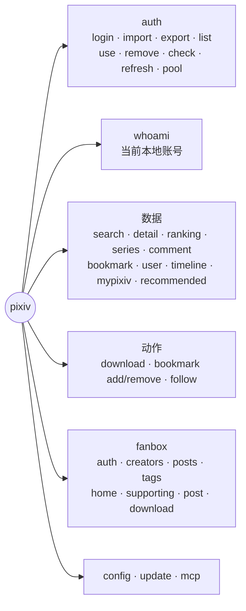
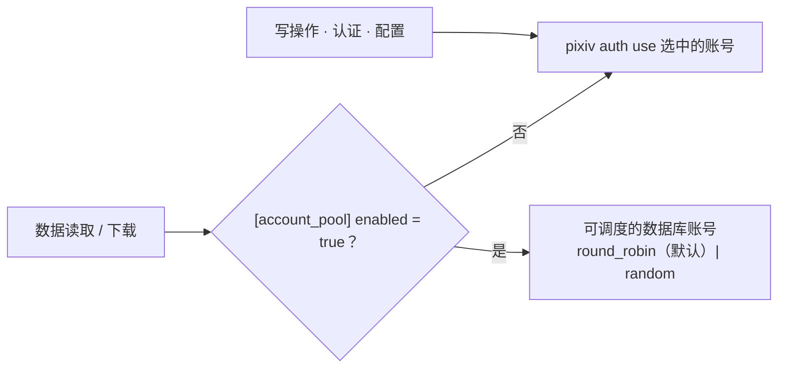
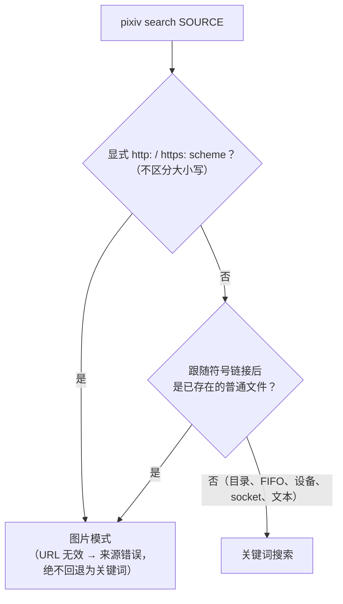
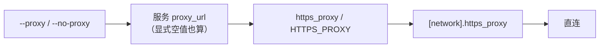
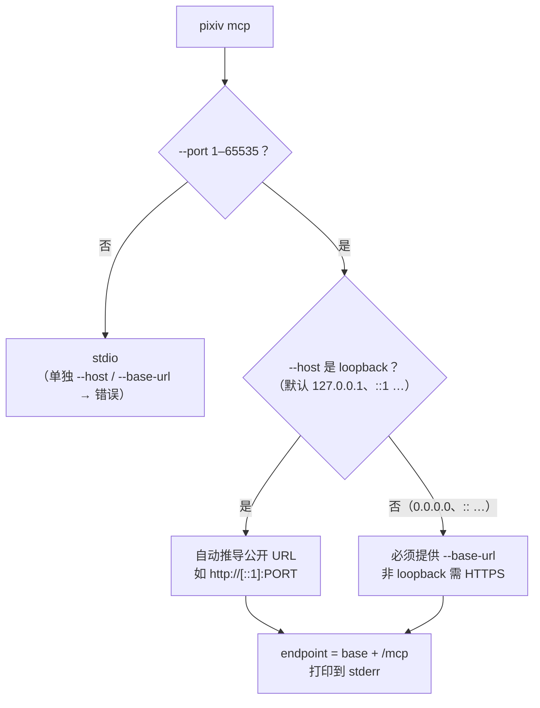

# Pixiv CLI 参考手册

[English](../en/cli-reference.md) | 简体中文 | [项目首页](../../README.zh-CN.md)

`pixiv` 命令、参数、配置与 MCP 启动的契约。安装/更新与认证分别见[安装](install.md)与[认证](authentication.md)；SDK 与 MCP 工具见各自指南（[相关文档](#相关文档)）；用户可见变更见[更新日志](../../changelog/README.zh-CN.md)。



| 速览 | 规则 |
| --- | --- |
| 输出 | 默认文本；`--json` = 单个文档；`--ndjson`（或视觉列表在未指定格式时接入非 TTY）= canonical record 流 |
| 下载 | 成功时 stdout 为空；Ugoira 文件名 fallback warning → stderr；单项失败 → 诊断 + 非零退出 |
| 未知选项 | 按 unknown flag 失败 |
| 代理 URI | `http`、`https`、`socks5`、`socks5h` |
| 反向搜图 | `pixiv search SOURCE` 传入 HTTP(S) URL 或已存在的普通文件；与 Pixiv 账号无关；可能把来源上传给第三方——请先阅读 [SauceNAO 隐私与条款](https://saucenao.com/legal.html)（上传可能被短期保留；URL 查询可能缓存更久） |

## CLI 使用

```bash
pixiv auth login                                        # 或：printf '%s\n' TOKEN | pixiv auth import
pixiv auth list
pixiv auth use 12345678
pixiv auth check
pixiv auth refresh
pixiv whoami
pixiv whoami --json
pixiv config path
pixiv config get download_path
pixiv config set download_path ~/Downloads/pixiv
pixiv config unset https_proxy
pixiv --version
pixiv update --check [--json]

pixiv search "初音ミク" --type artwork --limit 10
pixiv search "初音ミク" --type novel --json
pixiv search "artist" --type user --limit 10
pixiv search ./image.png --provider ascii2d-color --json
pixiv search https://example.com/image.png --provider all --ndjson
pixiv search --trending-tags --json
pixiv detail 123456 --type artwork --json
pixiv detail 123456 --type novel --json
pixiv series SERIES_ID_OR_URL --type artwork --limit 20
pixiv comment 123456 --type artwork --limit 20
pixiv comment create 123456 --type artwork --comment "hello"
pixiv comment reply 123456 --type artwork --parent-comment-id 789 --comment "reply" --json
pixiv comment stamp 123456 --type artwork --stamp-id 9 --json
pixiv comment delete 789 --type artwork --json
pixiv comment stamps --json
pixiv bookmark list --type artwork --limit 20
pixiv bookmark list --type all --limit 20 --json
pixiv bookmark tags --type all --limit 20 --json
pixiv bookmark detail NOVEL_ID --type novel --json
pixiv bookmark add NOVEL_ID --type novel
pixiv user followers 123456 --limit 20
pixiv user follow add 123456 --restrict private
pixiv follow remove 123456
pixiv ranking --mode day
pixiv recommended --type all --limit 5
pixiv download 123456 789012 --output ./downloads
```

| 本地状态 | |
| --- | --- |
| 位置 | `~/.pixiv-cli`（macOS/Linux）、`%USERPROFILE%\.pixiv-cli`（Windows） |
| 内容 | `pixiv-cli.db`（账号按 UID 存储）、`config.toml`、callback bridge 状态、Release 检查缓存、macOS callback helper |
| 权限 | Unix 目录 `0700` / 文件 `0600`；Windows 首次创建继承父目录 ACL、替换时保留目标 ACL，不声称修改 DACL |
| `config.toml` 创建 | 首次普通命令时生成，含常用下载/输出/登录/更新设置；从不覆盖已有文件。高级设置（代理、登录超时、Premium 状态缓存）在显式配置前不写入。help、根 `--version`、secret 导出与内部 OAuth 回调不会创建它 |

选项可出现在位置参数前后（Cobra/pflag）：`pixiv auth check 12345678 --json` 与 `pixiv search "初音ミク" --json` 都受支持。`auth export` 有意不提供 `--json`。

### 数据操作契约



- 账号池成员由数据库 `schedulable` 标记决定；用 `pixiv auth pool status|enable|disable` 管理。写操作、认证与配置从不使用账号池。
- 数据命令拒绝 `--uid` 与 `--refresh-token`。
- **Record：** stdout 非终端且未选择输出格式时，视觉列表写出 canonical NDJSON。每行有稳定的字符串 `id`、`type`、`url`。`download`、`bookmark add/remove` 与 `follow add/remove` 无需位置 ID 即可消费兼容 record；bookmark 的 record 必须匹配所选 `--type` 命名空间（默认 artwork，`--type novel` 为小说）。
- **关注：** 显式目标必须是正整数用户 ID（用户 URL 在本地被拒绝）。`pixiv user follow add/remove` 与根命令 `pixiv follow add/remove` 共用同一 owner；`add --restrict public|private` 默认 `public`。
- **评论：** `create/reply/stamp/delete` 只接受一个正整数 ID，不消费 Record。读取保留可选的 `total`/`access_control`；opaque 数值 `comment_access_control` 保留在 `access_control.comment_access_control`，不推断布尔值。create/reply/stamp 返回上游的正整数 `comment_id`；delete 返回状态。`comment stamps` 只读、不分页。`--json` 与显式 `--ndjson` 优先。

```bash
pixiv search "miku" --type artwork --limit 20 | pixiv detail            # 管道自动选择 NDJSON
pixiv search "miku" --type artwork --limit 20 --ndjson | pixiv detail   # 显式等价写法
```

`detail` 根据每条 record 的 `type` 推断端点；record 模式下显式 `--type` 只是兼容约束，从不覆盖推断结果。反向搜图的 `artwork`/`user` 身份 record 走同一路径。`search --json` 是聚合文档而不是 record 流——不支持 `pixiv search ... --json | pixiv detail`。

### 反向搜图



- 图片模式在任何 Pixiv SDK 或账号池初始化之前进入，只接受 `--provider`、`--json`、`--ndjson`、`--proxy`、`--no-proxy`；搜索筛选、`--type`、分页与 `--trending-tags` 会被拒绝而不是忽略。
- stdin 上的二进制字节不会进入图片模式（不支持 `cat image.png | pixiv search`）。

| Provider | 说明 |
| --- | --- |
| `saucenao` | 配置默认值；`--provider` 可按次覆盖 |
| `ascii2d-color`、`ascii2d-bovw` | JPEG、PNG、WEBP；ascii2d 专属 10 MB 上传上限 |
| `all` | 固定顺序 SauceNAO → ascii2d color → ascii2d bovw；可能部分成功 |

`reverse_search_pixiv_only`（默认 `true`，仅配置项）决定非 Pixiv 匹配是否保留在 `results`。不存在反向搜图通用的 1 MiB 压缩上传规则；`gzip, deflate, br` 只是响应协商。

| 网络面 | 代理 | User-Agent |
| --- | --- | --- |
| 标准来源 / SauceNAO client | `--proxy`/`--no-proxy`，否则全局 `https_proxy`/`[network].https_proxy` | — |
| ascii2d 浏览器 client | `--proxy`/`--no-proxy`，否则 `[reverse_search.network].proxy_url`（显式空值 = 直连），否则标准路由 | `[reverse_search.network].user_agent`；默认 Chrome 146 macOS UA，配合 `Chrome_146` TLS profile。Chromium UA 派生 `Sec-CH-UA`、`Sec-CH-UA-Mobile`、`Sec-CH-UA-Platform`；其他 UA 省略。拒绝控制字符 |
| FlareSolverr（可选） | `url` 是 JSON 控制端点，从不继承原生/标准代理；`proxy_url` 只作为 `sessions.create` 中的浏览器上游 | 为原生 ascii2d client 返回浏览器 UA 与 clearance |

FlareSolverr 只在检测到 ascii2d challenge 后运行；图片始终以原生 `/search/file` multipart 上传，绝不经过 FlareSolverr。solver 状态限于进程/client，从不写入磁盘。

- 来源只获取/打开一次，进入私有临时快照；输出只显示 `input.kind`（`file`/`url`）与 `input.sha256`。第三方可能上传、保留或缓存——不要提交你无权分享的图片或 URL。
- **JSON** 信封：`{input, providers, results, records, provider_errors, partial}`。`records` 只含 canonical Pixiv 身份：作品匹配使用通用 `type:"artwork"`（不会为推断子类型而调用 detail），用户匹配为 `type:"user"`。关闭仅 Pixiv 过滤时外部匹配可留在 `results`，但不会成为 record。人类可读输出是安全摘要；管道/显式 NDJSON 只输出 record，可直接交给 `detail`（通用 `artwork` 解析为具体详情）。
- **退出：** `all` 下一个成功 + 一个失败 → `partial=true`，stderr 写安全 warning，退出 0。单 provider 失败或全部失败时非零退出，保留可用的 JSON 信封。
- **错误** 使用稳定的 `code` + `message`；来源、API key、Cookie、CSRF/重定向值、临时路径与上游响应体从不出现。原因在输出边界被清洗。词表：`unknown`、`invalid_request`、`invalid_source`、`source_not_regular_file`、`source_read_failed`、`source_http_status`、`snapshot_failed`、`source_loader_not_configured`、`provider_not_configured`、`missing_credential`、`malformed_upstream_response`、`upstream_http_status`、`provider_failed`、`all_providers_failed`、`challenge_required`、`solver_unavailable`、`solver_failed`、`malformed_solver_response`。

### 从 stdin 读取位置参数

- 缺失的必需位置参数或省略的可选位置参数，会把整个非 TTY stdin 当作**一个**值，只去掉一个结尾 LF/CRLF（不按空白拆分）：`printf '%s\n' 13214141 | pixiv search` ≡ `pixiv search 13214141`。
- 显式位置参数优先，不读 stdin。
- 下载与写操作命令按首个非空白字节分类：`{` → 严格的流式 canonical NDJSON；否则整个流是一个原始 ID/URL。
- `-` 没有 stdin 含义，就是普通文本。

canonical 数据动作：`search`、`detail`、`ranking`、`series`、`comment`、`bookmark`、`download`、`user`、`timeline`、`mypixiv`、`recommended`。常用短选项 `-t/--type`、`-p/--page`、`-l/--limit`、`-o/--output`（下载目录）、`-j/--json` 是选项拼写，不是命令别名（如 `pixiv timeline latest --type artwork`）。`novel search`、`user search` 与根命令 `follow` 是兼容路由，映射到同一用例。只存在文档列出的结构化实体筛选——没有被忽略的顶层表达式筛选。Ugoira 下载接受 `--ugoira-mode gif|apng`（默认 `gif`）；Ugoira 不支持页码选择和非 original 质量。

### CLI 命令表

| 命令 | 用法 | 说明 |
| --- | --- | --- |
| `auth import` | `pixiv auth import [REFRESH_TOKEN] [--json] [--proxy URL\|--no-proxy]` | 直接输入经校验后保存轮换 token；无参数时 TTY 隐藏输入，非 TTY 自动识别 opaque token 或严格离线 bundle。显式值永远是 token；bundle 模式与代理参数冲突。 |
| `auth login` | `pixiv auth login [--json] [--no-open] [--addr 127.0.0.1:0] [--use] [--timeout DURATION] [--relay-public-url URL --relay-listen-addr ADDR] [--relay-tls-cert-file PATH --relay-tls-key-file PATH] [--proxy URL\|--no-proxy]` | 普通 loopback OAuth。relay server 配置完整时打印一次性 hand-off URL，直接启动已安装的桌面 CLI handler。按 Pixiv UID 保存；从不打印 refresh token。 |
| `auth list` | `pixiv auth list [--json]` | 列出本地账号；从不打印 token。文本用 `*` 表示默认账号，`✓`/`-` 表示本地是否存有 token——是本地状态标记，不代表在线有效。 |
| `auth pool` | `pixiv auth pool status [--json]`；`pixiv auth pool enable UID... [--all]`；`pixiv auth pool disable UID... [--all]` | 查看/修改非 secret 的调度状态。`status` 报告 `enabled`、`strategy`、`schedulable`、`frozen_until` 与当前 `eligible`；enable/disable 在提交整批前校验每个 UID。 |
| `auth export` | `pixiv auth export [UID] [--all] [--output PATH] [--force]` | 本地导出默认/指定/全部账号。无 `--output`：单账号 = 原始 token 到 stdout，`--all` = bundle 到 stdout。有 `--output`：私有 bundle + 安全摘要。`--force` 需要 `--output`。 |
| `auth use` | `pixiv auth use [UID] [--json]` | 设置默认账号；TTY 上可交互选择。 |
| `auth remove` | `pixiv auth remove [UID] [--yes] [--json]` | 删除账号；TTY 上默认确认。删除默认账号后自动选中第一个剩余账号。 |
| `auth check` | `pixiv auth check [UID] [--json] [--proxy URL\|--no-proxy]` | 刷新 token 并校验账号；成功时记录 `user_id`，可用时记录用户名。 |
| `auth refresh` | `pixiv auth refresh [UID] [--all] [--json] [--proxy URL\|--no-proxy]` | 为选中/默认账号刷新 access 与轮换 refresh token，然后强制读取资料以更新缓存的 Premium 状态。`--all` 刷新全部账号。JSON 始终返回 `accounts`。 |
| `whoami` | `pixiv whoami [--json]` | 显示当前本地账号，不联网，也不轮换 token：有用户名时输出 `用户名 (UID)`，缓存显示为会员时追加 ` · Premium`，用户名未知时只输出 UID。`--json` 返回单个对象，字段与 `auth list --json` 中的账号项相同。没有本地账号时 stdout 为空，退出码 1，stderr 输出 `error: not logged in; run "pixiv auth login"`。 |
| `config path` | `pixiv config path` | 打印 `config.toml` 路径，缺失时创建基线文件。 |
| `config get` | `pixiv config get KEY` | 打印一个生效值。 |
| `config set` | `pixiv config set KEY [VALUE]` | 写入一个已知键（见[配置别名](#cli-可管理的-config-别名)）；`saucenao_api_key` 只从 stdin 读取。 |
| `config unset` | `pixiv config unset KEY` | 从 `config.toml` 删除一个已知键。 |
| `update` | `pixiv update [--check] [--prerelease] [--proxy URL]` | 按安装来源检查或执行更新；`--json` 只能配合 `--check`。 |
| `search` | `pixiv search [WORD\|IMAGE_PATH_OR_URL] [-t artwork\|novel\|user] [options]` | 实体搜索或自动反向搜图。`--trending-tags` 是无关键词的作品标签列表模式；不接受筛选或分页。 |
| `detail` | `pixiv detail [ID_OR_URL] [-t artwork\|novel\|user] [--content] [--json\|--ndjson]` | 一个作品、小说或用户，或 canonical NDJSON record。`--content` 是保留的小说专用兼容参数，在打开账号池或调用已拒绝端点之前返回 `content_unavailable`。 |
| `ranking` | `pixiv ranking [-t artwork\|novel] [--mode MODE --date YYYY-MM-DD --page N --limit N]` | 作品（默认）或小说排行；`--date` 仅作品。 |
| `series` | `pixiv series SERIES_ID_OR_URL -t artwork\|novel [--page N --limit N --json\|--ndjson]` | 一个系列中的作品；正整数 ID 或受支持的系列 URL，其命名空间必须匹配必填的类型。 |
| `comment` | `pixiv comment ID -t artwork\|novel [--page N --limit N --json\|--ndjson]`；`pixiv comment create ID -t artwork\|novel --comment TEXT [--json]`；`pixiv comment reply ID -t artwork\|novel --parent-comment-id COMMENT_ID --comment TEXT [--json]`；`pixiv comment stamp ID -t artwork\|novel --stamp-id STAMP_ID [--comment TEXT] [--json]`；`pixiv comment delete COMMENT_ID -t artwork\|novel [--json]`；`pixiv comment stamps [--json\|--ndjson]` | 读取以及 create/reply/stamp/delete/贴图列表。写操作只接受正整数 ID；create/reply 需要非空正文；stamp 正文可选（空 = 纯贴图 wire）；create/reply/stamp 返回 `comment_id`，delete 返回状态；`stamps` 返回输出安全的 stamp，无分页、无运行时 URL。 |
| `bookmark` | `pixiv bookmark list\|tags\|detail\|add\|remove ...` | `list`/`tags` 接受用户 ID 或 URL，以及 `--type artwork\|novel\|all`（`all` = 作品在前、小说在后，record/标签保留类型）。`detail`、`add`、`remove` 接受 artwork/novel，不接受 `all`；add/remove 默认 `artwork`。 |
| `user` | `pixiv user search\|detail\|artworks\|novels\|bookmarks\|following\|followers\|related\|blocked\|follow ...` | 资料/关系读取与关注管理。关注接受正整数 ID 或用户 Record；只有子命令注明时，省略 ID 才使用当前账号。 |
| `download` | `pixiv download [options] SRC...` | 作品 ID/URL、允许的 CDN URL，或由用户页与公开收藏页 URL 展开的作品。作品系列 URL 不是下载来源。`--output/-o` 是 `--download-path` 的别名。 |
| `timeline` | `pixiv timeline following\|latest -t artwork\|novel [--content-type TYPE ...]` | 关注用户或最新作品流。following 作品在本地按子类型筛选（上游无子类型参数）；latest 作品只支持 `illust\|manga`。 |
| `mypixiv` | `pixiv mypixiv users\|works [-t artwork\|novel ...]` | `users` 只针对已验证身份的当前账号；`works USER_ID` 只接受正整数 ID，从不把 URL 当 ID。 |
| `recommended` | `pixiv recommended [-t artwork\|novel\|user\|all] [--content-type all\|illust\|manga] [--page N --limit N --json]` | 作品推荐中，`--page/--limit` 先选定原始窗口，`--content-type` 再在窗口内筛选（不发给上游；不会无限向前扫描）。`all` 遍历一次作品流，并把同一窗口拆成 illust/manga。仍接受位置参数 `KIND`。 |
| `novel search` | `pixiv novel search WORD [options]` | 兼容路由；推荐 `pixiv search WORD --type novel`。只有基础小说字段。 |
| `user search` | `pixiv user search WORD [options]` | 兼容路由；推荐 `pixiv search WORD --type user`。 |
| `follow` | `pixiv follow add\|remove USER_ID ...` | 兼容路由，与 `pixiv user follow add\|remove` 共用 owner 与输入契约。 |
| `mcp` | `pixiv mcp [--port PORT [--host HOST] [--base-url URL]] [--proxy URL\|--no-proxy]` | 默认本地 stdio；显式 `--port` 启用认证 HTTP。 |
| `mcp auth init` | `pixiv mcp auth init [--reset]` | 初始化 MCP owner 并只打印一次 secret；reset 撤销授权，保留 client 与已选账号。 |
| `fanbox auth` | `pixiv fanbox auth import\|list\|use\|remove\|status` | 本地 FANBOX 会话；值从不打印。原生 `--proxy`/`--no-proxy` 只作用于 FANBOX 命令。 |
| `fanbox creators` | `pixiv fanbox creators [--kind supporting\|following] [--page N --limit N]` | 支持中或关注中的创作者。 |
| `fanbox posts` | `pixiv fanbox posts SOURCE [--page N --limit N]` | 来自创作者、标签、帖子 ID 或受支持 FANBOX URL 的帖子。 |
| `fanbox tags` | `pixiv fanbox tags CREATOR` | 创作者的精选标签。 |
| `fanbox home` / `supporting` | `pixiv fanbox home\|supporting [--page N --limit N]` | 已认证的主页或支持中 feed。 |
| `fanbox post` | `pixiv fanbox post POST_ID` | 一个帖子及其安全资源摘要。 |
| `fanbox download` | `pixiv fanbox download SOURCE...` | 把帖子资源保存到配置的下载路径下。 |

**文件名：** 模板输出与 URL 派生扩展名中的跨平台非法字符都会规范化；ASCII 控制字符被替换，结尾的点/空格（Windows 拒绝）被去掉。Pixiv 缩略图成功时，资源 Content-Type 可替换含糊的 URL 扩展名（如 `.png`）以匹配实际字节；未知媒体类型保留 URL 扩展名。

### `auth login` 参数

| 参数 | 默认值 | 说明 |
| --- | --- | --- |
| `--json` | `false` | 以 JSON 输出保存结果；从不打印 token。 |
| `--no-open` | `false` | 打印登录 URL 与本地页面地址，而不打开浏览器。 |
| `--addr` | `127.0.0.1:0` | loopback 监听地址；端口 `0` 自动分配。 |
| `--use` | `false` | 登录后设为默认（无默认账号时自动设为默认）。 |
| `--timeout` | `0` | 最长等待时间；`0` = CLI 不设截止时间。 |
| `--relay-public-url` | 配置 | 本次登录中本服务器 relay 的公开 HTTP(S) base URL。 |
| `--relay-listen-addr` | 配置 | 本次登录 relay 的监听 host:port。 |
| `--relay-tls-cert-file` / `--relay-tls-key-file` | 配置 | 直接 TLS 的 PEM 对，两者都必须提供。不提供时，HTTPS 公开 URL 要求 loopback listener 位于同机反向代理之后。 |
| `--proxy URL` / `--no-proxy` | 空 | 只用于本次 token 交换的代理覆盖；从不保存。 |

### 数据命令参数

| 命令 | 参数 | 默认值 | 说明 |
| --- | --- | --- | --- |
| `search` | `--type` / `-t` | `artwork` | 实体：`artwork`、`novel`、`user`。子类型用 `--content-type`；`illust` 不是实体值。 |
| `search` | `--provider` | `reverse_search_provider`（`saucenao`） | `saucenao`、`ascii2d-color`、`ascii2d-bovw`、`all`；仅图片来源。 |
| `search` | `--content-type` | `all` | `all`、`illust-and-ugoira`、`illust`、`manga`、`ugoira`；仅作品搜索。 |
| `search`、`novel search` | `--search-by` | `tag-partial` | 作品：`tag-partial`、`tag-exact`、`title-caption`、`tag-title-caption`；小说：前三个。 |
| `search`、`novel search` | `--sort` | `date_desc` | `date_desc` 或 `date_asc`。 |
| `search` | `--period` | 空 | 作品：`day`、`week`、`month`、`half-year`、`year`；与 `--start-date`/`--end-date` 互斥。 |
| `novel search` | `--period` | 空 | `day`、`week`、`month`。 |
| `search` | `--start-date` / `--end-date` | 空 | 含端点的 `YYYY-MM-DD`；start ≤ end。仅作品。 |
| `search` | `--rating` | 空 | 本地作品筛选 `sfw`、`r18`、`r18g`、`mature`、`all`，基于模型 `x_restrict`；绑定到 cursor，从不发给上游。 |
| `search` | `--ai-mode` | `all` | `all`、`exclude`、`only`；Pixiv `AIType==2` = AI 生成。 |
| `search` | `--aspect-ratio` | `all` | `all`、`landscape`、`portrait`、`square`。 |
| `search` | `--resolution` | `all` | `all`、`high`、`medium`、`low`。 |
| `search` | `--draw-tool` | 空 | [目录](#绘图工具目录)中的精确名称；含糊值被拒绝。 |
| `search` | `--bookmark-min` / `--bookmark-max` | 空 | 基于 `TotalBookmarks` 的含端点非负区间；min ≤ max。元数据报告策略与完整性。 |
| `search` | `--bookmark-strategy` | `auto` | `auto`（目前等于 `local`）、`local`（对已获取候选精确筛选）、`best_effort`（App 候选区间，始终为 `partial`，包括空结果和候选流耗尽）、`server`（在有可靠服务端证据前直接失败）。 |
| `novel search` | `--rating`、`--min-text-length`、`--max-text-length`、`--original-only` | 不支持 | 不在 v1 命令中；不发送，也不作为本地筛选。 |
| 列表命令 | `--limit` / `-l` | 一个上游批次 | 正数 = 跨批次填满逻辑页；`0` = 遍历到 cursor 结束。 |
| 列表命令 | `--page` / `-p` | 空 | 从 1 开始的逻辑页；需要正数 `--limit`。 |
| `ranking` | `--mode` | `day` | `day`、`day_male`、`day_female`、`week`、`week_original`、`week_rookie`、`month`、`day_manga`、`week_manga`、`month_manga`、`week_rookie_manga`、`day_r18`、`day_male_r18`、`day_female_r18`、`week_r18`、`week_r18g`。最后九个需要认证。 |
| `ranking` | `--date` | 空 | 通常为 `YYYY-MM-DD`。 |
| `detail` | `--type` / `-t` | `artwork` | `artwork`（也接受 `illust`、`manga`、`ugoira`）、`novel`、`user`；record 模式下从 record 推断。`--content` → 在账号池执行前返回 `content_unavailable`。 |
| `series`、`comment` | `--type` / `-t` | 必填 | `artwork` 或 `novel`。系列：正整数 ID 或匹配类型的受支持 URL。评论读取/create/reply/stamp：作品/小说正整数 ID；delete：类型决定端点。输入在类型确定后才解释。 |
| `comment create`、`comment reply` | `--comment` | 必填 | 非空；从不截断。 |
| `comment stamp` | `--comment` | 可选 | 省略或空 = 纯贴图 wire；从不截断。 |
| `comment reply` | `--parent-comment-id` | 必填正整数 | 父评论 ID，不是作品/小说 ID。 |
| `comment stamp` | `--stamp-id` | 必填正整数 | 与正文分开发送。 |
| `bookmark list` | `--type` / `-t` | `artwork` | `artwork`、`novel`、`all`（一个逻辑页，作品在前、小说在后，保留类型）。`--restrict`、`--tag` 传给对应列表。 |
| `bookmark tags` | `--type` / `-t` | `artwork` | `artwork`、`novel`、`all`（同名标签分别保留并带类型）。`--restrict` 选择公开/私密。 |
| `user artworks` | `--type` | `illust` | `illust`、`manga`、`ugoira`。 |
| `user bookmarks` | `--restrict`、`--tag` | `public`、空 | 可见性与精确收藏标签筛选。 |
| `user following`、`user followers` | `--restrict` | `public` | `public` 或 `private`。 |
| `timeline following` | `--type` / `-t`、`--content-type` | 必填、`all` | `artwork` 或 `novel`；作品本地筛选 `all\|illust-and-ugoira\|illust\|manga\|ugoira`；`--restrict public\|private`。`novel` 搭配 `--content-type` 被拒绝。 |
| `timeline latest` | `--type` / `-t`、`--content-type` | 必填、`illust` | 最新作品只支持 `illust` 或 `manga`。`novel` 搭配 `--content-type` 被拒绝。 |
| `mypixiv users` | `--page`、`--limit` | 可选 | 仅限已验证的认证身份；无位置目标，无匿名 fallback。 |
| `mypixiv works` | `--type` / `-t` | 必填 | 无 `USER_ID`：`artwork` 或 `novel`；有正整数 `USER_ID`：另支持 `manga`。不再接受 `illust`，请使用 `artwork`。非法类型/ID → 账号池执行前返回 `invalid_argument`。 |
| `recommended` | `--type` / `-t` | 空 | `artwork`、`novel`、`user`、`all`；位置参数 `KIND` 是兼容语法。 |
| `recommended` | `--content-type` | `all` | 仅作品的本地筛选 `all`、`illust`、`manga`，在 `--page/--limit` 之后应用；不作为上游 `content_type` 发送。 |
| record 动作 | `--on-error` | `skip` | 对格式错误/不兼容 record：`skip`（stderr 诊断）或 `fail-fast`。 |
| `download` | `--pages` | 空 | 从 1 开始的页码与闭区间（`1,3-5`）；开区间非法。默认全部页；缺失页明确失败。 |
| `download` | `--quality` | `original` | `original`、`regular`（长边 1200）、`small`（540）、`thumb`（250×250 居中裁剪）、`mini`（48×48 居中裁剪）。Ugoira 拒绝非 original 质量与页码选择。 |
| `download` | `--ugoira-mode` | `gif` | `gif` 或 `apng`。 |
| `download` | `--download-path` / `--output` / `-o` | `DOWNLOAD_PATH`、`config.toml` 或 `./downloads` | `--output` 是别名；值冲突时报错。 |
| `download` | `--filename-template` | `FILENAME_TEMPLATE`、`config.toml` 或 `{author} - {title}_{id}` | `{id}`、`{title}`、`{author}`、`{author_id}`、`{date}`、`{tags}`、`{num}`。未知占位符/括号不匹配是错误；Ugoira 模板非法或渲染为空时回退默认值并在 stderr 给出 warning。 |
| `download` | `SRC...` | 必填 | 作品 PID/URL、允许的 CDN URL、用户主页/作品页 URL、公开收藏页 URL；不含作品系列 URL。CDN 文件使用安全的 URL basename + 确定性的 URL 身份后缀；元数据相关选项不适用。 |
| `bookmark add` | `--type` / `-t` | `artwork` | `artwork` 或 `novel`；`all`/其他值在任何网络请求前被拒绝。 |
| `bookmark add` | `--restrict` | `public` | `public` 或 `private`。 |
| `bookmark add` | `--tag` | 空 | 可重复。 |
| `bookmark remove` | `--type` / `-t` | `artwork` | `artwork` 或 `novel`。 |
| `follow add` | `--restrict` | `public` | `public` 或 `private`。 |

**分页与筛选**

- 所有内容读取都通过 App API 使用已认证账号（或可用账号池）。App 失败即最终结果——没有匿名 Web/API fallback。
- 筛选绑定到 opaque SDK cursor；逻辑 `--page`/`--limit` 跨批次继续直到填满或耗尽。无 `--limit` = 一个批次；`--limit 0` = 直到耗尽；正数 `--page` 需要正数 `--limit`。
- 无筛选的作品搜索把深页直接定位到原始 App offset（`--page 10 --limit 30` → offset 270），不请求之前的批次。仅 AI 与收藏数筛选在本地筛选后再做逻辑跳过，因此可能需要前面的批次。其他列表命令保持原有行为。

| `--rating` | 匹配的 `x_restrict` |
| --- | --- |
| `sfw` | `0` |
| `r18` | `1` |
| `r18g` | `2` |
| `mature` | `1` 或 `2` |
| `all` | 不筛选 |

其 canonical 语义摘要绑定到 cursor；不会发送 `rating`/`x_restrict` 字段。收藏数区间基于公开 `TotalBookmarks`，含端点且非负；Premium 不是本地硬门槛，收藏数不是点赞数。

**作品输出字段** —— `search --json/--ndjson` 与 `detail --json` 保留上游 `is_bookmarked`、`is_muted`、`visible`、`sanity_level`、`restriction_attributes` 与可选 `series`（`id`、`title`）；detail 在上游提供时还保留 `total_comments`（search 从不编造）。viewer 标记属于执行读取的账号。缺失字段被省略——缺失表示未知，不是 `false`/`0`；显式为空的 `restriction_attributes` 保持 `[]`。不会逐条补充请求。输出保留 opaque 资源引用，但从不包含解析/签名 URL、请求头、Cookie、过期元数据、token 或其他传输凭据。

### 绘图工具目录

`--draw-tool` 与 MCP `tool` 需要一个精确值。该目录是本版本公开契约的一部分，help 与错误输出不会展开它。

```text
SAI · Photoshop · CLIP STUDIO PAINT · IllustStudio · ComicStudio · Pixia · AzPainter4 · Painter · Illustrator · GIMP
FireAlpaca · 網上描繪 · AzPainter · CGillust · 描繪聊天室 · 手畫博克 · MS_Paint · PictBear · openCanvas · PaintShopPro
EDGE · drawr · COMICWORKS · AzDrawing · SketchBookPro · PhotoStudio · Paintgraphic · MediBang Paint · NekoPaint · Inkscape
ArtRage · AzDrawing4 · Fireworks · ibisPaint · AfterEffects · mdiapp · GraphicsGale · Krita · kokuban.in · RETAS STUDIO
emote · 4thPaint · ComiLabo · pixiv Sketch · Pixelmator · Procreate · Expression · PicturePublisher · Processing · Live2D
dotpict · Aseprite · Pastela · Poser · Metasequoia · Blender · Shade · 3dsMax · DAZ Studio · ZBrush
Comi Po! · Maya · Lightwave3D · 六角大王 · Vue · SketchUp · CINEMA4D · XSI · CARRARA · Bryce
STRATA · Sculptris · modo · AnimationMaster · VistaPro · Sunny3D · 3D-Coat · Paint 3D · VRoid Studio · 筆芯筆
鉛筆 · 原子筆 · 毫筆 · 顏色鉛筆 · Copic麥克筆 · 沾水筆 · 透明水彩 · 毛筆 · 記號筆 · 麥克筆
水溶性彩色铅笔 · 涂料 · 丙烯顏料 · 鋼筆 · 粉彩 · 噴筆 · 顏色墨水 · 蠟筆 · 油彩 · COUPY-PENCIL · 顏彩
```

### 插画标签查询语法

已在认证 App API 上对使用标签 `--search-by` 模式的插画 `search` 验证：

| `--search-by` | `tagA tagB` | `tagA OR tagB` |
| --- | --- | --- |
| `tag-exact` | 两个完整标签都需要（AND） | 任一完整标签（OR） |
| `tag-partial`（默认） | 每个词模糊匹配——**不是**严格的精确 AND；结果可能匹配部分、别名或翻译标签 | 已测试，词项模糊 |
| `title-caption`、仅 App 的 `tag-title-caption` | 无文档化的布尔契约 | — |

`OR` 必须大写；字面 `AND` 不是已验证的操作符（用空格）。字面大写 `OR` 标签/关键词的转义方式未经验证——需要严格查询时避免使用该 token。

### 各命令输入规则

| 命令 | 接受 | 说明 |
| --- | --- | --- |
| `novel search` | 关键词目标、排序、时间范围、分页、文档列出的目标 | 仅 App；分级、文本长度、仅原创不在 v1 |
| `detail --type novel` | 正整数 ID | 元数据；`--content` → `content_unavailable`，不调用已拒绝端点，无 WebView fallback |
| `detail --type artwork` | 正整数 ID，或 HTTPS `pixiv.net`/`www.pixiv.net` `/artworks/{id}`（可带语言段、query、fragment） | |
| `detail --type novel\|user` | 正整数 ID | 用户/小说 URL 绝不被当作作品 URL；不支持的形态在本地失败 |
| `detail`（stdin record） | `illust`、`manga`、`ugoira`、通用 `artwork` → 作品详情；`novel`、`user` → 对应详情 | `--ndjson` = record，`--json` = 一个数组，省略且非 TTY = NDJSON；不接受聚合的 `search --json` |
| `user follow add/remove`、`follow add/remove` | 正整数用户 ID 或 canonical 用户 Record | 主页 URL 在本地被拒绝；`--restrict` `public`（默认）或 `private`；成功输出保持为空 |
| `download` | 作品引用、允许的 CDN URL、`/users/{id}`、`/users/{id}/artworks`、`/users/{id}/bookmarks/artworks` | 用户/收藏来源分页遍历 `illust`、`manga`、`ugoira` 并按首次出现去重；系列 URL 被拒绝；需要 App OAuth，无 Web fallback；URL 解析在本地进行（不抓 HTML、不跟随重定向） |

`--pages` 只接受从 1 开始的页码与闭区间。record 级输入错误遵循 `--on-error`；已报告的作品失败保持可见并使命令非零退出。取消会立即停止。

### 通用参数

| 参数 | 适用于 | 默认值 | 说明 |
| --- | --- | --- | --- |
| `--ndjson` | 数据列表/读取命令 | `false` | 每行一条 canonical Record；不能与 `--json` 同用。 |
| `--json` | 安全数据读取、auth 摘要、`update --check`、评论写操作、`comment stamps` | `false` | 在提供处输出一个完整文档。download/bookmark/follow 动作不输出成功报告；评论 create/reply/stamp 输出 `comment_id`，delete 输出 `deleted: true`。 |
| `--proxy URL` | 网络命令与 `mcp` | `https_proxy`/`HTTPS_PROXY`、`config.toml` 或空 | 仅本次命令使用的 `http`/`https`/`socks5`/`socks5h`；bundle 形式的 `auth import` 禁用。 |
| `--no-proxy` | 同 `--proxy` | 空 | 清除本次命令的代理；不能与 `--proxy` 或 bundle 恢复同用。 |

### CLI 可管理的 `config` 别名

`pixiv config get/set/unset` 只接受这些别名；其他设置在私有 `config.toml` 中手工维护（没有通用编辑器）。

| KEY | 类型 | 默认值 | 说明 |
| --- | --- | --- | --- |
| `account_pool_enabled` | boolean | `false` | 为安全读取/下载启用数据库账号池选择。 |
| `account_pool_strategy` | string | `round_robin` | `round_robin` 或 `random`。 |
| `download_path` | string | `./downloads` | 下载目录。 |
| `filename_template` | string | `{author} - {title}_{id}` | 文件名模板。 |
| `directory_template` | string | 空 | 相对下载目录模板。 |
| `request_interval` | duration | `0` | 网络请求起始最小间隔；也可用 `PIXIV_REQUEST_INTERVAL` 或 `[network].request_interval`。 |
| `https_proxy` | string | 空 | 全局代理 URI；小写 `https_proxy` 环境变量优先。 |
| `log_level` | string | `info` | `debug`、`info`、`warn` 或 `error`；`info` 保持常规操作安静。写为 `[logging].level`。 |
| `log_format` | string | `text` | `text` 或每行一条 JSON 日志。写为 `[logging].format`。 |
| `reverse_search_provider` | string | `saucenao` | `saucenao`、`ascii2d-color`、`ascii2d-bovw`、`all`。 |
| `reverse_search_pixiv_only` | boolean | `true` | canonical 结果只保留已识别的 Pixiv 作品/用户匹配；关闭时外部证据可留在 `results`。 |
| `saucenao_api_key` | 敏感 string | 未设置 | `config get` 始终打印 `<redacted>`；`config set` 只读非 TTY stdin，从不接受参数。 |
| `mcp_gallery_*` | — | — | Gallery 设置，见 [MCP HTTP server](#mcp-http-server)。 |

- 首个需要配置的命令按当前 schema 生成紧凑基线（核心下载、输出、登录、更新、日志默认值）；`directory_template`、`request_interval` 等高级键在显式设置前不写入。从不覆盖已有文件。配置在命令启动时读取——修改在下一次调用生效。

```bash
read -rs SAUCENAO_KEY && printf '%s\n' "$SAUCENAO_KEY" | pixiv config set saucenao_api_key
unset SAUCENAO_KEY
pixiv config get saucenao_api_key    # 始终打印 <redacted>
```

`SAUCENAO_API_KEY` 会覆盖文件值且不显示内容。不要把 key 放进 shell history、诊断、JSON、MCP 输入或提交到仓库的 TOML。

**高级 TOML 段：** `[account_pool]`、`[network]`、`[pixiv.network]`、`[fanbox.network]`、`[fanbox.flaresolverr]`、`[reverse_search]`、`[reverse_search.network]`、`[reverse_search.flaresolverr]`、`[mcp]`、`[login]`、`[update]`。

```toml
[network]
https_proxy = "http://global-proxy.example:7890"

[pixiv.network]
proxy_url = "socks5h://pixiv-proxy.example:1080"

[fanbox.network]
proxy_url = ""                    # 显式直连原生 FANBOX
user_agent = "my-native-agent/1.0"

[fanbox.flaresolverr]
url = "http://127.0.0.1:8191"
proxy_url = "socks5://solver-upstream.example:1080"

[reverse_search]
provider = "saucenao"
pixiv_only = true

[reverse_search.network]
proxy_url = "socks5://ascii2d-proxy.example:1080"
user_agent = "Mozilla/5.0 (Macintosh; Intel Mac OS X 10_15_7) AppleWebKit/537.36 (KHTML, like Gecko) Chrome/146.0.0.0 Safari/537.36"

[reverse_search.flaresolverr]
url = "http://127.0.0.1:8191"
proxy_url = "socks5://solver-upstream.example:1080"
```



- 服务代理键区分"缺失"与"显式为空"。Pixiv 与 FANBOX 各自保持服务边界。CLI 覆盖从不持久化。
- 反向搜图：命令级覆盖对标准与 ascii2d 流量都生效；否则服务值只影响 ascii2d，SauceNAO/标准 client 走全局路由。`user_agent` 只影响 ascii2d（与 client hints 配对）。FlareSolverr 可选、仅用于 challenge、使用 JSON（不是图片 multipart），与两条原生路由都独立。默认生成器省略服务代理与 FlareSolverr 表，但可能写入基线 `[reverse_search]` 值。
- 更新检查只使用通用网络 fallback；从不读取 FANBOX 服务或 solver 设置。
- `[account_pool]` 只存 `enabled` 与 `strategy`；每个账号的 `schedulable`、冻结与标记状态在 `pixiv-cli.db`。残留的 `account_pool.accounts` 属于未声明键，加载时忽略；`pixiv config unset account_pool_accounts` 会报告未知键。历史上的 `data/account-pool.json` 不会被读取、迁移或删除。不要把 refresh token 放进 `config.toml`。
- `[logging].level`（`debug|info|warn|error`）与 `[logging].format`（`text|json`）生效；`PIXIV_LOG_LEVEL` / `PIXIV_LOG_FORMAT` 可覆盖。日志只写 stderr，省略 query string、header、Cookie、token、响应体与签名 URL，从不创建日志文件。`debug` 增加请求与决策记录。文本记录格式为 `[HH:MM:SS.mmm] [operation] [LEVEL] [上级目录/文件:行号]: 消息 key=value`；没有调用上下文时省略 operation 方括号。JSON 记录带 `source`。失败保留 stderr 的 `error: <message>` 行。JSON 日志额外写 ERROR 级别的 `Command failed`；文本日志仅在 DEBUG 级别写该记录。记录带 `operation`、`call_id`、`error`，存在 SDK 错误时还带真正创建位置 `origin=上级目录/文件:行号`。DEBUG 的 `Request failed` 记录提供 typed cause 中的网络 `op`、`net`、远端 `address`（host:port）与已知 `errno` 名称，覆盖 OAuth 换 token 失败。`config` 管理与 secret 导出保持安静。MCP JSON-RPC 在 stdio 模式用 stdout，`--port` 时用 HTTP。
- v1 不读取也不迁移旧的 `~/.pixiv-cli/auth.json`。显式迁移：旧版本执行 `pixiv auth export --all --output <private bundle>`，再用 v1 执行 `pixiv auth import < bundle.json`。

### 环境变量

| 变量 | 默认值 | 说明 |
| --- | --- | --- |
| `DOWNLOAD_PATH` | `./downloads` | 下载目录。 |
| `FILENAME_TEMPLATE` | `{author} - {title}_{id}` | 文件名模板。 |
| `DIRECTORY_TEMPLATE` | 空 | 相对下载目录模板。 |
| `PIXIV_REQUEST_INTERVAL` | 空 | 网络请求起始最小间隔。 |
| `PIXIV_LOG_LEVEL` | `info` | `debug`、`info`、`warn` 或 `error`；覆盖 `[logging].level`。 |
| `PIXIV_LOG_FORMAT` | `text` | `text` 或 `json`；覆盖 `[logging].format`。 |
| `SAUCENAO_API_KEY` | 空 | 覆盖私有配置值；从不打印。 |
| `https_proxy` / `HTTPS_PROXY` | 空 | 代理 URI；区分大小写的系统上小写优先；Windows 把两者视为同一变量。 |

数据命令在账号池关闭时使用显式/默认账号，开启时使用可用的数据库账号；不接受凭据选择参数。

### 文本输出与失败

文本输出将上游标题、用户名、评论、标签与简介转义为单行，控制字符显示为可打印的转义序列。JSON 与 NDJSON 保留原始值。FANBOX 创作者和帖子命令写入输出失败时会返回错误。

默认文本日志下，命令失败向 stderr 输出一行 `error: <message>`。缺少 Pixiv 凭据时输出 `error: not logged in; run "pixiv auth login"`；FANBOX 的登录命令为 `pixiv fanbox auth import`。参数无效、上游 HTTP 状态、超时与取消的错误均给出下一步。本地枚举参数（含 `ranking --mode`）先于打开账号校验。SDK 错误码与 MCP 结构化错误保持现有契约。

`pixiv auth list --json` 的空账号列表输出 `"accounts": []`。

### 移除的匿名 web fallback

v1 移除了匿名 Web API fallback：内容命令需要已认证账号（`pixiv auth use` 或 `[account_pool]`），否则返回需要认证。残留的 `web_fallback_enabled` 属于未声明键，加载时忽略。无效 token 与 App API 网络/服务端错误返回安全的分类失败。

## MCP HTTP server

`pixiv mcp` 默认 stdio——一个本地 connector 同时服务两个产品：

```json
{"mcpServers":{"pixiv":{"command":"pixiv","args":["mcp"]}}}
```

stdio 使用 CLI 的账号/默认账号或账号池，以及独立的 FANBOX 会话；从不初始化或读取 HTTP owner 状态。本地登录用 `pixiv auth login` / `pixiv fanbox auth`。stdout 只承载 JSON-RPC；诊断写 stderr。

```bash
pixiv mcp auth init
pixiv mcp --port 1270
pixiv mcp --port 9000
pixiv mcp --port 1270 --host 0.0.0.0 --base-url https://mcp.example.com/prefix
# 容器：使用既有 HTTPS 代理和持久私有 app-data volume
docker run --rm -p 1270:1270 -v pixiv-data:/home/pixiv/.pixiv-cli IMAGE mcp --port 1270 --host 0.0.0.0 --base-url https://mcp.example.com
```



- `--port` 是唯一的 HTTP 选择器。不会根据 TTY、stdin、凭据、环境或配置推断传输方式。非法参数/owner 状态与绑定错误明确失败；不会尝试其他端口。
- canonical URL 拒绝 user info、非法端口、query、fragment 与点路径段；校验通过的路径前缀会保留。Host/Forwarded header 从不决定公开 URL。
- 未发布 PR 中的 `mcp.listen_addr` / `mcp.base_url`（别名 `mcp_listen_addr` / `mcp_base_url`）已不再公开且无效——请删除。旧的 `--listen-addr HOST:PORT` 对应 `--port PORT --host HOST`。
- endpoint 与 owner 初始化状态打印到 stderr，从不打印 secret。HTTP 模式下 stdout 不是 JSON-RPC。两个产品共用 endpoint，凭据/runtime owner 各自独立；`pixiv fanbox mcp` 迁移到 `pixiv mcp`。`--proxy` / `--no-proxy` 是每次启动的上游覆盖——不是入站 TLS——也不会改写 FlareSolverr 设置。

**Gallery 设置**（通过 `pixiv config get/set/unset`；修改后需重启 MCP）：

| 别名 | `[mcp]` 下的 TOML 键 | 默认值 | 校验 |
| --- | --- | --- | --- |
| `mcp_gallery_animation_temp_capacity_mib` | `gallery_animation_temp_capacity_mib` | `1024` | 正整数；带检查的 MiB 换算；私有动画临时存储 |
| `mcp_gallery_cache_capacity_mib` | `gallery_cache_capacity_mib` | `256` | 整数 ≥ 0；带检查的 MiB 换算；`0` 关闭缓存 |

缺失键与 `config unset` 恢复默认；没有额外参数或环境变量。缓存有效期（15 分钟）以及元数据与图片各自的读取并发上限（各 4）为固定值；原 `mcp_gallery_cache_ttl` 与 `mcp_gallery_concurrency` 设置已删除——配置中残留时属于未声明键，加载时忽略。进程内 LRU 预算覆盖元数据载荷与图片填充缓冲；超大图片完整流式传输但不缓存。过期时间 = 15 分钟 TTL、签发授权过期、上游读取会话过期三者中最早者，因此作品信息在窗口内可能滞后，收藏状态与写操作保持实时。每次命中都重新检查授权与账号/凭据/网络代际；撤销后拒绝后续读取；重启清空缓存。HTTP 响应为 `private, no-store`，无磁盘或公共 CDN 缓存。

**云端部署** —— 支持本地 HTTP；云 connector 需配置公开 HTTPS base，并在已有反向代理处终止 TLS（pixiv-cli 不签发证书）。保留公开 Host header 与原始转义路径。入站 Host 与任何 Origin 必须匹配 canonical origin（接受 host 大小写与默认端口等价）；转发 header 不能建立信任。base 为 `https://mcp.example.com/pixiv` 时需转发：

```text
/pixiv/mcp
/pixiv/oauth/authorize
/pixiv/oauth/register
/pixiv/oauth/token
/.well-known/oauth-protected-resource
/.well-known/oauth-protected-resource/pixiv/mcp
/.well-known/oauth-authorization-server/pixiv
```

不要剥离前缀，也不要规范化转义路径或双斜杠。见 [MCP HTTP 授权](mcp-tools.md#http-授权)；本地 fixture 检查不能证明云端宿主互通。

Unix 上 `SIGINT`（Ctrl+C）与 `SIGTERM` 会取消 server，并等待进行中的 handler 完成清理；取消在 stderr 报告，退出码 `1`；没有固定清理超时。

## MCP owner 初始化

`pixiv mcp auth init` 是本地管理命令——不是工具，不启动 server，也不开 listener（另行按 [HTTP 启动](#mcp-http-server) 运行 `pixiv mcp --port PORT`）。

| 方面 | 行为 |
| --- | --- |
| 写入 | `<app-data>/mcp-state.json`，使用私有 sidecar 锁与原子替换；Unix 目录 `0700`，状态/锁文件 `0600` |
| 不改动 | Pixiv/FANBOX 凭据、CLI 默认账号、数据库 schema、配置；不运行更新或桌面 helper 安装 |
| stdout | 只有新的 256 位随机 owner secret + 换行——存进密码管理器；不要放进聊天、MCP 参数、日志或源码管理 |
| 持久化 | 只保存其 SHA-256 verifier |
| 重复执行 | 失败，不替换状态，也不显示旧 secret |
| `--reset` | 轮换 verifier/代际，清除全部 OAuth 授权/token hash；保留 client 元数据与 `selected_pixiv_user_id` |
| 异常状态 | JSON 损坏/不完整、不支持的版本、非普通文件/符号链接与权限错误都会失败——从不静默重置 |
| 失败 | 磁盘写入失败不会发布 secret；提交后 stdout 失败时 owner 已保存——用 `--reset` 恢复（同时撤销授权） |

## 相关文档

- [安装与更新](install.md)：渠道、Docker、信任、`pixiv update`。
- [认证](authentication.md)：登录、relay hand-off、导入/导出。
- [Go SDK](sdk.md)：公开客户端、模型、分页、资源、类型化错误。
- [MCP 工具](mcp-tools.md)与 [MCP Apps 画廊](mcp-gallery.md)：工具、schema、输出、HTTP 授权、Gallery UI。
- [架构](maintainers/architecture.md)：包职责与运行时流程。
- [开发](maintainers/development.md)：环境、测试、构建、发布门禁。
- [Agent skill](../../skills/pixiv-cli/SKILL.md)：Agent 安全驱动已安装 CLI 的说明。
