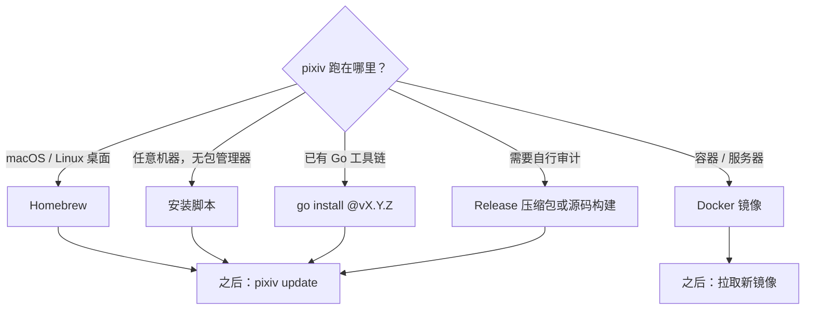
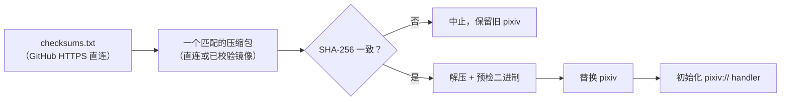
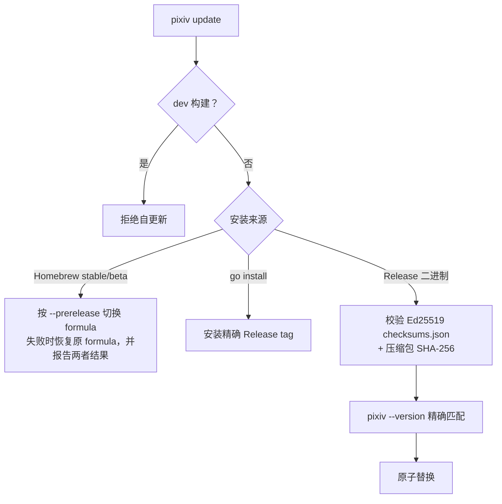

# 安装与更新

[English](../en/install.md) | 简体中文 | [CLI 参考](cli-reference.md)

[GitHub Releases 页面]: https://github.com/FlanChanXwO/pixiv-cli/releases



> [!NOTE]
> Ed25519 公钥、key ID 与指纹已提交在 [`internal/selfupdate/installer/release_installer.go`](../../internal/selfupdate/installer/release_installer.go)；公开源码/tap 仓库、受保护的 `release` Environment 与隔离凭据均已配置。Release 与 tap 分别发布——当前状态以 [GitHub Releases 页面] 与 `brew info FlanChanXwO/tap/pixiv-cli` 为准。每个版本都必须通过同样的 tag、签名、资产与 Homebrew 门禁后，才可作为可信来源。

## 官方安装脚本

```bash
# Linux/macOS
curl -fsSLo /tmp/pixiv-install.sh https://github.com/FlanChanXwO/pixiv-cli/releases/latest/download/install.sh
sh /tmp/pixiv-install.sh --add-to-path
```

```bat
rem Windows 命令提示符；不依赖 PowerShell
curl.exe -fsSLo "%TEMP%\pixiv-install.cmd" https://raw.githubusercontent.com/FlanChanXwO/pixiv-cli/main/scripts/install.cmd
call "%TEMP%\pixiv-install.cmd" --add-to-path
```

| | `install.sh` | `install.cmd` |
| --- | --- | --- |
| 平台 | Linux/macOS AMD64、ARM64 | Windows AMD64、ARM64 |
| 默认目录 | `$HOME/.local/bin` | `%LOCALAPPDATA%\Programs\pixiv` |
| `--add-to-path` | 仅限 `$HOME/.local/bin` | 只改当前用户的 `Path` 值 |
| `--install-dir DIR` / `--no-path` | 改用其他目录 / 不改 profile 或注册表 | 同左 |



- 不请求管理员/root 权限，不安装前置工具，不读取 Pixiv 凭据，不绕过系统信誉提示。
- **首次引导的信任边界：** `pixiv` 尚不存在时没有内嵌 Ed25519 校验器——SHA-256 只能发现损坏或不匹配，真实性依赖 HTTPS 与官方仓库。执行前请先审阅脚本。安装后 `pixiv update` 使用内嵌的 Ed25519 信任根。
- **镜像源：** 带版本的安装脚本内嵌静态源列表（从不远程获取，只随签名 Release 变化）。候选源只用于平台压缩包，且其 checksum 响应必须与直连文件逐字节一致才可用；压缩包仍须匹配直连的 SHA-256。
- **Linux：** release 与 packaged-smoke 二进制为静态链接（`CGO_ENABLED=0`），在 Ubuntu 22.04 构建；预检会在替换前暴露 loader 失败。
- **`pixiv://` handler：** 校验安装后初始化（Homebrew 在 `post_install` 中完成）。出现 warning 表示二进制已装好但桌面集成未完成。macOS/Windows 上下一次普通命令会重试，因此手动解压的压缩包会自行修复。桌面 Linux 需要 `xdg-mime` 与 `gio`；无头 Linux 不注册 handler，但支持 relay server。

## 从源码构建

```bash
sh scripts/build.sh
```

使用 `go.mod` 中的 Go 版本，设置 `CGO_ENABLED=0`，输出 `build/pixiv`（Windows 为 `build/pixiv.exe`）；不需要 Rust 工具链、native library 或 C linker。Windows 使用 Git Bash、MSYS2 或 WSL。编码、许可证与平台证据见[开发流程](maintainers/development.md#ugoira-go-encoder)。

## Go 源码安装

```bash
go install github.com/FlanChanXwO/pixiv-cli/cmd/pixiv@vX.Y.Z
```

- 使用精确的已发布 tag（不要用分支），并遵循该 tag 的构建要求；含 Go 编码器的版本可用 `CGO_ENABLED=0` 构建。
- 前端源码已内嵌，无需生成器或 npm。安装到 `GOBIN` 或 `GOPATH/bin`。
- 自更新会安装选中的精确 tag，失败时保留原可执行文件。

## Homebrew

```bash
brew install FlanChanXwO/tap/pixiv-cli        # stable
brew install FlanChanXwO/tap/pixiv-cli-beta   # 未来的 beta 通道，只随预发布版本提供
```

两个 formula 安装同一个 `pixiv`，互相冲突；只下载已校验的 macOS/Linux Release 资产，不引入 `ffmpeg` 依赖。Release 与 tap 是独立的发布渠道——请用 `brew info FlanChanXwO/tap/pixiv-cli` 与 [GitHub Releases 页面] 查询，而不是本文硬编码的版本。

## Docker

| 事项 | 值 |
| --- | --- |
| 镜像 | `ghcr.io/flanchanxwo/pixiv-cli`、`docker.io/flanchanxwo/pixiv-cli`（同样的原生 `linux/amd64` + `linux/arm64` 镜像） |
| Tag | 需要可复现时用精确版本（`v1.2.3`）；`latest` 只跟随 stable，预发布不会移动它 |
| 状态 | 同一个 `pixiv` 二进制与 `~/.pixiv-cli` 命名空间（`/home/pixiv/.pixiv-cli`，镜像 UID 1000） |
| 工作目录 | `/work`——配合显式输出路径使用；不是单独的产品模式 |
| 升级 | 拉取新镜像并用同一个 state volume 重新部署；`pixiv update` 不感知容器 |

```bash
# 持久化状态 + 下载工作区
docker run --rm -v pixiv-cli-state:/home/pixiv/.pixiv-cli -v "$PWD:/work" \
  ghcr.io/flanchanxwo/pixiv-cli:v1.2.3 --version

# 宿主目录不能被 UID 1000 写入：以宿主身份运行，并给临时 HOME
docker run --rm --user "$(id -u):$(id -g)" -e HOME=/tmp/pixiv-cli -v "$PWD:/work" \
  ghcr.io/flanchanxwo/pixiv-cli:v1.2.3 download URL --output /work/downloads

# 该身份下的持久状态：绑定一个你拥有的宿主目录
mkdir -p "$PWD/pixiv-cli-state"
docker run --rm --user "$(id -u):$(id -g)" -e HOME=/tmp/pixiv-cli \
  -v "$PWD/pixiv-cli-state:/home/pixiv/.pixiv-cli" ghcr.io/flanchanxwo/pixiv-cli:v1.2.3 auth list

# 通过 stdin 导入 token（TTY → 隐藏输入；粘贴后按 Ctrl-D）
docker run --rm -it -v pixiv-cli-state:/home/pixiv/.pixiv-cli ghcr.io/flanchanxwo/pixiv-cli:v1.2.3 auth import
# 自动化：用 -i（不是 -it）管道输入；只写入 state volume
secret-manager print-token | docker run --rm -i -v pixiv-cli-state:/home/pixiv/.pixiv-cli \
  ghcr.io/flanchanxwo/pixiv-cli:v1.2.3 auth import

# MCP stdio（stdout 专用于 JSON-RPC）；挂载 state volume 以复用账号
docker run --rm -i ghcr.io/flanchanxwo/pixiv-cli:v1.2.3 mcp
```

bind mount 保留宿主属主。不要把 token 作为 argv 传入。`auth import` 行为与宿主一致；Docker 不为 `auth login` 提供 OAuth callback 流程。容器中的 MCP HTTP 见 [MCP HTTP server](cli-reference.md#mcp-http-server)。

## 直接下载

- 六个固定名称的压缩包（darwin/linux/windows × amd64/arm64）：`pixiv-cli_<version>_<os>_<arch>.tar.gz`（Windows 为 `.zip`），另有 `checksums.txt` 与 Ed25519 签名的 `checksums.json`。只有对应 release 通过门禁后才可信。
- 没有 Apple notarization 或 Windows Authenticode：Gatekeeper/SmartScreen 仍可能提示。只从项目 GitHub Release 页面下载，核对版本、checksum 与签名，不要对来源不明的资产绕过警告。

## 版本与更新

```bash
pixiv --licenses          # 内嵌第三方声明；不认证、不联网、不创建本地状态
pixiv --version           # 恰好一行：pixiv <version>；无 stderr，不检查更新
pixiv update --check [--json] [--prerelease]
pixiv update --proxy http://127.0.0.1:7890
```

- 压缩包只含可执行文件，不另带许可证文件。
- 原 `version` 子命令、其 `--json` 与公开的 `commit`/`build_date` 字段已移除（breaking）：现在以 unknown command 失败且 stdout 为空。请改用根 flag。
- 实际安装不接受 `--json`。



- **来源：** 未显式指定 `--proxy`、未配置 `https_proxy` 且无 `HTTPS_PROXY` 时，Release 二进制更新会并发探测内嵌源列表——支持 API 的候选用于 Releases API，支持资产的候选用于清单、checksum 与压缩包。首个有效响应成为首选路径；资产下载可静默尝试其余已声明路径各一次；全部失败时错误会列出每条失败路径。候选源不会改变 canonical URL、SemVer 选择、Ed25519 或 SHA-256 校验。
- **通道：** 只选 canonical SemVer tag。stable 排除 GitHub 预发布；`--prerelease` 包含它们。通道内任何已发布非草稿 Release 使用非 SemVer tag 时，检查会报告该 tag 并 fail closed。
- **信任：** 二进制内嵌生产 Ed25519 公钥/key ID/指纹；私钥只存在于受保护的 `release` Environment 与受控的 macOS Keychain 恢复副本。`pixiv update --check` 只读，不能替代安装时对所选版本资产的校验。
- **自动检查：** 普通命令成功后尽力检查 stable 更新——MCP、help、根 `--version`、`update`、所有 `auth export`、bundle 形式的 `auth import` 与 dev 构建跳过；每个用户缓存 24 小时最多一次（仅用支持 API 的候选），上限 3 秒。结果与失败只写 stderr（失败为 warning），不改变退出码，也不污染 JSON stdout 或 MCP HTTP 响应。关闭方式：

```toml
# ~/.pixiv-cli/config.toml
[update]
check_enabled = false
```
