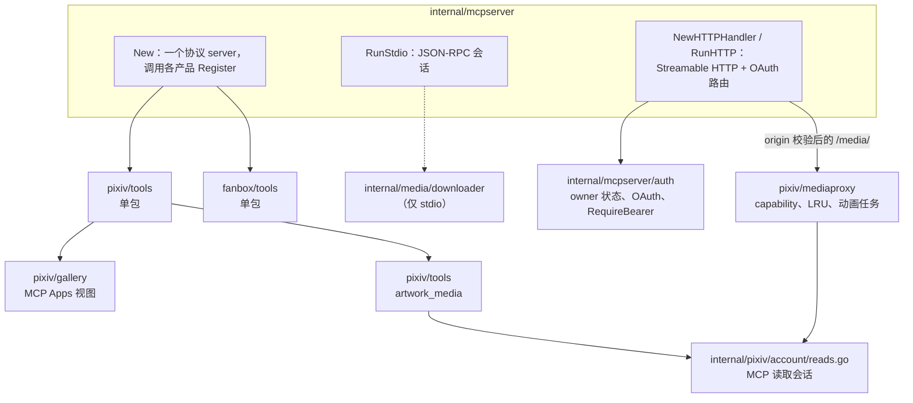
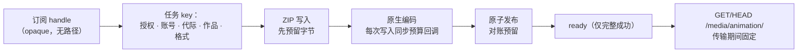

# MCP server 架构

[English](../../en/maintainers/architecture-mcp.md) | 简体中文 | [架构说明](architecture.md)

`internal/mcpserver` 内部的包归属及其组合的服务。工具行为见 [MCP 工具](../mcp-tools.md) 与 [MCP Apps 画廊](../mcp-gallery.md)。

## Server 与注册

- `New` 构造唯一的协议 server 并调用各产品的 `Register`。Pixiv 工具用 `pixiv_`，FANBOX 用 `fanbox_`；没有无前缀别名。每个工具包负责自己的名称、annotations、schema 与 handler。
- stdio 通过 `internal/media/downloader` 注入本地下载；HTTP 从不获得该端口。Gallery 与 owner 工具需要各自的媒体/账号/登录端口。
- `NewHTTPHandler`（父包）组装无状态 Streamable HTTP 与 OAuth 路由；`RunHTTP` 负责 listener 与生命周期；`RunStdio` 负责本地会话并等待清理。
- 各产品保留自己的 SDK 端口、账号选择与 runtime。发现阶段不打开 FANBOX 账号；FANBOX 工具运行时根包才惰性打开其独立服务。Pixiv 可空的 `page`/`limit` 由其适配器解析；遍历留在 `internal/pagination`。handler 失败保留结构化输出并设置 `isError=true`；合法的空结果保持成功。

## Gallery 与媒体

| 包 | 负责 |
| --- | --- |
| `pixiv/gallery` | 挂到 `pixiv_show_gallery`、`pixiv_show_artwork` 与 `pixiv_artwork_media` 的 MCP Apps 视图；稳定资源 URI + 内容版本别名作为 UI 缓存 key；合法的历史别名把新读取转到当前内嵌视图 |
| `pixiv/mediaproxy` | 进程内图片 capability 签名与经公开 SDK 的栅格交付（canonical origin 校验后路由到 `/media/`）；按授权/会话划分的元数据与图片 LRU；查询/图片信号量；同 key 元数据合并请求；流式响应生命周期；动画任务 |
| `pixiv/tools/media.go` | `pixiv_artwork_media` 静态图片交付与每次调用的 Ugoira 编码；`pixiv_gallery_animation` 动画任务控制适配；`pixiv_show_gallery` / `pixiv_show_artwork` 视图 |
| `pixiv/internal/outputs` | 结构化媒体信封与 schema 错误脱敏 |

- capability 绑定 OAuth 授权、账号与图片选择；浏览器与路由都不接受上游凭据或任意 URL。组合根提供与其他 Pixiv 操作相同的出站代理与显式账号 lease 工厂。
- Gallery UI 负责惰性占位、显式重试、视图取消、Blob 清理与宿主能力下载，并在内部导航间维护约 256 MiB 的估算会话 LRU（静态图、元数据、原图字节）；新的工具输入/结果与 teardown 会清空。脱离视图的缓存图片失去视图监听；驱逐会释放来源；活动中的超大图仍可显示。原图弹窗使用全字节媒体工具，并与宿主确认的下载共享字节。宿主不支持下载时，通过 Gallery 工具准备所选页的原图 capability，并暴露受保护的 HTTPS 附件链接（只接受精确下载 query、仅 original 质量、复用 inline 图的 server 缓存）。收藏状态从不缓存；搜索续读留在数据工具。
- **mediaproxy 缓存：** 序列化元数据、进行中缓冲与被固定的载荷共享配置预算；大图/无法预留的图片流式传输不缓存。每次查找校验当前授权；旧账号/会话代际不能复用内容；只有完整成功的传输进入缓存（从不包含收藏状态或写入）。授权通知、凭据代际信号与条目过期回收空闲条目；被固定的字节在释放前持续计费。发布时在缓存互斥锁下校验授权与代际，迟到的旧填充无法重新写入。SDK 在映射可信元数据时注册经策略校验的质量变体。诊断使用固定阶段，不含 secret 标识。
- **artwork_media：** 一个 SDK lease 把元数据与所有页面资源绑定到所选账号；每次读取后关闭响应；所有退出路径关闭 lease；返回字节 + 显式的逐页索引/失败；不暴露 server 路径；不重放部分交付。Ugoira 使用共享下载器的压缩包选择器、SDK `SaveResource` 与 Go 编码器，在每次调用的私有工作区中运行，以 `ImageContent` 返回全部 GIF/APNG 字节与单独索引的 PNG 预览（APNG 的 content MIME 属于 PNG 族，元数据保留动画子类型），并在交付前删除临时文件。实际压缩包质量与输出文件名是显式的；仅静态适用的参数被拒绝而非忽略。支持 App 的客户端获得 [媒体交付](../mcp-gallery.md#mcp-apps-媒体交付) 中描述的 `_meta["pixiv/mediaContents"]` 索引交付；可选发布不可用时数组保留完整 inline 内容（宿主仍可能拒绝——准备完成不等于已接收）。
- ZIP body 失败在任务 context 仍有效时输出固定的 `animation_zip_incomplete` / `animation_zip_reset` / `animation_zip_timeout` 标记（只含部分字节数），不改变重试、截止时间、质量或工具错误。
- **HTTP 写入观测** 只在存在诊断 scope 时进行；字节数描述 writer 已接受，而非对端已收到；`ResponseController` 解包保持 SDK 流式/截止时间行为；不保留 body/header；不增加缓冲、等待或重试。

### 动画任务

- 组合根提供 server 持有的私有工作区，并在账号读取会话之前关闭它。二进制动画与 PNG 预览路由复用 canonical origin 与授权检查。
- ZIP/预览写入器在写入前预留磁盘字节；内部同步原生回调在触碰文件前，把每次输出写入预留到同一个池。只有实际请求的字节放不下时才回收 ready 产物（不预先预留其空间）。原生输出上限保持强制，全局串行编码门保持共享。
- 临时生产者与原生预留一起排队；启动清理需要服务标记与已释放的生命周期 OS 锁。GET/HEAD 期间文件保持固定；清理会等待活动工作。Gallery 通过 Apps bridge 轮询；CSP 仍禁止直接 fetch 连接。

## 读取会话（`internal/pixiv/account/reads.go`）

- 受生命周期管理的 MCP 读取会话：获取时校验本地账号修订号；只在 OAuth 刷新与成功的轮换持久化时共享轮换门。
- 凭据替换/删除、网络变化、过期与上游 401 使代际失效并释放空闲连接。写操作 lease 与账号池提交/重放保留在 Facade 中。
- 根包注入单独的读取端口与 opaque 会话代际；MCP 适配器从不读取凭据。被取消的账号查找返回其请求错误，不会使共享代际失效或强制轮换。
- Windows 上，凭据与动画授权 watcher 还会监视各自的父目录，以发现被监视目录本身被移动。

## OAuth 与 owner 状态（`internal/mcpserver/auth`）

- 一个具体的版本化 JSON 状态，以及 owner 初始化/重置。根包注入 app-data 路径；只有 CLI 打印一次性 secret。写操作锁定 sidecar、读取最新状态并原子替换；读取不缓存。owner verifier 也是后续内存授权状态的代际边界。不引入数据库。
- 授权记录必须显式包含布尔 `revoked` 与 `used_refresh_hashes`；字段缺失或类型错误 fail closed（refresh 历史可为 `[]` 或序列化器为 nil 切片产生的 `null`）。非法状态会阻止读取、初始化/重置与注册，且不覆盖文件。
- `auth.NewHandler` 提供 discovery、DCR、authorize 与 token 路由以及 `Handler.RequireBearer`。`NewHTTPHandler` 把它们与 `/mcp` 一起挂载，监听前校验 owner 状态，并在 OAuth 或 SDK handler 之前执行 canonical Host/Origin 检查。构造函数接收 canonical base URL，允许本地 HTTP，拒绝凭据、query、fragment 与客户端规范化的点路径段。issuer 从不来自请求 Host 或转发 header。

| 领域 | 规则 |
| --- | --- |
| 元数据路由 | 根与资源专属的 protected-resource 元数据共用 SDK handler。base `https://example.test/pixiv` → resource `https://example.test/pixiv/mcp`；元数据 `/.well-known/oauth-protected-resource` 与 `/.well-known/oauth-protected-resource/pixiv/mcp`；AS 元数据 `/.well-known/oauth-authorization-server/pixiv`；注册 `/pixiv/oauth/register`。反向代理必须转发这些路由与 `/pixiv/` |
| DCR | 只接受 JSON public client；省略 auth method → `none`；从不签发或保存 client secret。响应返回固定 profile（code；authorization_code/refresh_token；mcp）。忽略未知元数据；从不抓取 logo/client/JWKS URL。不支持的 method、grant、response type 或 scope → OAuth JSON 错误 |
| 重定向 | 原样保存，不规范化。接受 HTTPS、loopback HTTP（含 localhost）与带点的反向域名原生 scheme；拒绝 fragment、相对 URI、普通远程 HTTP、可执行 scheme 与格式错误的 URI。authorize 要求与注册值精确匹配；格式错误的回调 query 与已存在的 `code`、`error`、`error_description`、`error_uri`、`state`、`iss` 在本地被拒绝；其他 query 参数保留 |
| 持久化 | 注册与重置共用 sidecar 锁并读取最新状态；只有原子写成功才返回 201/client_id；失败 → `server_error`，不含路径、原始元数据或凭据。重置保留注册与已选账号 |
| Authorize | 需要 code、canonical resource、`mcp` scope（也是默认值）与合法的 S256 challenge。未知 client/非法重定向在本地失败；其他已校验的错误带原 state 与 canonical `iss` 重定向（AS 元数据中声明） |
| 同意页 | 经转义；client 名称标注为未验证；展示重定向 origin 与 URI。一次性 CSRF token 把表单绑定到浏览器、请求与 owner 代际。owner 验证会轮换 HttpOnly/SameSite=Lax Cookie（HTTPS base 需 Secure）。每次授权都需要显式 Allow/Deny。POST 拒绝跨域请求与参数覆盖（比较时考虑 host 大小写与默认端口）。表单 action 是完整的 canonical 授权 URL（合法的双斜杠前缀不会变成跨域目标）；Host/转发 header 与客户端重定向无法改变它。Cookie 路径保留转义前缀 |
| CSP | 禁止脚本、嵌套框架与 base 覆盖；form-action 只允许 self 与已校验的回调 origin（Chromium 也检查表单重定向）。`strict-origin` 避免泄露授权 query 参数，同时保留同源表单 POST 需要的 Origin |
| Code | 会话、待处理同意与哈希后的 code 只在内存中，重置/重启即失效。code 有 10 分钟截止时间，绑定 client/重定向/resource/scope/PKCE/代际；交换在文件事务内校验这些绑定与当前代际，到截止时间即拒绝，只在持久化成功后消费 |
| Token 端点 | 只接受标准 form POST。query 中的凭据、重复/缺失参数与不支持的 grant → OAuth JSON 错误，不回显输入。PKCE verifier 须为 43–128 个 unreserved ASCII 字符后再做 S256 校验。access 与 refresh 是独立的 256 位 opaque 随机值，只持久化 SHA-256。access `expires_in=3600`；refresh 没有空闲过期 |
| Refresh | 在与重置相同的锁下重新读取状态；绑定 canonical resource、client 与 scope；轮换并保留已用哈希。重放会先持久化该授权的撤销再返回 `invalid_grant`；随机非法值不会撤销任何授权。写入失败不发布 token，并保留可重试的 code/refresh token；撤销失败从不声称成功。重启保留 client/授权/refresh，丢弃待处理 code |
| `RequireBearer` | 复用 SDK middleware；每个请求读取当前状态；校验 resource/撤销/过期；拒绝多个 Authorization header。未授权 → 401 + canonical `resource_metadata` challenge（不是 MCP 结果）。非法状态安全失败且不暴露路径。`no-store`；过期/重置影响之后的授权，不影响已授权的长请求 |
| 测试 | HTTP 与真实临时文件测试覆盖精确截止时间、并发 code/refresh/reset、重启与真实写入失败；截止时间测试用 `testing/synctest`，不增加生产时钟配置 |

**HTTP owner** —— 使用精确的转义路径而非 ServeMux 清理；Host 与任何 Origin 必须匹配 canonical origin；转发 header 从不建立信任；反向代理必须保留公开 Host 与前缀。在响应提交时强制 `no-store`，包括 SDK SSE。服务取消或 listener 失败时，server 取消自身 context 并等待活动 handler（无固定超时），保留原始 listener 错误，从不取消调用方 context。接收 middleware 把旧 SDK 会话绑定到服务 context；SDK 传播新版协议的 HTTP 请求取消。不增加自定义会话存储或传输 fallback。

**互通证据** —— 标准 client fixture 覆盖 401 发现、DCR、PKCE、两个产品的 SDK 读取，以及在同一地址重启后授权仍持久存在。固定版本的 Go MCP SDK v1.8.0 默认 refresh token source 省略 `resource` 并收到 `invalid_request`；server 不为它放宽校验。另一个对照通过可配置的 HTTP client 在表单中加入[必需的 resource 参数](https://modelcontextprotocol.io/specification/2026-07-28/basic/authorization#resource-parameter-implementation)，验证轮换与重连读取——这不证明未修改的 SDK refresh 兼容，也不证明 ChatGPT/Gemini 产品验收。路径与注册规则遵循 RFC 8414 §3、RFC 9728 §3、RFC 7591 §2/§3.2 与 RFC 8252 §7/§8.4。临时文件与 HTTP fixture 检查不能证明真实 connector 的 OAuth 兼容性。
