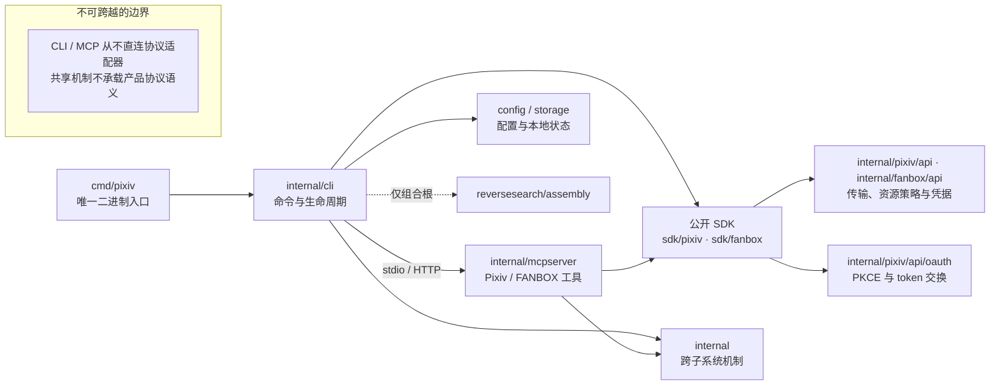
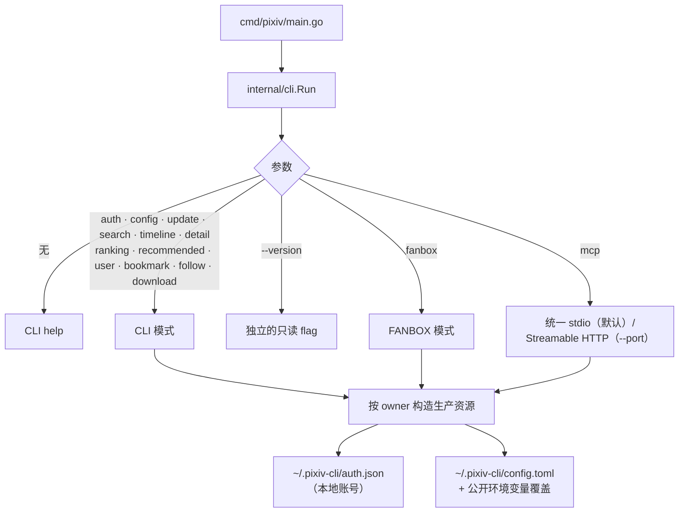
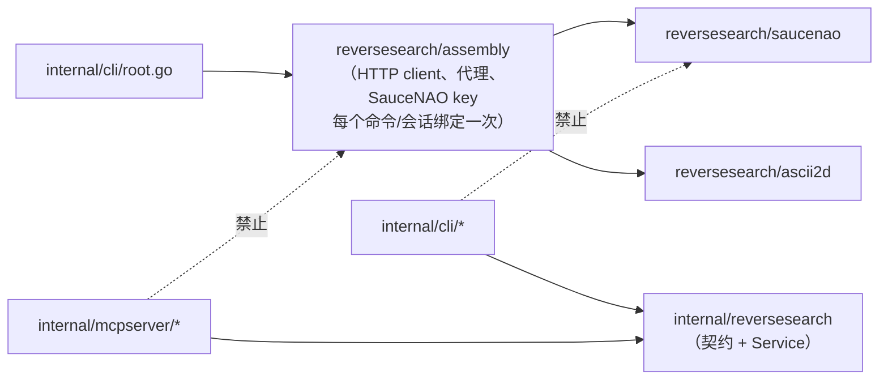
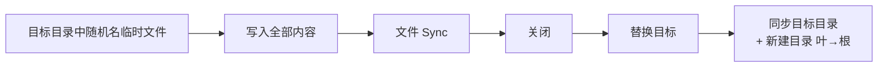
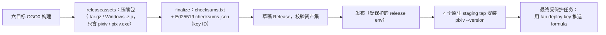

# 架构说明

[English](../../en/maintainers/architecture.md) | 简体中文 | [文档索引](../../index-zh-CN.md)

> [!IMPORTANT]
> CLI 与 MCP 只能通过公开 SDK 与 owner-local 窄端口获得业务能力。生产组装可以依赖具体实现，但不得向命令层暴露 locator、runtime graph 或协议适配器。

| 读者 / 关注点 | 跳转 |
| --- | --- |
| 从入口到 SDK 的调用链 | [总体流程](#总体流程) |
| 页面源码与嵌入 | [前端源码与页面嵌入](#前端源码与页面嵌入) |
| 某个包能做/不能做什么 | [包职责](#包职责) |
| MCP server、OAuth、媒体代理、Gallery 任务 | [MCP server 架构](architecture-mcp.md) |
| Release 信任根与签名 | [Release assets 与信任边界](#release-assets-与信任边界) |
| 本地状态、配置、路径权限 | [internal/account](#internalaccount)、[internal/config](#internalconfig)、[internal/storage](#internalstorageatomicfilefilelocksecretfile) |
| 硬约束清单 | [已知约束](#已知约束) |

## 总体流程

- `auth import` 处理直接导入 token 或恢复 bundle；`auth export` 处理本地 secret 快照。`pixiv fanbox mcp` 已移除。
- Windows 路径为 `%USERPROFILE%\.pixiv-cli\`。首次访问账号时创建 `auth.json`；存在本地 `pixiv-cli.db` 时自动导入，旧数据库保持原样。
- 没有匿名 Web fallback：内容需要已认证的本地账号或显式凭据；残留的 `web_fallback_enabled` 属于未声明键，加载时忽略。

## 前端源码与页面嵌入

| 源码目录 | 负责 | 嵌入方式 |
| --- | --- | --- |
| `frontend/mcp-apps/gallery/` | Gallery HTML/CSS/JS | CSS/JS 内联 |
| `frontend/pages/login/` | 登录/回调/结果模板与样式 | 保持分离，逐字节保留 |
| `frontend/pages/oauth/` | 同意页 HTML/CSS | CSS 内联 |

纯资源包 `frontend` 嵌入精确路径（不含 fixture），启动时用标准库组装一次页面；页面行为通过相应浏览器/MCP 宿主手动检查。Go owner 保留 MCP 注册、模板渲染/数据/转义、CSP/媒体 origin、canonical action、CSRF 与授权。当前与历史资源 URI 均受支持。干净构建与带版本的 `go install` 无需生成步骤；运行时只读嵌入字节。Homebrew 模板保持原 owner。

## 包职责

### `cmd/pixiv`

生成 `pixiv` 二进制的 `main` 包；没有业务逻辑，只调用 `internal/cli.Run` 并返回退出码。

### `internal/cli`

CLI 组合根。`internal/cli` 只有一个 `root.go` 和命令目录；与 MCP 或另一产品共用的代码都放在模块级 owner：

| 文件 | 负责 |
| --- | --- |
| `root.go` | `Run`、Cobra 命令树、全局 flag、按需启动 hook、退出码映射、stderr logger 启动、broken-pipe 策略、生产装配与反向搜索 ports；唯一导入 `internal/reversesearch/assembly` 的文件 |

职责：Cobra 命令树/help/flag；文本/JSON 输出；`auth import` 输入适配（位置参数 = opaque token；无参数时 TTY 隐藏输入，非 TTY 按首个非空白字节区分 token 与严格 bundle；通过管道/重定向恢复，没有 `--file`）；`auth export` secret 输出适配（无 `--output`：原始 token + 换行，或 `--all` 的 bundle；有 `--output`：私有文件 + 不含 secret 的摘要）；`--page`/`--limit` 解析（逻辑计划在 `internal/pagination`）；`auth login` 的 loopback OAuth、浏览器与 TTY；`pixiv mcp` 分发；根 `--version` 与 `pixiv update`（已移除的 `version` 子命令在解析时返回 unknown command）；只写 stderr 的只读自动更新提示。

- **关闭：** `lifecycle.CloseState` 登记 `Run` 打开的资源；调用方在关闭前停止资源生产者并完成注册；互斥锁保护列表，不保护迟到的注册；closer 不得向同一 scope 注册或递归关闭它。关闭在命令完成后进行；MCP stdio 等待进行中的 handler；关闭错误被合并。
- **Owner：** `internal/cli` 只有一个 `root.go` 与命令目录，没有 `internal/` 子目录，也没有测试文件。`root.go` 通过显式工厂与窄端口把生产依赖接到命令 owner，并逆序关闭已登记的资源。没有跨命令 locator、bootstrap 构造器或 `internal/cli/runtime`。CLI 契约测试放在 `cmd/pixiv`，通过 `cli.Run` 做黑盒测试。
- **命令包：** 根级 `internal/cli/{config,mcp,update,whoami}`；Pixiv `internal/cli/{auth,bookmark,comment,detail,download,follow,mypixiv,ranking,recommended,search,series,timeline,user}`；FANBOX `internal/cli/fanbox/{auth,browse,download}`。组的持久 `--proxy`/`--no-proxy` flag 由 `internal/cli/fanbox` 拥有。Pixiv 查询、评论与下载命令通过 `session.SDKExecutor` 使用新 `*pixiv.Client`，列表输出使用 `record.RunSDKList`。FANBOX 命令通过延迟会话工厂与 `fanbox.UseClient` 使用 `*fanbox.Client`。公共输入输出由 `environment.Env` 提供。
- **共享 helper 位于模块级 owner：** `internal/environment`（输入输出流、stdin codec、flag 绑定、usage 标记、生命周期标注）、`internal/pagination`（`--limit`/`--page` 解析、`PagePlan`、分页输出字段）、`internal/record`（record 投影、NDJSON 消费与逐行诊断、列表 JSON/NDJSON/文本输出）、`internal/session`（Pixiv 重放执行器、FANBOX 租约包装与账号/账号池/会话的生产构造函数）、`internal/display`（终端文本渲染、身份格式、上游文本转义）、`internal/pixiv/target`（目标解析）。这些包不导入 `internal/cli` 或 `internal/mcpserver`。
- **`--version` / 自动更新：** stdout 恰为 `pixiv <version>`，stderr 为空，不检查更新。自动更新只在普通业务命令成功后运行，MCP、help、`--version`、`update`、所有 `auth export`、bundle 形式 `auth import`、标记为离线的命令（例如 `whoami`）与 dev 构建跳过；选择 stable Release，用户缓存 24 小时节流，最多等 3 秒；失败只作为 stderr warning——不改变退出码，不泄漏到 JSON stdout 或 MCP JSON-RPC。
- **Windows 启动清理** 待更新文件属于潜在写操作：所有 `auth export` 调用在 Cobra 解析前识别并跳过它。根 bool 解析变更时，手动核对 `--help=false` 等重复覆盖形式仍遵守 secret 导出边界。

### `internal/urlscheme`

负责 `pixiv://` URL scheme：平台 handler 安装、回调分发、持久化 handler 清单、一次性远程 hand-off 私有状态与远程回调 client。`internal/cli/auth` 通过它安装按需 handler，并保留 OAuth、loopback HTTP、浏览器、TTY 与 relay server 编排。中继的 HTTP 协议留在 `internal/loginrelay`。

| 平台 | 机制 |
| --- | --- |
| Darwin | 内嵌 Swift、`Info.plist`、LaunchServices |
| Windows | 当前用户注册表/class 启动 |
| 桌面 Linux | XDG desktop entry + `gio` |
| 无头 Linux | 不注册 handler；relay server 仍可用 |

只有精确的 `pixiv://account/login` 与 `pixiv://account/remote-login` 进入本轮；活动 loopback 优先；远程回调只交给活动的一次性 hand-off；其他 URL 交给清单中持久化的 handler。桌面状态只保存当前 hand-off 的 relay origin、会话 ID 与 capability；server 不保存设备记录；SDK 不暴露这些状态。远程回调只接受同一 relay base 上的一次性结果 URL；`internal/cli` 打开不敏感的最终页面并等待交换。

### 横切关注点

每个关注点只有一个归属层，其他层不重复实现。

1. 每个关注点只有一个归属层和一种传入方式。
2. 业务对象可以持有基础设施，但只持有一个已经封装好的依赖（一个 transport、一个 repository），不持有构成它的零件（`http.Client`、`selfHTTP`、`sync.Mutex`、缓存 map）。
3. 请求范围内的信息（取消、调用关联、日志）通过 `context.Context` 传递，不放进字段。
4. 只为测试存在的注入点不出现在导出 API 中。同包测试可以设置未导出字段。

| 关注点 | 归属层 | 传入方式 | 业务对象中的形态 |
| --- | --- | --- | --- |
| 日志、诊断事件 | `pixiv/api`、`fanbox/api`（请求与内部决策）；执行边界（最终结果） | 新 SDK：当前 slog 默认 logger；旧 SDK：`Options.Logger`；内部调用信息：`context.Context` | 无 logger 字段 |
| 取消、超时、调用关联 | 执行边界 | `context.Context` | 方法参数 |
| HTTP client、代理、重试、Retry-After、请求间隔 | `internal/pixiv/api`、`internal/fanbox/api` | 构造时传入一次 | 一个 transport 字段 |
| 签名 URL 缓存、资源域名白名单 | `pixiv/api` 资源传输层 | 同上 | 无字段 |
| 资源释放（`Close`、`CloseIdleConnections`） | 创建者；`lifecycle` 包提供 `Lease` | 构造函数返回关闭函数或 `Lease` | 无额外字段 |
| 账号快照、文件锁、原子更新 | `internal/account` | `Store` 方法持锁重读 `auth.json` | 一个 store 依赖 |
| 本地凭据轮换的持久化 | `internal/account` | 新 SDK：按账号绑定的 `CredentialStore`；旧 SDK：`session.Pixiv.Open` / `Use` | 新 client 离线构造；刷新后的凭据先保存，再发内容请求 |
| 配置 | 组合根读取一次 | 以具名字段的值传入构造函数 | 值字段，不持有 `settings.Store` |
| stdout 输出（文本/JSON/NDJSON） | CLI 命令层 | 命令持有 writer | 业务返回数据 |

本身就是基础设施的包不受“业务对象”这一限制：`pixiv/api`、`fanbox/api`、`storage/*`、`pixiv/saving`、`mcpserver/pixiv/mediaproxy` 的职责就是并发、缓存、文件和网络。规则只要求它们对外暴露的接口窄、内部零件不外泄。

### 日志入口

| 位置 | 负责 |
| --- | --- |
| `internal/logging/` | 文本 handler 输出 `[HH:MM:SS.mmm] [operation] [LEVEL] [上级目录/文件:行号]`，按终端决定是否着色，转义不可打印文本并缩进多行值；JSON handler 带 `source`；ctx 调用信息与共享属性键也在本包；内部恢复点经 `logging.From(ctx)` 取得 logger  SDK 创建位置通过私有字段传递；传输属性只提取 typed cause 的 `op`、`net`、`address` 与已知 `errno` 名，不读取原始错误文本。 |
| `internal/cli/root.go` | 经 `internal/logging` 创建 stderr logger 和调用上下文，启动时用 `slog.SetDefault` 安装，命令清理完成后恢复原默认值；JSON 以 ERROR、文本以 DEBUG 记录 `Command failed`，旧 SDK 错误存在私有 `origin` 时附加该字段；保留 stderr 错误输出 |
| `internal/cli/mcp/runtime.go`、`internal/session/options.go` | 将同一 logger 传给旧 SDK 的 `Options.Logger` 和 MCP 端口；新 Pixiv SDK 选项只携带连接设置 |
| `internal/mcpserver/toolrun/toolrun.go` | 共用的 `Scope` / `AddTool` 包装，绑定工具名与调用 ID；错误或 `isError` 结果记录一次受控的失败摘要 |
| `internal/pixiv/api/`（含 `oauth/`）、`internal/fanbox/api/` | 持有构造时传入的 logger，在实际请求与决策处记录结果 |

新 SDK 事件使用当前 slog 默认 handler，协议事件经现有适配器转交。旧 SDK 方法通过 `logging.WithOperation` 登记 `sdk_operation`，nil logger 保持静默。新 SDK 错误省略旧版私有 `origin`，部分事件也没有旧版 `sdk_operation`。`operation` 表示 CLI 命令路径或 MCP 工具名，`call_id` 区分并发工具调用，`source` 标明日志位置。CLI/MCP 日志只写 stderr，数据 stdout 与 JSON-RPC 通道保持纯净。

### 共享机制

| 包 | 负责 | 不得 |
| --- | --- | --- |
| `internal/version` | linker 注入的 `Version`（默认 `dev`；只有 `dev` 构建拒绝自更新） | — |
| `internal/record` | CLI/MCP 共享的稳定 Pixiv record 投影：新绑定对象投影为现有输出值，固定 `id`/`type`/`url`，JSON 规范化、版本元数据清理、基于 record 字段的本地筛选；CLI 的 NDJSON 消费与逐行诊断、列表 JSON 暂存和合并后的 Pixiv/FANBOX 列表输出 | 依赖 CLI、MCP 或适配器；变成杂物箱（MCP schema 与输出信封留在 `internal/mcpserver/pixiv/internal/{records,outputs}`） |
| `internal/environment` | 只供 CLI 的执行环境：流、stdin codec、flag 绑定、usage 标记、生命周期标注 | 产品协议或账号语义；导入 `internal/mcpserver` |
| `internal/display` | 只供 CLI 的终端文本：实体列表行、详情卡片、`用户名 (UID)`、上游转义；并入原 `plaintext` | JSON/NDJSON 输出；只服务一个命令的渲染 |
| `internal/pixiv/searchfilter` | 作品本地分级/内容类型规范化，客户端侧 `x_restrict` 与类型匹配，隐藏原始值的 cursor 上下文 | 把分级映射为未确认的上游 `x_restrict` 参数；持有 client、凭据或适配器（字段可用性与已确认的 wire 参数由各命令负责） |
| `internal/lifecycle` | 与协议无关的生命周期、`Lease`、`Attempt`、`CloseState` | 负责账号选择、凭据或重放策略 |
| `internal/pagination` | 单流与有序聚合流的逻辑分页：筛选先于全局 skip/limit 预算，`OneBatch` 在首个匹配批次停止，批次截断通过来源位置 checkpoint 续读；`StreamState` = 当前流 + 各流 cursor（owner 与查询/账号/子类型绑定一起编码） | 产品语义 |
| `internal/pagination` | 单流/聚合读取的可重入执行生命周期，安全重放前清除未提交结果 | 负责命令筛选装配 |
| `internal/logging` | `log/slog` handler 与 ctx 调用信息；CLI、MCP、传输、账号池、下载与 FlareSolverr 共用属性键，只输出 operation、method、host、path、status、duration、attempt、wait、reason、count、origin、op、net、address、errno；文本记录的 operation 放在标签中，JSON 记录保留为键并增加 `source`；SDK 路由遵循上方日志入口 | 创建日志文件，或记录响应体、Cookie、token、query、签名 URL 或任意错误 cause 转储 |

**账号池读取：** 旧路径的 `session.Read[T]` 在 `Runner` 的 `Executor` 回调内读取，整个执行边界成功后才返回结果；失败返回 T 零值。`Runner.Write` 从进入修改回调起就按已提交处理，即使返回错误，避免跨账号重放结果未知的写入。新 CLI 路径使用 `Local.ExecuteSDK`；MCP 经 `SDKPorts.ExecuteSDK` 使用 `ReadSDK`、`WriteSDK`、`SDKReadExecutor` 与新收集器，`WriteSDK` 在进入回调时提交。命令 owner 负责流式 NDJSON、分页与部分交付；JSON 结果暂存到成功后输出，可见的文本/NDJSON 输出会提交当前尝试。`pagination` 接受两代 cursor，安全重放前清除未提交结果。旧 MCP 消费方保留 `Execute`/`Read` 端口。

**输出过渡：** `record/pixiv_output.go` 与 `pixiv_user_output.go` 在本次尝试内把新 SDK 对象投影为旧输出 DTO。`pixiv_resource.go` 保留 CLI 资源身份；Gallery 记录经 `RecordFromMediaArtwork` 生成可读图片引用。可用 URL 和请求头留在 SDK 对象或私有媒体缓存内。`pixiv/target` 经新 SDK 解析 URL，再投影为现有目标描述符。S16 将这些旧输出、资源和目标类型与剩余消费者一并迁移。

### 业务会话、账号与账号池

- `internal/account` 拥有 Pixiv/FANBOX 有序账号快照、凭据持久化、登录完成、轮换门、读会话缓存，以及 Pixiv 账号池的选择/冻结/安全重放。目录、网络选项与池策略由调用方传入；默认账号配置由 `internal/session` 管理。
- `session.Local` 装配共享 store、`Accounts`、`FanboxAccounts`、`Pixiv`、`Fanbox` 与读会话。`Accounts`/`FanboxAccounts` 将本地快照与 `internal/config` 默认账号组合，提供命令使用的摘要、导入/导出与恢复编排。Pixiv 同时交出两代 SDK client，FANBOX 继续使用 `internal/legacy/sdk`；FANBOX 的凭据与生命周期独立于 Pixiv，没有账号池策略。
- 新旧 SDK 读取 client 共享有效的内存访问凭据与同一失效代次。构造另一种 client 时保留已验证的账号身份，无需再次轮换 OAuth；每次内容请求仍校验已保存的 revision。旧 token 构造入口在过渡期间接收这份调用方已验证的身份。
- `Store.OpenSDKClient` 交出新 `sdk/pixiv` client，`OpenAccountClient` 保留旧 client。按账号绑定的 `CredentialStore.Load` 读取最新 revision 并固定账号创建时间，`CompareAndSwap` 比较两者后保存，revision 冲突返回 `false, nil`。OAuth 在存储锁外执行；SDK 冲突后重新加载，保存失败在内容请求前传播。`Client.Credentials(ctx)` 经相同流程准备凭据，省去内容请求。
- `session.PixivOptions` 为两代 client 装配一致的连接设置。`Local.ExecuteSDK` 复用现有账号池与 gate，单独交出已选 UID；加载凭据前，`Client.UserID()` 仍可能为零。缺省目标在每次尝试内解析，MCP fetch 回调使用 `SDKUserID`。stdio 的 `ResolveSDKAccount` 保留原始请求用于池调度，HTTP 使用持久化的 `ResolveAccount` 快照。SDK 绑定对象在本次操作内使用。
- S11 迁移 auth、whoami、作品/用户 detail、user（含委托给 user 的用户搜索）、follow、bookmark CLI 路径，以及对应的账号/作品/用户/收藏/related MCP handler，包含这些 handler 内的小说分支和聚合。S12 迁移独立的小说、评论、文字搜索、排行榜、推荐、系列、动态与 MyPixiv 入口。CLI 下载通过 `internal/pixiv/saving` 展开来源并调用 `sdk/download`；MCP 下载与媒体也使用新 SDK；FANBOX 和反向搜图保留各自的迁移路径。完整 SDK 参考重写留在 S16，当前 API 以 [SDK 包 GoDoc](../../../sdk/pixiv/pixiv.go) 为准。
- `Request.Selection` 使用带正数 UID 的 `SelectionFixed` 或 `SelectionPool`。固定账号的读写保持该身份；安全且尚未提交的读取可经池重放。调用方从 `internal/config` 读取 `enabled`/`strategy`；`account` 无 config 导入，默认账号由 session 解析。账号池关闭时，session 选择配置的默认账号或存储中的第一个账号。
- CLI/MCP 经 owner-local port 与 MCP runtime `SDKPorts` 使用会话；筛选、record、schema 与输出渲染留在各适配器。SDK 的依赖图保持独立于本地账号存储。

**登录 relay** —— `internal/loginrelay` 同时负责纯渲染器（消费 `frontend` 模板/CSS，不依赖 CLI、账号库、浏览器或 listener）与可复用的 HTTP handler/session：接收 OAuth 会话校验器并交付一次回调；从不监听、交换或持久化。CLI 保留 listener/TLS/终端编排。宿主 mux 可剥离前缀后挂载；生产 MCP 将其挂在 canonical base + `/pixiv-login/`，位于相同的 Host/Origin 检查之后，但以 hand-off 证明而非 MCP bearer 认证。转义前缀在 URL 与分发中保留。已取消的 relay 会话返回 HTTP 410，并在接受已校验回调前再次检查取消。回调 allowlist、启动响应 wire 类型与结果 URL header 位于 `loginrelay`，由 CLI relay 与桌面 helper 复用。

**MCP 登录 relay**（`accounts.Login`） —— 单一当前登录：重复启动复用待处理工作，restart 取消并等待旧尝试，关闭时等待交换/持久化。完成时保留不含 secret 的 account-saved/selection-updated 标记（含部分失败）。组合根把它绑定到同一 SDK 登录会话，保存凭据但不改 CLI 默认，再单独写 MCP 选择。账号服务在多次 restart 间复用；每次完成的 SDK 登录释放其空闲 HTTP 连接（显式代理/直连时，组合根在每个退出路径关闭其 client 的空闲连接）。

### `internal/pixiv/api`、`internal/fanbox/api`

上游协议实现按产品位于 `internal/pixiv/api`、`internal/fanbox/api`；CLI/MCP 的内容操作通过公开 SDK 使用它们。SDK 持有端点请求、响应校验与映射；协议包持有传输与资源策略。

| 位置 | 负责 |
| --- | --- |
| `internal/pixiv/api/api.go`、`transport.go` | App 请求、认证头、状态处理、请求节流；幂等读取仅在首次 429 带有效 `Retry-After` 时重试一次，写入不重放 |
| `internal/pixiv/api/api.go`、`profile.go`、`failure.go`、`required.go` | 路径/参数/请求头常量、请求 profile、脱敏失败与必需字段解码 |
| `internal/pixiv/api/resource.go` | 签名 URL 缓存、媒体域名白名单、资源读取与重定向检查 |
| `internal/pixiv/api/oauth/` | PKCE、授权码交换、refresh token 轮换与 token 状态 |
| `internal/fanbox/api/` | FANBOX 会话 Cookie、原生传输、身份缓存、Cloudflare 挑战与 solver、媒体地址缓存和 URL 策略 |
| `sdk/pixiv/` | 按账号绑定的引用与对象；`credentials.go`、`refresh.go` 中的凭据加载/刷新/持久化；对应领域文件中的端点请求、响应校验与绑定查询的分页 |
| `internal/legacy/sdk/` | 待迁移消费者使用的 client 与输出 DTO；过渡期保留旧 cursor 和资源契约 |
| `sdk/fanbox/` | `creator.go`、`post.go` 中的路由、请求、响应校验与映射；`pagination.go` 的分页；`resource.go` 的公开资源操作 |

旧产品 client 各持有一个协议 client，新 Pixiv 请求从当前凭据快照构造协议 client。`RequiredList` / `RequiredObject` 共享字段存在性解码：`null` 为 Present true、Valid false；缺失字段不调用解码器。调用方处理解码错误、检查 Valid，并在复用外层响应结构前重置状态；领域层继续检查响应完整性。

### reverse-search service 例外

唯一跨越常规 SDK 边界的产品能力。

只有 `internal/cli/root.go` 导入 `internal/reversesearch/assembly`。CLI 命令 owner 与 MCP owner 可以使用顶层 `internal/reversesearch` 契约；它们不得导入 `assembly` 或 `saucenao`、`ascii2d` 等 provider 包。

- Service 返回领域结果；CLI/MCP 适配器在输出边界投影 canonical record。
- 它把普通文件或 HTTP(S) 来源加载为一个私有快照、计算哈希，并在完成后删除。来源策略有意允许任意可读普通文件与私有、loopback、link-local URL；单 owner OAuth 下只授权可信 connector——路径指 MCP server 文件系统，URL 使用 server 网络。只有来源类型/哈希、安全的 provider 摘要/错误、领域证据与 canonical `artwork`/`user` record 可以发布。
- 三个网络面：标准来源/SauceNAO client、专用 ascii2d 浏览器 client、FlareSolverr JSON 控制 client。服务代理只能覆盖 ascii2d；命令级覆盖同时作用于两个原生 client；否则标准 client 走全局路由。ascii2d UA 与 `Chrome_146` TLS profile 及匹配的 Chromium hints 配对（非 Chromium UA 省略 hints）。FlareSolverr 上游代理只用于浏览器 `sessions.create`；控制流量保持独立；图片始终使用原生 ascii2d multipart。solver 状态限于进程/client，不持久化。

### `internal/account`

- `Store` 拥有 `auth.json`，标识为 `schema: "pixiv-cli.auth"`、`version: 1`。有序 `pixiv`/`fanbox` 数组保存各产品的 UID 身份、明文凭据与正数 `revision`。数组顺序即显示顺序；新账号追加，更新保留原位置。Pixiv `premium` 可为空，时间均为 UTC；`pixiv_pool_last_user_id` 记录唯一的上次池选择（0 表示无历史选择）。
- 首次访问缺失文件或 schema 缺失/不同的合法 JSON 时执行迁移 1：存在 `pixiv-cli.db` 则导入，否则写空账号文件。非法 JSON、自有 schema 损坏、更新的版本均返回错误并保留原文。有效的当前格式文件成为后续读取的权威。
- 迁移仅通过 `database/sql` 与已有 `ncruces/go-sqlite3` 驱动只读导入，检查 `application_id=0x50495843`、schema 版本 1–3，以及连续且与 `user_version` 一致的迁移账本。导入保留账号顺序、UID、名称、revision、会员与池状态；旧库内容和修改时间保持原样，文件保留原位。
- 每次读取和更新均持有 `auth.json.lock` 并重读文件。更新校验完整新快照，再经 `storage/secretfile` 原子替换私有文件。迁移额外持有 `pixiv-cli.db.lock`，顺序始终为 JSON 锁在先。锁覆盖本地快照与写入；OAuth 和内容请求在锁外执行。可取消的锁等待沿用 `storage/filelock` 的取消语义。
- 凭据轮换先在锁外执行 OAuth，再比较存储中的 revision 与创建时间，将新 token 与递增的 revision 原子保存。冲突时丢弃本次 client，使用最新已保存的凭据重新打开；持久化失败时直接返回错误；交出 client 以保存成功为前提。
- `ReadSessions` 在缓存复用前、轮换 client 发布前、每次内容请求前检查 revision 与创建时间。创建时间区分同一 UID 删除后重建的账号。发现凭据替换/删除时作废对应代际；仅元数据变化保留原代际。账号缓存通过这些读取保持一致，无文件系统 watcher。
- Unix 账号目录/文件权限为 `0700`/`0600`；Windows 原子替换沿用共享存储 ACL 策略。普通 JSON、fmt、slog 中的凭据值保持脱敏，仅在文件编码和显式凭据流程展开。auth export 本地读取已保存凭据，保持 token 与配置原值。

### `internal/config`

| 存储 | 保存 |
| --- | --- |
| `auth.json` | 有序 Pixiv/FANBOX 账号身份、凭据、revision 与池状态；Unix `0600` |
| `config.toml` | 全局键，含 `pixiv.auth.default_user_id`、`fanbox.auth.default_user_id`；Unix `0600`。无默认账号时由 session 按数组顺序选第一个账号 |

#### 原生 TOML 配置

`Config` 使用嵌套结构体与原生 `toml` 标签。`Store.Current` 先取 `Default()`，用 `go-toml/v2` 解码文件，再显式应用环境变量并校验结果。缺失字段保留默认值，未知文件键被忽略，每次读取返回独立的配置值。文件值遵循声明的 TOML 类型；解码器在应用环境变量覆盖前报告类型错误。

- `environment.go` 显式赋值支持的变量；存在即生效，包括空字符串。小写 `https_proxy` 优先于 `HTTPS_PROXY`。公开列表见[环境变量](../cli-reference.md#环境变量)。
- 服务代理与 User-Agent 指针区分缺失和显式空值。服务代理缺失时沿用全局路由，空值表示直连。FlareSolverr 组任一字段出现时，URL 须为非空值。
- `values.go` 将 TOML 叶子路径映射到 `Config` 字段指针，并负责字段校验；`Keys()` 提供 CLI 帮助列表。`config get/set/unset` 接受这些路径，包括服务和默认账号设置。`get` 直接输出生效值（含 API key）；`set` 接受值参数或 stdin，并校验目标字段。
- `document.go` 通过 `tomledit` 编辑目标值，保留该键的注释及其他键（含废弃键）；支持普通段、点分键与 inline table，写入前检查 TOML 语义与被编辑的 solver 组，保留逐项修复其他配置错误的能力。`unset` 在 section 清空后仍保留其注释。
- `default.toml` 通过 `go:embed` 内嵌，首次创建时原样写出。英文注释包含可选服务、solver 与账号示例；模板解码测试与 `Default()` 对比。
- 默认账号读写方法保留在此。独立读取方法只校验所选 UID，跳过无关设置的校验；`Config` 中的可选 UID 字段使用 `*int64`。`AccountPool` 仅含 `Enabled` 与 `Strategy`，可调度成员、冻结与调度标记保留在 `internal/account`。
- `paths.go` 负责应用管理路径、`AppDataDirName` 与 Unix 私有权限常量。`HTTPClient` 按所选代理构造独立 transport，空值表示直连。配置解析与 storage 包通过端口连接：组合根将 `secretfile.ConfigFiles` 注入 `FileStore`，复用已有私有文件写入协议。

新增设置时，同步更新 `Config` 字段与原生标签、`Default()`、CLI 字段映射及相关校验、内嵌模板与双语公开参考。仅为支持的变量增加显式环境赋值；按[测试提交规则](coding-standards.md#测试提交规则)复用适用的优先级/空值测试。

| 文件 | 职责 |
| --- | --- |
| `config.go` | 配置类型、原生标签与默认值 |
| `store.go` | 文件端口、内嵌模板创建与有效配置读取 |
| `environment.go` | 显式环境赋值与覆盖检测 |
| `values.go` | CLI 字段路径、格式化、规范化与取值规则 |
| `document.go` | TOML 定位与稀疏修改 |
| `auth.go` | 默认账号读写 |
| `paths.go` | 应用管理路径与私有权限常量 |
| `http.go` | 按配置的代理构造 HTTP transport |

**原子写入**（`FileStore`，由 `internal/storage/secretfile.ConfigFiles` 实现）：

- Unix 主动把父目录/文件收紧为 `0700`/`0600`。若本次调用新建了目录，提交后按叶→根顺序同步目标目录与每个新目录的外层父目录，使文件条目与新目录条目都落入持久化边界；已有目录只同步目标目录。
- 失败：替换前（写入/Sync/关闭）失败时保留旧目标；普通替换失败与可恢复的部分完成失败会保留/恢复旧目标并清理临时文件。目录同步失败仍会尝试其余目录并合并错误——替换已提交，旧文件可能已不存在。部分完成后的恢复本身失败时，调用方收到合并错误，目标可能暂时缺失，同目录的旧内容恢复备份与新内容临时文件都保留以便人工恢复（此时"无临时残留"不适用）。其他临时文件清理失败与主错误一起返回。
- Windows：替换前同样 Sync 并关闭；目标存在 → 使用带同目录唯一恢复备份的 `ReplaceFileW`；首次创建 → 不覆盖的 `MoveFileEx`。`ERROR_UNABLE_TO_MOVE_REPLACEMENT` 保持目标/源的原名；`ERROR_UNABLE_TO_MOVE_REPLACEMENT_2` 尝试恢复已移到备份的旧目标，失败则保留备份/源。成功替换后备份清理失败属于已提交错误。新文件继承父目录 ACL，替换保留目标 ACL；不声称收紧 ACL，也不提供与 POSIX mode 或目录 fsync 等价的保证。

`update.check_enabled`（默认 `true`），只控制自动检查，不影响用户主动执行的 `pixiv update`。`logging.level` / `logging.format`；默认 `info`/`text`，`debug` 增加请求与决策记录，`json` 选择 JSON 记录；环境变量按次覆盖。

### `internal/browsercookies`

只读浏览器 Cookie provider；不属于公开 SDK；不依赖 FANBOX、Pixiv、CLI、MCP 或账号库。

| 部分 | 作用 |
| --- | --- |
| 根包（core） | 与协议无关；固定的 `CookieQuery`；按安全 profile 标识发现浏览器目录；返回脱敏的 `Secret`；`sqlite.go` 通过系统 `sqlite3` 只读查询 cookie 数据库；不导入任何 provider（只导入根包不会注册浏览器） |
| `chromium` | 显式的 Chrome/Edge provider；从平台 profile 根目录读取 Local State/Cookies；支持 v10/v11 GCM 与旧 CBC；`secret_*.go` 实现 macOS Keychain、Windows 当前用户 DPAPI、Linux 通过固定属性的 `secret-tool` 访问 Secret Service |
| `firefox` | 解析 `profiles.ini` |
| `safari` | `Cookies.binarycookies`，仅 macOS |

需要全部浏览器的调用方空导入 `chromium`、`firefox` 与 `safari` 完成注册，再调用根包 `New`。

未知 Chromium 衍生浏览器不做模糊识别；多个 profile 且未选择时明确失败。缺少工具、权限、锁、schema 漂移与解密错误映射为稳定错误；Cookie、密钥、绝对路径与命令输出从不进入日志、错误、JSON 或 MCP。各平台 native 证据须按 release-prep 手册在对应主机采集；离线 fixture 与交叉编译只证明代码/格式契约。

### `internal/selfupdate`

薄根包（协调器 + 自动检查 API + 不经 shell 的命令执行器），向 CLI 组合根重新导出 `internal/selfupdate/{source,release,installer}` 的类型。

| 安装来源 | 更新行为 |
| --- | --- |
| Homebrew | 通过可执行文件符号链接与 keg `INSTALL_RECEIPT.json` 区分 stable/beta；切换时先卸载冲突 formula，失败时显式尝试恢复原 formula |
| `go install` | 必须同时匹配 Go build info **与**实际 `GOBIN`/`GOPATH/bin` 可执行文件；安装所选的精确 tag |
| Release 二进制 | 选择平台压缩包 → 校验 Ed25519 `checksums.json` → 校验 SHA-256 → 精确 `pixiv --version` 预检 → 同目录原子替换 |

- GitHub Releases API 是唯一查询后端；排除草稿；stable 在校验前排除预发布；ETag/缓存用于节流并原子持久化。对通道内已发布 Release 强制 canonical SemVer——任一非法 tag 都 fail closed 并报告（绝不跳过而选旧版本）。
- 签名、checksum、HTTP、压缩包、替换与权限错误从不伪装成"没有更新"。Release 安装的失败语义是保护边界，不是临时降级。
- **信任根**（`internal/selfupdate/installer`）：key ID 与公钥常量位于 `release_installer.go`；`internal/cli/update/production.go` 为安装器构造 key ID → 公钥映射，调用方无法污染；`composition.go` 直接调用生产更新构造。离线安装器测试验证带有效签名但 archive checksum 错误的下载保留原二进制；私钥不在源码或配置中；只读检查不需要它；这层装配不能替代每个版本的发布验收。`internal/bootstrap` 已在 v1 删除。

### `scripts/`

| 位置 | 内容 |
| --- | --- |
| `scripts/build/`、`scripts/ci/`、`scripts/release/`、`scripts/pr/` | 构建/打包脚本与平台注册表、必需 CI 脚本、发布工具、受信 PR 工具；Go 工具均为一目录一个 `package main`，测试与之同目录 |
| `scripts/citest/` | 真实执行安装器、变更范围分类、验证预过滤、workflow action pin 与容器发布契约的测试 |
| `scripts/build/platforms.json` → `scripts/build/matrix.sh` | 供 workflow 使用的 runner/能力元数据；workflow 测试验证行为/安全边界，而不是第二份 YAML 策略模型 |

### `sdk`、`sdk/pixiv`、`sdk/fanbox`

唯一的对外契约面。模块路径保持 `github.com/FlanChanXwO/pixiv-cli`。公开 SDK 的破坏性变更在 v1 次版本中发布并列入 changelog；更新器、安装路径与 import 路径保持不变。

| 包 | 导出 |
| --- | --- |
| `sdk` | `Page[T]`、`Cursor`（Text/JSON codec）、`Error`（sentinel、context 链、脱敏）、`ResourceRef`/`Resource`、资源请求/响应/保存类型 |
| `sdk/pixiv` | 仅 App：`Open/OpenWith/New/NewWith`、OAuth `LoginSession`、轮换、作品/小说/用户/评论/贴图模型、opaque cursor、`ParseURL`、评论写操作、贴图读取、资源读取；没有 Web 路径 |
| `sdk/fanbox` | `Client.ValidateSession`、creator/tag/post/home/supporting、两种分页、资源读取；不读浏览器、DB 或 Pixiv 凭据；从不导入 `sdk/pixiv` |

- FANBOX 传输：Chrome 146 TLS profile + Firefox 148 UA 基线；构造时只接受显式 HTTP client、代理、UA 与可选 FlareSolverr。`FANBOXSESSID` 只出现在发往 `api.fanbox.cc` 与 `downloads.fanbox.cc` 的已校验请求中——从不发往第三方 CDN、Pixiv host 或 solver 控制请求。solver 控制直连；其上游代理只是 solver 配置（不继承原生/环境代理）；非 challenge 的 API/资源错误从不进入 solver。
- 旧的顶层 `pixiv/` facade 已在 v1 删除（`pixiv` 仍是 `sdk/pixiv` 的导入别名）。auth 备份（`AuthExportSelection` / bundle codec）使用同一本地快照边界；bundle 是未加密的时间点 secret 备份，轮换后可能失效。
- 来源模式、预算、筛选、cursor 持久化与 HTTP 呈现由调用方负责。不提供 HTTP Provider、Discover、Probe、Capabilities、RSS 或爬虫。

### `internal/mcpserver`

见 [MCP server 架构](architecture-mcp.md)。每个产品的 tools 只有一个 `tools` 包：`register.go` 保存唯一的 `Register` 与原有的端口门控注册顺序，各领域文件（`accounts.go`、`media.go`、`bookmarks.go` 等）保存该领域工具的名称、annotations、schema 与 `<tool>Handler` 方法。共享端口仍放在 `internal/mcpserver/{pixiv,fanbox}/internal/toolhost`。

### `internal/pixiv/saving`

展开 CLI 与 stdio MCP 下载来源，把逐页保存结果汇总成既有的作品报告。范围字符串由调用方解析，构造页下标前校验边界。`sdk/download` 负责文件发布、命名模板与动图编码；输入的资源身份通过绑定账号的 SDK 对象重新解析。

作品 ID 去重后排序。每件作品在首个失败页停止，报告保留已发布文件与提示。目录 `{num}` 使用第 0 页，文件名 `{num}` 使用实际选中的页。未设置目录模板时，单页文件写入下载根目录，多页与动图按作品建立子目录。目录模板适用于所有作品，包含单页作品。静态扩展名优先采用受支持的响应 MIME，再嗅探图片字节；响应未声明 MIME 时可使用已知 URL 扩展名。Ugoira 使用原质量，不接受显式页选择，输出 GIF 或 APNG。

### `internal/media/ugoira`

负责 `Format`、有序帧输入、`Encoder`、ZIP 校验/解码、缩放、GIF 量化/抖动、APNG 容器组装与原子发布。下载器消费 `Encoder` 契约，不得重复编码或发布。JPEG/PNG 解码与 GIF/PNG 编码使用标准库；本包保留 RGB Wu 量化、Floyd–Steinberg 抖动、双线性缩放与 APNG 动画块。[开发流程](development.md#ugoira-go-encoder)说明缓冲区归属与帧预算。六目标执行证据来自平台 smoke worker，与运行时编码器分离。

## Release assets 与信任边界

- 项目 `LICENSE` 留在源码仓库。Windows Git Bash 缺少 `zip` 时使用预装的 `7z`；两条分支产生相同成员；缺少归档工具直接失败。
- `release.yml` 在受保护的 `release` Environment 中签名/发布，最小权限，Action 固定完整 SHA。发布任务把已校验的 `release/checksums.txt` 交给渲染器；stable/预发布分别生成唯一的 `pixiv-cli` / `pixiv-cli-beta` formula。四个原生 macOS/Linux runner 从隔离的本地 staging tap 安装（tap 限定名，验证 `pixiv --version`），从不使用或写入公开 tap；Homebrew 6 所需的信任只写入 runner 本地 staging tap 的临时信任库。
- 只有最终受保护任务能读取独立的 tap deploy key，并只推送对应 formula。tap 凭据与 release 密钥是不同的信任域；tap key 只进入最后的推送步骤，不能替代 Ed25519 信任根（`internal/selfupdate/installer/release_installer.go`）。formula 模板只使用已校验六目标 checksum 中的 macOS/Linux 资产；stable 与 beta 互相冲突，都安装 `pixiv`。
- 草稿 URL 无法安装，因此先公开 Release 再跑四架构门禁；失败时保留已公开的 Release 待处理，不写入 formula。v0.3.0 是首个走此路径的 tag；之后每个 tag 都必须通过同样的门禁。
- 没有 Apple notarization 或 Windows Authenticode：Gatekeeper/SmartScreen 提示须对照已验证的 Release、checksum 与签名记录处理，绝不静默绕过。

详细门禁见[发布](release.md)。

### `internal/storage/{atomicfile,filelock,secretfile}`

这些包负责原子写入/替换、文件锁与私有文件写入。路径/权限使用方依赖 `internal/config`，`secretfile.ConfigFiles` 实现其文件端口。配置解析由 `internal/config` 负责，该包的实现仅通过端口使用 storage。

### 测试与 helper owner

与协议无关的 helper 放在调用方：正整数解析与 stdin codec 在 `internal/environment`，字符串安全与终端渲染在 `internal/display`，URL 路径/file URI 在 `internal/pixiv/saving`，按月截断在 `internal/pixiv/searchfilter`。

| 迁出的职责 | Owner |
| --- | --- |
| 文件名清理、模板展开 | `internal/media/filename` |
| 下载 ID 去重、媒体 MIME 类型 | `internal/pixiv/saving` |
| refresh token 校验 | `internal/pixiv/api/oauth` |
| 路径、权限 | `internal/config` |
| 原子写入、替换 | `internal/storage/atomicfile` |
| 文件锁 | `internal/storage/filelock` |
| secret 导出写入 | `internal/storage/secretfile` |

## 已知约束

> [!WARNING]
> 不可协商。任何新增的超时、截断、数量上限、重试上限、静默 fallback 或隐藏降级都必须有证据、注释、测试或文档，否则视为违规。

- `internal/pixiv/api`、其 `oauth` 子包与资源传输使用调用方/SDK 注入的 HTTP client；默认 client 专属于当前 SDK client，没有固定的整请求超时；取消/截止时间经 context 传播；显式 client 保留调用方策略。
- `pixiv mcp` 默认 stdio；显式 `--port` 启用 HTTP 并要求 owner 状态已初始化；单独运行 `pixiv` 显示 help。用 `--port`、`--host`、`--base-url` 配置 HTTP，而不是已移除的地址设置（[启动](../cli-reference.md#mcp-http-server)）。
- 没有持久化账号导入/导出的 MCP 工具；会话范围的 MCP auth 工具与 wire 契约不变。
- 凭据以明文存于 `auth.json`；Unix 账号文件权限为 `0600`。拥有当前用户文件访问权限的人仍可读取；禁止自动备份。保留的旧数据库同样含有明文凭据。
- `config.toml` 首次创建时写出包含默认值的内嵌注释模板；后续编辑只修改目标键。
