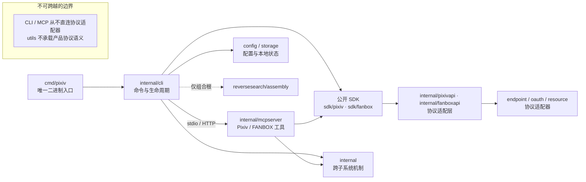
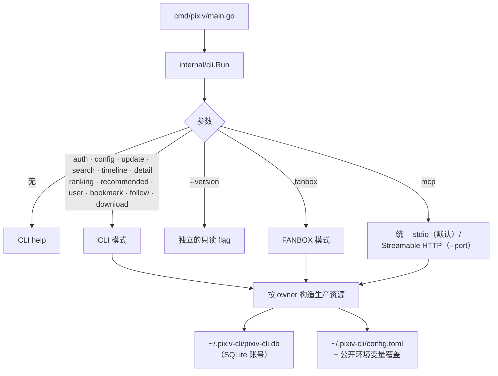
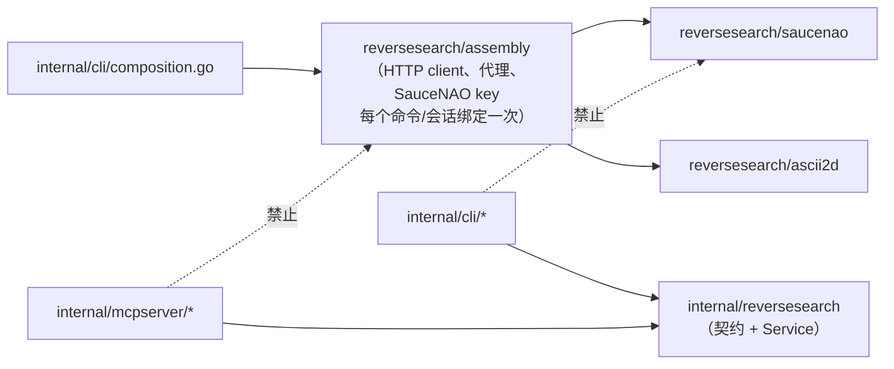
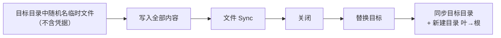
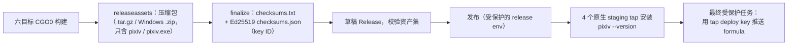

# 架构说明

[English](../../en/maintainers/architecture.md) | 简体中文 | [文档索引](../../index-zh-CN.md)

> [!IMPORTANT]
> CLI 与 MCP 只能通过公开 SDK 与 owner-local 窄端口获得业务能力。生产组装可以依赖具体实现，但不得向命令层暴露 locator、runtime graph 或协议适配器。

| 读者 / 关注点 | 跳转 |
| --- | --- |
| 从入口到 SDK 的调用链 | [总体流程](#总体流程) |
| 页面源码与嵌入 | [前端源码与页面嵌入](#前端源码与页面嵌入) |
| 某个包能做/不能做什么 | [包职责](#包职责) |
| MCP server、OAuth、媒体代理、Gallery 任务 | [MCP server 架构](architecture-mcp.md) |
| Release 信任根与签名 | [Release assets 与信任边界](#release-assets-与信任边界) |
| 本地状态、配置、路径权限 | [internal/config/paths](#internalconfigpaths)、[internal/storage](#internalstorageatomicfilefilelocksecretfile) |
| 硬约束清单 | [已知约束](#已知约束) |

## 总体流程

- `auth import` 处理直接导入 token 或恢复 bundle；`auth export` 处理本地 secret 快照。`pixiv fanbox mcp` 已移除。
- Windows 路径为 `%USERPROFILE%\.pixiv-cli\`。旧 `auth.json` 从不自动读取——用户需显式导出/导入 bundle。
- 没有匿名 Web fallback：内容需要已认证的本地账号或显式凭据；残留的 `web_fallback_enabled` 属于未声明键，加载时忽略。

## 前端源码与页面嵌入

| 源码目录 | 负责 | 嵌入方式 |
| --- | --- | --- |
| `frontend/mcp-apps/gallery/` | Gallery HTML/CSS/JS + fixture | CSS/JS 内联 |
| `frontend/pages/login/` | 登录/回调/结果模板与样式 | 保持分离，逐字节保留 |
| `frontend/pages/oauth/` | 同意页 HTML/CSS | CSS 内联 |

纯资源包 `frontend` 嵌入精确路径（不含 fixture），启动时用标准库组装一次页面；其测试校验源码与占位符。Go owner 保留 MCP 注册、模板渲染/数据/转义、CSP/媒体 origin、canonical action、CSRF 与授权。当前与历史资源 URI 均受支持。干净构建与带版本的 `go install` 无需生成步骤；运行时只读嵌入字节。Homebrew 模板保持原 owner。

## 包职责

### `cmd/pixiv`

生成 `pixiv` 二进制的 `main` 包；没有业务逻辑，只调用 `internal/cli.Run` 并返回退出码。

### `internal/cli`

CLI 组合根，分为三个同包文件：

| 文件 | 负责 |
| --- | --- |
| `root.go` | 命令树、全局 flag、共享装配、按需启动生命周期 |
| `execution.go` | 执行入口、退出码、资源关闭（私有 `closeState`，按注册逆序幂等关闭）、启动/收尾 |
| `composition.go` | Pixiv/FANBOX/MCP 的生产依赖组装 |

职责：Cobra 命令树/help/flag；文本/JSON 输出；`auth import` 输入适配（位置参数 = opaque token；无参数时 TTY 隐藏输入，非 TTY 按首个非空白字节区分 token 与严格 bundle；通过管道/重定向恢复，没有 `--file`）；`auth export` secret 输出适配（无 `--output`：原始 token + 换行，或 `--all` 的 bundle；有 `--output`：私有文件 + 不含 secret 的摘要）；`--page`/`--limit` 解析（逻辑计划在 `internal/pagination`）；`auth login` 的 loopback OAuth、浏览器与 TTY；`pixiv mcp` 分发；根 `--version` 与 `pixiv update`（已移除的 `version` 子命令在解析时返回 unknown command）；只写 stderr 的只读自动更新提示。

- **关闭：** 调用方在关闭前停止资源生产者并完成注册；互斥锁保护列表，不保护迟到的注册；closer 不得向同一 scope 注册或递归关闭它。关闭在命令完成后进行；MCP stdio 等待进行中的 handler；关闭错误被合并。
- **Owner：** `internal/cli/streams.go` 只负责 `Streams`。命令 owner 通过显式工厂与窄端口构造配置快照、DB、Facade、生命周期、媒体/下载与更新依赖，并逆序关闭。没有跨命令 locator、bootstrap 构造器或 `internal/cli/runtime`。
- **命令包：** 根级 `internal/cli/{config,mcp,update}`；Pixiv `internal/cli/{auth,bookmark,comment,detail,download,follow,mypixiv,ranking,recommended,search,series,timeline,user}`；FANBOX `internal/cli/fanbox/{auth,download,post}`。命令间共享支撑位于 `internal/cli/internal/{command,input,pixivcmd,fanboxcmd,resolver}`。数据命令经 owner-local 的 `Data` 端口（`Open`/`Pooled`/`JSONOut` 等）使用 `*pixiv.Client` / `*fanbox.Client`，从不直连协议适配器。
- **共享 helper：** stdin codec 在 `internal/cli/internal/input`；record 投影在 `internal/record`；目标解析器在 `internal/cli/internal/resolver`（只消费命令契约、record 与离线的 `sdk/pixiv.ParseURL`；owner 显式注入裸 ID 探测；不持有 client、凭据或适配器）。这些子包不反向导入 `internal/cli` 根包。
- **`--version` / 自动更新：** stdout 恰为 `pixiv <version>`，stderr 为空，不检查更新。自动更新只在普通业务命令成功后运行，MCP、help、`--version`、`update`、所有 `auth export`、bundle 形式 `auth import` 与 dev 构建跳过；选择 stable Release，用户缓存 24 小时节流，最多等 3 秒；失败只作为 stderr warning——不改变退出码，不泄漏到 JSON stdout 或 MCP JSON-RPC。
- **Windows 启动清理** 待更新文件属于潜在写操作：所有 `auth export` 调用在 Cobra 解析前识别并跳过它。根 bool flag 的重复覆盖语义由聚焦测试保护，避免 `--help=false` 之类形式绕过 secret 导出边界。

### `internal/cli/auth/loginhelper`

负责 URL scheme helper、持久化 handler 清单、一次性远程 hand-off 私有状态与远程回调 client。`internal/cli` 只通过它安装按需 handler，并保留 OAuth、loopback HTTP、浏览器、TTY 与 relay server 编排。

| 平台 | 机制 |
| --- | --- |
| Darwin | 内嵌 Swift、`Info.plist`、LaunchServices |
| Windows | 当前用户注册表/class 启动 |
| 桌面 Linux | XDG desktop entry + `gio` |
| 无头 Linux | 不注册 handler；relay server 仍可用 |

只有精确的 `pixiv://account/login` 与 `pixiv://account/remote-login` 进入本轮；活动 loopback 优先；远程回调只交给活动的一次性 hand-off；其他 URL 交给清单中持久化的 handler。桌面状态只保存当前 hand-off 的 relay origin、会话 ID 与 capability；server 不保存设备记录；SDK 不暴露这些状态。远程回调只接受同一 relay base 上的一次性结果 URL；`internal/cli` 打开不敏感的最终页面并等待交换。

### 共享机制

| 包 | 负责 | 不得 |
| --- | --- | --- |
| `internal/version` | linker 注入的 `Version`（默认 `dev`；只有 `dev` 构建拒绝自更新） | — |
| `internal/record` | CLI/MCP 共享的稳定 Pixiv record 投影：保留 SDK 模型未知字段，固定 `id`/`type`/`url`，JSON 规范化、版本元数据清理、基于 record 字段的本地筛选 | 依赖 CLI、MCP 或适配器；变成杂物箱（MCP schema 与输出信封留在 `internal/mcpserver/pixiv/internal/{records,outputs}`） |
| `internal/searchfilter` | 作品本地分级/内容类型规范化，客户端侧 `x_restrict` 与类型匹配，隐藏原始值的 cursor 上下文 | 把分级映射为未确认的上游 `x_restrict` 参数；持有 client、凭据或适配器（字段可用性与已确认的 wire 参数由各命令负责） |
| `internal/lifecycle` | 与协议无关的生命周期、Lease、Attempt | 负责账号选择、凭据或重放策略 |
| `internal/pagination` | 单流与有序聚合流的逻辑分页：筛选先于全局 skip/limit 预算，`OneBatch` 在首个匹配批次停止，批次截断通过来源位置 checkpoint 续读；`StreamState` = 当前流 + 各流 cursor（owner 与查询/账号/子类型绑定一起编码） | 产品语义 |
| `internal/pagination` | 单流/聚合读取的可重入执行生命周期，安全重放前清除未提交结果 | 负责命令筛选装配 |
| `internal/logging` | `log/slog` handler 与 ctx 调用信息；CLI、MCP、传输、账号池、下载与 FlareSolverr 共用属性键，只输出 operation、method、host、path、status、duration、attempt、wait、reason、count；SDK 只接受一个 `Options.Logger`，nil 时静默 | 创建日志文件，或记录响应体、Cookie、token、query、签名 URL 或任意错误 cause 转储 |

**账号池读取：** 普通 CLI 读取在具体函数类型上使用 `Pooled[R].Read[T]`——失败返回 T 零值且回调不提交；owner 保留自己的 Request 类型。`Write` 会把已调用的 SDK 请求标记为已提交（即使出错），防止跨账号重放结果未知的写入；缺少 pooled 端口是错误。流式 NDJSON、分页与部分交付仍由 owner 与 traversal/lifecycle 负责。

### 业务会话、账号与账号池

- `internal/session` 同时拥有两个按账号打开 SDK 会话的对象：`session.Pixiv` 聚合 `pixivaccount`（本地账号、登录完成、默认账号、凭据身份/轮换、管理）与 `pixivaccount/pool`（选择、冻结、Gate、安全重放、相关错误语义）；`session.Fanbox` 聚合 `fanboxaccount` 与 client 生命周期。两者位于同一个包的 `pixiv.go` 与 `fanbox.go`；FANBOX 会话与 Pixiv refresh token 不共享类型或生命周期，也没有账号池策略。
- 会话对象只依赖叶模块 Port、配置快照、与协议无关的共享模块与公开 SDK——不依赖 `internal/storage/database` 的具体实现；SDK 从不导入它们。会话中没有 CLI/MCP 的筛选、record、schema 或输出适配。
- 显式非零 `Request.UserID` 把读写固定到该账号，即使账号池开启；打开/业务错误从不切换账号；无 UID 的请求保留账号池调度；CLI 默认账号不变。
- 配置 schema、`config.toml` 的 path/get/set/unset、基线与单次执行的不可变 `Snapshot` 位于 `internal/config/settings`；按月截断位于 `internal/searchfilter`。CLI/MCP 经 owner-local Seam 与 MCP runtime `SDKPorts` 使用会话对象。`internal/account` 已删除，不保留别名。

**登录 relay** —— `internal/loginrelay` 同时负责纯渲染器（消费 `frontend` 模板/CSS，不依赖 CLI、账号库、浏览器或 listener）与可复用的 HTTP handler/session：接收 OAuth 会话校验器并交付一次回调；从不监听、交换或持久化。CLI 保留 listener/TLS/终端编排。宿主 mux 可剥离前缀后挂载；生产 MCP 将其挂在 canonical base + `/pixiv-login/`，位于相同的 Host/Origin 检查之后，但以 hand-off 证明而非 MCP bearer 认证。转义前缀在 URL 与分发中保留。已取消的 relay 会话返回 HTTP 410，并在接受已校验回调前再次检查取消。回调 allowlist、启动响应 wire 类型与结果 URL header 位于 `loginrelay`，由 CLI relay 与桌面 helper 复用。

**MCP 登录 relay**（`accounts.Login`） —— 单一当前登录：重复启动复用待处理工作，restart 取消并等待旧尝试，关闭时等待交换/持久化。完成时保留不含 secret 的 account-saved/selection-updated 标记（含部分失败）。组合根把它绑定到同一 SDK 登录会话，保存凭据但不改 CLI 默认，再单独写 MCP 选择。账号服务在多次 restart 间复用；每次完成的 SDK 登录释放其空闲 HTTP 连接（显式代理/直连时，组合根在每个退出路径关闭其 client 的空闲连接）。

### `internal/pixivapi`、`appapi`、`oauth`、`resource`

仅由公开 SDK 组合的上游适配器；不承载账号/会话 Facade。

| 包 | 负责 |
| --- | --- |
| `protocol` | 上游 base、profile header、端点目录、脱敏的适配器失败——不读配置、不发请求、不保存 body/URL/header/凭据 |
| `appapi` | 携带凭据的 App 传输/认证/重试；只向端点族暴露 `GetJSON`/`GetRaw`/`PostForm`；幂等读取仅在首个带有效 `Retry-After` 的 429 时按 context 重试一次；没有业务方法、路由 facade 或原始 DTO/mapper |
| `oauth` | PKCE、code 交换、刷新、token 状态 |
| `resource` | 受策略约束的资源传输；重定向/header/body 边界 |

- 匿名 Web/AJAX 路径已删除；App 错误直接返回规范化错误，不切换协议。
- `sdk/pixiv` 按领域文件承载全部 App API 操作：`artwork.go`、`artwork_search.go`、`novel.go`、`user.go`、`bookmark.go`、`comment.go`、`mutation.go`，游标编解码在 `cursor.go`。每个文件同时持有该领域的请求类型、响应结构、mapper，以及每个端点一条 continuation Spec 与解析函数。`response.go` 只放多个领域共用的 user/tag/image_urls 结构与值转换，`models.go` 放公开实体与取值类型。Client 只持有一个 `*pixivapi.Client`，不再有各端点的子 client。MCP 交付常量留在 `internal/mcpserver`。
- FANBOX：`internal/fanboxapi` 负责会话、Cookie、challenge、URL 策略与窄传输；`endpoint/{creator,post}/<leaf>` 与 `resource` 负责路由/fixture/转换；`sdk/fanbox` 直接组合它们，不依赖 Facade。
- `RequiredList` / `RequiredObject` 只共享字段存在性解码；端点保留完整性检查与映射。`null` = Present true、Valid false；解码出的空对象不必完整。缺失字段不调用解码器（复用外层 DTO 时调用方须清空或重建）。被调用的解码器会重置旧状态，但失败时可能留下本次输入的部分数据——先处理错误并检查 Valid。历史对象解码一致性只覆盖已验证的生产 DTO 与输入。

### reverse-search service 例外

唯一跨越常规 SDK 边界的产品能力。

- Service 返回领域结果；CLI/MCP 适配器在输出边界投影 canonical record。
- 它把普通文件或 HTTP(S) 来源加载为一个私有快照、计算哈希，并在完成后删除。来源策略有意允许任意可读普通文件与私有、loopback、link-local URL；单 owner OAuth 下只授权可信 connector——路径指 MCP server 文件系统，URL 使用 server 网络。只有来源类型/哈希、安全的 provider 摘要/错误、领域证据与 canonical `artwork`/`user` record 可以发布。
- 三个网络面：标准来源/SauceNAO client、专用 ascii2d 浏览器 client、FlareSolverr JSON 控制 client。服务代理只能覆盖 ascii2d；命令级覆盖同时作用于两个原生 client；否则标准 client 走全局路由。ascii2d UA 与 `Chrome_146` TLS profile 及匹配的 Chromium hints 配对（非 Chromium UA 省略 hints）。FlareSolverr 上游代理只用于浏览器 `sessions.create`；控制流量保持独立；图片始终使用原生 ascii2d multipart。solver 状态限于进程/client，不持久化。

### `internal/storage/database`

- 本地账号状态的 SQLite 权威：`pixiv-cli.db` 的 schema、迁移账本与 repository；身份/凭据按 `user_id`；Pixiv 轮换与 FANBOX 会话替换使用 `credential_revision` compare-and-swap。
- 只前进的迁移到 schema v3；旧 v1 数据库通过 v2/v3 变更升级；本树初始 schema 中已有的最终列会被识别，不重放 DDL。旧 `auth.json` 与 `account_pool.accounts` 不在启动迁移路径中。
- 私有 DB/journal 权限（Unix `0700`/`0600`）。auth export 只读取默认、指定 UID 或全部账号——不读环境 token、不刷新、不联网、不修改。
- **锁：** owner 通过私有 `pixiv-cli.db.lock` sidecar 协调初始化、短账号/账号池事务与完整快照读取（不含凭据、不改账号数据；从不覆盖 OAuth 或内容请求；外部 SQL 写入者与旧进程不参与）。不可取消的 context 保持原生等待；可取消的 context 每 10 ms 轮询同一非阻塞锁接口，取消时立即唤醒并关闭等待中的文件句柄。没有整体截止时间或事务重放。账号 owner 在获取会话互斥锁前先取消生命周期，因此 watcher 校验期间的 DB 锁等待不会阻塞关闭。
- 从旧 CLI 迁移：旧版本执行 `pixiv auth export --all --output <private bundle>`，新版本执行 `pixiv auth import < bundle.json`；失败直接返回原因；不自动删除旧文件。

### `internal/config/settings`

| 存储 | 保存 |
| --- | --- |
| `pixiv-cli.db` | 账号身份与凭据（`pixiv_account` / `fanbox_account`），文件 `0600` |
| `config.toml` | 全局键，含 `[pixiv.auth].default_user_id`、`[fanbox.auth].default_user_id`；Unix `0600`。无默认账号时按 `sort_order` 选第一个 |

运行时设置用 `go-toml/v2` 解析 `config.toml`，并在每个快照中一次性捕获公开环境变量；`config set/unset` 用 `tomledit` 稀疏回写，尽量保留注释、顺序与排版。首次运行的紧凑基线只写入 `example:"true"` 条目。

#### 配置声明：结构体字段标签是唯一事实来源

`RuntimeConfig` 的导出字段（含嵌套的账号池、网络与 FlareSolverr 组）声明全部静态事实；运行时绑定、CLI 元数据与基线生成复用同一份声明。

| 标签 | 含义 |
|---|---|
| `config` | 相对于所属组的 TOML 路径；`"-"` 排除该字段及其整个子树 |
| `alias` | `config get/set/unset` 使用的公开名称；组与私有高级叶子省略 |
| `env` | 可读取的环境变量，按声明顺序（即优先级；存在即命中，空值不会继续向下） |
| `default` | 缺失时使用的值，按字段类型解释（以标签**是否存在**区分，而非字符串是否为空） |
| `example` | 是否进入首次运行的紧凑配置；只有 `"true"` 进入，且要求有 `default` |
| `cli` | 是否由 `config get/set/unset` 管理 |
| `secret` | 是否必须在公开输出中隐藏并排除出示例配置（`secret:"true"` + `example:"true"` 是 schema 错误） |

- 组只声明 `config` 前缀；叶子声明相对路径；同一组类型可在不同前缀下复用。`OptionalString` 是叶子。可选指针组按类型检查，不分配实例。
- 声明错误：展开后路径重复、非空别名重复、空路径段、循环组、不支持的叶子类型、组上出现仅限叶子的属性。私有叶子没有公开别名就不能启用 CLI 管理、示例或环境变量绑定。`cli`、`secret`、`example` 只接受 `"true"`/`"false"`（不影响用户配置值的解析）。
- 私有 schema 缓存字段索引链与 Go 类型，从不缓存实例。标量绑定与 `Effective` 使用相同的来源选择；普通绑定不分配指针组。高级读取器按字段归属定位已编译路径，不新增别名，也不会在领域启用检查前分配 solver 组。账号池默认值来自声明；严格文件类型与策略校验仍是领域规则。
- 默认账号选择有单独的私有声明范围：`int64` UID 叶子无别名、无默认值；正整数解析留在按需的 auth 读写方法中；从不进入普通绑定或 Snapshot 早期校验。
- `SettingSpec` 是 CLI 消费的**公开派生视图**，不是手写事实表。`keys.go` 为每个别名声明具名 `Key` 常量；表驱动测试在常量与别名不一致、或某个已声明别名缺少常量时失败。`LogLevel` 与 `LogFormat` 是带常量的具名类型。
- **新增普通设置** = 字段 + 标签 + `Key` 常量、一个行为测试、对应文档。没有注册表、环境变量 `switch`、逐字段赋值、基线列表或别名列表需要同步。

| 文件 | 职责 |
| --- | --- |
| `config.go` | 类型、字段标签、字段契约 |
| `keys.go` | 公开别名对应的具名 `Key` 常量 |
| `schema.go` | 标签派生元数据、声明校验、查找、公开 `SettingSpec` 视图 |
| `snapshot.go` | 文件/环境快照、来源选择、运行时绑定（服务网络、FlareSolverr、账号池领域规则） |
| `values.go` | 类型解析、规范化、领域校验 |
| `document.go` | TOML 定位与稀疏修改 |
| `defaults.go` | 基线配置文档生成 |
| `store.go` | `Store` 操作（路径、读取、稀疏回写） |
| `auth.go` | 默认账号读写（有意**不属于**普通绑定） |
| `paths.go` | `FileStore` 端口与默认文件适配器 |

**原子写入**（`FileStore`，由 `internal/storage/{atomicfile,filelock,secretfile}` 注入）：

- Unix 主动把父目录/文件收紧为 `0700`/`0600`。若本次调用新建了目录，提交后按叶→根顺序同步目标目录与每个新目录的外层父目录，使文件条目与新目录条目都落入持久化边界；已有目录只同步目标目录。
- 失败：替换前（写入/Sync/关闭）失败时保留旧目标；普通替换失败与可恢复的部分完成失败会保留/恢复旧目标并清理临时文件。目录同步失败仍会尝试其余目录并合并错误——替换已提交，旧文件可能已不存在。部分完成后的恢复本身失败时，调用方收到合并错误，目标可能暂时缺失，同目录的旧内容恢复备份与新内容临时文件都保留以便人工恢复（此时"无临时残留"不适用）。其他临时文件清理失败与主错误一起返回。
- Windows：替换前同样 Sync 并关闭；目标存在 → 使用带同目录唯一恢复备份的 `ReplaceFileW`；首次创建 → 不覆盖的 `MoveFileEx`。`ERROR_UNABLE_TO_MOVE_REPLACEMENT` 保持目标/源的原名；`ERROR_UNABLE_TO_MOVE_REPLACEMENT_2` 尝试恢复已移到备份的旧目标，失败则保留备份/源。成功替换后备份清理失败属于已提交错误。新文件继承父目录 ACL，替换保留目标 ACL；不声称收紧 ACL，也不提供与 POSIX mode 或目录 fsync 等价的保证。

`update_check_enabled` = `[update] check_enabled`（默认 `true`），只控制自动检查，不影响用户主动执行的 `pixiv update`。`log_level` / `log_format` = `[logging].level` / `.format`；默认 `info`/`text`，`debug` 增加请求与决策记录，`json` 选择 JSON 记录；环境变量按次覆盖。

### `internal/browsercookies`

只读浏览器 Cookie provider；不属于公开 SDK；不依赖 FANBOX、Pixiv、CLI、MCP 或账号库。

| 部分 | 作用 |
| --- | --- |
| 根包（core） | 与协议无关；固定的 `CookieQuery`；按安全 profile 标识发现浏览器目录；返回脱敏的 `Secret`；不导入任何 provider（只导入根包不会注册浏览器） |
| `chromium` | 显式的 Chrome/Edge provider；从平台 profile 根目录读取 Local State/Cookies；支持 v10/v11 GCM 与旧 CBC |
| `firefox` | 解析 `profiles.ini` |
| `safari` | `Cookies.binarycookies`，仅 macOS |
| `system` | 导入并注册全部 provider，使根包 `New` 能分发到每个浏览器 |
| `secret` | macOS Keychain、Windows 当前用户 DPAPI、Linux 通过固定属性的 `secret-tool` 访问 Secret Service |

未知 Chromium 衍生浏览器不做模糊识别；多个 profile 且未选择时明确失败。缺少工具、权限、锁、schema 漂移与解密错误映射为稳定错误；Cookie、密钥、绝对路径与命令输出从不进入日志、错误、JSON 或 MCP。各平台 native 证据须按 release-prep 手册在对应主机采集；离线 fixture 与交叉编译只证明代码/格式契约。

### `internal/selfupdate`

薄根包（协调器 + 自动检查 API），向 CLI 组合根重新导出 `internal/selfupdate/{source,release,installer,process}`。

| 安装来源 | 更新行为 |
| --- | --- |
| Homebrew | 通过可执行文件符号链接与 keg `INSTALL_RECEIPT.json` 区分 stable/beta；切换时先卸载冲突 formula，失败时显式尝试恢复原 formula |
| `go install` | 必须同时匹配 Go build info **与**实际 `GOBIN`/`GOPATH/bin` 可执行文件；安装所选的精确 tag |
| Release 二进制 | 选择平台压缩包 → 校验 Ed25519 `checksums.json` → 校验 SHA-256 → 精确 `pixiv --version` 预检 → 同目录原子替换 |

- GitHub Releases API 是唯一查询后端；排除草稿；stable 在校验前排除预发布；ETag/缓存用于节流并原子持久化。对通道内已发布 Release 强制 canonical SemVer——任一非法 tag 都 fail closed 并报告（绝不跳过而选旧版本）。
- 签名、checksum、HTTP、压缩包、替换与权限错误从不伪装成"没有更新"。Release 安装的失败语义是保护边界，不是临时降级。
- **信任根**（`internal/selfupdate/installer`）：key ID 与公钥常量位于 `release_installer.go`；`internal/cli/update/production.go` 为安装器构造 key ID → 公钥映射，调用方无法污染；`root.go` 只持有更新 seam。指纹与签名 fixture 由同包测试验证；私钥不在源码或配置中；只读检查不需要它；这层装配不能替代每个版本的发布验收。`internal/bootstrap` 已在 v1 删除。

### `scripts/`

| 位置 | 内容 |
| --- | --- |
| `scripts/build/`、`scripts/ci/`、`scripts/release/`、`scripts/pr/` | 构建/打包脚本与平台注册表、必需 CI 脚本、发布工具、受信 PR 工具；Go 工具均为一目录一个 `package main`，测试与之同目录 |
| `scripts/citest/` | 真实执行安装器、变更范围分类、验证预过滤、workflow action pin 与容器发布契约的测试 |
| `scripts/build/platforms.json` → `scripts/build/matrix.sh` | 供 workflow 使用的 runner/能力元数据；workflow 测试验证行为/安全边界，而不是第二份 YAML 策略模型 |

### `sdk`、`sdk/pixiv`、`sdk/fanbox`

唯一的对外契约面。

| 包 | 导出 |
| --- | --- |
| `sdk` | `Page[T]`、`Cursor`（Text/JSON codec）、`Error`（sentinel、context 链、脱敏）、`ResourceRef`/`Resource`、资源请求/响应/保存类型 |
| `sdk/pixiv` | 仅 App：`Open/OpenWith/New/NewWith`、OAuth `LoginSession`、轮换、作品/小说/用户/评论/贴图模型、opaque cursor、`ParseURL`、评论写操作、贴图读取、资源读取；没有 Web 路径 |
| `sdk/fanbox` | `Client.ValidateSession`、creator/tag/post/home/supporting、两种分页、资源读取；不读浏览器、DB 或 Pixiv 凭据；从不导入 `sdk/pixiv` |

- FANBOX 传输：Chrome 146 TLS profile + Firefox 148 UA 基线；构造时只接受显式 HTTP client、代理、UA 与可选 FlareSolverr。`FANBOXSESSID` 只出现在发往 `api.fanbox.cc` 与 `downloads.fanbox.cc` 的已校验请求中——从不发往第三方 CDN、Pixiv host 或 solver 控制请求。solver 控制直连；其上游代理只是 solver 配置（不继承原生/环境代理）；非 challenge 的 API/资源错误从不进入 solver。
- 旧的顶层 `pixiv/` facade 已在 v1 删除（`pixiv` 仍是 `sdk/pixiv` 的导入别名）。auth 备份（`AuthExportSelection` / bundle codec）使用同一本地快照边界；bundle 是未加密的时间点 secret 备份，轮换后可能失效。
- 来源模式、预算、筛选、cursor 持久化与 HTTP 呈现由调用方负责。不提供 HTTP Provider、Discover、Probe、Capabilities、RSS 或爬虫。

### `internal/mcpserver`

见 [MCP server 架构](architecture-mcp.md)。每个产品的 tools 只有一个 `tools` 包：`register.go` 保存唯一的 `Register` 与原有的端口门控注册顺序，各领域文件（`accounts.go`、`media.go`、`bookmarks.go` 等）保存该领域工具的名称、annotations、schema 与 `<tool>Handler` 方法。共享端口仍放在产品的 `internal/toolhost`。

### `internal/media/downloader`

CLI 下载 owner。通过 `DownloadTargetClient` / `DownloadClient` 获取 SDK 执行快照，集中负责来源展开、ID 去重、页码/质量校验、获取与发布、进度事件与 Ugoira 格式选择（适配器不得重复实现）。`ResourceRef` 只由产品 client 解析；SDK 只保留原子的解析/保存能力，没有批量下载流程。

| 情况 | 结果 |
| --- | --- |
| `Download` | 同步执行；返回每个作品的实际产物路径 |
| 单页 | 保存到下载目录 |
| 多页、Ugoira | 每个作品一个子目录 |
| 扩展名 | 来自上游 URL 路径，与模板文件名同样规范化；Pixiv 缩略图在有显式 Content-Type 时修正含糊后缀；未知类型保留 URL 扩展名 |
| Ugoira | SDK 校验的 `download_url` ZIP → Go 编码器生成 GIF/APNG，或由 SDK 原样发布 ZIP/帧；可以选择 App medium，但绝不标记为 original |

默认路径构造 `ugoira.NewEncoder()`——没有后端选择器或外部编码器 fallback；`CGO_ENABLED=0`。Rust 源码、native library 与 FFI/staticlib 适配器已删除（历史见 Git）。

### `internal/media/ugoira`

负责 `Format`、有序帧输入、`Encoder`、ZIP 校验/解码、缩放、GIF 量化/抖动、APNG 流式写入与原子发布。下载器消费 `Encoder` 契约，不得重复编码或发布。PNG 使用标准库；owner-local `jpeg` 保留旧的 IDCT/颜色舍入。六目标执行证据来自平台 smoke worker，与运行时编码器分离。

## Release assets 与信任边界

- 项目 `LICENSE` 留在源码仓库。Windows Git Bash 缺少 `zip` 时使用预装的 `7z`；两条分支产生相同成员；缺少归档工具直接失败。
- `release.yml` 在受保护的 `release` Environment 中签名/发布，最小权限，Action 固定完整 SHA。发布任务把已校验的 `release/checksums.txt` 交给渲染器；stable/预发布分别生成唯一的 `pixiv-cli` / `pixiv-cli-beta` formula。四个原生 macOS/Linux runner 从隔离的本地 staging tap 安装（tap 限定名，验证 `pixiv --version`），从不使用或写入公开 tap；Homebrew 6 所需的信任只写入 runner 本地 staging tap 的临时信任库。
- 只有最终受保护任务能读取独立的 tap deploy key，并只推送对应 formula。tap 凭据与 release 密钥是不同的信任域；tap key 只进入最后的推送步骤，不能替代 Ed25519 信任根（`internal/selfupdate/installer/release_installer.go`）。formula 模板只使用已校验六目标 checksum 中的 macOS/Linux 资产；stable 与 beta 互相冲突，都安装 `pixiv`。
- 草稿 URL 无法安装，因此先公开 Release 再跑四架构门禁；失败时保留已公开的 Release 待处理，不写入 formula。v0.3.0 是首个走此路径的 tag；之后每个 tag 都必须通过同样的门禁。
- 没有 Apple notarization 或 Windows Authenticode：Gatekeeper/SmartScreen 提示须对照已验证的 Release、checksum 与签名记录处理，绝不静默绕过。

详细门禁见[发布](release.md)。

### `internal/config/paths`

应用管理路径、`AppDataDirName` 与 Unix 私有目录/文件权限常量的唯一 owner；不读业务配置，不写文件。没有通用常量包：Pixiv 协议值、MCP 交付值与配置键/默认值留在各自领域。`internal/logging` 负责由 `[logging]` 配置的 slog handler、ctx 调用信息与共享属性键——不是持久化日志。MCP JSON-RPC 使用干净的 stdio 或认证 HTTP；错误仍通过 CLI、MCP 或 SDK 接口返回。

### `internal/storage/{atomicfile,filelock,secretfile}`

三个叶子包：原子写入/替换、文件锁、secret 文件写入。只依赖 `config/paths` 约定；不负责配置 schema、账号状态或 Pixiv 语义。

### 测试与 helper owner

与协议无关的 helper 放在调用方：正整数解析在 `internal/cli/internal/input`，字符串安全处理在 `internal/plaintext`，URL 路径/file URI 在 `internal/media/downloader`，按月截断在 `internal/searchfilter`。

| 迁出的职责 | Owner |
| --- | --- |
| 文件名清理、模板展开 | `internal/media/filename` |
| ID 去重、媒体 MIME 类型 | `internal/media/downloader` |
| refresh token 校验 | `internal/pixivapi/oauth` |
| 路径、权限 | `internal/config/paths` |
| 原子写入、替换 | `internal/storage/atomicfile` |
| 文件锁 | `internal/storage/filelock` |
| secret 导出写入 | `internal/storage/secretfile` |

## 已知约束

> [!WARNING]
> 不可协商。任何新增的超时、截断、数量上限、重试上限、静默 fallback 或隐藏降级都必须有证据、注释、测试或文档，否则视为违规。

- `appapi`、`oauth` 与资源传输使用调用方/SDK 注入的 HTTP client；默认 client 专属于当前 SDK client，没有固定的整请求超时；取消/截止时间经 context 传播；显式 client 保留调用方策略。
- `pixiv mcp` 默认 stdio；显式 `--port` 启用 HTTP 并要求 owner 状态已初始化；单独运行 `pixiv` 显示 help。用 `--port`、`--host`、`--base-url` 配置 HTTP，而不是已移除的地址设置（[启动](../cli-reference.md#mcp-http-server)）。
- 没有持久化账号导入/导出的 MCP 工具；会话范围的 MCP auth 工具与 wire 契约不变。
- 凭据以未加密 BLOB 存于 SQLite `pixiv-cli.db`；Unix DB/journal `0600`。拥有当前用户文件访问权限的人仍可读取；禁止自动备份。
- `config.toml` 稀疏写入；从不整体持久化默认值。
