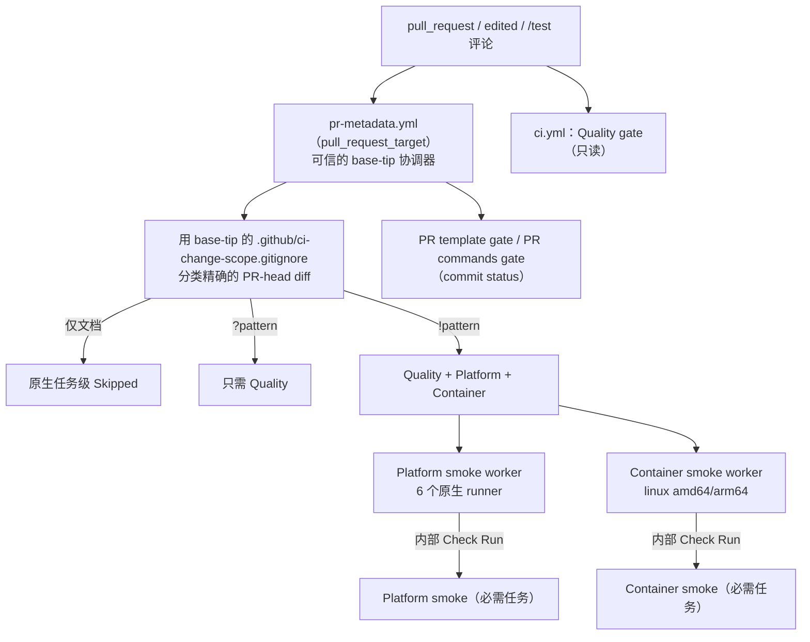

# CI 门禁

[English](../../en/maintainers/ci.md) | 简体中文 | [开发流程](development.md)

PR 上会运行哪些 workflow、如何决定哪些是必需检查、结果如何被信任。workflow YAML、`ci/platforms.json` 与工具清单仍是可执行的事实来源。

## 触发

| 事件 | 运行 |
| --- | --- |
| `pull_request`、`workflow_dispatch` | `ci.yml` Quality gate（不再响应 tag push） |
| `pull_request.edited` | 同样运行 Quality，使 PR 改目标到 `main` 时发布必需结果；标题/正文编辑也会重新分类并运行必需的 Quality |
| `pull_request_target` | `pr-metadata.yml` 协调器 |
| `/test` 评论 | `pr-verification.yml` 的 `dispatch` 在分配 runner 前用 `contains(github.event.comment.body, '/test')` 预过滤——它是 `tools/prmeta --check-trigger` 的宽松超集（少量误报，从不漏掉真实触发）；`tools/prmeta` 仍是权威判断 |
| 分支 / `main` push | 不运行 CI |
| stable `vX.Y.Z` tag | 只运行 `release.yml`（负责全部 tag 门禁、六平台测试/构建与双平台容器验证；不重复 PR smoke 矩阵） |
| 手动 | 浏览器/native 证据 workflow |

真实 Pixiv/FANBOX SDK E2E 从不进入 PR CI；离线 `go test ./...` 由发布测试构建覆盖相同包，真实 E2E 在 release-prep 中单独验收。

## 变更范围分类

- `ci.yml` 与 `pr-metadata.yml` 使用同一信任模型：解析受保护 base 分支的当前 tip，从该 tip checkout `scripts/classify-change-scope.sh` 与 `.github/ci-change-scope.gitignore`，再只为 diff 范围 fetch 精确的 PR HEAD——PR 无法改变自己的跳过判断。分类器失败时 fail closed。
- 普通 pattern 表示仅文档；`?pattern` 只需要 Quality；`!pattern` 需要 Quality + Platform + Container。`pr-metadata.yml` 本身（smoke 控制器：分类、两个 dispatch 与必需门禁）必须是 `!pattern`。
- 不需要的任务是原生任务级 `Skipped`，绝不伪造成功。Quality 任务即使仅文档跳过也保留字面的必需名称（GitHub 不评估被跳过的动态任务名）。
- 只改 PR 正文的元数据编辑会重新分类未变化的 head：必需的 smoke 任务镜像已有 worker 结果，不需要的保持跳过——编辑正文无法把失败的 smoke 替换为绕过性的跳过。

## 协调器（`pr-metadata.yml`）

- 从 base tip 出发：校验 PR 模板与验证声明，分类，发布 `PR template gate` / `PR commands gate` 状态，派发必需的 smoke worker，并把 `Platform smoke` / `Container smoke` 作为真实的任务级必需检查——协调器任务中从不执行 PR 代码。
- 只为 PR 评论使用 `pull-requests: write`（不申请普通 issue 写权限）。读取 PR 或策略状态评论失败，以及评论创建/更新/删除失败，都会保留原始 GitHub API 错误并指出失败的请求；元数据失败仍会阻塞 smoke 门禁。workflow-shell API fixture 只在 Linux 上运行（匹配 Ubuntu 工具）；权限契约跨平台。
- smoke 门禁以 `filter=all` 查询精确 head 与 worker 名称并分页，选择最新的 `started_at`（ID 作平局裁决）；不假设响应顺序。`filter=latest` 可能在 PR 更新后隐藏另一个 check suite 中的 worker。缺失或失败的 worker 会使门禁失败。

## Smoke worker

| Worker | 隔离方式 |
| --- | --- |
| Platform | 矩阵从可信 workflow ref 解析；只有矩阵任务以 `contents: read` checkout 精确 PR head；单独的发布任务从不 checkout PR 代码，只持有完成内部 Check Run 所需的 `checks: write`。六个原生任务并行，包括 Windows 根回调装配与原生 `loginhelper` 契约；运行 Go 编码器包测试 |
| Container | 对 Linux amd64/arm64 使用同样的隔离模型，任务并行 |

两者都以 `CGO_ENABLED=0` 构建，保留可信 ref、精确 head 校验与独立结果发布者。`Platform smoke worker` / `Container smoke worker` Check Run 只是可信的结果桥；worker 矩阵不是必需检查；PR 门禁任务镜像聚合结果，失败时保留 worker 详情 URL。

## 安装器与打包测试

- `scripts/tests/installers` 使用本地 fake Release、fake `curl` 与 checksum fixture（不访问 GitHub）。Unix 任务实际运行 `install.sh`，覆盖 SHA-256、带空格的目录、版本预检与校验失败时不覆盖旧二进制。Windows amd64/arm64 platform-smoke 用真实的 `cmd.exe`、`certutil.exe` 与 `tar.exe` 运行 `install.cmd`，始终传 `--no-path`（不修改 runner 注册表）。它是平台任务的一部分，没有单独的 workflow 策略实现。
- Windows `.zip` 使用 runner 预装的 `7z`；其他平台使用 `zip`。`scripts/test-package-release.sh` 在 Windows 上把 fake 调用委托给真实 `7z`，其他机器使用 `zip` fixture，并检查压缩包成员——缺少 `zip` 的 Git Bash 会在发布测试门禁暴露。它用 MSYS 的 `winsymlinks:nativestrict` 创建受检链接；无法创建原生链接时测试失败，避免纯文件伪链接让输出祖先安全门禁失效。
