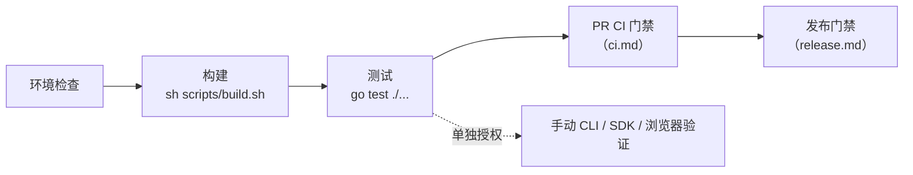
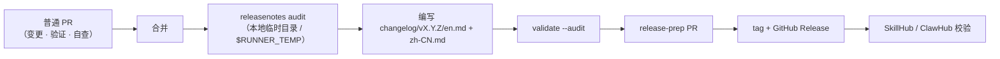

# 开发流程

[English](../../en/maintainers/development.md) | 简体中文 | [文档索引](../../index-zh-CN.md)



| 你想做什么 | 从这里开始 |
| --- | --- |
| 检查本地工具链 | [环境检查](#环境检查) |
| 编辑或验证页面 | [前端资源](#前端资源) |
| 构建或验证 ugoira 编码 | [Ugoira Go encoder](#ugoira-go-encoder) |
| 运行 CLI 与 MCP | [运行](#运行) |
| 处理登录与凭据 | [开发中的凭据](#开发中的凭据) |
| 选择测试范围 | [测试](#测试) |
| 理解 PR 检查 | [CI 门禁](ci.md) |
| 查看发布流程 | [发布](release.md) |
| 准备 release notes | [Release notes and publication](#release-notes-and-publication) |

## 环境检查

`go.mod` 是 Go 工具链版本的唯一事实来源。

```bash
go version
go env GOVERSION CGO_ENABLED GOOS GOARCH
CGO_ENABLED=0 go test ./...
```

## 前端资源

`frontend/mcp-apps/gallery/`、`frontend/pages/login/`、`frontend/pages/oauth/` 中的源码由纯资源包 `frontend` 嵌入，并在启动时组装一次（Gallery CSS/JS 与同意页 CSS 内联；登录页保留原模板/样式与 `html/template` 组合；fixture 不嵌入）。运行时无需 npm、框架、磁盘读取或网络；干净构建与带版本的 `go install` 无需生成步骤。

```bash
go test ./...
go vet ./...
sh scripts/build.sh
```

- 本地/平台/race 构建直接编译嵌入源码。Gallery、同意页和登录页的行为变更通过相应浏览器/MCP 宿主手动检查。
- 前端改动需要 Quality、Platform 与 Container 检查。Docker 使用预构建二进制；Homebrew 模板仍在 `templates/homebrew/`。
- 源码安装与自更新使用精确 tag：`go install github.com/FlanChanXwO/pixiv-cli/cmd/pixiv@vX.Y.Z`。

## Ugoira Go encoder

默认下载器构造 `ugoira.NewEncoder()`，用 Go 生成 GIF/APNG——不需要 `ffmpeg`，没有后端选择器，也没有运行时 fallback。PNG 帧用 Go 标准解码器；JPEG 帧用 owner-local 的 `internal/media/ugoira/jpeg` 解码器。

```bash
sh scripts/build.sh                                   # CGO_ENABLED=0 → build/pixiv(.exe)
CGO_ENABLED=0 go test ./internal/media/ugoira/... -count=1
```

| 规则 | 说明 |
| --- | --- |
| 单帧上限 | 512 MiB，分别作用于 ZIP 成员源字节与解码前分配估算（继承固定版本 Rust `image` crate 的 `Limits::default().max_alloc`） |
| 超出上限 | 声明大小超出 → 读取前失败；实际展开超出 → 分块读取时失败；非法/溢出尺寸或估算 → 错误。不截断，不 fallback |
| 取消 | 每个读取分块与图片解码的前后都会检查；PNG/JPEG 解码循环没有回调，因此单帧解码中途的取消在该次解码返回时才被观察到 |
| 工具链 | 不需要 Rust、native library 或 C linker；只有 race 测试需要 `CGO_ENABLED=1` + C 工具链 |

**编码器保真说明** —— `internal/media/ugoira`：JPEG 解码器是 Go 1.26.3 解析加旧 zune-jpeg 0.5.15 整数 IDCT 与 14 位 BT.601（标准库 IDCT 舍入对调色板选择的改变足以让固定门禁失败；解析器 BSD 许可证留在该包，zune-jpeg 的 MIT 署名留在 `internal/media/ugoira/jpeg/idct.go`）。缩放使用带显式 `math.FMA` 的有界正弦/余弦多项式对齐旧 `sinf`，保真证据由保留的 native 编码测试负责。APNG 使用固定 Sub 预测、每帧独立的 level-7 zlib 流与 RGBA8 无损：只有全部变化像素不透明且差分能减少横向 RGBA 游程时，才对未变像素使用透明的 Over，否则使用 Source，均用 None disposal。压缩字节可能随工具链变化；只有在验证完整渲染画布、时序与循环行为后才能复用旧质量证据——不能只看文件大小。

**平台构建** —— `scripts/build/platform.sh` 以 CGO0 构建精确目标，并可选生成 canonical 压缩包：`--target GOOS/GOARCH`、`--output-dir DIR`、可选 `--version VERSION`（不带 `v`）与 `--package`（需要版本）。保留 Windows 后缀。runner 元数据在 `scripts/build/platforms.json`；测试、源码身份、权限、审批与发布留在 workflow 中。

**Linux 兼容性** —— release 与打包 smoke 的二进制以 `CGO_ENABLED=0` 构建，产物是静态 ELF。release 测试/生产、打包 smoke 与 Homebrew 安装矩阵的 Linux runner 固定为 `ubuntu-22.04` / `ubuntu-22.04-arm`；构建配方变化时用 `file build/pixiv` 核实。

## 运行

```bash
sh scripts/build.sh                     # build/pixiv(.exe)；Windows 用 Git Bash/MSYS2/WSL；交叉构建用 go build
pixiv auth login
pixiv search "初音ミク" --json
pixiv download 123456

pixiv auth use 12345678                 # 认证的统一 MCP HTTP
./build/pixiv mcp auth init
./build/pixiv mcp --port 1270           # http://127.0.0.1:1270/mcp

https_proxy=http://127.0.0.1:7890 ./build/pixiv mcp --port 1270
./build/pixiv mcp --proxy http://127.0.0.1:7890
./build/pixiv mcp --no-proxy
```

- owner OAuth 授权与 Pixiv/FANBOX 凭据相互独立；一次性 owner secret 请私下保存（不要出现在测试输出或聊天中）。云 connector 需要公开 HTTPS 反向代理（[HTTP 启动](../cli-reference.md#mcp-http-server)）。
- CLI 下载保留自己的设置；stdio 下载工具复用 CLI 设置；HTTP 从不暴露文件系统写入。
- 状态位于 `~/.pixiv-cli`（`%USERPROFILE%\.pixiv-cli`）：`pixiv-cli.db`（Pixiv UID / FANBOX UID 为键；内嵌迁移到 schema v3，旧 v1 原地升级，已存在的后续列只记录不重放 DDL，未知的更新 schema fail closed）、`config.toml`、callback bridge、Release 检查缓存、callback helper。Unix `0700`/`0600`；Windows 首次创建继承父目录 ACL、替换时保留目标 ACL，不修改 DACL。

> [!WARNING]
> 新版本从不读取或删除旧的 `auth.json`。迁移方式：旧版本执行 `pixiv auth export --all --output <private bundle>`，新版本执行 `pixiv auth import < bundle.json`。

**配置** —— `pixiv config path/get/set/unset` 管理 `account_pool_enabled`、`account_pool_strategy`、`download_path`、`filename_template`、`directory_template`、`request_interval`、`https_proxy`、`log_level`、`log_format`、`reverse_search_provider`、`reverse_search_pixiv_only`、`saucenao_api_key`。其他 TOML（如 `[reverse_search.network]`、`[reverse_search.flaresolverr]`）手工维护，不在基线中，作为启动快照读取。基线由 `internal/config/settings` 中的**结构体字段标签**驱动，用 `tomledit` 生成，紧凑（只含 `example:"true"`），从不覆盖。新增普通设置：(1) 在 `internal/config/settings/config.go` 添加字段与声明，(2) 按清单核对现有优先级/空值测试，(3) 文档——见[标签契约](architecture.md#配置声明结构体字段标签是唯一事实来源)。

> [!NOTE]
> 残留的 `[web] fallback_enabled` 属于未声明键，加载时忽略。`[logging].level`（`debug|info|warn|error`）与 `[logging].format`（`text|json`）生效；`PIXIV_LOG_LEVEL` / `PIXIV_LOG_FORMAT` 可覆盖。

**Flag 与代理** —— Cobra/pflag 允许 flag 出现在位置参数前后。Pixiv 命令代理、`[pixiv.network]`、环境变量与 `[network]`，FANBOX 的 `[fanbox.network]` / `[fanbox.flaresolverr]`，以及反向搜图的 `[reverse_search.network]` / `[reverse_search.flaresolverr]` 都按各自服务边界解析；反向搜图有独立的标准/SauceNAO、ascii2d 浏览器与 FlareSolverr JSON 控制网络面（FlareSolverr 只用于 challenge 恢复）。

## 查找协议与日志实现

- Pixiv 协议在 `internal/pixivapi/`，OAuth 在其 `oauth/` 子包；FANBOX 协议在 `internal/fanboxapi/`。端点请求、响应校验与映射在 `sdk/pixiv/` 和 `sdk/fanbox/` 的领域文件中，按领域定位问题。职责图见[架构说明](architecture.md#internalpixivapiinternalfanboxapi)。
- `internal/cli/execution.go` 创建 stderr logger；`internal/cli/composition_options.go` 与 `composition_mcp.go` 传递到 SDK 和 MCP。MCP 共用包装在 `internal/mcpserver/toolrun/toolrun.go`，handler 与 ctx 属性在 `internal/logging/`。归属见[日志入口](architecture.md#日志入口)，外部 Go 调用方示例见[SDK](../sdk.md#连接与日志)。
- 本地排查使用 `pixiv config set log_level debug`，需要结构化字段时再设置 `pixiv config set log_format json`；设置在下次执行生效。文本日志在第二个方括号显示 operation，其余上下文写成 `key=value`；JSON 日志保留 `operation`，MCP 调用另带 `call_id`；数据输出保持在 stdout。

## 开发中的凭据

完整流程见[认证](../authentication.md)。开发相关的补充事实：

- 浏览器 Cookie（`refresh_token=...`、`PHPSESSID`、`device_token`）**不是** Pixiv App OAuth refresh token；CLI、MCP、环境变量、SDK 与已存账号都会拒绝。
- 远程 hand-off 不提供手动回填回调或移动端路径；`pixiv auth devices` 已移除，现有的 `remote-devices.json` 被静默忽略；旧的 `login_relay_secret` / `login_relay_target_url` 被忽略。relay 支持 HTTP/HTTPS、直接 TLS 或同机 TLS 代理。
- 代理覆盖（`--proxy socks5h://127.0.0.1:7890`、`--no-proxy`）适用于直接 token 的 `auth import`、`auth login`、`auth check`、`search`、`timeline`、`detail`、`ranking`、`recommended`、`download` 与 `mcp` 启动。bundle 形式的 `auth import` 拒绝；`auth export/list/use/remove` 与 `config path/get/set/unset` 不接受。请求节流：`PIXIV_REQUEST_INTERVAL` / `[network].request_interval`。调试：`pixiv config set log_level debug`（+ `log_format json`），只写 stderr，在启动时生效。

> [!WARNING]
> 只有不带 `--output` 的显式 `pixiv auth export` 可以把 token 写到 stdout。bundle 是未加密、含 secret 的时间点备份，不是实时同步。恢复结果 `committed` / `unknown` 绝不算成功回滚。

真实登录依赖 Pixiv 的 OAuth 网页流程，离线测试使用本地 HTTP 服务。已授权的真实账号观测按[手动验证流程](#手动真实环境验证)执行。

## 测试

长期测试契约、准入、数量上限、CI 选中库存与删除规则以[编码规范](coding-standards.md#测试提交规则)为准。使用[pixiv-cli-test 流程](../../../.agents/skills/pixiv-cli-test/SKILL.md)处理 test-first、检查选择与证据。本页负责测试布局和手动真实环境验证流程。

编辑期间运行受影响包；共享契约的最终候选执行：

```fish
go test ./... -count=1
env CGO_ENABLED=1 go test -race ./... -count=1
go vet ./...
sh scripts/build.sh
```

race 检查需要 C 工具链，源码构建保持 CGO-free。保留 workflow 对 Windows ARM64 race 的限制与诊断处理。记录实际通过、失败、跳过及尚未运行的必需检查。发布 fixture 门禁见[发布](release.md#本地发布-fixture-门禁)。

### CI 豁免

CI 选中测试的准确库存与保留规则见[编码规范](coding-standards.md#测试提交规则)。

`PIXIV_E2E_BINARY` 与 `PIXIV_E2E_EXPECTED_VERSION` 继续作为 `platform-smoke.yml` 在六个 runner 上使用的离线打包二进制输入。Platform 与 Container 证据须指向实际 PR head。套件重写的证据与交付要求见[pixiv-cli-test 流程](../../../.agents/skills/pixiv-cli-test/SKILL.md)。

### 测试文件布局

生产 owner `x.go` 同目录最多对应一个 `x_test.go`；平台专用测试使用 `x_<platform>_test.go`。新测试使用外部包（`X_test`），CI 豁免文件按[手册测试规则](coding-standards.md#测试提交规则)保留所需布局。同包例外如下：

| 目录 | 理由 |
| --- | --- |
| `internal/pixivaccount` | `pixiv_test.go` 调用私有 `newAccountWithToken` 检查凭据格式化/slog 脱敏；轮换测试使用外部包。 |
| `internal/cli/auth/loginhelper` | 保留的 native CI 测试观察私有 callback、handoff 与平台 installer 状态。 |
| `internal/media/ugoira` | 保留的 native CI 测试观察私有解码、量化与 GIF/APNG 编码状态。 |
| `internal/storage/database` | 保留的 Windows 点名 CI 测试沿用原 package 声明；其他数据库测试使用外部包。 |
| `scripts/release` | 保留的 release CI 测试运行命令包及私有发布/产物操作。 |

新增同包例外须在此记录具体私有符号与理由。用 `go list` 查看当前选中文件；分别设置 `GOOS=darwin`、`windows`、`linux` 核对平台差异：

```fish
go list -f '{{if .TestGoFiles}}{{.ImportPath}}{{end}}' ./... | grep .
```

### 手动真实环境验证

真实环境验证在明确授权后通过正常 CLI/SDK 操作完成。长期测试与手动观测的边界见[编码规范的测试提交规则](coding-standards.md#测试提交规则)。

1. 约定产品、副账号、目标、联网请求与下载范围。浏览器秘密访问、图片上传及写入操作分别确认范围。记录 Pixiv/FANBOX 当前默认账号以便恢复；账号检查可能轮换并持久化 token，切换账号会写入本地状态。
2. 使用已有 CLI 账号，或通过约定的私密凭据输入路径调用仅 SDK 提供的能力。token、Cookie 值、签名 URL 与原始响应体留在私密操作范围内，argv、源码、环境转储与共享证据只含安全信息。登录/导入流程见[认证](../authentication.md)。
3. 将下列大写占位符替换为已授权的非 secret ID/路径，只执行约定范围内的命令，内容输出私下检查。

```fish
pixiv auth list --json
pixiv auth use PIXIV_UID
pixiv auth check PIXIV_UID --json
pixiv detail ARTWORK_ID --json
pixiv search SEARCH_WORD --limit 1 --json
pixiv download ARTWORK_ID --output PRIVATE_TEMP_DIR

pixiv fanbox auth list --json
pixiv fanbox auth use FANBOX_UID --json
pixiv fanbox auth status --json
pixiv fanbox posts CREATOR_ID --limit 1 --json
pixiv fanbox post POST_ID --json
env DOWNLOAD_PATH=PRIVATE_TEMP_DIR pixiv fanbox download POST_URL
```

4. 仅 SDK 或平台专属的观测通过忽略目录 `tmp/test/_probe/` 中的私密本地调用程序使用当前导出 API，或走正常浏览器导入流程。按范围选择：

| 范围 | 手动观测 |
| --- | --- |
| Pixiv SDK | 核对账号身份、一个稳定详情/列表、同查询的一次 `Next` 续读及完整资源读取/保存。轮换后通过正常服务重新打开账号。用 context 取消在途请求，观察取消向上传播。 |
| FANBOX SDK | 在授权 creator/tag/post 上按需运行 `Creator`、`Creators`、`CreatorTags`、`CreatorPosts`、`TaggedPosts`、`Post`、`Home`、`Supporting`、`ResolveURL`，对可用 cursor 续读一次。用 `OpenResource`（HEAD/GET）与 `SaveResource` 完整读取第一方文件附件，核对 EOF 与保存字节数；缺少附件时记录覆盖缺口。经明确授权的过期会话检查应得到 `credentials_expired`。 |
| 代理/solver/反向搜图 | 使用已配置的服务专属代理与可选 solver 拓扑。另获图片上传授权后运行 `pixiv search IMAGE_PATH --provider PROVIDER`，观察 provider 兼容性及相关 solver 会话复用，保留上游 429/错误诊断。 |
| 浏览器凭据 | 浏览器/profile 获授权后走正常导入，在实际 Keychain、Secret Service 或 DPAPI 后端核对所得账号身份；凭据值保持私密。 |
| 写入 | 先约定精确操作/目标与初始状态，执行一次操作，以同账号独立回读，然后恢复原状态或仅删除本次创建的对象。清理失败时报告安全对象 ID 与所需恢复动作。 |

5. 恢复默认账号，仅清理本次创建的临时下载/探测程序。记录提交、OS/架构、安全账号/目标 ID、操作、状态/计数/字节数、错误与清理结果，分别归档手动观测、离线测试和 native CI 结果。遵循上游重试契约，保留失败诊断，额外等待、重试或轮换账号须有实际依据。

### 能力边界

“不支持”表记录 v1 中必须保持缺失的入口。“证据门禁”表列出已有实现；标记为 `public_ready` 前仍须完成列出的真实环境与发布检查。禁止仅 schema 的占位与 mock 空结果。新增或恢复入口属于功能变更：更新对应行与用户文档，并核对已注册的工具名和 SDK 导出，取代原来的逐工具目录检查。

**不支持**

| ID | 唯一 owner | 当前证据 | 关闭条件 |
| --- | --- | --- | --- |
| `ART-SEARCH-RATING` | `internal/cli/search` + `internal/searchfilter` + `sdk/pixiv` | CLI 作品搜索在本地筛选规范化的 `x_restrict` 并将筛选绑定到 cursor；不发送上游分级字段。MCP `pixiv_search_illust` 没有独立的分级参数 | 保留本地 CLI 契约并手动验证 cursor/筛选一致性；暴露新的 MCP 参数或上游字段需要其自身的受支持行为与同步的 schema/文档 |
| `NOVEL-SEARCH-ADVANCED` | 无 owner（不得新增） | SDK/MCP schema 没有高级字段 | 上游契约出现后可评估；禁止仅 schema 的占位 |

**证据门禁**

| ID | 唯一 owner | 当前证据 | 关闭条件 |
| --- | --- | --- | --- |
| `NOVEL-RANKING` | `sdk/pixiv` + `internal/cli/ranking`（MCP 之后） | SDK 与 CLI 在内部 `/v1/novel/ranking` 适配器上暴露增量的 `NovelRanking` seam；CLI 通过 `--type novel` 显式选择；MCP 没有 `novel_ranking` 工具，实时/公开发布证据仍不完整 | 完成实时第二页、共享 cursor、MCP 与发布兼容门禁；在此之前保持证据门禁，不是 `public_ready` |
| `NOVEL-BOOKMARK-MUTATION` | `sdk/pixiv` + `internal/cli/bookmark` + `internal/mcpserver/pixiv/tools` | SDK 提供 `AddNovelBookmark`/`RemoveNovelBookmark`；CLI `bookmark add/remove --type novel` 与 MCP `pixiv_bookmark_add`/`pixiv_bookmark_remove` 调用这些方法。严格/实时、同账号回读、清理与发布证据仍不完整 | 完成严格/实时写入证据、同账号回读、清理与兼容/发布门禁；在此之前保持证据门禁，不是 `public_ready` |
| `COMMENT-WRITE` | `sdk/pixiv` + `internal/cli/comment` + `internal/mcpserver/pixiv/tools` | SDK 提供作品与小说各自的 post/reply/delete/stamp 方法。CLI 已注册 `comment create/reply/delete/stamp`，MCP 已注册 `pixiv_comment_create`/`pixiv_comment_reply`/`pixiv_comment_delete`/`pixiv_comment_stamp`。响应 ID、回读、清理与严格实时证据仍不完整 | 完成严格/实时写入证据、同账号回读、清理与 兼容门禁；在此之前保持证据门禁，不是 `public_ready` |
| `NOTIFICATION` | 无 owner | 没有已注册的通知 MCP 工具或 `Notification*` SDK 导出 | 同上 |
| `AUTOCOMPLETE` | 无 owner | 没有已注册的自动补全 MCP 工具或 `Autocomplete*` SDK 导出；未并入 `search` | 同上 |
| `WEB-RESTRICTED-READ` | 无 owner | 没有 `webapi` 包；`web_fallback_enabled` 属未声明键，加载时忽略 | 不重新开放匿名 Web 路径；任何恢复 Web/AJAX 的提议须先修订 AGENTS 冻结契约并通过 ADR |
| `USER-BLOCK-MUTE-REPORT` | 无 owner | 没有已注册的 mute/report MCP 工具，或 `BlockUser`/`MuteUser`/`ReportUser` SDK 写入操作 | 上游提供可验证的写入契约之后 |
| `WATCHLIST-MARKER` | 无 owner | 没有已注册的 watchlist MCP 工具或 `Watchlist*` SDK 导出 | 上游提供之后 |
| `BOOKMARK-USERS` | 无 owner | 没有对应工具/SDK 导出；`pixiv_bookmark_detail` 与 `pixiv_novel_bookmark_detail` 只覆盖当前账号的收藏状态 | 上游提供后可评估 |
| `SPOTLIGHT-PIXIVISION` | 无 owner（不在范围内） | 没有已注册的 spotlight/pixivision MCP 工具，或 `Spotlight*`/`Pixivision*` SDK 导出 | 明确不在范围内；只在产品范围变化时重新评估 |

## Git 与本地产物

`.gitignore` 已排除 `.DS_Store`、`build/`、`pixiv`、`pixiv-cli`、`downloads/`、`*.db` 以及常见缓存/临时文件。不要提交 Pixiv token、下载内容、本地数据库、机器相关配置、Ed25519 私钥或 tap deploy key。

## Release notes and publication



- 非空章节依次为 `Breaking changes`、`Added`、`Changed`、`Fixed`、`Security`、`New Contributors`（中文使用对应译名），末尾附同范围的 `Full Changelog` compare 链接（首个版本链接到该 tag 的提交）。
- 面向 CLI、MCP 与 SDK 使用者写：他们看到的命令、参数或 tool，以及需要做什么。CI、测试、内部重构、PR 治理流程和文档/README 改动不写进正文。
- 每条说明内联来源 PR（无 PR 时用真实短 SHA commit 链接）；一条可合并多个相关来源。审计范围内每个 PR 和 direct commit 都必须出现在正文或末尾的 `<!-- internal: ... -->` 注释中，渲染 Release 正文时注释会被去掉。每个版本列出首次合并贡献的外部贡献者（非仓库所有者、非 bot）。`changelog/unreleased/` 是 release-prep 暂存区，不是普通 PR 的编辑目标。
- 分类、breaking change 判断与版本摘要由 release-prep 维护者依据最终 Markdown 章节与兼容性评估决定，不读取 PR 正文；PR 作者无需事先决定版本号。
- `validate --audit` 检查章节顺序、中英文逐条对应、compare 页脚，以及缺失来源与范围外来源；`validate --unreleased --audit` 对 `changelog/unreleased/` 做同样的检查，不要求版本标题和 compare 链接。正式 tag 上的 `release_notes_audit` 任务以只读的 `contents` 与 `pull-requests` 权限重跑审计与校验。
- 选定版本不等于发布授权：创建 release-prep PR、合并、创建或推送 tag、触发发布或同步历史 GitHub Release 之前，维护者必须在当前会话中明确确认具体版本、范围与影响。完整流程见 `.agents/skills/pixiv-cli-release-notes/SKILL.md`。
- `sync-history` 默认 dry-run；只有显式 `--apply` 才更新已有 Release 正文，或基于已有 tag 创建缺失的历史 Release（不带资产）；两种情况都会比较远端正文与本地双语渲染结果。

## 文档同步

以下内容变化时，同步更新双语 README、CLI 参考或对应 `docs/` 页面：MCP 工具/参数/返回语义；CLI 命令/参数/账号配置/输出；环境变量或默认值；下载、认证、代理、Ugoira 流程；安装/更新渠道、签名信任根、Release/tap 门禁或系统信誉提示；新增限制、重试、超时、截断、降级或错误处理；测试或构建命令。
