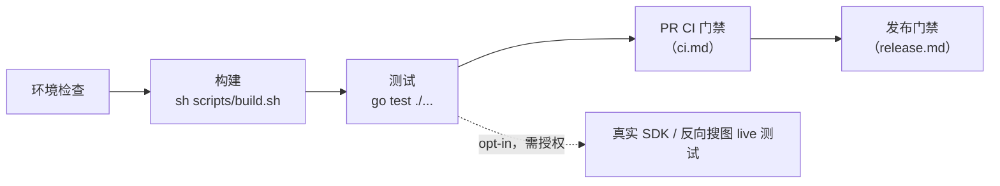
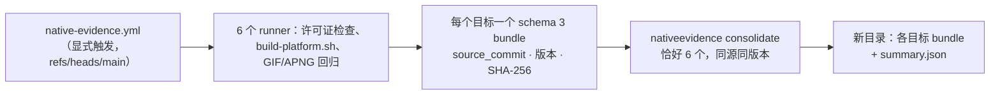
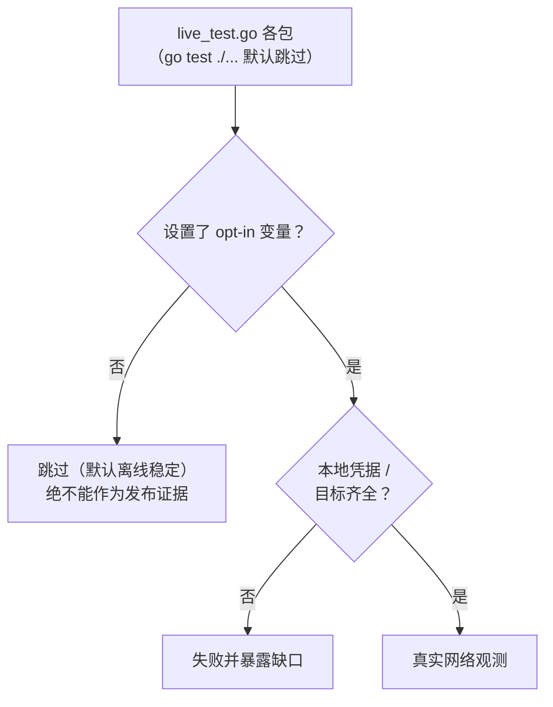
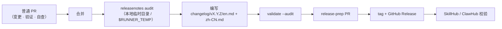

# 开发流程

[English](../../en/maintainers/development.md) | 简体中文 | [文档索引](../../index-zh-CN.md)



| 你想做什么 | 从这里开始 |
| --- | --- |
| 检查本地工具链 | [环境检查](#环境检查) |
| 编辑或验证页面 | [前端资源](#前端资源) |
| 构建或验证 ugoira 编码 | [Ugoira Go encoder](#ugoira-go-encoder) |
| 运行 CLI 与 MCP | [运行](#运行) |
| 处理登录与凭据 | [开发中的凭据](#开发中的凭据) |
| 选择测试范围 | [测试](#测试) |
| 理解 PR 检查 | [CI 门禁](ci.md) |
| 查看发布流程 | [发布](release.md) |
| 准备 release notes | [Release notes and publication](#release-notes-and-publication) |

## 环境检查

`go.mod` 是 Go 工具链版本的唯一事实来源。

```bash
go version
go env GOVERSION CGO_ENABLED GOOS GOARCH
CGO_ENABLED=0 go test ./...
```

## 前端资源

`frontend/mcp-apps/gallery/`、`frontend/pages/login/`、`frontend/pages/oauth/` 中的源码由纯资源包 `frontend` 嵌入，并在启动时组装一次（Gallery CSS/JS 与同意页 CSS 内联；登录页保留原模板/样式与 `html/template` 组合；fixture 不嵌入）。运行时无需 npm、框架、磁盘读取或网络；干净构建与带版本的 `go install` 无需生成步骤。

```bash
go test ./...
go vet ./...
sh scripts/build.sh
node frontend/mcp-apps/gallery/gallery_test.mjs   # 直接测试 Gallery bridge
```

- `frontend` 包测试校验嵌入输入与占位符；本地/平台/race 构建直接编译源码。有 Node 时 Go 回归测试也会跑遍所有宿主能力模式。
- 前端改动需要 Quality、Platform 与 Container 检查。Docker 使用预构建二进制；Homebrew 模板仍在 `templates/homebrew/`。
- 源码安装与自更新使用精确 tag：`go install github.com/FlanChanXwO/pixiv-cli/cmd/pixiv@vX.Y.Z`。

## Ugoira Go encoder

默认下载器构造 `ugoira.NewEncoder()`，用 Go 生成 GIF/APNG——不需要 `ffmpeg`，没有后端选择器，也没有运行时 fallback。PNG 帧用 Go 标准解码器；JPEG 帧用 owner-local 的 `internal/media/ugoira/jpeg` 解码器。

```bash
sh scripts/build.sh                                   # CGO_ENABLED=0 → build/pixiv(.exe)
CGO_ENABLED=0 go test ./internal/media/ugoira/... -count=1
```

| 规则 | 说明 |
| --- | --- |
| 单帧上限 | 512 MiB，分别作用于 ZIP 成员源字节与解码前分配估算（继承固定版本 Rust `image` crate 的 `Limits::default().max_alloc`） |
| 超出上限 | 声明大小超出 → 读取前失败；实际展开超出 → 分块读取时失败；非法/溢出尺寸或估算 → 错误。不截断，不 fallback |
| 取消 | 每个读取分块与图片解码的前后都会检查；PNG/JPEG 解码循环没有回调，因此单帧解码中途的取消在该次解码返回时才被观察到 |
| 工具链 | 不需要 Rust、native library 或 C linker；只有 race 测试需要 `CGO_ENABLED=1` + C 工具链 |

**编码器保真说明** —— `internal/media/ugoira`：JPEG 解码器是 Go 1.26.3 解析加旧 zune-jpeg 0.5.15 整数 IDCT 与 14 位 BT.601（标准库 IDCT 舍入对调色板选择的改变足以让固定门禁失败；解析器 BSD 许可证留在该包，zune-jpeg 的 MIT 署名留在许可证 bundle）。缩放使用带显式 `math.FMA` 的有界正弦/余弦多项式对齐旧 `sinf`，参考值在 `testdata/lanczos-kernel.json`（1,031 条）。APNG 使用固定 Sub 预测、每帧独立的 level-7 zlib 流与 RGBA8 无损：只有全部变化像素不透明且差分能减少横向 RGBA 游程时，才对未变像素使用透明的 Over，否则使用 Source，均用 None disposal。压缩字节可能随工具链变化；只有在验证完整渲染画布、时序与循环行为后才能复用旧质量证据——不能只看文件大小。

**平台构建** —— `scripts/build-platform.sh` 以 CGO0 构建精确目标，并可选生成 canonical 压缩包：`--target GOOS/GOARCH`、`--output-dir DIR`、可选 `--version VERSION`（不带 `v`）与 `--package`（需要版本）。保留 Windows 后缀与 Linux ABI 门禁。runner 元数据在 `scripts/ci/platforms.json`；测试、源码身份、权限、审批与发布留在 workflow 中。

**Linux ABI 门禁** —— 公开基线为 glibc 2.35。release test/production、native evidence、packaged smoke 与 Homebrew 安装矩阵的 Linux runner 固定为 `ubuntu-22.04` / `ubuntu-22.04-arm`（其他任务可用较新 runner）。每个 Linux 可执行文件生成后：

```bash
go run ./scripts/linuxabi --binary <linux-elf>
```

它从 ELF `SHT_GNU_verneed` 读取 loader 契约并检查导入符号版本；任何高于 `GLIBC_2.35` 的依赖在打包前失败。"在构建 runner 上能跑"不是可接受的证据——runner 自带的新 glibc 会掩盖向后兼容回退。

### 许可证 bundle

- `go run ./scripts/licensebundle` 在六个发布目标上以 `CGO_ENABLED=0` 合并 `go list -mod=readonly -deps -json ./cmd/pixiv` 选出的生产模块。离线（`GOPROXY=off`、`GOSUMDB=off`），忽略 workspace/flag 覆盖，需要已缓存的模块源码，不用 Cargo，不含仅测试/工具模块。`--check` 比较索引与完整文本树但不发布。
- `third_party/attributions.json` 固定额外的移植源码声明；文本在 `third_party/attributions/`（与生成的 `third_party/licenses/` 分开）。移除 Rust 源码后仍保留选定的 MIT 文本、Go BSD/专利授权与 SunPro 声明；`fhttp v0.6.8` 提供其源码头引用的 Go BSD 文本（该模块归档缺少独立许可证文件）。文本缺失/为空会在发布前失败；包含嵌套声明；CRLF → LF 并保留全文。
- 生成的文本由 `third_party/notices.go` 内嵌，`pixiv --licenses` 打印；压缩包只含 `pixiv`/`pixiv.exe`。索引与文本树保持可回滚的发布方式。`third_party/attributions/image-compare-0.5.0/` 中仅测试使用的署名不内嵌。

### Native runner evidence



- `.github/workflows/native-evidence.yml` 是显式的维护入口，不是 main push 门禁：全局权限为空、仅任务级 `contents: read`、Action 固定完整 SHA、无凭据 checkout、没有发布/签名环境；runner 由注册表的 `native-evidence` 能力选择。
- schema 3 绑定精确的 `source_commit`、目标、二进制版本与二进制/压缩包/成员 SHA-256；执行 `--version` 并检查压缩包恰好包含记录的二进制；拒绝旧 schema 与 Rust 源码摘要/staticlib 字段。`consolidate` 拒绝符号链接与不安全路径并原子发布；从不把库回填到源码。

```bash
go run ./scripts/nativeevidence consolidate \
  --repo-root . --expected-version "v0.1.0-native-evidence.${RUN_ID}" \
  --expected-commit "$SOURCE_COMMIT" --input-dir /absolute/evidence \
  --output-dir /absolute/new-complete-evidence
```

`RUN_ID` 与 `SOURCE_COMMIT` 取自同一次已审计的运行，并使用新的绝对路径。PR Platform worker 也会从可信 base-ref workflow 上传 schema 3 `native-evidence-<goos>-<goarch>` bundle（`v0.2.0-ci.<run-id>`）——修改 PR head 的 workflow 不会改变该生产者。请检查实际运行与精确 head；不要拼接多次运行，也不要把 fixture、交叉构建或 workflow 定义当作六平台执行。


## 运行

```bash
sh scripts/build.sh                     # build/pixiv(.exe)；Windows 用 Git Bash/MSYS2/WSL；交叉构建用 go build
pixiv auth login
pixiv search "初音ミク" --json
pixiv download 123456

pixiv auth use 12345678                 # 认证的统一 MCP HTTP
./build/pixiv mcp auth init
./build/pixiv mcp --port 1270           # http://127.0.0.1:1270/mcp

https_proxy=http://127.0.0.1:7890 ./build/pixiv mcp --port 1270
./build/pixiv mcp --proxy http://127.0.0.1:7890
./build/pixiv mcp --no-proxy
```

- owner OAuth 授权与 Pixiv/FANBOX 凭据相互独立；一次性 owner secret 请私下保存（不要出现在测试输出或聊天中）。云 connector 需要公开 HTTPS 反向代理（[HTTP 启动](../cli-reference.md#mcp-http-server)）。
- CLI 下载保留自己的设置；stdio 下载工具复用 CLI 设置；HTTP 从不暴露文件系统写入。
- 状态位于 `~/.pixiv-cli`（`%USERPROFILE%\.pixiv-cli`）：`pixiv-cli.db`（Pixiv UID / FANBOX UID 为键；内嵌迁移到 schema v3，旧 v1 原地升级，已存在的后续列只记录不重放 DDL，未知的更新 schema fail closed）、`config.toml`、callback bridge、Release 检查缓存、callback helper。Unix `0700`/`0600`；Windows 首次创建继承父目录 ACL、替换时保留目标 ACL，不修改 DACL。

> [!WARNING]
> 新版本从不读取或删除旧的 `auth.json`。迁移方式：旧版本执行 `pixiv auth export --all --output <private bundle>`，新版本执行 `pixiv auth import < bundle.json`。

**配置** —— `pixiv config path/get/set/unset` 管理 `account_pool_enabled`、`account_pool_strategy`、`download_path`、`filename_template`、`directory_template`、`request_interval`、`https_proxy`、`log_level`、`log_format`、`reverse_search_provider`、`reverse_search_pixiv_only`、`saucenao_api_key`。其他 TOML（如 `[reverse_search.network]`、`[reverse_search.flaresolverr]`）手工维护，不在基线中，作为启动快照读取。基线由 `internal/config/settings` 中的**结构体字段标签**驱动，用 `tomledit` 生成，紧凑（只含 `example:"true"`），从不覆盖。新增普通设置：(1) 在 `internal/config/settings/config.go` 添加字段与声明，(2) 一个聚焦的行为测试，(3) 文档——见[标签契约](architecture.md#配置声明结构体字段标签是唯一事实来源)。

> [!NOTE]
> 残留的 `[web] fallback_enabled` 属于未声明键，加载时忽略。`[logging].level`（`info|debug`）与 `[logging].format`（`text|json`）生效；`PIXIV_LOG_LEVEL` / `PIXIV_LOG_FORMAT` 可覆盖。

**Flag 与代理** —— Cobra/pflag 允许 flag 出现在位置参数前后。Pixiv 命令代理、`[pixiv.network]`、环境变量与 `[network]`，FANBOX 的 `[fanbox.network]` / `[fanbox.flaresolverr]`，以及反向搜图的 `[reverse_search.network]` / `[reverse_search.flaresolverr]` 都按各自服务边界解析；反向搜图有独立的标准/SauceNAO、ascii2d 浏览器与 FlareSolverr JSON 控制网络面（FlareSolverr 只用于 challenge 恢复）。

## 开发中的凭据

完整流程见[认证](../authentication.md)。开发相关的补充事实：

- 浏览器 Cookie（`refresh_token=...`、`PHPSESSID`、`device_token`）**不是** Pixiv App OAuth refresh token；CLI、MCP、环境变量、SDK 与已存账号都会拒绝。
- 远程 hand-off 不提供手动回填回调或移动端路径；`pixiv auth devices` 已移除，现有的 `remote-devices.json` 被静默忽略；旧的 `login_relay_secret` / `login_relay_target_url` 被忽略。relay 支持 HTTP/HTTPS、直接 TLS 或同机 TLS 代理。
- 代理覆盖（`--proxy socks5h://127.0.0.1:7890`、`--no-proxy`）适用于直接 token 的 `auth import`、`auth login`、`auth check`、`search`、`timeline`、`detail`、`ranking`、`recommended`、`download` 与 `mcp` 启动。bundle 形式的 `auth import` 拒绝；`auth export/list/use/remove` 与 `config path/get/set/unset` 不接受。请求节流：`PIXIV_REQUEST_INTERVAL` / `[network].request_interval`。调试：`pixiv config set log_level debug`（+ `log_format json`），只写 stderr，在启动时生效。

> [!WARNING]
> 只有不带 `--output` 的显式 `pixiv auth export` 可以把 token 写到 stdout。bundle 是未加密、含 secret 的时间点备份，不是实时同步。恢复结果 `committed` / `unknown` 绝不算成功回滚。

真实登录依赖 Pixiv 的 OAuth 网页流程；自动化测试使用 fake OAuth server，从不访问 Pixiv。

## 测试

默认复用已有检查，不新增永久测试。[测试准入规则](../../../.agents/skills/pixiv-cli-test/SKILL.md#decide-whether-test-code-must-change)决定哪些长期核心回归可以进入主线，以及如何在 `tmp/test/` 下运行本地探测。

覆盖范围包括 CLI 命令与构建元数据、显式/自动更新、`internal/{pixivaccount,fanboxaccount}`、`internal/pixivaccount/pool`、`internal/reversesearch` fixture 与聚合、`internal/storage/database`、`internal/config/settings`、`internal/{lifecycle,pagination}`、App API 认证重试、公开 SDK、HTTP client 装配、下载、Go 编码器/native-evidence 契约，以及 `internal/mcpserver/{pixiv,fanbox}/tools` 的工具注册。

```bash
go test ./...
sh scripts/build.sh
go test ./internal/browsercookies/... -count=1   # 离线 fixture/加密/权限分类回归
```



| 测试 | 开启 | 需要 | 验证 |
| --- | --- | --- | --- |
| `TestRealPixivSDKRead` | `PIXIV_SDK_E2E=1` | 本地 `pixiv-cli.db` 中的选中账号；可选 `PIXIV_E2E_READ_USER_ID`（必须指向已存账号，联网前 fail closed，不回退默认；发布证据应选副账号） | 身份、稳定的详情/列表与 `Resource` 读取；轮换凭据先经普通 repository 事务持久化 |
| `TestRealFanboxSDKRead` | `FANBOX_SDK_E2E=1` | 约定 macOS Keychain 项中的 `FANBOXSESSID`；`FANBOX_E2E_CREATOR_ID`、`_TAG`、`_POST_ID`、`_POST_URL` | `Creator`、`Creators`、`CreatorTags`、`CreatorPosts`、`TaggedPosts`、`Post`、`Home`、`Supporting`、`ResolveURL`、`OpenResource`、`SaveResource`；每个列表 cursor 续读一次；在临时目录完整读取文件附件（HEAD、保存、字节数）；会话过期 → `credentials_expired` |
| `TestRealFanboxSDKPostInfo` | `FANBOX_SDK_E2E=1 FANBOX_E2E_POST_ONLY=1` | 帖子 ID + 页面 URL | `Post`、非空正文、`ResolveURL`、资源清单；允许 `file_assets=0`（不能替代严格测试） |
| `TestRealReverseSearch` | `PIXIV_REVERSE_SEARCH_E2E=1` | `PIXIV_REVERSE_SEARCH_SOURCE`、`_PROVIDER`；SauceNAO/`all` 需要 `SAUCENAO_API_KEY`（从私有环境 export，不要内联） | 第三方兼容性；不接受来源/key 参数，也不回显；仅用已授权测试图；不是发布门禁 |
| `TestRealReverseSearchMCPReusesSolverSession` | 同上 | `PIXIV_REVERSE_SEARCH_SOLVER_URL`；可选 `_SOLVER_PROXY`（仅浏览器上游） | solver 会话复用；不持久化会话状态或来源 |

```bash
PIXIV_E2E_READ_USER_ID=<secondary-uid> \
PIXIV_SDK_E2E=1 go test ./sdk/pixiv -run TestRealPixivSDKRead -count=1 -v
FANBOX_E2E_CREATOR_ID=<non-secret-creator-id> FANBOX_E2E_TAG=<non-secret-tag> \
FANBOX_E2E_POST_ID=<non-secret-post-id> FANBOX_E2E_POST_URL=<non-secret-post-url> \
FANBOX_SDK_E2E=1 go test ./sdk/fanbox -run TestRealFanboxSDKRead -count=1 -v
# 可选的 challenge 恢复（默认不配置）
FANBOX_E2E_SOLVER_URL=http://127.0.0.1:8191 FANBOX_E2E_SOLVER_PROXY=http://host.docker.internal:7890 \
FANBOX_E2E_CREATOR_ID=... FANBOX_E2E_TAG=... FANBOX_E2E_POST_ID=... FANBOX_E2E_POST_URL=... \
FANBOX_SDK_E2E=1 go test ./sdk/fanbox -run TestRealFanboxSDKRead -count=1 -v
FANBOX_E2E_POST_ID=<non-secret-post-id> FANBOX_E2E_POST_URL=<non-secret-post-url> \
FANBOX_SDK_E2E=1 FANBOX_E2E_POST_ONLY=1 go test ./sdk/fanbox -run TestRealFanboxSDKPostInfo -count=1 -v
export SAUCENAO_API_KEY      # 预先从私有环境导出
PIXIV_REVERSE_SEARCH_E2E=1 PIXIV_REVERSE_SEARCH_SOURCE=<private-test-image-path-or-url> \
PIXIV_REVERSE_SEARCH_PROVIDER=all go test ./internal/reversesearch -run TestRealReverseSearch -count=1 -v
```

- 没有单独的 E2E 包装脚本；离线套件与需要凭据的观测共用一条路径。目标只接受显式的非 secret 值——从不接受 token、会话或 Cookie 作为参数或环境变量。`PIXIV_E2E_PROXY` 是非 secret 的代理 URI；solver 变量是可选的非 secret 拓扑配置。
- release-prep 运行后，检查 stdout、stderr、日志与证据：token、Cookie、签名 URL 与原始响应体绝不能出现在 argv、环境转储、日志、测试名、产物或 diff 中。本节描述的是覆盖范围，并不表示真实测试已运行。
- 显式代理下，资源传输协商 HTTP/1.1，App API 与 OAuth 保持原协商；live 资源读取回归这一边界，不为慢速下载加超时。收到没有有效 `Retry-After` 的 429 时保留诊断并失败——不猜测等待，不无限重试。
- `PIXIV_E2E_BINARY` / `PIXIV_E2E_EXPECTED_VERSION` 让离线 `cmd/pixiv` smoke 针对已构建并解包的 release 二进制运行（不注入 token、不启用真实 API）；`platform-smoke.yml` 在六个 runner 上运行这组 CLI/config/MCP 命令面检查。
- 按改动范围新增或更新测试；无法运行测试时，在交付说明中写明原因与风险。发布 fixture 门禁见[发布](release.md#本地发布-fixture-门禁)。

### 测试文件布局

生产文件 `x.go` 在同目录最多对应一个 `x_test.go`；平台测试使用 `x_<platform>_test.go`，且必须有真实的基础 owner。新 owner 一律使用外部测试包（`X_test`）；只有下列目录因观察未导出状态而允许同包测试。新增同包例外必须在此登记并给出永久理由。

| 目录 | 同包理由 |
| --- | --- |
| `internal/media/ugoira` | 测试直接调用 `readFrameSource`、`frameSource`、`validateDecodedSize`、`frameNRGBA`、`decodeInto`、`resizeFrame` 与 `apngWriter`，在不做巨量分配的前提下验证分配边界与取消，保持透明 RGB 与缓冲复用时上一帧的所有权，用固定的上游参考向量比较 Lanczos3 像素，覆盖 APNG 序号溢出与写入失败，并检查 reservoir 状态、去重权重/索引、Oklab/Wu 参考值、固定种子 K-means 中心与逐像素抖动索引。`colorGrid` 测试验证格子边缘的精确候选范围；`frameQuantizer` 测试验证复用的误差行被清空、普通量化返回独立索引、显式缓冲复用只在上一帧被消费后开始。LZW 测试覆盖跨帧的字典/码宽重置与写入失败后的恢复。GIF 测试观察 `gifWriter`/`gifBlocks`，验证全局色表、流式 LZW 子块与写入失败；生命周期测试观察 `encodeGate`，无 sleep 地协调排队中的取消。为测试暴露这些 codec 内部细节会扩大 `Encoder` 契约。 |
| `internal/config/settings` | `schema_test.go` 把合成类型传给私有的 `deriveSchemaFromTags` 编译器，在不导出反射元数据、不重置生产缓存的前提下测试声明拒绝。 |
| `internal/session` | `pixiv_test.go`、`fanbox_test.go` 设置未导出的 `closeClient` 字段并断言未导出的配置错误 sentinel，验证 Lease 释放与失败传播；导出这些符号会扩大 `session` 的公开接口。 |
| `internal/pixivaccount` | `pixiv_test.go` 观察未导出的 `newAccountWithToken` 构造，验证 `AccountWithToken` 的格式化与 JSON 输出不泄露 refresh token；为测试导出该构造会扩大凭据边界。 |
| `internal/cli` | 组合根测试观察未导出的根装配、invocation 生命周期与关闭顺序；这些 seam 不是公开 API。 |
| `internal/cli/auth` | 测试直接构造 controller，替换未导出的 browser、handler 安装、清理与 relay client seam；这些是生产装配细节，不是公开 API。 |
| `internal/cli/auth/loginhelper` | 测试直接构造各平台 installer 与 callback handler，替换 executable 解析、桌面/注册表命令与 relay 传输；为测试导出会扩大内部 CLI 接口。 |
| `internal/cli/search` | 测试通过带 HTTP fixture 的真实 SDK 观察私有 searchArtworks 逻辑页续读。私有逻辑页策略仍是实现细节；MCP 另外暴露绑定的默认批次续读。仅为测试导出应用内部会扩大公开面。 |
| `internal/mcpserver/pixiv/tools` | 测试通过带 HTTP fixture 的真实 SDK 观察私有 searchArtworks 逻辑页续读。私有逻辑页策略仍是实现细节；MCP 另外暴露绑定的默认批次续读。仅为测试导出应用内部会扩大公开面。 |
| `internal/browsercookies/chromium` | 测试直接构造 provider 并注入加密密钥覆盖，观察未导出的 Cookie 记录解密路径与 profile 发现逻辑。 |
| `internal/browsercookies/firefox` | 测试观察未导出的 profile 发现（`profiles.ini` 解析）、Cookie 数据库路径解析与记录布局。 |
| `internal/browsercookies/safari` | 测试直接调用未导出的 `parseBinaryCookies`，断言 binarycookies 记录布局。 |
| `internal/browsercookies/secret` | 测试构造 `SecretService{command: ...}` 注入未导出字段，并断言未导出的 sentinel 错误与命令输出脱敏行为。 |
| `internal/selfupdate/installer` | 测试注入未导出的 `assetURLValidator` seam 与 checksum 校验函数，并用真实 fixture 二进制验证根 `--version` 预检，以及失败时不替换旧可执行文件。 |
| `internal/selfupdate/release` | `source_route_test.go` 观察未导出的来源路由选择与 canonical API URL 缓存状态；目录中其他测试已使用外部包。 |
| `internal/storage/database` | 测试观察未导出的 `tableInfoQuery` allowlist 与迁移兼容 seam，确保 SQL 标识符保持固定字面量，旧 schema 无法静默绕过契约。 |
| `sdk/pixiv` | `cursor_test.go` 观察未导出的 cursor 构造与 client 实例绑定，在不扩大公开 SDK 面的前提下验证与查询精确绑定的非法续读。 |

- 当前没有临时条目，也不接受"迁移期间""将来"之类开放式表述。新增目录必须说明具体观察的未导出符号，并确认导出最小接口不可行；移除目录需要删除任务与测试迁移证据（外部包可编译 + 覆盖不变）。
- `live_test.go`、`live_mutation_test.go`、`live_solver_test.go` 是按开关变量启用的真实测试，没有单一生产文件归属；它们留在被测包（`sdk/pixiv`、`sdk/fanbox`、`internal/reversesearch`、`internal/browsercookies`），未设置文档中的开关变量时跳过。带 build tag 的测试文件在不同 `GOOS`/`GOARCH` 下可见数量不同；校验时分别用 `GOOS=darwin`、`windows` 与 `linux` 运行 `go list`。

```bash
# 列出测试留在生产包内的目录（package X 而非 X_test）
go list -json ./... | python3 -c 'import json,sys
dec=json.JSONDecoder(); s=sys.stdin.read(); i=0; same=[]
while i<len(s):
    try: p,i=dec.raw_decode(s,i)
    except json.JSONDecodeError: break
    while i<len(s) and s[i] in " \n\t": i+=1
    if p.get("Dir") and p.get("TestGoFiles") and not p["ImportPath"].endswith(("_test",)):
        same.append((p["ImportPath"],len(p["TestGoFiles"])))
for ip,n in sorted(same): print(ip,n)'
# 期望结果 = 上表 Permanent 目录
```

### 能力边界

v1 的负面契约：下列任一项出现可发布的 CLI/MCP/SDK 入口即为缺陷。证据门禁表中的仅 SDK 迁移 seam 不是 release-ready。禁止仅 schema 的占位与 mock 空结果。新增或恢复入口属于功能变更：更新对应行与用户文档；审查者需手动重跑各项的负面 grep / 目录检查。

**不支持**

| ID | 唯一 owner | 当前证据 | 关闭条件 |
| --- | --- | --- | --- |
| `ART-SEARCH-RATING` | `internal/cli/search` + `internal/searchfilter` + `sdk/pixiv` | CLI 作品搜索在本地筛选规范化的 `x_restrict` 并将筛选绑定到 cursor；不发送上游分级字段。MCP `pixiv_search_illust` 没有独立的分级参数 | 保留本地 CLI 契约并测试 cursor/筛选一致性；暴露新的 MCP 参数或上游字段需要其自身的受支持行为与同步的 schema/文档 |
| `NOVEL-SEARCH-ADVANCED` | 无 owner（不得新增） | SDK/MCP schema 没有高级字段 | 上游契约出现后可评估；禁止仅 schema 的占位 |

**证据门禁**

| ID | 唯一 owner | 当前证据 | 关闭条件 |
| --- | --- | --- | --- |
| `NOVEL-RANKING` | `sdk/pixiv` + `internal/cli/ranking`（T18/T30；MCP 之后） | SDK 与 CLI 在内部 `/v1/novel/ranking` 适配器上暴露增量的 `NovelRanking` seam；CLI 通过 `--type novel` 显式选择；MCP 没有 `novel_ranking` 工具，实时/公开发布证据仍不完整 | 完成实时第二页、共享 cursor、MCP 与发布兼容门禁；在此之前保持证据门禁，不是 `public_ready` |
| `NOVEL-BOOKMARK-MUTATION` | `sdk/pixiv` + `internal/mcpserver/pixiv`（G1-T13；CLI 之后） | SDK 暴露增量的类型化 `AddNovelBookmark`/`RemoveNovelBookmark`；MCP 暴露 `add_novel_bookmark`/`remove_novel_bookmark`；已有离线结果、校验与不重放证据，严格/实时、回读与发布证据仍不完整 | 完成严格/实时写入证据、同账号回读、清理与兼容/发布门禁；在此之前保持证据门禁，不是 `public_ready` |
| `COMMENT-WRITE` | `sdk/pixiv`（T16；CLI/MCP 之后） | SDK 暴露命名空间专属的 `PostArtworkComment`/`ReplyArtworkComment`/`DeleteArtworkComment` 及小说对应方法；MCP `comment_post`/`comment_add` 目录仍 = 0；响应 ID、回读、清理与严格实时证据不完整 | 完成严格/实时写入证据、同账号回读、清理与 T33/T38 兼容门禁；在此之前保持证据门禁，不是 `public_ready` |
| `NOTIFICATION` | 无 owner | MCP `notification` 目录 = 0；SDK `Notification*` 导出 = 0 | 同上 |
| `AUTOCOMPLETE` | 无 owner | MCP `autocomplete` 目录 = 0；SDK `Autocomplete*` 导出 = 0；未并入 `search` | 同上 |
| `WEB-RESTRICTED-READ` | 无 owner | 没有 `webapi` 包；`web_fallback_enabled` 属未声明键，加载时忽略 | 不重新开放匿名 Web 路径；任何恢复 Web/AJAX 的提议须先修订 AGENTS 冻结契约并通过 ADR |
| `USER-BLOCK-MUTE-REPORT` | 无 owner | MCP `mute`/`report` 目录 = 0；SDK `BlockUser`/`MuteUser`/`ReportUser` 导出 = 0 | 上游提供可验证的写入契约之后 |
| `WATCHLIST-MARKER` | 无 owner | MCP `watchlist` 目录 = 0；SDK `Watchlist*` 导出 = 0 | 上游提供之后 |
| `BOOKMARK-USERS` | 无 owner | 没有对应工具/SDK 导出；`bookmark_detail` 只覆盖当前用户详情 | 上游提供后可评估 |
| `SPOTLIGHT-PIXIVISION` | 无 owner（不在范围内） | MCP `spotlight`/`pixivision` 目录 = 0；SDK `Spotlight*`/`Pixivision*` 导出 = 0 | 明确不在范围内；只在产品范围变化时重新评估 |

## Git 与本地产物

`.gitignore` 已排除 `.DS_Store`、`build/`、`pixiv`、`pixiv-cli`、`downloads/`、`*.db` 以及常见缓存/临时文件。不要提交 Pixiv token、下载内容、本地数据库、机器相关配置、Ed25519 私钥或 tap deploy key。

## Release notes and publication



- 非空章节依次为 `Breaking changes`、`Added`、`Changed`、`Fixed`、`Security`、`Documentation`、`Maintenance`（中文使用对应译名），末尾附同范围的 `Full Changelog` compare 链接（首个版本链接到该 tag 的提交）。
- 每条面向结果的说明内联来源 PR（无 PR 时用真实短 SHA commit 链接）；一条可合并多个相关来源。纯内部改动归入 `Maintenance`，不得省略。每个版本列出首次合并贡献的外部贡献者（非仓库所有者、非 bot）。`changelog/unreleased/` 只保留 release-prep 提示，不是普通 PR 的编辑目标。
- 分类、breaking change 判断与版本摘要由 release-prep 维护者依据最终 Markdown 章节与兼容性评估决定，不读取 PR 正文；PR 作者无需事先决定版本号。
- `validate --audit` 检查章节顺序、双语来源集合、compare 页脚、缺失来源与范围外来源。正式 tag 上的 `release_notes_audit` 任务以只读的 `contents` 与 `pull-requests` 权限重跑审计与校验。
- 选定版本不等于发布授权：创建 release-prep PR、合并、创建或推送 tag、触发发布或同步历史 GitHub Release 之前，维护者必须在当前会话中明确确认具体版本、范围与影响。完整流程见 `.agents/skills/pixiv-cli-release-notes/SKILL.md`。
- `sync-history` 默认 dry-run；只有显式 `--apply` 才更新已有 Release 正文，或基于已有 tag 创建缺失的历史 Release（不带资产）；两种情况都会比较远端正文与本地双语渲染结果。

## 文档同步

以下内容变化时，同步更新双语 README、CLI 参考或对应 `docs/` 页面：MCP 工具/参数/返回语义；CLI 命令/参数/账号配置/输出；环境变量或默认值；下载、认证、代理、Ugoira 流程；安装/更新渠道、签名信任根、Release/tap 门禁或系统信誉提示；新增限制、重试、超时、截断、降级或错误处理；测试或构建命令。
