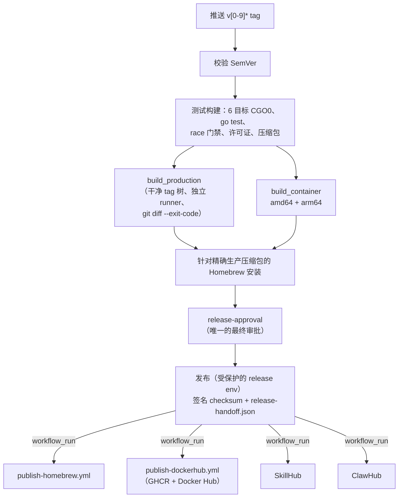

# 发布

[English](../../en/maintainers/release.md) | 简体中文 | [开发流程](development.md)

发布门禁、签名、容器与 Homebrew 发布。release notes 的编写见[开发流程](development.md#release-notes-and-publication)；授权规则见 `.agents/skills/pixiv-cli-release-notes/SKILL.md`。



## 发布 workflow

- `.github/workflows/release.yml` 只接受 `v[0-9]*` tag push——没有 `workflow_dispatch`、`release_tag` 输入或仅测试 overlay。它不读取或注入 Pixiv/FANBOX 凭据；真实 SDK E2E、原生浏览器与一次性 solver 验收需在授权环境中完成，不构成发布证据。
- validate、测试构建、生产构建与发布都绑定同一 tag。失败时在默认分支修复并重跑正常的不可变 tag 流程；绝不把新的校验器、测试或源码注入旧 tag，也没有针对已有 Release 的手动恢复入口。
- `scripts/release assets finalize` 还会从 tag 读取 `scripts/install.sh` 与 `scripts/install.cmd`，以固定名称复制进 Release，并与六个压缩包一起写入 `checksums.txt` 与 Ed25519 清单。发布策略锁定 finalize 参数与完整的八个资产上传集合；Homebrew 渲染器要求 checksum 集合包含两个安装器，而 formula 只下载平台压缩包。
- **Race 门禁：** `go.mod` 工具链在 Windows ARM64 上不支持 race，但六个原生目标都会执行——五个运行 `go test -race ./...`，Windows ARM64 运行同一命令且必须匹配 Go 精确的 `-race is not supported on windows/arm64` 诊断；任何其他失败都算失败，不跳过任何条目。测试矩阵把 `GIT_CONFIG_*` 固定为 `core.autocrlf=false`，让 Git for Windows 保留 LF blob（否则 pre-commit 的 `gofmt` 会误报 CRLF）。仅用于测试门禁；生产构建使用 tag 的干净默认 checkout。
- **Handoff：** release 准备会写入不可变的 `release/release-handoff.json`（release 运行、tag、commit、每个生产/容器产物的大小与 SHA256）；发布时对照已审批的 `release/checksums.txt` 校验；策略拒绝中间步骤、路径替换与发布后改写。生产压缩包、容器镜像、准备好的 checksum 以及针对精确压缩包的 Homebrew 安装都在 `release-approval` 之前完成；之后发布使用带 secret 的 `release` 环境，消费已审批的产物而不重新构建。
- **下游发布者**（Homebrew、Docker Hub、SkillHub、ClawHub）由成功的 `Release` 的 `workflow_run` 触发。handoff 绑定原运行、tag、commit 与产物身份（不只是 tag 文件；不依赖 Homebrew 先完成）。每个发布者都会重新校验身份与所需产物。绝不从 `workflow_run.head_branch` 推断版本或改用之后的 `main` 内容。经授权的恢复派发向具体发布者传入原 `release_run_id`——绝不使用替代 tag 或当前 main。

## 容器发布验证

- `build_container` 在共享 `build` 门禁之后与 `build_production` 并行运行（不等待资产重建）。目标：`ubuntu-22.04` → `linux/amd64`，`ubuntu-22.04-arm` → `linux/arm64`。
- 每个目标 checkout tag，构建带版本的静态 CGO0 Linux 二进制，运行容器打包测试，构建固定的 glibc 运行时镜像，验证非 root、精确版本、`/home/pixiv/.pixiv-cli/` 下的 `pixiv config path`、`/work` 与 OCI provenance（`org.opencontainers.image.source`、revision、version、licenses），然后导出 `verified-container-linux-amd64` / `-arm64`。构建任务只有 `contents: read`。
- `.github/workflows/publish-dockerhub.yml` 是 GHCR 与 Docker Hub 的独立发布后发布者（Release 与 registry 无法原子提交）。它接收不可变 handoff 与两个已验证产物，检查 tag 与源码身份，把同样已加载的镜像字节推送到 `ghcr.io/flanchanxwo/pixiv-cli` 与 `docker.io/flanchanxwo/pixiv-cli`——从不重新构建。只有 Docker Hub 认证使用受保护的 `DOCKER_HUB_TOKEN`（经 stdin 传入）；只有该发布者申请 `packages: write`。失败时从默认分支以原 `release_run_id` 重新派发。精确版本 tag 总会发布；较旧 stable 的恢复成功但不移动 `latest`；只有最新 stable 才推进 `latest`。没有掩盖推送失败的重试循环。

```bash
go test ./scripts/citest ./scripts/release -count=1
```

无凭据的容器 smoke workflow 在相关改动时构建两个架构；这些本地检查不能替代 tag 的 CI 证据。

## Verifier 源码导航

| Owner | 职责 |
| --- | --- |
| `scripts/build/platforms.json` + `scripts/build/matrix.sh` | 共享 runner/能力注册表，校验并输出 |
| `scripts/release` | 发布身份、资产打包/finalize、changelog notes、Homebrew formula/recovery，以及不可变 tag/默认分支祖先、已发布 Release 状态、handoff 身份、精确 archive/container 集合与 checksums 校验 |
| 各发布 workflow | 只保留渠道凭据、权限、变更检测与发布命令 |

恢复运行可以校验成功的 `Release` handoff，而不把 workflow head 绑定到 tag；契约要求该身份的发布者（如 Docker Hub）还会把 handoff 运行绑定到 tag commit。workflow 测试保留行为与安全边界，不复刻精确的任务数、步骤位置或 shell 文本。历史恢复方案与验收报告保留原文，不作为当前流程说明。

## Homebrew

`publish-homebrew.yml` 消费 handoff，校验其生产部分，把 stable/预发布映射到 `pixiv-cli` / `pixiv-cli-beta`（都安装 `pixiv`，互相冲突）。Homebrew 不属于 Release workflow，也不增加审批边界（只有 `release-approval`）。`HOMEBREW_TAP_DEPLOY_KEY` 只通过 `release` Environment 进入已授权的 tap 写入步骤。

1. **安装检查**（macOS Intel/arm64 与 Linux amd64/arm64）：`brew tap-new pixiv-cli-release/staging --no-git`，把单个 staging formula 放入 `Formula/`，执行 `brew install --formula pixiv-cli-release/staging/<formula>`，再执行 `test "$(pixiv --version)" = "pixiv $RELEASE_TAG"`。macOS 用 `brew trust --tap pixiv-cli-release/staging` 信任临时命名空间；Linux 使用短期、固定 digest 的 `homebrew/brew` 容器与只读 bind mount。不使用工作区 formula 路径、绕过变量或公开 tap 的 clone/写入/信任。
2. **部署** 只在全部目标通过后进行：受保护的 `deploy_homebrew_tap` 任务 HTTPS clone 公开 tap；`scripts/release recover`（可信默认分支 tip）对每个 formula 独立地用 `internal/version` SemVer 比较版本：

| 已发布 vs 请求 | 动作 |
| --- | --- |
| 版本相同、字节一致 | 报告已发布；不 commit/push |
| 请求更旧，或版本相同但内容不同 | 读取 deploy key 前 fail closed |
| 请求更新 | 校验 staged formula，在最后一步读取 key，用固定的 GitHub ED25519 known_hosts 与严格检查 SSH 推送到精确的 `HEAD:main` |

用同一 `release_run_id` 恢复是幂等的；更旧的请求无法回滚。之前任何任务失败都不改变 tap。草稿资产无法被 Homebrew 下载，因此安装前先公开 Release；安装失败时 Release 保持公开、tap 不变，由维护者处理——绝不手动推送绕过。

**为什么 Linux 使用容器** —— GitHub 托管 Linux runner 上 Linuxbrew 的 `Resource` staging 清理会在 `FileUtils.chmod` 触发 `EINVAL`，且早于 `--keep-tmp` 能介入的时机。`docker run --rm` 启动固定 digest 镜像，创建本地 staging tap，从只读挂载复制 formula，执行普通的 tap 限定 `brew install --formula`，并与 `RELEASE_TAG` 精确比较 `pixiv --version`。`HOMEBREW_NO_AUTO_UPDATE=1` 与 `HOMEBREW_NO_ENV_HINTS=1` 只消除漂移。容器不读 secret、不写宿主、不用公开 tap，也不使用 `HOMEBREW_TEMP`/source/debug/keep-tmp 参数。其 Homebrew 4.6 没有 `brew trust`——这不是绕过，因为 tap 是在 `--rm` 容器内由 `brew tap-new` 创建的。两个平台使用同样的 `--version` 门禁，不依赖 Python/Ruby JSON 解析器。版本比较在安装之后进行。本地 Docker 已在 arm64 与 amd64 QEMU 上做过同 formula 实验；runner 演练仍是必需的外部证据。

此本地检查只证明 workflow 声明的依赖与语义——**不**验证远端 `release` Environment、secret 或 tag 保护，也不替代正式 tag 产生的四架构安装证据。

### 发布前只读 Homebrew 演练

<details>
<summary>展开运行边界与平台证据</summary>

- 只读：没有 `release` Environment、secret、tag checkout、Release 编辑、tap clone/commit/push，也有意不设 deploy 任务——唯一的发布路径无法被绕过。Linux 使用固定 digest 容器；macOS 使用原生命令。
- 它用于正式发布前复现安装链，**不能替代**正式 tag 发布、签名 Release、tap 部署或发布后验收。quality gate 保留行为级的 formula 与产物检查，而不是第二份策略实现。
- 正式发布仍需要 tag、签名 Release、tap formula 与安装验收；完整的同源同版本六目标证据（[Native runner evidence](development.md#native-runner-evidence)）；以及已配置的 `release` Environment、签名私钥与公开仓库——这些前提本身不代表 Release/tap 已存在或安装路径已验收。

</details>

## 签名信任根

生产 Ed25519 信任根提交在 [`internal/selfupdate/installer/release_installer.go`](../../../internal/selfupdate/installer/release_installer.go)：

| 字段 | 值 |
| --- | --- |
| Key ID | `ed25519-2c27e77742d3c33a` |
| SPKI DER SHA-256 指纹 | `2c27e77742d3c33ad14be867d4e0519229a220898c9a7c868447eaef0951b4cf` |

- 同包测试用一个已知真实签名验证该映射——只证明信任根已接入生产装配，不代表签名、资产或安装验收已完成。
- 私钥只作为受保护 `release` Environment 的 secret 使用，恢复副本只存于受控的 macOS Keychain；绝不进入源码、日志、资产或 formula。
- 轮换：先发布一个信任新 key ID 的版本，保留旧公钥直到旧版本停止支持，再通过新的签名 Release 停用旧 key。已有二进制绝不能突然依赖未提交的信任根。
- 没有 Apple notarization 或 Windows Authenticode；Gatekeeper/SmartScreen 提示是系统信誉边界，文档与脚本都不得绕过。

## Skill 发布者

| 发布者 | 契约 |
| --- | --- |
| SkillHub | 检查不可变 tag、默认分支祖先、公开 Release、SemVer，以及自上一个已合并 semver tag 以来产品 skill 的变化；无变化 → 跳过；有变化 → dry-run 后 commit。产品 `SKILL.md` 版本必须等于 CLI tag。`SKILLHUB_TOKEN` 只进入最终 commit 步骤；返回的 `skillId` 与审核状态只证明已接收，不代表已公开接受 |
| ClawHub | 无凭据 dry-run；最终发布/检查校验精确的产物指纹；`verify_only` 检查已提交版本而不重新发布（要求聚合安全状态干净）。静态扫描干净但聚合安全仍为 `pending`，或 `skill-card.md` 延迟时，给出明确 warning 而非误报失败——两者都不代表最终接受。平台未提供服务端解析的 GitHub provenance 时，依赖可信 tag checkout 与指纹证据；不要声称独立的 provenance 校验 |

## 本地发布 fixture 门禁

```bash
sh scripts/ci/test-package-release.sh
go test ./scripts/release ./scripts/citest -count=1
git diff --check
```

它们只证明格式、失败语义与本地策略——不能替代六个原生 runner 的真实 GIF/APNG smoke、带版本的压缩包内容与 Homebrew 安装验收。
