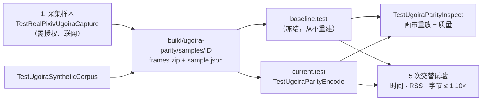

# 离线 ugoira 对照

[English](../../en/maintainers/ugoira-parity.md) | 简体中文 | [开发流程](development.md#ugoira-go-encoder)

如何把 Go 编码器与冻结的旧基线比较质量与性能。这些都不会在普通测试中运行。



## 1. 采集样本

`TestRealPixivUgoiraCapture` 与 `TestRealPixivSDKRead` 共用选中账号与凭据轮换持久化，然后调用 SDK `UgoiraMetadata` 与 `SaveResource`。只有获得下载样本的授权时才开启。

```bash
PIXIV_UGOIRA_CAPTURE=1 PIXIV_UGOIRA_IDS=150808387,150247639,150356234 \
PIXIV_UGOIRA_QUALITY=medium PIXIV_UGOIRA_DIR="$PWD/build/ugoira-parity/samples" \
go test ./e2e -run '^TestRealPixivUgoiraCapture$' -count=1 -v
```

- 正整数、逗号分隔的 ID 与显式的 `original` 或 `medium`；质量不可用时失败，不替换。此命令采集 medium；语料表中的 1080p original 是另外从文档化的 `originalSrc` 获取并保存在单独目录中的。
- 每个新 ID 目录包含完整的 `frames.zip` 与 `sample.json`（有序文件名/延迟、实际质量、尺寸、时长、字节数、ZIP SHA-256、帧元数据 SHA-256）；日志记录清单 SHA-256。URL、ref、header 与凭据从不序列化。拒绝已存在的样本；采集失败只删除本次新建的目录。
- 产物放在被忽略的 `build/` 下，绝不提交。`PIXIV_E2E_PROXY` 含义与 SDK E2E 相同。普通测试会跳过采集。

## 2. 编码

从迁移前的源码编译一次旧基线，记录其源码 commit、Go/构建设置与二进制 SHA-256，之后不再改动。当前的仅测试 driver 使用与下载器相同的 `ugoira.NewEncoder()`（无需凭据或网络）。绝不覆盖 `baseline.test`。

```bash
mkdir -p build/ugoira-parity
CGO_ENABLED=0 go test -c -trimpath -o build/ugoira-parity/current.test ./e2e
GOMAXPROCS=1 RAYON_NUM_THREADS=1 \
UGOIRA_PARITY_SAMPLE="$PWD/build/ugoira-parity/samples/150808387" \
UGOIRA_PARITY_OUTPUT="$PWD/build/ugoira-parity/current-150808387.gif" \
UGOIRA_PARITY_FORMAT=gif UGOIRA_PARITY_MAX_EDGE=0 \
build/ugoira-parity/current.test -test.run '^TestUgoiraParityEncode$' -test.v
```

- 需要绝对路径、与 `gif`/`apng` 匹配的新输出，以及 uint32 最大边长（`0` = 不缩放）。编码前检查 ZIP 与帧哈希，并输出 `UGOIRA_PARITY_RESULT`（输入哈希、格式、最大边长、`Encode` 耗时、输出字节、Go 版本、`GOMAXPROCS`）。
- 每次试验使用新输出；不同实现间保持相同输入与运行时设置。峰值 RSS 用同一主机工具单独测量；记录的时间不含编译、采集、哈希与进程启动。driver 本身不能证明质量、性能或六平台一致性。
- 工具链变化时：保留冻结基线；必要时从同一已审计生产者构建单独命名的旧版对照器，对照冻结输出验证，记录两种构建模式，在同一工具链下比较两个实现。
- **验收：** 每个真实样本/格式先预热，再进行五次交替试验；时间、峰值进程 RSS 与输出字节比值均 ≤ 1.10（RSS 不等于 Go heap）。
- 始终设置 `GOMAXPROCS=1` 与 `RAYON_NUM_THREADS=1`：旧 Rust 量化器的 worker 数会改变输出像素与耗时。选择用于质量评分的输出时，匹配基线的 worker 设置。

## 3. 检查质量

```bash
UGOIRA_PARITY_CORPUS="$PWD/build/ugoira-parity/synthetic" \
go test ./e2e -run '^TestUgoiraSyntheticCorpus$' -count=1
UGOIRA_PARITY_SAMPLE="$PWD/build/ugoira-parity/samples/150808387" \
UGOIRA_PARITY_OUTPUT="$PWD/build/ugoira-parity/baseline-150808387.gif" \
go test ./e2e -run '^TestUgoiraParityInspect$' -count=1 -v
```

| 测试 | 作用 |
| --- | --- |
| `TestUgoiraSyntheticCorpus` | 写出三个原始质量场景，以及透明/重复帧、单像素与奇数尺寸用例；未设 `UGOIRA_PARITY_CORPUS` 时用临时目录，否则用绝对目录为两个二进制保存 schema-1 样本；拒绝已存在的样本目录 |
| `TestUgoiraParityInspect` | 从 Keep/Background 矩形重建 GIF 画布，以 None disposal 重放 APNG Source/Over 矩形；检查帧数、尺寸、循环、延迟与 GIF 透明；要求 `MaxEdge=0`；PNG 输入必须精确重建，JPEG 像素差异单独报告（参考使用 Go 的 JPEG 解码器）；输出带哈希的逐帧 `UGOIRA_QUALITY_RESULT`；不计入性能测量 |
| `TestUgoiraSSIMRustCalibration` | 由 `UGOIRA_PARITY_RUST_QUALITY` 开启；对照旧质量门禁保存的 `<scene>-rust.gif` 与 `<scene>-ssim.csv`，容差 1e-9（九位小数 CSV） |

**指标** —— RGB SSIM 对三个通道分数取平均。MSSIMSimple 使用按实际面积加权的不重叠 8×8 窗口（含较小的边缘窗口）；协方差是求和而非总体方差。`DynamicImage::into_luma8` 背后的旧 `image` 0.25 CICP 转换使用 BT.709/D65 矩阵、float32 乘加与舍入；该指标保留实测的 arm64/FMA 基线（较旧的整数 `Pixel::to_luma` 不是这条路径）。

## 编码器保真说明

| 部分 | 选择 | 原因 |
| --- | --- | --- |
| JPEG | owner-local `internal/media/ugoira/jpeg`：Go 1.26.3 的 JPEG 解析 + 旧 zune-jpeg 0.5.15 整数 IDCT + 14 位 BT.601 | 标准库 IDCT 舍入对调色板选择的改变足以让固定质量门禁失败；只匹配颜色系数无法修复全部样本。不注册全局图像格式，不新增模块依赖。解析器的 BSD 许可证保留在该包中；zune-jpeg 的 MIT 署名必须保留在许可证 bundle。合成的 17×9 `jpeg-{444,progressive,gray,restart}` fixture 与旧版解码的 RGBA 参考覆盖这些路径，测试时无需 Rust 或 jpegtran |
| 缩放 | 带显式 `math.FMA` 的有界正弦/余弦多项式，对齐旧运行时的 `sinf` 结果；`testdata/lanczos-kernel.json` 中 1,031 个数值参考 | 不调用平台数学库即保留 Lanczos3 舍入 |
| APNG | 固定 Sub 预测，每帧独立的 level-7 zlib 流，RGBA8 无损。只有全部变化像素不透明且差分能减少横向 RGBA 游程时，才对未变像素使用透明的 Over；否则使用 Source。都用 None disposal | 避免把纯色区域打碎并增大压缩体积；Go 1.27 的快速压缩级别在高纹理语料上超出原 10% 体积余量（确定性的不透明纹理回归仍对其冻结 Rust 参考保持该余量） |

压缩字节可能随工具链变化；只有在验证完整渲染画布、时序与循环行为后才能复用旧质量证据——不能只看文件大小。

## 语料

压缩包尺寸通过解码每一帧验证（作品显示尺寸不足以作为依据）。第一个 original ZIP 来自 Pixiv 公开 `ugoira_meta` 的 `originalSrc`，其完整帧列表已与认证 SDK 元数据核对（该作品 SDK 只提供 medium）——这是测试数据获取步骤，不是产品 fallback。

| 作品 ID | 压缩包质量 | 实际尺寸 | 帧数 | 覆盖 |
| --- | --- | --- | --- | --- |
| 150808387 | original | 1920×1080 | 63 | 高分辨率、局部运动、细线 |
| 150247639 | medium | 423×600 | 8 | 复杂插画、大范围变化 |
| 150356234 | medium | 219×320 | 121 | 小画布、长序列、渐变 |
| 150863948 | medium | 600×420 | 12 | 局部运动、纯色 |
| 150863611 | medium | 600×338 | 37 | 渐变、纹理、局部运动 |
| 150863218 | medium | 480×270 | 128 | 整帧变化、密集纹理 |

original 与 medium 压缩包放在不同目录，本地保留完整元数据与哈希；绝不推断 original ZIP URL 或重新标记 medium 样本。这些来源不能替代之后的逐样本质量检查与五次交替新旧性能检查。
