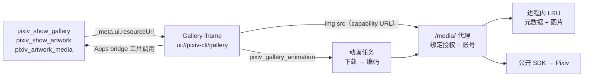
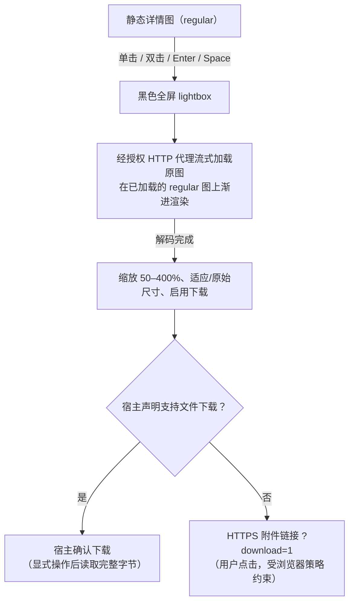
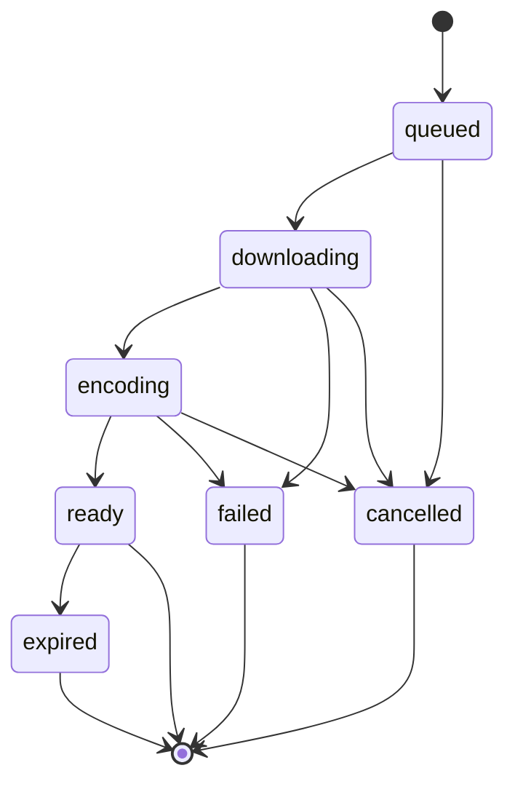
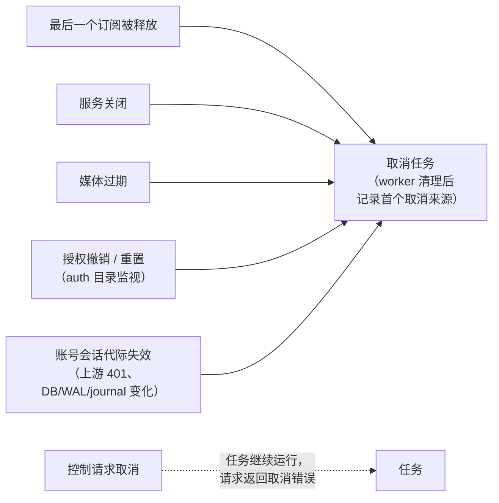

# MCP Apps 画廊

[English](../en/mcp-gallery.md) | 简体中文 | [MCP 工具](mcp-tools.md)

仅 HTTP 可用的图片 UI，对应 `pixiv_show_gallery`、`pixiv_show_artwork`、`pixiv_artwork_media` 的 App 交付与 `pixiv_gallery_animation`。启动设置（缓存大小、TTL、并发、动画磁盘预算）见 [CLI 参考](cli-reference.md#mcp-http-server)。

## MCP Apps 作品预览

- `pixiv_show_gallery`、`pixiv_show_artwork` 与 `pixiv_artwork_media` 把结果关联到 Gallery UI（`text/html;profile=mcp-app`、`_meta.ui.resourceUri`）。稳定的 `ui://pixiv-cli/gallery` 始终可读；工具引用由渲染后前端（含注入的 canonical 媒体 origin）派生的 `ui://pixiv-cli/gallery/sha256-<digest>` 别名，避免宿主 UI 缓存掩盖更新。历史别名在新读取时交付当前视图——digest 是缓存标识，不是完整性保证。
- 普通搜索、排行、推荐与详情工具没有 UI 关联。只有用户明确要看图片或画廊时才调用；是否渲染由宿主决定。

| `pixiv_show_gallery` | 契约 |
| --- | --- |
| 输入 | 必填非空正整数数组 `illust_ids`（重复项保留首次位置）；可选正数 `page`（默认 1）、`quality`（默认 `thumbnail`、`regular`、`original`） |
| 行为 | 获取元数据（不发起新搜索）；只展示传入的 ID——更多页请用数据工具，再显式打开另一个画廊 |
| 输出 | `records`、`images`（作品 ID、页码、URL、可选 `avatar_url`）、`failures`，配置时还有 `media_origin`。单项失败保留成功 record 并设置 `isError` |

`pixiv_show_artwork` 只接受必填正整数 `illust_id`，返回结果与只传该 ID 的 `pixiv_show_gallery` 相同。仅在用户明确要求查看某个作品时调用。宿主支持工具调用时，两个工具中只含一个作品的结果都会直接打开该作品详情页，不显示返回结果按钮；静态（非动图）`pixiv_artwork_media` 结果也会打开同一详情页，并定位到返回的第一页；不支持工具调用时保留单张缩略图卡片。

**图片 capability** —— 静态预览是同源代理 URL，不是 base64 工具内容，也不是原始 CDN 链接。canonical base 下 `/media/` 的 GET/HEAD 校验绑定 OAuth 授权、所选账号、作品、页码与质量的签名 capability。

| 属性 | 规则 |
| --- | --- |
| 有效期 | ≤ 签发它的 access token；授权撤销/重置或重启后失效；切换账号不会改变旧 URL 的指向 |
| 读取 | 公开 SDK + 配置的出站代理；拒绝任意 URL 输入与非栅格内容 |
| 缓存 | `Cache-Control: private, no-store`；无磁盘或公共缓存；HEAD 校验但不返回 body |
| 处理 | 完整图片 URL 是短期凭据——不要分享或记录 |

## 卡片与详情

| 元素 | 行为 |
| --- | --- |
| 框架 | 请求无边框宿主表面；内边距 16px（桌面多图：上下 32px）。单张缩略图（仅在不支持工具调用时显示）报告内容宽度，含内边距最多 384px。高度随内容变化并受宿主限制（可以缩小）。最终尺寸与是否采纳边框偏好由宿主决定 |
| 网格 | 宿主宽度小于 600px 时，多个结果排成一行可键盘聚焦、按卡片吸附的横向滚动列表，因为手机宿主会把纵向滑动交给聊天页而非内部滚动区；更宽的宿主保留响应式网格，置于可键盘聚焦、最高 480px 的滚动区域。每个结果都可访问。悬停不会移动卡片或图片，且只对支持悬停的指针生效，触屏点按后不会残留高亮 |
| 卡片 | 缩略图（含静态 Ugoira 封面），无文字或徽章：网格中完整显示并保持原始比例，窄屏横向列表中统一裁切为 3:4 |
| 详情布局 | 使用宿主可用宽度；圆角详情面板位于未裁剪图片下方，置于最宽 960px 的居中栏中（不会在空媒体栏旁出现高侧栏）。图片框按页面宽高比显示，高度不超过 360px 与宿主宽度 90% 中的较小值（不使用会随自适应框架增长的 `vh`）；留边处显示同一张图的模糊背景，而不是纯色条 |
| 详情内容 | 完整标题、标签、简介、作者、日期、浏览数、收藏数、作品 ID、尺寸（不显示页数行）；R-18/R-18G 徽章。作者与收藏按钮共用一行紧凑区域；随后是一条无文字标签的图标+数值条（浏览、收藏、ID、尺寸、日期），窄屏时整项换行；最后是浅蓝色标签，放在一行，溢出时提供展开全部的按钮 |
| 作者 | 有效 ID 通过宿主打开 Pixiv 主页。真实栅格头像来自可选 `images[].avatar_url`——一个绑定作品作者、授权与账号的 capability；代理解析可信 SDK 头像资源，拒绝非栅格内容，不接受任意 URL 或原图语义。头像加载失败时不显示头像，也不生成替代图标；失败状态仅供辅助技术读取 |
| 复制 ID | 点击复制；对勾确认。请求 clipboard-write 权限；不可用时尝试原生选区复制；两者都失败时 ID 保持选中以便手动复制，不显示错误标记 |
| 拖拽柄 | 无文字的拖拽柄跟随拖动：向下/点击收起，向上/点击展开；支持键盘 |
| 简介 | ` ` → 换行；解码数字与常见命名实体；绝对 HTTP(S) `<a>` 通过宿主打开链接流程重建。丢弃 script URL、含凭据的 URL 与事件属性；其他标记与非法实体保持为惰性文本 |
| 无障碍 | 图标控件有可访问名称、键盘焦点与宿主主题色；元数据保持为文本 |

### 图片加载与翻页

- 详情、图片与头像加载使用骨架屏，支持 reduced-motion；加载/失败描述对辅助技术可用。失败只显示图标重试按钮（无横幅）；没有自动重试。重试画廊中任一失败的缩略图时，会用一次认证批量请求重新加载该画廊所有失败的缩略图。
- 图片进入可见区域才加载。支持工具调用时，视图先在一次认证批量请求中获取新的缩略图 capability，避免复用因过期/重启失效的 URL；不支持时，传入的 URL 只能尽力使用。
- 点击缩略图进入详情。单页作品没有翻页；多页作品在图片上显示 `n / total` 计数并支持横向滑动；前后箭头在首尾页和触屏设备上隐藏。点击计数切换浮在图片上的原生进度滑块，不占布局空间。拖动时预览，确认后加载，过时的响应被忽略。纵向手势留给聊天。尺寸随所选页变化；原图下载使用该页。

### 原图查看与下载

| 控件 | 行为 |
| --- | --- |
| 栏 | 底部只有一个浮动工具条，包含当前页码（多页）、缩放、适应/原始尺寸（图标表示下一步操作）和下载，图片显示后才出现。宿主全屏时由宿主提供关闭按钮，lightbox 不再显示自己的关闭按钮；内联宿主保留左上角关闭按钮 |
| 布局 | “适应”完全由 CSS 计算，宿主调整框架尺寸（面板、最大化、旋转）时图片会自动重新适应。图片区域为工具条预留位置，工具条不遮挡图片；宿主全屏时工具条还会避开浮在底部的宿主输入栏。宽度不超过 600px 的触屏设备上图片占满宽度，工具条可叠在图片底边以节省高度。宿主提供的 `safeAreaInsets` 优先于浏览器安全区。触屏隐藏分步缩放和侧边箭头，改用双指缩放和滑动翻页；首尾页的侧边箭头也会隐藏。宿主全屏时，lightbox 通过 `ui/notifications/size-changed` 上报按图片比例计算的期望宽度，是否采纳由宿主决定 |
| 加载 | 若 regular 图已加载则立即显示，原图在其上渐进渲染（否则在黑底上）。不变暗的白色环形 spinner 持续到解码完成；之后才启用缩放/下载。翻到尚未加载的页时，上一页保持显示并变暗、带 spinner，替换图解码后淡入 |
| 全屏 | 宿主声明支持时请求全屏；关闭时恢复原模式 |
| 手势 | 滚轮 / 双指捏合缩放；点击图片在适应与原始尺寸间切换；适应模式下横向滑动翻页，放大后拖动平移 |
| 键盘 | 方向键翻页，`+`/`-` 缩放，`0` 适应，Escape 关闭 |
| 错误 | 紧凑的重试操作；下载保持当前页 |
| 浏览器附件 | 复用该页已校验的 original 质量 capability；只接受精确的 `?download=1`；文件名由作品 ID、从 1 开始的页码与校验后的 MIME 推导。与 inline 图共用授权的 server 缓存；授权、过期与账号版本检查保持生效。不声称保存成功 |

原图经代理流式传输，避免通过宿主 bridge 传输完整 Base64。

### 浏览器会话缓存

- 一个约 256 MiB 的估算会话 LRU 保存已加载的静态图、成功的动画/PNG 预览元素、详情元数据、已解码原图与显式下载的原图字节；翻页与重新进入详情会复用并恢复所选页。
- 未缓存的替换图加载完成前，当前图保持显示；快速切换会丢弃过时的加载。
- 新查询/结果、取消与 teardown 会清空；不带新工具输入地重复交付相同结果时保留详情与缓存。
- 不缓存：失败、收藏状态。超大图完整显示但不保留。估算包含解码像素与编码数据余量，不代表浏览器/GPU 总内存。

### 收藏操作

| 交互 | 效果 |
| --- | --- |
| 点击 | 切换收藏；添加时使用当前可见性（新收藏为公开） |
| 长按 500 ms / 右键 / Shift+F10 | 锚定的紧凑弹窗：公开/私密、显式 Save changes、删除、刷新状态。关闭、Escape 或点击外部会关闭且不改变布局。按住时移动/取消会中止长按；打开设置从不写入收藏 |
| 写入后 | 刷新已确认的按钮状态，重新加载统计，使缓存详情失效；统计不可读时显示不可用值与明确错误 |
| 未知 / 未确认状态 | 禁用写入，并把收藏按钮替换为仅图标的状态重试按钮；原因仅供辅助技术读取，不显示为文字。写入始终是显式操作，需宿主审批并随后刷新状态 |

**标签** 只有在宿主声明 `message.text` 时，才通过 `ui/message` 向当前会话发送用户发起的精确标签画廊搜索（否则标签为惰性、无悬停效果）。点击任一标签会立即禁用该 app 实例中的所有标签；消息被拒绝时恢复并显示可重试错误。消息被接受 ≠ agent 已完成，且 bridge 没有回合完成事件，因此被接受的请求会让该实例保持锁定（跨导航与重复交付）——请在新返回的画廊中继续。没有定时器或确认消息能解锁它。

## 宿主集成

- 标准 Apps bridge 负责初始化、工具结果与调用（[MCP Apps 规范](https://github.com/modelcontextprotocol/ext-apps/blob/main/specification/2026-01-26/apps.mdx)）。
- CSP：图片只允许 canonical 代理 origin 与 Blob；禁止直接 fetch 连接、外部脚本或样式；`no-referrer`。iframe 不会获得 OAuth bearer、Pixiv 凭据或 FANBOX 会话。
- 替换视图会取消待处理的工具请求并释放动画订阅。
- 本地 bridge/浏览器 fixture 不能证明云端宿主互通。没有 Apps 支持时，直接使用结构化数据与 `pixiv_artwork_media`。

## MCP Apps 媒体交付

适用于 HTTP 下的 `pixiv_artwork_media`。

| 客户端 | `content` | App 数据 |
| --- | --- | --- |
| 声明 `io.modelcontextprotocol/ui` 与 `text/html;profile=mcp-app`，且动画原件已被保留 | 只有独立的 PNG 预览 | `_meta["pixiv/mediaContents"]`：动画的受保护 `resource_link` + inline PNG 预览；`content_index` / `preview_content_index` 指向此数组 |
| 同上，但没有已发布的 HTTP 产物（含 stdio） | 原始完整 inline 内容 | 没有隐藏动画的 App 元数据 |
| 非 App 或不支持的 MIME | 原始完整 `content` | — |

- 播放时按需读取原始二进制；下载使用同一文件，并进行授权/账号版本检查与过期校验。静态媒体与公开输入不变。
- 工具还附带 App 视图用于播放与静态预览。支持工具调用时，静态（非动图）结果改为打开常规详情页；动图视图只使用图标按钮，状态文字仅供辅助技术读取，不常驻显示下载说明。下载：宿主支持文件下载 → 确认流程；否则受保护的 HTTP 附件在浏览器中打开（受浏览器限制）。server 在动画临时容量、授权、账号版本与 TTL 下保留已编码的动画与预览——不重新下载或编码。私有 UI 元数据携带短期地址；不暴露文件系统路径。可选发布失败时保留完整 inline 结果，但浏览器下载不可用。重启、过期或授权变化会使地址失效。
- **Refresh animation** 通过 `pixiv_gallery_animation` 以原格式显式重新获取授权，替换过期地址，沿用现有轮询与订阅清理。图片失败不会自动重新准备。不支持 server 工具调用的宿主无法续期过期链接。

## `pixiv_gallery_animation`

| Action | 输入 | 说明 |
| --- | --- | --- |
| `prepare` | 正整数 `illust_id`，可选 `format`（默认 `gif`、`apng`） | 每次调用返回独立的订阅 `handle` |
| `status` | opaque `handle` | 每 2 秒轮询；终态时停止 |
| `release` | opaque `handle` | 释放最后一个订阅会取消未完成的工作 |

- 控制响应从不内嵌字节，也不提供进度百分比。只在用户显式操作后重试。
- **Ready** 输出：`animation_url`、独立的 `preview_url`（PNG）、`media_origin`、`filename`、`mime_type`、`size`、`expires`。
- **UI 流程：** 先显示静态预览；未加载的动画只在点击 Play 后开始；Gallery 在图片加载完成前显示加载中，之后确认是静态预览还是动画播放。在动画与预览之间切换复用图片元素，不再发起读取。准备就绪后隐藏多余的 Load animation 操作；交付失败、宿主下载未确认或切换格式时恢复它，但不会自动重新准备。带着保留媒体重新进入时会发起新的 prepare 校验授权；只有 URL 与新 ready 响应一致的旧元素才会被复用。
- **保留：** 成功的元素共享 256 MiB 会话 LRU；失败、不完整与超预算的来源被清除；保留的元素在驱逐、新结果或 teardown 时释放；离开视图会释放订阅与图片回调。切换格式与重试会获取新订阅。估算覆盖编码字节与全部帧的解码像素，依据私有 UI 提示 `_meta["pixiv/animationFrameCount"]`（缺失/非法 → 不再新保留）。该提示不增加输入或结构化字段；PNG 估算使用解码像素余量；解码器开销与浏览器/GPU 总内存不在其中。
- **下载：** 宿主支持时用带 `resource_link` 的 `ui/download-file`；否则提供用户点击的浏览器链接，指向同一受保护动画并带精确 `?download=1`。GET/HEAD 保持授权、过期与账号版本检查；附件文件名由作品 ID 与格式推导。拒绝其他 query 参数与预览下载；受浏览器策略约束；不声称保存成功。
- **任务：** 在同一授权/账号/会话代际/作品/格式下，重复准备复用一个任务与完整产物。ready 产物保留到过期（受缓存 TTL 与授权过期约束）。`/media/animation/` 下每个 GET/HEAD 都检查授权与当前账号代际；响应 `private, no-store`；地址是短期 capability——不要记录或分享。
- **磁盘：** 私有目录/文件 `0700`/`0600`。ZIP、原生输出预留、预览与保留产物共享启动预算 `mcp_gallery_animation_temp_capacity_mib`（默认 1024 MiB）。原生写入通过内部同步回调申请实际字节，因此在容量允许时编码另一种格式会保留未使用的 ready 产物。写入在超出预算前明确失败——绝不截断或降质重编码。过期/未使用的 ready 产物可被驱逐；被传输固定的文件在其 handle 关闭后清理。
- **生命周期：** 关闭时先等待 worker 与传输结束再删除工作区。启动时只删除带标记且生命周期 OS 锁已释放的工作区；运行中的实例与未知目录保持不动。临时生产者与原生输出预留一起排队（避免并发准备之间的虚假容量失败）；ready 文件的读取保持并发。首次准备仍需下载与编码；不承诺任何延迟。

## 只读会话与服务端缓存

| 层 | 行为 |
| --- | --- |
| Gallery 查询 | 去重 ID，在配置的限制内并发查询，保持输入顺序与单项失败 |
| 读取会话 | 在过期前复用 access token 与 HTTP 连接，按账号、凭据修订号与网络配置区分。只有刷新 + 凭据持久化持有轮换门；内容请求在持久化后开始，传输期间不持有它。上游认证失败使会话失效且不自动重试。可信 SDK 元数据注册质量变体（无需额外作品查询）。取消单次凭据检查会保留共享会话与无关传输；真实的凭据/授权失效会取消它们 |
| 服务端缓存 | 按授权划分，默认 256 MiB / 15 分钟 / 并发 4。合并并发的元数据查询；只保存成功的元数据与完整栅格图；每次命中重新授权并解析当前账号/会话代际；从不缓存收藏状态与写入 |
| 流式传输 | 校验上游状态与文件头后再流式传图；保留可信的 Content-Length，否则以未声明长度流式传输。中断的传输会关闭上游、丢弃填充缓冲，绝不把错误文本追加到图片字节 |
| 阶段观测 | 固定阶段：会话等待/刷新、作品查询、首个图片字节、传输、缓存命中——不含 token、授权或 capability URL |
| ZIP 标记 | 任务 context 仍有效时：`animation_zip_incomplete`（意外 EOF 或 Content-Length 不符）、`animation_zip_reset`（连接被重置）、`animation_zip_timeout`（读取器超时）。只含部分字节数；不含原始错误或签名 URL；不改变重试、截止时间、质量或工具错误 |

## 诊断

启用 debug 诊断时：

| 事件 | 含义 |
| --- | --- |
| `mcp_response_serialization` | `pixiv_artwork_media` / `pixiv_gallery_animation` 结果 JSON 实际编码耗时与字节数（不含 JSON-RPC 信封与网络） |
| `mcp_http_write` / `mcp_http_flush` | 每次底层 POST 写入（接受字节数、耗时）/ flush（耗时），包括失败、请求取消与关闭。保持 SDK 分帧；不证明对端已收到；不记录 body 或 header |
| artwork-media 动画阶段 | 作品查询、动画元数据、ZIP 下载、观测到的原生编码等待/编码、结果文件读取 |
| `animation_generation` | 临时文件清理后的最终结果，含失败与取消；失败时字节数为 0，成功时为动画大小。不含序列化与交付。进入原生队列前失败的编码尝试不会编造排队时长 |

普通日志保持原有编码路径；重叠的 HTTP/协议诊断范围不会重复编码或观测。交付中断报告固定的 request-cancelled / transport-interrupted 原因，从不包含原始错误、凭据或 capability URL。后台元数据、ZIP 与编码观测携带真实结果：ZIP 在关闭并校验 Content-Length 后才算成功，编码在编码器返回后才算成功；部分 ZIP 字节描述的是传输量，而非交付。共享的作品查询与会话获取区分失败结果；OAuth 刷新包含轮换凭据持久化（持久化失败不算刷新成功）；获取轮换门时被取消会记录固定原因，并在刷新或读取前停止。错误返回与重试行为不变。

## 取消与失效

- CLI presenter 使用固定原因，不使用 handle 或原始取消文本。订阅或媒体检查发现的授权/账号会话失效有单独原因。订阅检查遇到已撤销授权时会取消其任务，同时仍拒绝该请求；其他账号无法取消它。控制请求取消（包括在获取会话期间）不影响已订阅的工作。
- 取消单个动画 HTTP 请求会保留共享产物与其他订阅；授权或凭据失效仍会使其过期。活动传输绑定到任务：关闭或撤销会取消传输、关闭文件并设置即时写截止时间以解除卡住的写入（由取消触发，不是传输超时）。回调在 handler 返回前完成；私有文件在被固定的传输释放后删除。
- 动画 owner 监视授权目录以发现原子状态替换，并主动取消被撤销/重置的授权。失去该监视会停止动画工作、阻止新请求，关闭时报告固定的 watcher 错误。
- 账号会话失效发布按代际划分的取消信号：上游认证失败会停止该代际上的其他传输与任务，且不重试；旧代际无法取消其替代者。MCP 账号 owner 监视数据库父目录中的 DB、WAL 与 journal 变化，并在不刷新 token 的情况下重新校验凭据修订号；外部替换/删除会取消旧代际，仅元数据变化则保留。
- 轮换持久化后，发布前会重新检查凭据修订号，即使其通知已被提前消费，也会拒绝过时的 client。失去目录或数据库路径会停止旧会话，并在关闭时报告固定 watcher 错误。关闭时先取消账号生命周期再等待 watcher（包括等待 DB 锁）；正常关闭不算 watcher 失败。在 kqueue 上，对刚删除的 SQLite journal 执行 lstat 得到 ENOENT 时，只有父目录监视与普通主数据库仍存在，才视为提交通知并重新校验修订号。其他 watcher 错误、目录/数据库丢失与重新校验失败仍是致命错误。
- 发布订阅前，在获取会话后会再次检查授权；授权通知在任务发布互斥锁下读取快照。空闲的静态元数据/图片条目会在授权撤销、凭据代际失效与过期时回收；被固定的内容在读取者释放前持续计费。迟到的缓存填充在缓存互斥锁下校验授权与代际。产物删除失败会保留其占用的预算，并在关闭时报告（即使后续清理成功）；HTTP 与清理的关闭错误会合并而不是丢弃。
