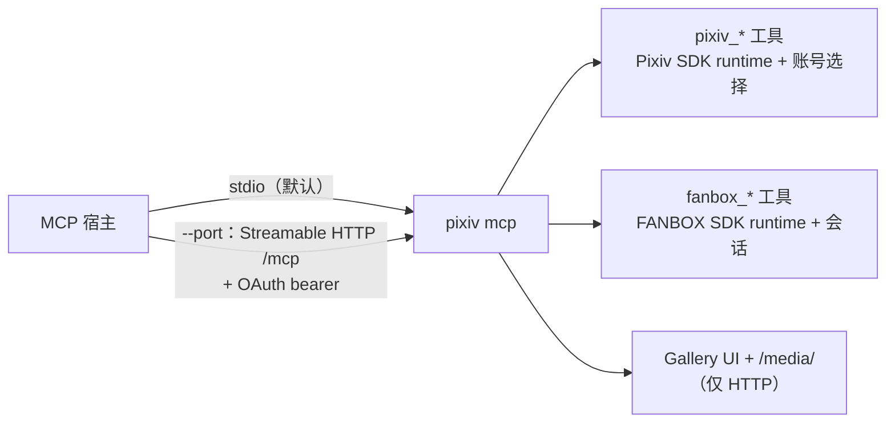
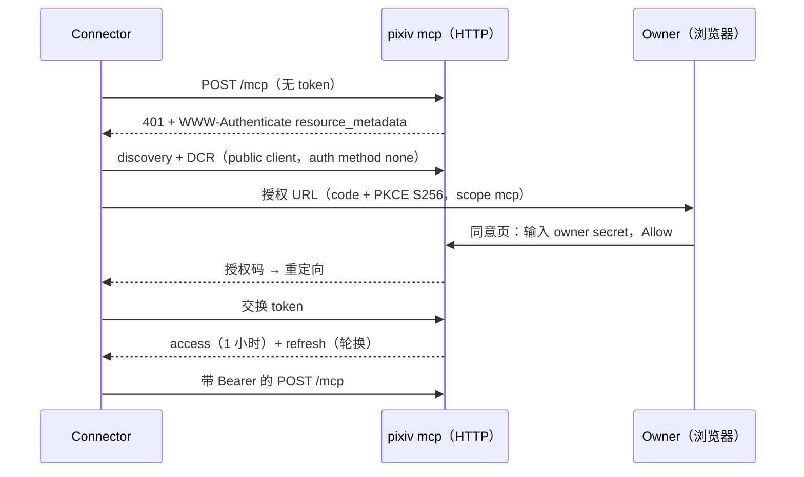
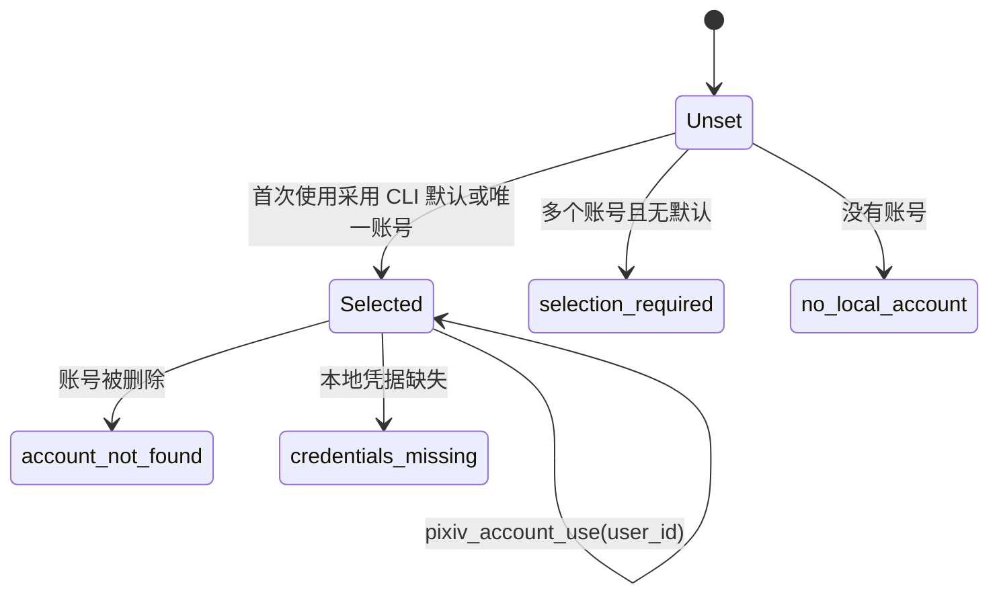
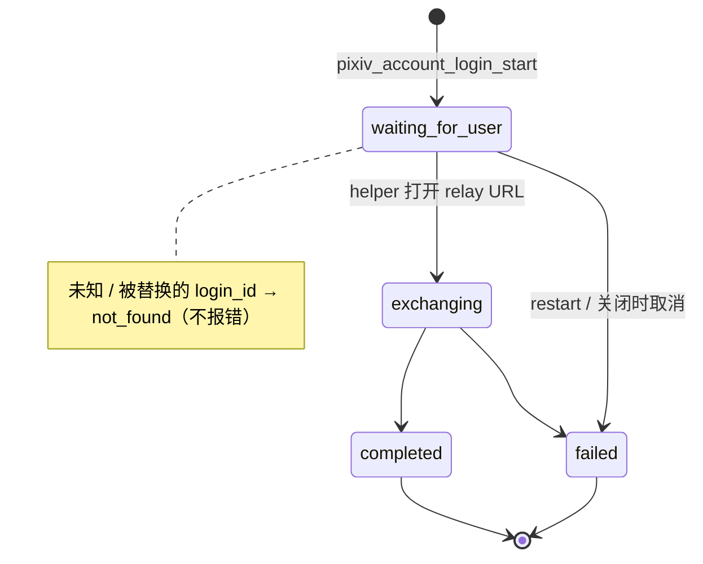
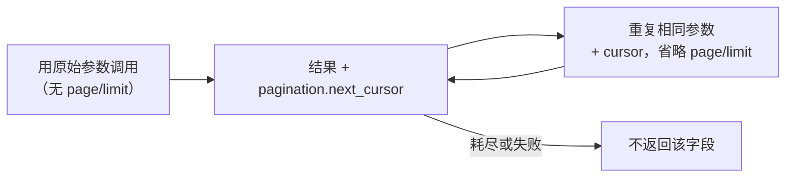

# MCP 工具

简体中文 | [English](../en/mcp-tools.md) | [文档索引](../index-zh-CN.md)

`pixiv mcp` 的工具契约。MCP Apps 画廊、动画交付、缓存与取消见 [MCP Apps 画廊](mcp-gallery.md)；启动与代理见 [CLI 参考](cli-reference.md#mcp-http-server)。



| 通用规则 | 说明 |
| --- | --- |
| 传输 | stdio 使用本地产品凭据，没有 HTTP owner 状态与读取会话文件监视。HTTP 使用持久化的 owner 选择。请把 `pixiv fanbox mcp` 迁移到唯一的 `pixiv mcp` |
| Owner 管理 | `pixiv mcp auth init [--reset]` 是本地命令，不是工具也不启动 server——见 [owner 初始化](cli-reference.md#mcp-owner-初始化) |
| Schema | 可选输入保持可选：没有必填字段的对象省略 `required` 或使用 `required: []`，绝不使用 `required: null`（严格客户端否则会拒绝整个工具发现响应） |
| 命名 | Pixiv 工具用 `pixiv_`，FANBOX 用 `fanbox_`；旧 Pixiv 名称不是别名。同一个 server，SDK runtime 与凭据各自独立 |
| `pixiv_novel_content` | 保留的兼容工具：正整数 `novel_id` 返回结构化 `content_unavailable`、`isError=true` 与空内容块；从不调用 `/v1/novel/content`，无 WebView fallback。元数据请用 `pixiv_novel_detail` |

## 传输能力

| 能力 | stdio | HTTP |
| --- | --- | --- |
| Pixiv/FANBOX 查询与写入工具、opaque FANBOX 资源 | 是 | 是 |
| `pixiv_artwork_media` 完整图片 / GIF / APNG 与 PNG 预览 | inline 内容 | inline 或受保护的 App 交付 |
| `pixiv_download`、`pixiv_download_random_from_recommendation` | 本地文件 | 不注册 |
| `pixiv_show_gallery`、`pixiv_show_artwork`、`pixiv_gallery_animation`、Gallery 资源 | 不注册 | 有媒体服务时可用 |
| `pixiv_account_*` owner 管理 / helper 登录 | 使用本地 CLI 认证 | owner 状态与 relay |

## HTTP 授权



- 内置单 owner OAuth server：protected-resource 与 authorization-server 元数据、DCR public client（`token_endpoint_auth_method=none`）、Authorization Code + PKCE S256、scope `mcp`。owner 只在实例的同意页输入 secret——绝不在聊天或工具参数中——且每次授权都需明确同意。
- 云端部署需要 HTTPS 反向代理；支持本地 HTTP。本契约并不代表 ChatGPT 或 Gemini 实时连接测试已通过。

| 主题 | 规则 |
| --- | --- |
| Bearer | 每个 `/mcp` 请求都需要有效 token。缺失/过期/撤销 → HTTP 401 与 canonical `WWW-Authenticate`，不是工具结果。私有 auth 状态不可用时 fail closed |
| 缓存 | MCP 响应 `Cache-Control: no-store`，包括 SSE |
| Token | access 有效一小时。refresh 轮换整对 token；复用旧 refresh token 会撤销其授权 |
| 重置 / 重启 | 重置撤销授权、使 owner 会话与未交换的 code 失效，保留已注册 client。重启丢弃内存中的会话/code，不影响持久化的 client 与授权。过期/重置影响新请求，不影响已授权的工作 |
| 取消 | server 取消会停止接受新请求并取消/等待活动 handler；新版协议的请求取消经官方 SDK 传播 |
| 请求体上限 | OAuth 控制请求与 query string ≤ 64 KiB（超出 → 413，不截断）。控制请求体须在 10 秒内读完（慢 → 408 + 关闭连接）。读取成功后在解析/授权/存储前清除截止时间；提前拒绝时保留截止时间，避免清理过程无限读取不完整的请求体 |
| DCR 注册表 | ≤ 1024 个 client。满时新注册替换任意一个既无 owner 批准也无授权的 client，匿名注册无法耗尽注册表；压力下待批准 client 可能需要重新注册 |
| 批准标记 | owner 明确同意会在签发 code 前持久保护该 client；DCR 元数据无法设置这个私有标记。已有授权（包括旧状态文件中已撤销的授权）也会保护其 client；重置在清除授权前保留批准。1024 个都受保护 → `temporarily_unavailable`（503）；管理员需在停机时检查私有状态中陈旧的已批准 client 与授权。拒绝未知私有字段的旧版本二进制无法读取含该标记的状态 |
| 待处理条目 | owner 会话、表单与 code 各 ≤ 1024，满时 `temporarily_unavailable`（503），不驱逐。会话/表单 10 分钟过期（= code 寿命），在下次读取 auth 状态时回收 |
| 截止时间 | HTTP header 准入 10 秒。工具执行、媒体传输与关闭没有新增完成截止时间。这些上限针对未认证资源增长，不是上游媒体大小 |

## Pixiv 账号选择

适用于 HTTP。stdio 使用本地 CLI 的账号选择与认证。



- 一个持久化选择由所有 connector 共享；从不被隐式替换。本地存在凭据不代表上游有效。
- 工具调用中首次访问 SDK 时固定账号快照，后续读写都使用它。显式选择覆盖账号池调度，但不改变 CLI 默认账号。

### 账号工具

| 工具 | 输入与语义 |
| --- | --- |
| `pixiv_account_list` | 空对象；所有本地账号摘要与共享选择。 |
| `pixiv_account_status` | 空对象查询本地选择/凭据存在情况；可选字符串 `login_id` 查询登录进度，不读取账号存储。 |
| `pixiv_account_use` | 必填正整数 `user_id`；检查本地存在后，为所有 connector 持久化选择。 |
| `pixiv_account_login_start` | 可选布尔 `restart`（默认 `false`）；启动或复用 server 持有的 helper 登录。 |

- 输入为封闭对象。三个本地操作（不带 `login_id` 的 status）返回 `selected_user_id`、`selection_state`、`credential_state`、`accounts`（`user_id`、`username`、`has_credentials`）。
- status 可能持久化初始的默认/唯一账号选择，因此三者都发布 `readOnlyHint=false`、`destructiveHint=false`、`idempotentHint=true`、`openWorldHint=false`。status 成功也可能报告账号不可用；它不是上游认证检查。
- 失败保留结构化信封，带 `error` 与 `isError=true`：`invalid_request`（schema）、`invalid_user_id`、`account_not_found`、`owner_not_initialized`、`canceled`、`deadline_exceeded`、`local_state_error`。状态不可用时报告 `unknown`，而不是空账号。从不回显原始参数、凭据、路径与存储原因。

### 新账号登录



| 步骤 | 契约 |
| --- | --- |
| 启动结果 | `login_id`、`authorization_url`（本 server 的 relay 入口，不是 SDK OAuth URL）、`status`、`requires_local_helper`（成功时为 true）、`instructions` |
| 用户操作 | 在安装了 pixiv-cli 及其 `pixiv://` helper 的电脑上打开 URL；未弹出时用官方安装器（重新）安装后再打开。没有定时器猜测 helper 是否可用。不要把回调 URL、code 或 token 粘贴进聊天 |
| 重复启动 | 复用等待中/交换中的流程。`restart=true` 先取消并等待旧流程结束。完成后新的启动替换结果；不保留历史 |
| Annotations | `readOnlyHint=false`、`destructiveHint=true`、`idempotentHint=false`、`openWorldHint=true`（restart 会丢弃待处理登录；流程可能保存账号并更新共享选择）。不改动 CLI 默认 |
| 状态查询 | `pixiv_account_status({"login_id":"..."})` → `login` 对象。不读账号存储：选择/凭据字段为 `unknown`，以零/空值占位——查询真实选择请不带 `login_id` |
| 成功 | `login.account`、`account_saved=true`。已有且带本地凭据的选择会保留（`selection_updated=false`、`status=completed`）；只有未设置、账号缺失或无凭据的选择才采用新账号（`selection_updated=true`） |
| 并发 | 在选择锁内检查可用性，不会用陈旧数据覆盖并发的显式选择 |
| 已保存但未选中 | `isError=true`、`account_saved=true`、`selection_updated=false`——修复本地写入问题后调用 `pixiv_account_use`，不要重新登录 |
| 错误 | `login.error_code` = `login_failed` 或 `login_cancelled`（从不是原始存储原因）。启动失败：`status=failed`、`error=login_start_failed`、`isError=true`；非法输入：同一信封，`error=invalid_request` |
| 生命周期 | 属于 server，而不是启动请求或 helper 连接。restart 与关闭会取消并等待；没有固定登录超时，也没有原始回调完成工具。loopback fixture 只覆盖本契约，不覆盖真实 helper 安装或宿主浏览器验收 |

## 错误、分页与输出

| 情况 | 结果 |
| --- | --- |
| schema 非法输入 | SDK 打开前即拒绝：MCP SDK 工具结果带 `isError=true` 与文本诊断，无结构化输出；不是 JSON-RPC 错误。账号工具与反向搜图改为返回清洗后的结构化信封 |
| handler 执行后失败 | 保留工具的结构化结果，`isError=true`；实体读取返回空 `records` |
| 正常空页 | 成功，绝不转成错误 |

**列表工具**接受 `page` 与 `limit`：

| 输入 | 含义 |
| --- | --- |
| 无 `limit` | 一个上游批次 |
| 正数 `limit` | 跨批次填满逻辑页 |
| `limit: 0` | 遍历到 cursor 结束 |
| `page` | 从 1 开始；需要正数 `limit` |

实体筛选在逻辑分页之前执行；按稳定实体身份去重。结果暴露 `pagination.page`、`limit`、`returned`、`has_more`，存在下一逻辑页时还有 `next_page`。`pixiv_recommended(kind="all")` 为 illust、manga、novel、user 分别提供独立分页。多数 SDK cursor 保留在 server 内部。

**默认批次 cursor** —— `pixiv_search_illust`、`pixiv_illust_related`、`pixiv_illust_ranking`、`pixiv_illust_recommended` 在默认批次还有更多数据时返回 `pagination.next_cursor`：



- 信封绑定原始参数（查询/策略、作品 ID、排行模式/日期、筛选），携带 SDK 续读状态而非凭据——是编码，不是加密或授权。SDK 每次都会重新校验操作/查询/账号绑定。
- 参数改变、账号不兼容、格式错误或立即重复的 cursor 都会明确失败。一个批次在前进前消费全部返回项，包括越过筛选后为空的上游批次。正数 limit 的逻辑分页不变。
- `pixiv_recommended`：默认批次为 `pagination.illust`、`manga`、`novel`、`user` 分别附加 `next_cursor`。流 cursor 需要匹配的单一 `kind`、相同适用筛选与省略的 `page`/`limit`；`kind=all` 带 cursor 被拒绝——请去掉其他类型的筛选。初始 illust/manga 投影共享一个上游窗口；续读其一不会消费另一个。筛选后为空的视觉窗口仍可续读；排除某视觉类型的筛选不会为它产生 cursor。失败或重放的尝试不会泄露先前尝试的 record 或分页。

**`pixiv_comments`** —— 封闭输入 `{kind, id, page, limit}`，必填 `kind=artwork|novel`、正整数 `id`。输出 `{comments, pagination}`，以及可选 `total` / `access_control`（上游未提供时省略）。作品与小说使用各自当前的评论操作。opaque 数值 `comment_access_control` 保留为 `access_control.comment_access_control`——不推断 `can_comment`/`is_locked`。没有写操作专用的 `stamp_id`；没有单独的 `stamps` 工具。

**输出安全** —— record 保留公开字段，需要时附带 opaque 资源引用；从不含解析/签名 URL、请求头、Cookie、过期元数据、access token 或其他传输凭据（小说内容块与评论/头像图片同理）。结构化结果使用公开 SDK 模型与类型化信封。FANBOX 第一方资源携带 opaque `ref` 与可选 `requires_credentials`，绝不含 `url`、`request_headers` 或 `expires_at`。

## 反向搜图

`pixiv_reverse_search` 接受封闭对象，`source` 与 `image` **恰好提供一个**（都没有或都有均为错误），另有可选 `provider`：

```json
{"source":"/private/path/image.png","provider":"ascii2d-color"}
{"image":{"download_url":"https://host.example/image?signature=temporary","file_id":"host-file-id","mime_type":"image/png","file_name":"image.png"}}
```

| 输入 | 规则 |
| --- | --- |
| `source` | server 本地普通文件路径、本地 `file://` URI 或 HTTP(S) URL |
| `file://` URI | 绝对路径；authority 为空或 `localhost`。其他 authority、userinfo、query、fragment、NUL 与 UNC 路径被拒绝（而非丢弃）。空格、`#`、`%` 需百分号编码。仅为 MCP 规则，不影响 CLI 模式选择 |
| `image` | 宿主附件，通过 `_meta["openai/fileParams"] = ["image"]` 声明。封闭对象，四个字符串字段：必填 `download_url`、`file_id`；可选 `mime_type`、`file_name` |
| `download_url` | HTTP(S)、有 host、无 userinfo；本地路径/file URI 无效。只有它进入快照加载器；file ID、MIME 与文件名从不转发。过期/不可用 → 错误提示重新附加；不猜测 URL 也不重试 |
| `file_id` | 非空，仅作描述，从不作为下载地址 |
| `provider` | `saucenao`、`ascii2d-color`、`ascii2d-bovw`、`all`；省略 → 启动配置（默认 `saucenao`） |

- `reverse_search_pixiv_only`、代理、API key 与传输设置在启动时捕获；调用无法修改。
- 网络面（启动时）：标准来源/SauceNAO client（全局代理路由）；ascii2d 浏览器 client（存在时用 `[reverse_search.network].proxy_url`，显式空 = 直连；`user_agent` 仅 ascii2d，Chromium UA 附带匹配的 `Sec-CH-UA*` hints，其他省略）；FlareSolverr JSON 控制 client（`[reverse_search.flaresolverr].proxy_url` 只作为 `sessions.create` 中的浏览器上游；控制流量不继承任何原生路由）。

> [!WARNING]
> `source` 指的是 **MCP server** 的文件系统与网络，而不是 connector 设备。允许私有、loopback 与 link-local 目标，server 可能读取私有文件。单 owner OAuth 授权允许 connector 请求这些资源——只授权可信的 connector。

- 来源只获取/打开一次进入私有快照，上传到所选 provider，完成、失败或取消时删除。从不返回或记录：原始来源、附件 URL、file ID、文件名、临时路径、请求头、Cookie、API key、CSRF 值、重定向 `Location`、上游响应体。SauceNAO/ascii2d 的处理与保留遵循其政策；URL 查询可能被缓存。ascii2d 接受 JPEG、PNG、WEBP，有其专属 10 MB 上限——不是反向搜图通用的 1 MiB 规则（`gzip, deflate, br` 是响应协商）。
- 图片以原生方式上传到 ascii2d `/search/file` multipart；FlareSolverr 只接收 JSON challenge 恢复请求。solver 状态限于进程/client，从不持久化。

| 输出字段 | 内容 |
| --- | --- |
| 信封 | 始终为 `{input, providers, results, records, provider_errors, partial}` |
| `input` | 只有 `kind` 与 `sha256` |
| `providers` | 固定的 provider 状态列表 |
| `results` | provider 证据 + 可选 canonical Pixiv 身份；仅外部结果留在这里 |
| `records` | canonical `artwork`（有意保持通用——不调用 detail 猜子类型）或 `user` |
| `provider_errors` | 只有稳定的 `provider`、`code`、`message`；原因先被清洗 |

| 结果 | `partial` | `isError` |
| --- | --- | --- |
| ≥1 个 provider 成功、另一个失败 | `true` | `false` |
| 单 provider 失败 / 全部失败 | — | `true`，保留信封 |
| schema 错误 | — | 执行前返回安全的 `invalid_request` 信封，不回显非法值 |
| 取消 | — | 完整的请求取消，绝不算部分成功 |

错误码：`unknown`、`invalid_request`、`invalid_source`、`source_not_regular_file`、`source_read_failed`、`source_http_status`、`snapshot_failed`、`source_loader_not_configured`、`provider_not_configured`、`missing_credential`、`malformed_upstream_response`、`upstream_http_status`、`provider_failed`、`all_providers_failed`、`challenge_required`、`solver_unavailable`、`solver_failed`、`malformed_solver_response`。

## 实体 filter 与收藏数搜索

只有以下类型化筛选是输入；原顶层表达式 `filter` 不再发布（它从未接入 handler）。

| Filter | 字段 |
| --- | --- |
| `illust_filter` | `id`（正数）、`type`（`illust`、`manga` 或 `ugoira`）、`tags`（全部精确匹配）、`min_views`（非负）、`min_pages`（非负） |
| `novel_filter` | `id`（正数）、`tags`（全部精确匹配）、`min_views`（非负） |
| `user_filter` | `id`（正数） |

作品搜索还接受含端点非负的 `bookmark_min`、`bookmark_max` 与 `bookmark_strategy`；结果报告 `filter.min`、`filter.max`、`membership`、`strategy`、`completeness`。

| `bookmark_strategy` | 行为 |
| --- | --- |
| `auto` | 目前为对已获取候选的本地 `TotalBookmarks` 筛选 |
| `local` | 同样的精确候选筛选，不声称全局完整 |
| `best_effort` | App 候选区间，部分完整 |
| `server` | 在有可靠服务端行为证据前明确失败；不静默回退 |

`pixiv_search_illust` 将收藏数区间与 `illust_filter` 按 AND 组合，先筛选再计算逻辑 page/limit。即使没有收藏数区间，显式指定 `auto`、`local` 或 `best_effort` 也会执行 `illust_filter`。使用 cursor 续读时须重复两类筛选条件和策略。

`best_effort` 始终报告 `partial`，包括候选流为空或已耗尽的情况。`auto`／`local` 仅在候选流耗尽且没有未交付结果时报告 `complete_for_source`，不表示该来源之外也完整。

未知会员状态不等于非 Premium；Premium 不是本地硬门槛；收藏数不是点赞数。

## 作品媒体

`pixiv_artwork_media` 通过所选账号的 SDK 资源 client 读取字节——不在 server 文件系统下载。搜索/详情/列表工具保持只返回元数据。

| 输入 | 契约 |
| --- | --- |
| `illust_id` | 必填正整数。 |
| `pages` | 可选的从 1 开始页码数组；省略表示全部页。空数组、非正或越界页失败。按请求顺序去重。 |
| `quality` | 静态图默认 `regular`；`thumbnail` 使用 SDK thumb 变体，`original` 需显式请求。不在本地缩放。 |
| `animation_format` | Ugoira：`gif`（默认）或 `apng`；对静态作品提供任何值都会失败。 |

- 尽可能在打开账号快照前校验输入；页码范围需要元数据，但在读取任何媒体前检查。一个 SDK lease 把详情与全部媒体读取绑定到同一账号，保留 Pixiv Referer 与资源 host 校验，并在所有退出路径关闭 body 与 lease。静态读取不产生临时文件；没有隐式页数/字节上限；部分交付不会跨账号重试。
- 结果：`illust_id`、`title`、`total_pages`、`requested_pages`、`delivered_pages`、`pages`、`failures`、`complete`。每个已交付页：从 1 开始的 `page`、实际 `mime_type`（按字节检测）、字节 `size`、MCP content 数组中从 0 开始的 `content_index`，对应条目是带真实字节的标准 `ImageContent`（绝不是 URL/路径）。意外 HTTP 状态、读取/关闭错误或非图片内容都不算已交付页。
- 部分结果按请求顺序保留成功图片，在失败页列出 `error` 与可选 `http_status`，并设置 `complete=false`、`isError=true`——请显式重试失败页。输入错误：`invalid_request`（schema）、`invalid_illust_id`、`invalid_pages`、`invalid_quality`、`invalid_animation_format`、`animation_format_not_applicable`。其他失败明确报告，并隐去上游响应体、URL 与凭据。顶层 `error` = 整次调用失败；单页失败放在 `failures`。
- `complete=true` 描述的是 server 构建的内容，不代表宿主已接受。宿主拒绝整个载荷时请改为请求指定页；不虚构通用载荷上限。Annotations：只读、非破坏、幂等、open-world。合成测试不能证明 ChatGPT/Gemini 的显示支持。
- MCP Apps 客户端获得 App 专用交付（`_meta["pixiv/mediaContents"]`、受保护链接、刷新）——见 [MCP Apps 媒体交付](mcp-gallery.md#mcp-apps-媒体交付)。

### Ugoira 动画

| 方面 | 契约 |
| --- | --- |
| 输入 | 省略 `pages` 与 `quality`（否则在读取压缩包前返回 `static_parameters_not_applicable`）；`animation_format` `gif`（默认）或 `apng` |
| 压缩包 | 复用 CLI 策略：优先 original，否则使用可用压缩包。`archive_quality` 报告实际质量；medium 绝不标记为 original。静态默认 `regular` 不是缩放设置 |
| GIF | 对不透明动画跳过重复未变区域，不改变量化像素、帧数或时序；含透明的动画保持整帧背景清除 |
| APNG | 在满足精确 alpha 合成时使用无损帧差；保留全部帧、尺寸与延迟。减少冗余编码，不保证每个宿主都接受大结果 |
| 结果 | 一个逻辑页（`total_pages=1`）。`pages` 条目：`filename`（`<illust_id>.gif`/`.apng`）、MIME、大小、`archive_quality`、`content_index` → 含全部字节的 `ImageContent`。APNG 的 content MIME 为 `image/png`（保留全部 chunk），结构化 `mime_type` 为 `image/apng`。`preview_content_index` → 独立的首帧 PNG（仅预览）。请依据 index 与文件名区分，不要假设所有 `image/png` 都是预览 |
| 工作区 | Go 编码器在私有临时工作区运行；压缩包保存、编码、预览解码与清理共用一个账号 lease；成功前删除。失败/取消不会发布路径，也不会把只有预览的结果标记为完整。不引入 ffmpeg 或新编码器 |

## Tool annotations 与下载

| 工具类别 | Annotations |
| --- | --- |
| 读取（上文账号工具除外） | 只读、非破坏、幂等 |
| 收藏/关注添加 | 非破坏、幂等写入 |
| 删除、删除评论 | 破坏性、幂等写入 |
| 评论 create/reply/stamp | 非破坏、非幂等写入 |
| 本地下载 | 写入/破坏性（共享保存器可能替换已有文件） |

这些提示用于宿主审批，并非 server 强制的授权。外部操作的 `openWorldHint` 为 true（包括反向搜图上传与可能认证的 Pixiv 读取）；`pixiv_account_list`、`pixiv_account_status`、`pixiv_account_use` 与 `fanbox_resolve_url`（本地快照 + URL 解析，无网络）为 closed-world。

**stdio 下载** —— `pixiv_download`（`src` 或 `srcs`，可选 `pages`、`quality`、`ugoira_mode`、`delivery=local_path`）与 `pixiv_download_random_from_recommendation`（可选 `count`，默认 5，范围 1–20，选项相同）。复用共享下载器与 CLI 下载目录/文件名/目录模板；结果保留 `items`、`files`（路径/file URI/MIME/大小/页码）、warning 与部分失败；失败设置 `isError=true`。没有任意目标路径参数。HTTP 从不注册它们。旧名 `download` / `download_random_from_recommendation` 没有别名。

## 工具迁移

合并后的工具需要显式选择器——没有隐式目标类型。旧名称已注销（无别名）。输出 schema、写操作 `action` 值与输出 ID 字段不变；只有下表标出的目标输入改为 `id`。不属于该实体类型的筛选在访问账号前被拒绝。

| 原入口 | 当前调用 / 参数变化 |
| --- | --- |
| `pixiv_illust_comments`、`pixiv_novel_comments` | `pixiv_comments`，增加 `kind=artwork` / `novel`；保留 `id` |
| `pixiv_create_artwork_comment`、`pixiv_create_novel_comment` | `pixiv_comment_create`，增加 `kind`；`illust_id` / `novel_id` 改为 `id` |
| `pixiv_reply_artwork_comment`、`pixiv_reply_novel_comment` | `pixiv_comment_reply`，目标映射同上；保留 `parent_comment_id` |
| `pixiv_stamp_artwork_comment`、`pixiv_stamp_novel_comment` | `pixiv_comment_stamp`，目标映射同上；保留 `stamp_id` 与可选 `comment` |
| `pixiv_delete_artwork_comment`、`pixiv_delete_novel_comment` | `pixiv_comment_delete`，增加 `kind=artwork` / `novel`；保留 `comment_id` |
| `pixiv_add_bookmark`、`pixiv_add_novel_bookmark` | `pixiv_bookmark_add`，增加 `kind=artwork` / `novel`；目标改为 `id`；保留 `restrict` 与 `tags` |
| `pixiv_remove_bookmark`、`pixiv_remove_novel_bookmark` | `pixiv_bookmark_remove`，增加 `kind=artwork` / `novel`；目标改为 `id` |
| `pixiv_novel_bookmark_tags` | `pixiv_bookmark_tags`，增加 `kind="novel"`（默认 `artwork`）；分页/可见性与输出信封不变 |
| `fanbox_creator_posts`、`fanbox_tagged_posts` | `fanbox_creator_posts`，省略 `tag` / 保留必填非空 tag |
| `fanbox_home`、`fanbox_supporting` | `fanbox_feed(source=home)` / `fanbox_feed(source=supporting)` |
| `pixiv_user_bookmarks`、`pixiv_user_novel_bookmarks` | `pixiv_user_bookmarks`，增加 `kind=artwork` / `novel` |
| `pixiv_user_followers`、`pixiv_user_following`、`pixiv_related_users` | `pixiv_user_relations`，增加 `relation=followers` / `following` / `related` |
| `pixiv_timeline_illust_following`、`pixiv_timeline_novel_following` | `pixiv_timeline_following`，增加 `kind=artwork` / `novel` |
| `pixiv_timeline_illust_latest`、`pixiv_timeline_novel_latest` | `pixiv_timeline_latest`，保留 `content_type=illust\|manga` / 增加 `content_type=novel` |
| `pixiv_mypixiv_illusts`、`pixiv_mypixiv_novels`、`pixiv_mypixiv_users` | `pixiv_mypixiv`，增加 `kind=artwork` / `novel` / `user` |
| `download`、`download_random_from_recommendation` | `pixiv_download`、`pixiv_download_random_from_recommendation`（仅 stdio） |

- 原作品操作包含漫画与 Ugoira 的，`kind=artwork` 同样包含。只能提供匹配的 `illust_filter` / `novel_filter` / `user_filter`；小说用户收藏没有新筛选。`restrict` 只影响 followers/following；related users 保持原有的忽略字段行为。
- 仍然独立：`pixiv_bookmark_list_all`（作品→小说共用一个逻辑预算）；`pixiv_illust_recommended` 与 `pixiv_recommended`（前者在收集时筛选并返回 records 分页信封；后者从一个窗口投影出类型化流，cursor 绑定与分页不同）。读/写、添加/删除、登录/状态、Gallery/媒体、本地下载/受保护 HTTP 媒体与 Pixiv/FANBOX 凭据保持区分。

## 读取工具

`search_illust` 与 `illust_detail` 的作品 record 保留上游 `is_bookmarked`、`is_muted`、`visible`、`sanity_level`、`restriction_attributes` 与可选 `series`（`id`、`title`）；上游提供时详情另含 `total_comments`。viewer 状态属于执行读取的账号。不会逐条补充请求。缺失字段被省略（未知，不是 `false`/`0`）；显式空的限制列表保持 `[]`。

| 工具 | 输入与语义 |
| --- | --- |
| `pixiv_search_illust` | 必填 `word`；可选 `search_target`、`sort`、`duration`、`start_date`、`end_date`、`content_type`、`ai_mode`、`aspect_ratio`、`resolution`、精确 `tool`、收藏区间/策略、`illust_filter`、`page`、`limit`。SDK 打开前校验枚举/日期。默认批次 `cursor` 保留收藏策略 checkpoint；省略 `page`/`limit`，重复相同查询、筛选与策略。 |
| `pixiv_search_novel` | 必填 `word`；可选 `search_target`、`sort`、`duration`、`novel_filter`、`page`、`limit`。分级、文本长度、仅原创有意不发布。 |
| `pixiv_reverse_search` | `source` 或宿主 `image` 恰好一个；可选 `provider`。见[反向搜图](#反向搜图)。 |
| `pixiv_illust_detail` | 正整数 `illust_id` 或受支持的作品 `url` 恰好一个；返回一条安全 record。 |
| `pixiv_novel_detail` / `pixiv_novel_content` | 正整数 `novel_id`；元数据 / 保留的 `content_unavailable` 兼容工具（空内容块，不调用已拒绝端点）。 |
| `pixiv_illust_related` | 正整数 `illust_id`，可选 `illust_filter`、`page`、`limit`；`cursor` 需省略 `page`/`limit`。 |
| `pixiv_illust_series` / `pixiv_novel_series` | 正整数 `series_id`、`page`、`limit`；小说系列另返回安全的系列元数据。 |
| `pixiv_comments` | 必填 `kind=artwork\|novel`、正整数 `id`；可选 `page`、`limit`。见[上文](#错误分页与输出)。 |
| `pixiv_illust_ranking` | 可选 `mode`（封闭枚举，默认 `day`）、`date`（合法 `YYYY-MM-DD`）、`illust_filter`、`page`、`limit`；`cursor` 需省略 `page`/`limit`。 |
| `pixiv_search_user` | 必填非空白 `word`（空白在 SDK 前被拒绝），可选 `user_filter`、`page`、`limit`；使用 App 用户搜索。 |
| `pixiv_illust_recommended` | 可选 `illust_filter`、`page`、`limit`；`cursor` 需省略 `page`/`limit`。 |
| `pixiv_recommended` | 必填 `kind`：`all`、`illust`、`manga`、`novel`、`user`；匹配的类型化筛选、`page`、`limit`。`illust`/`manga` 选择子类型；冲突筛选在 SDK 前被拒绝；`all` = 四个独立流，原子失败。`cursor` 需匹配的单一 kind 并省略 page/limit。 |
| `pixiv_trending_tags_illust` | 无输入；当前作品热门标签完整列表；上游为空 = 成功的空结果。 |
| `pixiv_timeline_following` | 必填 `kind=artwork\|novel`；可选 `restrict`（默认 `public` 或 `private`）、匹配筛选、`page`、`limit`。作品含插画、漫画与 Ugoira。 |
| `pixiv_timeline_latest` | 必填 `content_type=illust\|manga\|novel`；可选匹配筛选、`page`、`limit`。 |
| `pixiv_mypixiv` | 必填 `kind=artwork\|novel\|user`；可选匹配筛选、`page`、`limit`。只读取已认证账号的 MyPixiv。 |
| `pixiv_user_detail` | 必填正整数 `user_id`；一条安全的公开资料 record。 |
| `pixiv_user_artworks` | 可选 `user_id`、`type`（`illust`、`manga`、`ugoira`）、`illust_filter`、`page`、`limit`；省略 ID = 已认证用户。 |
| `pixiv_user_novels` | 可选 `user_id`、`novel_filter`、`page`、`limit`；省略 ID = 已认证用户。 |
| `pixiv_user_bookmarks` | 必填 `kind=artwork\|novel`；可选 `user_id`、`restrict`、`tag`、`page`、`limit`；`illust_filter` 仅作品。省略/零用户 ID = 已认证账号；null 分页/筛选值保持原有含义。 |
| `pixiv_bookmark_list_all` | 可选 `user_id`、`restrict`、`tag`、`page`、`limit`；先作品收藏后小说收藏；`page`/`limit` 作用于拼接结果；任一必需流失败 → 错误，无部分 record。 |
| `pixiv_bookmark_tags_all` | 可选 `user_id`、`restrict`、`page`、`limit`；先作品标签后小说标签，每个带 `content_type` 与原始 `count`；同名标签不合并；任一流失败 → 无部分标签。 |
| `pixiv_novel_bookmark_detail` | 必填正整数 `novel_id`；`{bookmarked, restrict, tags}`，保留缺失/未收藏状态；使用候选的小说收藏详情 App API。 |
| `pixiv_user_relations` | 必填 `relation=followers\|following\|related`；可选 `user_id`、`restrict`、`page`、`limit`；`user_filter` 仅 following/related；省略 ID = 已认证账号；related 接受但忽略 `restrict`。 |
| `pixiv_blocked_users` | 可选 `user_id`、兼容 `restrict`、`page`、`limit`；省略 ID = 已认证用户。App 失败直接报告，从不改用 Web fallback。 |
| `pixiv_bookmark_tags` | 可选 `kind`（默认 `artwork` 或 `novel`）、`user_id`、`restrict`、`page`、`limit`；`{bookmark_tags, pagination}`。 |
| `pixiv_bookmark_detail` | 必填正整数 `illust_id`；`{bookmarked, restrict, tags}`；无标签时 `tags` 为 `[]`，包括未收藏作品。 |

所有读取使用同一应用/公开 SDK 路径，保留类型化的认证、授权、not-found、上游、取消与响应格式错误——绝不因缺少可选端口或 App 请求失败而伪造空成功。

## 写工具

| 工具 | 输入 | 结构化输出 |
| --- | --- | --- |
| `pixiv_bookmark_add` | `kind=artwork\|novel`、正整数 `id`、可选 `restrict`、`tags` | `{success, action, illust_id}` 或 `{success, action, novel_id}` |
| `pixiv_bookmark_remove` | `kind=artwork\|novel`、正整数 `id` | `{success, action, illust_id}` 或 `{success, action, novel_id}` |
| `pixiv_comment_create` | `kind=artwork\|novel`、正整数 `id`、非空 `comment` | `{success, action, illust_id/novel_id, comment_id}` |
| `pixiv_comment_reply` | 必填 `kind=artwork\|novel`、正整数 `id`、非空 `comment` 与正整数 `parent_comment_id` | `{success, action, illust_id/novel_id, comment_id}` |
| `pixiv_comment_stamp` | `kind=artwork\|novel`、正整数 `id` 与 `stamp_id`、可选 `comment`（纯贴图为空） | `{success, action, illust_id/novel_id, comment_id}` |
| `pixiv_comment_delete` | `kind=artwork\|novel`、正整数 `comment_id`；不需要内容 ID | `{success, action, comment_id}` |
| `pixiv_follow_user` | `user_id`、可选 `restrict` | `{success, action, user_id}` |
| `pixiv_unfollow_user` | `user_id` | `{success, action, user_id}` |

添加时空 `restrict` = `public`；只接受 `public`/`private`。create/reply/stamp 返回上游 `comment_id`；delete 返回传入的 ID。server 从不读取最新评论来猜 ID，从不回退到候选 v3 评论契约，也从不在另一个账号下重放提交后状态未知的操作。写入失败返回 `success=false`、`isError=true` 与安全诊断。

## FANBOX tools

同一个 server，schema 见 `tools/list`，使用 FANBOX 专属凭据。

| 工具 | 语义 |
| --- | --- |
| `fanbox_current_user` | 当前已认证的 FANBOX 用户。 |
| `fanbox_creator`、`fanbox_creators` | 一个创作者资料，或支持中/关注中的创作者。 |
| `fanbox_creator_tags` | 创作者使用的标签。 |
| `fanbox_creator_posts` | 必填 `creator_id`；可选非空 `tag`、`page`、`limit`。无 tag → CreatorPosts；有 tag → TaggedPosts；显式空 tag 是错误。 |
| `fanbox_post` | 一个帖子及其安全资源引用。 |
| `fanbox_feed` | 必填 `source=home\|supporting`；可选 `page`、`limit`。保留各 feed 的 API、帖子结构与 FANBOX 认证。 |
| `fanbox_resolve_url` | 本地把 URL 解析为类型化引用。 |
| `fanbox_open_resource` | 打开 opaque `ref`；GET 交付字节 + 安全元数据，HEAD 只返回元数据。 |

### FANBOX 资源内容

| 方面 | 契约 |
| --- | --- |
| Lease | 只使用独立的 FANBOX SDK lease |
| GET 内容 | 静态图 → `ImageContent`；GIF/APNG 与其他附件 → embedded-resource blob。PNG 与 APNG 依据动画控制 chunk 区分，而非仅看 Content-Type。保留合法的非图片 MIME；缺失/格式错误的 MIME 按字节检测。不写 server 文件，不设字节上限 |
| 字段 | 原有 `ref`、`status_code`、`content_type`、声明的 `content_length`；`size` = 实际字节数、`content_index`、`delivered`（本响应含字节）、`complete`（请求/清理成功）。HEAD：`delivered=false`，无 index |
| URI | embedded resource URI 是内容哈希 URN，不是 server 路径，也不承诺单独的 resources/read 端点 |
| `filename` | 文件元数据有名称时 GET 与 HEAD 都返回（含扩展名，不重复后缀）。名称解析由 SDK 负责；MCP 从不解码 ref 或从 URL 猜测，并套用 CLI 文件名规范化（分隔符/保留标点 → `_`）。这只是建议名，不是可信路径；缺失时保持缺失 |
| 失败 | 非成功状态、读取/关闭错误、取消、lease 关闭错误都保持结构化；保留 SDK 错误类别，不含原始响应体、位置或非法输入。`status_code=0` = SDK 未暴露状态（分类为 forbidden 的错误不会被编造状态码）。schema → `invalid_request`；本地 ref/method → `invalid_ref` / `invalid_method`。仅为本地合成测试——不是真实账号或宿主验收 |

## 认证与 fallback

- Pixiv 读写需要 App API 路径；没有匿名或 Web fallback；App 错误即最终结果。残留的 `web_fallback_enabled` 属于未声明键，加载时忽略。
- FANBOX 共享协议 server，不共享 Pixiv 凭据或账号池。各产品保留自己的 SDK 与服务配置；命令级代理覆盖同时作用于两个原生 client。
