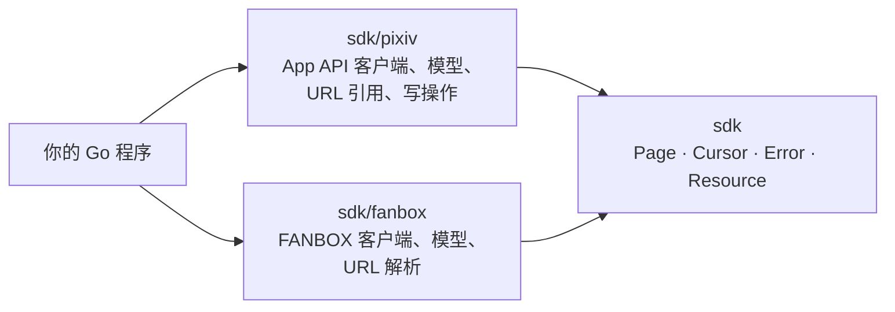
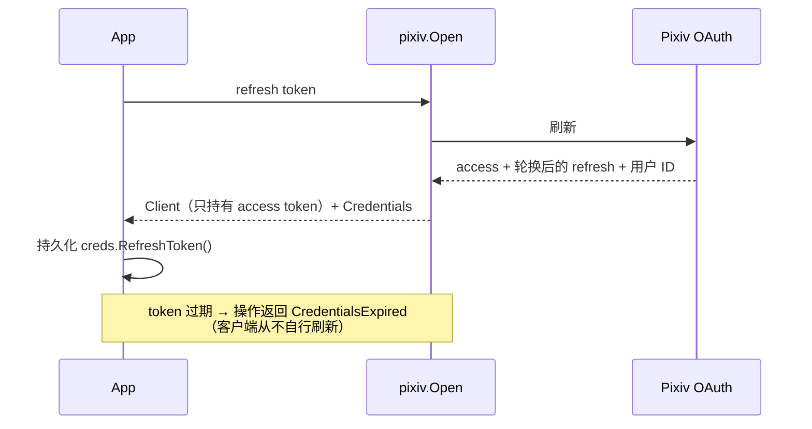
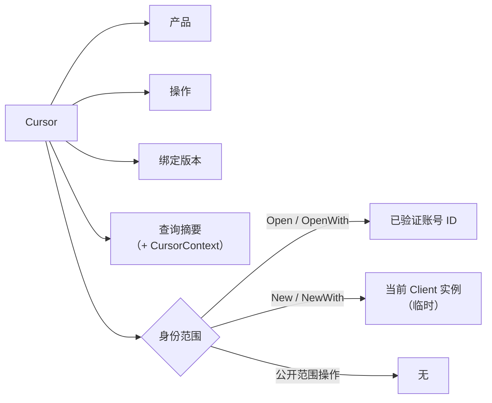
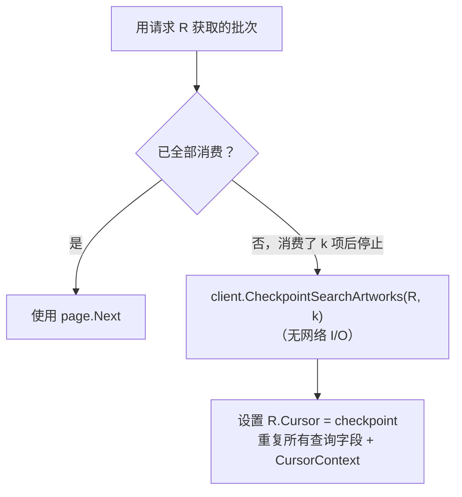
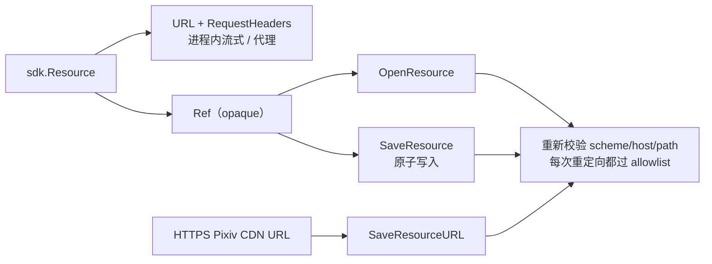

# Pixiv SDK (v1)

[English](../en/sdk.md) | 简体中文 | [文档索引](../index-zh-CN.md)



| 包 | 内容 |
| --- | --- |
| `github.com/FlanChanXwO/pixiv-cli/sdk` | 与协议无关的基础类型：分页、opaque cursor、分类错误、资源契约 |
| `github.com/FlanChanXwO/pixiv-cli/sdk/pixiv` | Pixiv App API 客户端、模型、URL 引用、写操作 |
| `github.com/FlanChanXwO/pixiv-cli/sdk/fanbox` | FANBOX 客户端、模型、URL 解析 |

所有导出声明都带英文 GoDoc；包源码是权威的 API 摘要。

## 快速开始

Pixiv：认证、搜索、获取分页、保存图片。

```go
package main

import (
	"context"
	"fmt"
	"os"

	"github.com/FlanChanXwO/pixiv-cli/sdk"
	"github.com/FlanChanXwO/pixiv-cli/sdk/pixiv"
)

func main() {
	ctx := context.Background()

	// 1. 通过 OAuth 轮换认证。在发起内容请求前先持久化轮换后的 refresh token；
	//    客户端从不自行刷新。
	client, creds, err := pixiv.Open(ctx, os.Getenv("PIXIV_REFRESH_TOKEN"))
	if err != nil {
		panic(err)
	}
	_ = creds // 把 creds.RefreshToken() 持久化到可靠存储

	// 2. 搜索作品并遍历类型化分页 cursor。
	page, err := client.SearchArtworks(ctx, pixiv.SearchArtworksRequest{Word: "miku"})
	if err != nil {
		panic(err)
	}
	if len(page.Items) == 0 {
		return
	}
	first := page.Items[0]

	// 3. 获取作品分页（图片资源）。
	pages, err := client.ArtworkPages(ctx, pixiv.ArtworkPagesRequest{ArtworkID: first.ID})
	if err != nil {
		panic(err)
	}
	if len(pages) == 0 {
		return
	}

	// 4. 通过 SDK 校验的资源路径保存第一张图。
	saved, err := client.SaveResource(ctx, pages[0].Image.Resource.Ref, sdk.SaveOptions{
		Path: "./first.png",
	})
	if err != nil {
		panic(err)
	}
	fmt.Println("saved", saved.Path)
}
```

FANBOX：用会话打开，列出支持中的帖子，读取一个帖子。

```go
client, err := fanbox.Open(fanbox.SessionCredentials{FANBOXSESSID: sess})
if err != nil {
    panic(err)
}
page, err := client.Supporting(ctx, fanbox.SupportingRequest{})
if err != nil {
    panic(err)
}
if len(page.Items) == 0 {
    return
}
post, err := client.Post(ctx, fanbox.PostRequest{PostID: page.Items[0].ID})
if err != nil {
    panic(err)
}
_ = post // post.Body 中的块携带带 Resource ref 的图片/文件资源
```

## 认证

Pixiv 仅支持 App：每个内容操作都需要有效 access token。没有匿名或 Web fallback。

```go
client, creds, err := pixiv.Open(ctx, refreshToken) // OAuth 轮换
// 发起内容请求前先持久化 creds.RefreshToken()

client, err := pixiv.New(accessToken) // 静态 token，无网络 I/O
```



- `Open` 要求 OAuth 响应包含正整数账号用户 ID；否则返回 `MalformedUpstreamResponse`，不返回客户端或凭据。

### 以编程方式发起浏览器登录

`BeginLogin` 创建自包含的一次性 PKCE 会话。它不打开浏览器，也不启动 listener：调用方打开 `AuthorizationURL()`，再把回调或裸 code 交给 `Complete`。

```go
session, err := pixiv.BeginLogin(pixiv.LoginOptions{HTTPClient: httpClient})
if err != nil { /* 处理错误 */ }
if !session.AcceptsCallbackURL(callbackURL) {
    // 在消耗一次性会话前拒绝回调。
}
credentials, err := session.Complete(ctx, callbackURL)
```

- `AcceptsCallbackURL` 不消耗会话，也不联网。官方 HTTPS 回调需要会话 `state`；`pixiv://account/login` 可省略 state，但提供的值必须匹配。
- `IsOfficialOAuthCallbackURL` / `IsOfficialOAuthStartURL` 按精确 origin 校验浏览器输入，不联系 Pixiv。
- 会话的格式化输出从不暴露 verifier、state、code 或回调 URL。

### FANBOX

```go
client, err := fanbox.Open(fanbox.SessionCredentials{FANBOXSESSID: session})

client, err := fanbox.OpenWith(credentials, fanbox.Options{
    ProxyURL:  "https://proxy.example:8443", // 仅原生 HTTP(S) CONNECT
    UserAgent: "my-native-agent/1.0",          // 仅原生 header
    FlareSolverr: &fanbox.FlareSolverrOptions{
        URL:      "http://127.0.0.1:8191",
        ProxyURL: "socks5://solver-upstream.example:1080",
    },
})
```

> [!IMPORTANT]
> Pixiv refresh token 与 FANBOX 会话相互独立，永不互相转换。

- 原生传输：tls-client Chrome 146 TLS profile。`UserAgent` 为空 = 内置 Firefox 148 HTTP header 基线。
- FlareSolverr 为 nil 时关闭，只在严格的原生 Cloudflare challenge 之后使用；其服务 URL 与上游代理独立于原生代理。
- 构造函数不进行网络 I/O。

## 分页

列表操作返回带 opaque `Cursor` 的 `sdk.Page[T]`：

```go
request := pixiv.SearchArtworksRequest{Word: "miku"}
page, err := client.SearchArtworks(ctx, request)
for {
    for _, artwork := range page.Items { /* ... */ }
    if page.Next.IsZero() { break }   // 没有 cursor 时停止
    request.Cursor = page.Next
    page, err = client.SearchArtworks(ctx, request)
}
```



| Cursor 范围 | 操作 | 复用 |
| --- | --- | --- |
| 已验证账号 | 由 `Open`/`OpenWith` 创建的客户端上的身份范围操作（含全部 `SearchArtworks`） | 仅同一账号 |
| Client 实例 | 由 `New`/`NewWith` 创建（无已验证 ID）的客户端上的身份范围操作 | 仅同一 Client；其他 Client 或进程得到 `InvalidCursor` |
| 公开 | `SearchNovels`、`SearchUsers`（冻结的源码兼容策略） | 任意客户端，相同查询 |

> [!NOTE]
> 用不同查询复用 cursor 会返回 `InvalidCursor`。

> [!WARNING]
> cursor 编码提供续读状态与绑定检查，不提供密码学真实性保证。它不是凭据：不要在其身份、上下文或载荷中放 secret，也不要在跨不可信边界接收 cursor 时依赖防篡改。`SearchArtworks` 的绑定版本变更还要求共享 collector、SDK 与调用方一起回滚；已签发的 version-2 cursor 无法被 version-2 之前的搜索实现消费。

- `SearchArtworksRequest.Offset` 是原始 App 搜索流中的非负初始位置（默认 0），不是本地筛选后的逻辑页。续读必须与 `Cursor` 一起重复相同的 `Offset`；改变或省略非零 offset 返回 `InvalidCursor`。
- 非零上游续读位置都是正的类型化位置：基于 offset 的操作在传输前拒绝零、负数与溢出；基于值的操作拒绝非正的 `last_order`、`max_bookmark_id`、`max_illust_id`。推荐 feed 保留显式 `offset=0` 的例外（见下）。

### 作品搜索批内续读

`SearchArtworks` cursor 使用绑定版本 **2**（包括普通批次续读）；version-1 搜索 cursor 返回 `InvalidCursor`——请丢弃并重新开始。其他操作保持原版本；外层 `sdk.Cursor` 编码不变。



- `consumed` 为正数，统计规范化与 AI 筛选后的 SDK 项，包括你的应用之后筛掉或跳过的项。从已续读请求创建的 checkpoint 会累加。非正/溢出 → `InvalidArgument`；超出批次的位置 → 获取时 `InvalidCursor`（绝不静默重来）。初始批次的 checkpoint 保留非零 `Offset`，重新获取该批次而不是 offset 0。
- Text/JSON codec 支持持久化。`CursorContext` 是调用方定义的本地筛选上下文，被哈希进绑定、从不发往上游——本地筛选语义变化时必须修改它。CLI/MCP 收藏搜索为生效策略与区间共用一个上下文（无新的 CLI 参数或 MCP 字段）。
- 重放顺序：上游批次 → 规范化项 / AI 筛选 → 已消费前缀 → 调用方筛选与逻辑上限。对稳定来源可避免遗漏与重复；重新获取实时批次**不是**快照，无法在上游插入、删除或重排时保证稳定。

## Pixiv 读取操作

| 操作 | 主要输入 | 返回 | 常见错误 |
| --- | --- | --- | --- |
| `SearchArtworks` | word、target、sort、日期范围、type、AI 模式、横纵比、分辨率、tool、收藏区间、原始初始 `Offset` | `Page[Artwork]` | `InvalidArgument`（未知枚举、非法日期、非法收藏区间） |
| `SearchNovels` | word、target、sort、duration | `Page[Novel]` | `InvalidArgument` |
| `SearchUsers` | word | `Page[User]` | `InvalidArgument` |
| `ArtworkRanking` | mode（默认 `day`）、可选 `YYYY-MM-DD` | `Page[Artwork]` | `InvalidArgument` |
| `RecommendedArtworks` | cursor | `Page[Artwork]` | `InvalidCursor` |
| `FollowingArtworks` | `restrict`（`public`/`private`）、cursor | `Page[Artwork]` | `InvalidArgument`、`InvalidCursor` |
| `LatestArtworks` | content type（默认 `illust` 或 `manga`）、cursor | `Page[Artwork]` | `InvalidArgument`、`InvalidCursor` |
| `NovelRanking` | mode（默认 `day`）、cursor | `Page[Novel]` | `InvalidArgument`、`InvalidCursor` |
| `RecommendedNovels` | cursor | `Page[Novel]` | `InvalidCursor` |
| `FollowingNovels` | `restrict`（`public`/`private`）、cursor | `Page[Novel]` | `InvalidArgument`、`InvalidCursor` |
| `LatestNovels` | cursor | `Page[Novel]` | `InvalidCursor` |
| `Stamps` | 无查询或 cursor 字段 | `[]Stamp` | `MalformedUpstreamResponse`、分类的上游/传输错误 |
| `Artwork` / `Novel` / `User` | 正整数类型化 ID | 详情 record | `NotFound`、`InvalidArgument` |
| `ArtworkSeries` / `NovelSeries` | 正整数系列 ID、cursor | 系列分页（小说另含元数据） | `InvalidCursor` |
| `ArtworkComments` / `NovelComments` | 正整数 ID、cursor | `CommentPage` | `NotFound` |
| `PostArtworkComment` / `ReplyArtworkComment` / `DeleteArtworkComment` | 正整数作品 ID；reply 另需正整数父评论 ID | post/reply 返回 `CommentMutationResult`；delete 返回 `error` | `InvalidArgument`、`MalformedUpstreamResponse`、分类的上游/传输错误 |
| `StampArtworkComment` | 正整数作品 ID、可选 comment（纯贴图为空）、正整数 stamp ID | `CommentMutationResult` | `InvalidArgument`、`MalformedUpstreamResponse`、分类的上游/传输错误 |
| `PostNovelComment` / `ReplyNovelComment` / `DeleteNovelComment` | 正整数小说 ID；reply 另需正整数父评论 ID | post/reply 返回 `CommentMutationResult`；delete 返回 `error` | `InvalidArgument`、`MalformedUpstreamResponse`、分类的上游/传输错误 |
| `StampNovelComment` | 正整数小说 ID、可选 comment（纯贴图为空）、正整数 stamp ID | `CommentMutationResult` | `InvalidArgument`、`MalformedUpstreamResponse`、分类的上游/传输错误 |
| `UserArtworkBookmarks` / `UserArtworkBookmarkTags` / `UserNovelBookmarks` / `UserNovelBookmarkTags` | `UserID`、`Restrict`、`tag`、cursor | 类型化分页 | `InvalidArgument`、`InvalidCursor` |
| `ArtworkBookmark` / `NovelBookmark` | 正整数作品或小说 ID | 收藏详情状态 | `InvalidArgument`、`MalformedUpstreamResponse`、分类的上游/传输错误 |
| `AddArtworkBookmark` / `RemoveArtworkBookmark`（旧名 `AddBookmark` / `RemoveBookmark`） | 正整数作品 ID；add 接受 `Restrict` 与 tags | `error` | `InvalidArgument`、分类的上游/传输错误 |
| `AddNovelBookmark` / `RemoveNovelBookmark` | 正整数小说 ID；add 接受 `Restrict` 与 tags | `error` | `InvalidArgument`、分类的上游/传输错误 |

`NovelContent` 为源码兼容仍然导出，但已弃用：它从不调用已拒绝的 `/v1/novel/content` 端点或被排除的 WebView 路径，直接返回 `ContentUnavailable` 且无网络 I/O。v1 中没有替代的正文端点。

### 关键语义

| 主题 | 规则 |
| --- | --- |
| `CurrentUser` | 用已验证的正整数账号 ID 与 Android filter 调用 `/v1/user/detail`；不使用已移除的 `/v1/user/me` |
| `SearchAIModeOnly` | 对 `Artwork.AIType == 2` 的本地批次筛选；模式包含在 cursor 绑定中 |
| 排行 | cursor 绑定 `mode`（以及作品排行的 `date`）。`NovelRanking` 发送固定的 `for_android`，首次请求省略 `offset`，只用上游返回的正 `offset` 续读 |
| 推荐 | `RecommendedArtworks` / `RecommendedNovels` 区分省略续读与显式 `offset=0`（只在续读时发送）。作品子类型筛选不在公开请求中；不要从调用方筛选推断它 |
| 身份范围的用户操作 | `RelatedUsers`、`UserFollowing`、`UserFollowers`、`UserBlockedUsers` 绑定已验证账号，否则绑定 client 实例。Following/Followers 在传输与绑定前把空 `restrict` 规范化为 `public` |
| 关注 feed | `FollowingArtworks` / `FollowingNovels`：空 `restrict` → `public`，其他值在传输前被拒绝，解析后的值绑定进 cursor |
| `LatestArtworks` | 空类型 → `illust`；接受 `manga`；解析后的子类型被绑定；拒绝 `all`、`illust-and-ugoira`、`ugoira`。旧的 `offset` 与 `max_illust_id` cursor 形式必须为正 |
| `LatestNovels` | 固定 `for_android`；cursor 携带正的 `max_novel_id`；不回退到 offset；续读时重复原请求字段 |
| 评论 | 上游未提供时 total 与 access-control 保持 nil；空列表是非 nil 的空 `Items` 切片 |
| `Stamps` | 认证的 `/v1/stamps`，无查询/续读字段。每个 `Stamp` 有正的稳定 ID 与一个 `ImageResource`（不声称尺寸或其他字段）；ref 走 opaque 资源边界，新客户端中会从 `/v1/stamps` 重新解析 |
| 评论 post/reply | 命名空间专属的 add 端点；只有上游返回正的 `comment_id` 时才填 `CommentMutationResult.CommentID`。不是回读确认；不猜测最新评论、不回读、不自动重放结果不确定的写操作 |
| 评论 delete | 命名空间专属的 delete 端点，使用传入的正 `comment_id`；校验本地形态，分类上游结果；归属、命名空间证明、回读与清理由应用负责 |
| 贴图评论 | 命名空间专属的 add 端点，`stamp_id` 为独立字段；`comment` 可选（空 = 纯贴图 wire）；绝不编码为回复父级或回退为文本；同样遵循直接响应、不回读规则 |
| 收藏详情 | `ArtworkBookmark` / `NovelBookmark` 用空 `Restrict` 与空 tags 表示未收藏。`NovelBookmark` 与 `UserNovelBookmarkTags` 遵循候选上游契约：小说收藏标签无续读，在契约验证前拒绝非零 cursor |
| 收藏写操作 | `AddArtworkBookmark` / `RemoveArtworkBookmark` 为显式方法；旧的 `AddBookmark` / `RemoveBookmark` 保持签名与错误操作标签并委托给它们。`AddNovelBookmark` / `RemoveNovelBookmark` 使用小说端点。Add 把空 `Restrict` 默认为 `public`，本地拒绝其他值。仅状态的成功，不回读，不重放 |
| 收藏区间 | `BookmarkMin` / `BookmarkMax`：可选、含端点、非负的 App 候选区间，以 `bookmark_num_min` / `bookmark_num_max` 转发；不做 Premium 预检，不声称全局完整，不静默切换策略。应用可重新检查 `Artwork.TotalBookmarks`，并须单独报告策略与完整性 |

## 错误

所有失败都是带稳定 `Reason` 的 `*sdk.Error`：

```text
invalid_argument, invalid_cursor, unauthorized, credentials_expired, forbidden,
not_found, content_unavailable, challenge_required, rate_limited, upstream_error,
upstream_unavailable, malformed_upstream_response, resource_forbidden,
local_state_error, removed_setting
```

`errors.Is` / `errors.As` 可用；保留 `context.Canceled` / `DeadlineExceeded`。错误链从不包含 URL、header、token、Cookie 或配置内容。

```go
if errors.Is(err, sdk.Unauthorized{}) {
    // 重新认证
} else if sdk.ReasonOf(err) == sdk.RateLimited {
    // 按 RetryAdvice 退避
}
```

## 资源



```go
// 直接流式读取，不落盘。
page, err := client.ArtworkPages(ctx, pixiv.ArtworkPagesRequest{ArtworkID: id})
if err != nil {
	// 处理
	return
}
if len(page) == 0 {
	// 没有可用的图片资源
	return
}
image := page[0].Image.Resource
resp, err := client.OpenResource(ctx, sdk.OpenResourceRequest{Ref: image.Ref})
if err != nil { /* 处理 */ }
defer resp.Body.Close()
// 按需结合 image.URL + image.RequestHeaders 读取 resp.Body

// 通过 SDK 校验的路径保存（重新校验 URL/重定向，原子写入）。
saved, err := client.SaveResource(ctx, image.Ref, sdk.SaveOptions{
    Path: "./out.png",
})
if err != nil { /* 处理 */ }
fmt.Println(saved.Path, saved.Size, saved.ContentType)
```

| API | 规则 |
| --- | --- |
| `SaveResource` | 原子写入目标；上游提供时 `SaveProgress.Total` = 响应 `Content-Length`；显式 header allowlist；从不发送调用方的 Cookie jar |
| `SaveResourceURL` | 一个无 userinfo、路径非空的 HTTPS URL，host 为 `i.pximg.net`、`s.pximg.net`、`i-f.pximg.net`（或加入 `ResourcePolicy.AllowedHosts` 的 host）。每次重定向都重新校验，发送产品 `Referer`，从不发送 Cookie jar，原子写入。返回只含 `Path`、`Size`、`ContentType` 的 `sdk.SavedResource`（不含来源 URL 或签名 query）。不展开分页或批量 |
| `ResourceResponse.Filename` | 可用时为上游建议的附件名。FANBOX 由文件名/扩展名元数据推导（不重复后缀），从不根据签名 URL 或响应 header 猜测。不做文件系统规范化——调用方选择目标前须自行校验。缺失时为空 |

| Ref | Pixiv | FANBOX |
| --- | --- | --- |
| 包含 | 资源类型、稳定 ID、页码、可选变体 | 资源类型、所属创作者/帖子、附件 ID |
| 从不包含 | 当前或签名的媒体 URL | 当前可用或签名的 URL（定位符轮换不改变缓存 key，ref 可跨会话重开） |
| 重新解析 | 复用客户端持有的当前定位符，或重新获取作品/小说/用户/ugoira/小说正文/贴图元数据；每个 URL 与重定向都重新过 allowlist | 复用会话内定位符，否则重新获取所属创作者/帖子并按 ID 定位附件。URL 与文件名一起缓存在 ref 下；未命中时按资源类型**与** ID 重新解析（图片/文件 ID 重叠也不会串用） |
| 凭据 | — | 会话 Cookie 只发给 `downloads.fanbox.cc`（以及认证的 FANBOX API）；从不发给 Pixiv/CDN 或第三方 host。`RequiresCredentials` 报告定位符是否仍需要它 |

> [!IMPORTANT]
> `Resource` 从不保存 Cookie 或 token；`RequiresCredentials` 报告资源是否仍需要调用方不可见的产品凭据。

### 模型与输出安全

每个实体只有一个公开模型类型；模型自带 JSON tag，直接序列化。`sdk.Resource` 可能持有可用的 `URL`、转发用的 `RequestHeaders` 与 `ExpiresAt`，供进程内流式使用，但它的 JSON 形态只包含 opaque `ref` 与可选的 `requires_credentials`。

- 不再有 `*DTO` 类型或 `To*DTO` 转换函数：直接编码 `pixiv.Artwork`、`pixiv.Novel`、`pixiv.NovelContent`、`pixiv.UgoiraMetadata`、`fanbox.Post` 等公开模型。`sdk.Page[T]` 把 cursor 输出为文本，最后一页输出空串。
- CLI 与 MCP 编码这些模型、管道 `Record` 值与类型化信封。
- `Artwork` 在搜索/详情中以指针保留上游 `IsBookmarked`、`IsMuted`、`Visible`、`SanityLevel`、`RestrictionAttributes`，另有可选 `Series`（`ID`、`Title`）。非 nil 保留显式的 `false`、`0` 或空数组；nil = 当前端点未提供。详情可提供 `TotalComments`（搜索从不合成）。viewer 状态属于执行读取的账号；不会逐条补充请求。

### 可选模型字段

模型省略上游未提供的字段，而不是输出 `null` 或空值——例如 `Artwork` 省略 `updated_at`、`tools` 与 `pages`（pages 仅在详情中）。缺失的 viewer/安全字段、`series` 与 `total_comments` 被省略；显式为空的 `restriction_attributes` 保持 `[]`。缺失的 key 视为未知，不是 `false`/`0`；MCP schema 将这些字段标为可选。

## URL 引用

`pixiv.ParseURL` 与 `fanbox.ResolveURL` 离线把页面 URL 转为类型化引用；`Reference.CanonicalURL` 返回去除追踪参数的形式。

```go
ref, err := pixiv.ParseURL(pageURL)
if err != nil { /* 处理 */ }
canonical := ref.CanonicalURL()
```

## FANBOX

- 创作者资料、帖子、标签、主页与支持中 feed、URL 解析，以及共享资源契约。
- 已验证的原生路由位于 `api.fanbox.cc`：`post.info`、`post.listHome`、`post.listSupporting`、`post.listTagged`、`tag.getFeatured`；创作者分页跟随服务端提供的 `pageUrls`。
- 帖子正文是结构化块；图片/文件块与其资源索引关联，包括只通过 `imageMap` / `fileMap` 提供的附件。第三方嵌入只保留 canonical 链接。受限帖子带摘要，body 为 nil。
- Home、Supporting 与 Creators cursor 是身份范围的：绑定已验证的 FANBOX 账号 ID（非 secret，每个客户端解析一次），另一账号重放会得到 `InvalidCursor`。CreatorPosts 与 TaggedPosts 为公开范围。所有 cursor 也绑定产品、操作、绑定版本与查询摘要。
